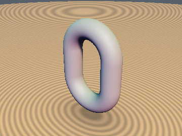
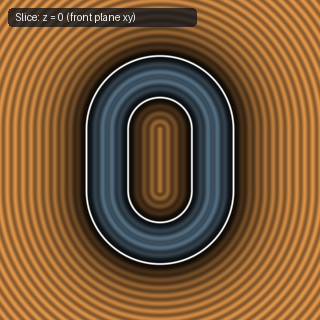

# `sdf-gems` — Modular 2D & 3D Signed Distance Field Library

`sdf-gems` is an **AI-assisted research and engineering effort to systematically explore Signed Distance Fields (SDFs)**—auditing classic formulations for numerical and geometric edge cases, finding algebraic and instruction-level optimizations, deriving tighter bounds and exact closed-form/numerical solutions, and discovering new 2D/3D primitives, exact polyhedra, analytical-gradient booleans, orthogonal extrusions, deformations, and simplicial domain repetition operators.

Every primitive and operator has:
1. **Its own standalone `.glsl` file** under [`glsl/<category>/<name>.glsl`](glsl/)
2. **Its own dedicated Markdown article** under [`docs/<category>/<name>.md`](docs/) with mathematical derivations, attribution, and before/after diffs
3. **Its own rendered 3D surface preview and 2D cross-section slices** under [`docs/images/<category>/`](docs/images/) and [`docs/images/comparisons/`](docs/images/comparisons/)

---

## 1. 3D Primitives ([`glsl/primitives3d/`](glsl/primitives3d/) & [`docs/primitives3d/`](docs/primitives3d/))

| 3D Surface | 2D Slice | Primitive & Docs | GLSL Source | Exact? | Notes |
| :---: | :---: | :--- | :--- | :---: | :--- |
|  |  | [**`sdSphere`**](docs/primitives3d/sdSphere.md) | [`sdSphere.glsl`](glsl/primitives3d/sdSphere.glsl) | Yes | Isotropic radial distance $\|p\| - r$ |
|  |  | [**`sdBox`**](docs/primitives3d/sdBox.md) | [`sdBox.glsl`](glsl/primitives3d/sdBox.glsl) | Yes | Octant-folded $\ell_2$ exterior + $\ell_\infty$ interior distance |
|  |  | [**`sdRoundBox`**](docs/primitives3d/sdRoundBox.md) | [`sdRoundBox.glsl`](glsl/primitives3d/sdRoundBox.glsl) | Yes | Minkowski sum of an inner core box and sphere of radius $r$ |
|  |  | [**`sdBoxFrame`**](docs/primitives3d/sdBoxFrame.md) | [`sdBoxFrame.glsl`](glsl/primitives3d/sdBoxFrame.glsl) | **Yes** | 4-line, 1-`sqrt` closest-beam reduction (down from 3 `sqrt`s & 3 box evals; includes `sdBoxEdges`) |
|  |  | [**`sdTorus`**](docs/primitives3d/sdTorus.md) | [`sdTorus.glsl`](glsl/primitives3d/sdTorus.glsl) | Yes | Cylindrical reduction $(\|p_{xz}\| - R, p_y)$ followed by 2D circle distance |
|  |  | [**`sdCappedTorus`**](docs/primitives3d/sdCappedTorus.md) | [`sdCappedTorus.glsl`](glsl/primitives3d/sdCappedTorus.glsl) | Yes | Clamped angular projection; avoids negative-radicand `NaN`s on the core circle |
|  |  | [**`sdLink`**](docs/primitives3d/sdLink.md) | [`sdLink.glsl`](glsl/primitives3d/sdLink.glsl) | Yes | 1D-elongated torus along the $y$-axis |
|  |  | [**`sdCappedCylinder`**](docs/primitives3d/sdCappedCylinder.md) | [`sdCappedCylinder.glsl`](glsl/primitives3d/sdCappedCylinder.glsl) | Yes | Axis-aligned cylinder via 2D box distance on $(\|p_{xz}\|, |p_y|)$ |
|  |  | [**`sdCappedCylinderSeg`**](docs/primitives3d/sdCappedCylinderSeg.md) | [`sdCappedCylinderSeg.glsl`](glsl/primitives3d/sdCappedCylinderSeg.glsl) | Yes | Normalized segment projection; avoids $O(\|b-a\|^6)$ FP16 overflow |
|  |  | [**`sdRoundedCylinder`**](docs/primitives3d/sdRoundedCylinder.md) | [`sdRoundedCylinder.glsl`](glsl/primitives3d/sdRoundedCylinder.glsl) | Yes | Revolved rounded rectangle with corner fillet radius $r_b$ |
|  |  | [**`sdCapsule`**](docs/primitives3d/sdCapsule.md) | [`sdCapsule.glsl`](glsl/primitives3d/sdCapsule.glsl) | Yes | Clamped line-segment projection minus radius $r$ |
|  |  | [**`sdCone`**](docs/primitives3d/sdCone.md) | [`sdCone.glsl`](glsl/primitives3d/sdCone.glsl) | **Yes** | Orthonormal $(c_x, c_y)$ mantle projection (saves 1 division, 4 multiplies, and 2 additions vs. IQ's `sdCone`) |
|  |  | [**`sdCappedCone`**](docs/primitives3d/sdCappedCone.md) | [`sdCappedCone.glsl`](glsl/primitives3d/sdCappedCone.glsl) | **Yes** | Revolved right trapezoid with simplified normal-side sign test `max(-ca.y, dot(cb, k2) - 4*h^2) < 0` |
|  |  | [**`sdCappedConeSeg`**](docs/primitives3d/sdCappedConeSeg.md) | [`sdCappedConeSeg.glsl`](glsl/primitives3d/sdCappedConeSeg.glsl) | Yes | Arbitrary-endpoint frustum; guards against $0/0$ `NaN`s on the symmetry axis |
|  |  | [**`sdRoundCone`**](docs/primitives3d/sdRoundCone.md) | [`sdRoundCone.glsl`](glsl/primitives3d/sdRoundCone.glsl) | **Yes** | 1-`sqrt` vertical round cone (down from 3 `sqrt`s) & $O(L^2)$ scale-safe `sdRoundConeSeg` (fixes $O(L^8)$ FP16 overflow) |
|  |  | [**`sdHexPrism`**](docs/primitives3d/sdHexPrism.md) | [`sdHexPrism.glsl`](glsl/primitives3d/sdHexPrism.glsl) | Yes | $D_6$ fundamental-sector folding + orthogonal $z$-extrusion |
|  |  | [**`sdTriPrism`**](docs/primitives3d/sdTriPrism.md) | [`sdTriPrism.glsl`](glsl/primitives3d/sdTriPrism.glsl) | **Yes** | Exact Euclidean SDF via $D_3$ folding + orthogonal $z$-extrusion (replaces plane bound) |
|  |  | [**`sdSolidAngle`**](docs/primitives3d/sdSolidAngle.md) | [`sdSolidAngle.glsl`](glsl/primitives3d/sdSolidAngle.glsl) | **Yes** | 2-`sqrt` orthonormal sector-dominance reduction (down from 3 `sqrt`s; `0.0` error across $\mathbb{R}^3$) |
|  |  | [**`sdCutSphere`**](docs/primitives3d/sdCutSphere.md) | [`sdCutSphere.glsl`](glsl/primitives3d/sdCutSphere.glsl) | **Yes** | Conjugate-square & signed-square reduction (`0` `sqrt`s in cap, `1` in sphere, `2` in rim; down from `2-3`) |
|  |  | [**`sdCutHollowSphere`**](docs/primitives3d/sdCutHollowSphere.md) | [`sdCutHollowSphere.glsl`](glsl/primitives3d/sdCutHollowSphere.glsl) | **Yes** | Conjugate-square & signed-square reduction (`1` `sqrt` in shell, `2` in rim; down from `3` `sqrt`s) |
|  |  | [**`sdDeathStar`**](docs/primitives3d/sdDeathStar.md) | [`sdDeathStar.glsl`](glsl/primitives3d/sdDeathStar.glsl) | **Yes** | 2-`length()` confocal-ellipse bisector reduction (down from 3 dynamic `length()` calls; `0.0` error) |
|  |  | [**`sdPyramid`**](docs/primitives3d/sdPyramid.md) | [`sdPyramid.glsl`](glsl/primitives3d/sdPyramid.glsl) | **Yes** | Includes exact $y=0$ base face and removes interior bisector fold distortion |
|  |  | [**`sdRhombus`**](docs/primitives3d/sdRhombus.md) | [`sdRhombus.glsl`](glsl/primitives3d/sdRhombus.glsl) | **Yes** | Direct diagonal-edge projection; eliminates `ndot` and fixes $x=0$ `sign(0.0)` collapse |
|  |  | [**`sdEllipsoid`**](docs/primitives3d/sdEllipsoid.md) | [`sdEllipsoid.glsl`](glsl/primitives3d/sdEllipsoid.glsl) | Bound | 11-line unified interior/exterior concave-secular Halley bound (`~1e-6` mean error, `0` overstep, `0` NaNs) |
|  |  | [**`sdEllipsoidExact`**](docs/primitives3d/sdEllipsoidExact.md) | [`sdEllipsoidExact.glsl`](glsl/primitives3d/sdEllipsoidExact.glsl) | **Yes** | True FP32-exact (`~1 ULP`) triaxial ellipsoid SDF across exterior, interior, and focal-ellipse medial surface |
|  |  | [**`sdSpheroid`**](docs/primitives3d/sdSpheroid.md) | [`sdSpheroid.glsl`](glsl/primitives3d/sdSpheroid.glsl) | **Yes** | Exact closed-form 3D oblate/prolate spheroid via pole-midpoint monic quartic |
|  |  | [**`sdVesicaSegment`**](docs/primitives3d/sdVesicaSegment.md) | [`sdVesicaSegment.glsl`](glsl/primitives3d/sdVesicaSegment.glsl) | **Yes** | 1-to-2 `sqrt` 3D revolved vesica spindle (eliminates `l = length(b-a)` & uses signed-square tip-cone test; down from 3 `sqrt`s) |
|  |  | [**`sdBarrel`**](docs/primitives3d/sdBarrel.md) | [`sdBarrel.glsl`](glsl/primitives3d/sdBarrel.glsl) | **Yes** | Revolved circular-arc cask ($r_{\text{mid}} > r_{\text{cap}}$) and waisted spool ($r_{\text{mid}} < r_{\text{cap}}$) |
|  |  | [**`sdLens`**](docs/primitives3d/sdLens.md) | [`sdLens.glsl`](glsl/primitives3d/sdLens.glsl) | **Yes** | 2-`length()` biconvex, plano-convex, and meniscus two-sphere optical lens via confocal-hyperbola bisector |
|  |  | [**`sdSphericalSegmentSym`**](docs/primitives3d/sdSphericalSegmentSym.md) | [`sdSphericalSegmentSym.glsl`](glsl/primitives3d/sdSphericalSegmentSym.glsl) | **Yes** | Two-plane truncated sphere ($y = \pm h$) with conjugate-square reduction (`0/1/2` `sqrt`s) |
|  |  | [**`sdSphericalZone`**](docs/primitives3d/sdSphericalZone.md) | [`sdSphericalZone.glsl`](glsl/primitives3d/sdSphericalZone.glsl) | **Yes** | Hollow spherical zone ($y \in [h_1, h_2]$) with conjugate-square reduction (`1/2` `sqrt`s, down from `4`) |
|  |  | [**`sdPyramidFrustum`**](docs/primitives3d/sdPyramidFrustum.md) | [`sdPyramidFrustum.glsl`](glsl/primitives3d/sdPyramidFrustum.glsl) | **Yes** | Flat-topped square frustum via $D_4$ folding and ridge-edge decoupling |
|  |  | [**`sdRectFrustum`**](docs/primitives3d/sdRectFrustum.md) | [`sdRectFrustum.glsl`](glsl/primitives3d/sdRectFrustum.glsl) | **Yes** | General rectangular frustum, rectangular pyramid, and hip roof |
|  |  | [**`sdSquareBucket`**](docs/primitives3d/sdSquareBucket.md) | [`sdSquareBucket.glsl`](glsl/primitives3d/sdSquareBucket.glsl) | **Yes** | Open-ended hollow square frustum shell with rounded rim |
|  |  | [**`sdCross3D`**](docs/primitives3d/sdCross3D.md) | [`sdCross3D.glsl`](glsl/primitives3d/sdCross3D.glsl) | **Yes** | 1-`sqrt` exact 3D orthogonal cross (`sdCross3D`) & infinite Menger cross (`sdInfCross3D`) via Weyl-chamber folding |
|  |  | [**`sdParaboloid`**](docs/primitives3d/sdParaboloid.md) | [`sdParaboloid.glsl`](glsl/primitives3d/sdParaboloid.glsl) | **Yes** | Exact closed-form 3D solid capped paraboloid & parabolic reflector dish (`sdParaboloidDish`) via depressed cubic |

---

## 2. Exact 3D Polyhedra ([`glsl/polyhedra3d/`](glsl/polyhedra3d/) & [`docs/polyhedra3d/`](docs/polyhedra3d/))

All polyhedra below fold $p \in \mathbb{R}^3$ into the fundamental Weyl chamber of their symmetry group ($O_h$, $T_d$, or $I_h$), yielding **exact Euclidean SDFs** (valid for outer rounding `sdPoly(p) - r` and onion shelling). Each documentation page includes two orthogonal cross-section slices.

| 3D Surface | 2D Slice | Polyhedron & Docs | GLSL Source | Exact? | Notes |
| :---: | :---: | :--- | :--- | :---: | :--- |
|  |  | [**`sdOctahedron`**](docs/polyhedra3d/sdOctahedron.md) | [`sdOctahedron.glsl`](glsl/polyhedra3d/sdOctahedron.glsl) | **Yes** | 4-line branchless sorted Weyl-chamber projection with weights $(2, 1, 3)$ |
|  |  | [**`sdRhombicDodecahedron`**](docs/polyhedra3d/sdRhombicDodecahedron.md) | [`sdRhombicDodecahedron.glsl`](glsl/polyhedra3d/sdRhombicDodecahedron.glsl) | **Yes** | 4-line branchless sorted Weyl-chamber projection with weights $(3, 1, 2)$; FCC Voronoi cell |
|  |  | [**`sdTetrahedron`**](docs/polyhedra3d/sdTetrahedron.md) | [`sdTetrahedron.glsl`](glsl/polyhedra3d/sdTetrahedron.glsl) | **Yes** | $T_d$ chamber fold ($p_x \ge p_y \ge p_z$, conditional sign flip of $p_y + p_z$) + 1-face/2-edge projection |
|  |  | [**`sdCuboctahedron`**](docs/polyhedra3d/sdCuboctahedron.md) | [`sdCuboctahedron.glsl`](glsl/polyhedra3d/sdCuboctahedron.glsl) | **Yes** | $O_h$ Weyl-chamber projection onto 1 square face, 1 triangle face, and 1 shared edge |
|  |  | [**`sdTruncatedOctahedron`**](docs/polyhedra3d/sdTruncatedOctahedron.md) | [`sdTruncatedOctahedron.glsl`](glsl/polyhedra3d/sdTruncatedOctahedron.glsl) | **Yes** | Exact Kelvin cell (BCC Voronoi cell) via $O_h$ Weyl-chamber projection |
|  |  | [**`sdDodecahedron`**](docs/polyhedra3d/sdDodecahedron.md) | [`sdDodecahedron.glsl`](glsl/polyhedra3d/sdDodecahedron.glsl) | **Yes** | 5-step $I_h$ reflection fold into the fundamental chamber + 1-face/1-edge projection |
|  |  | [**`sdIcosahedron`**](docs/polyhedra3d/sdIcosahedron.md) | [`sdIcosahedron.glsl`](glsl/polyhedra3d/sdIcosahedron.glsl) | **Yes** | 5-step $I_h$ reflection fold into the fundamental chamber + 1-face/1-edge projection |
|  |  | [**`sdRhombicTriacontahedron`**](docs/polyhedra3d/sdRhombicTriacontahedron.md) | [`sdRhombicTriacontahedron.glsl`](glsl/polyhedra3d/sdRhombicTriacontahedron.glsl) | **Yes** | 30-face Catalan solid via $I_h$ chamber fold + golden-rhombus face/edge projection |
|  |  | [**`sdIcosidodecahedron`**](docs/polyhedra3d/sdIcosidodecahedron.md) | [`sdIcosidodecahedron.glsl`](glsl/polyhedra3d/sdIcosidodecahedron.glsl) | **Yes** | 32-face Archimedean solid via $I_h$ chamber fold + pentagon/triangle face separator |

---

## 3. 2D Primitives ([`glsl/primitives2d/`](glsl/primitives2d/) & [`docs/primitives2d/`](docs/primitives2d/))

| 2D SDF Field | Primitive & Docs | GLSL Source | Exact? | Notes |
| :---: | :--- | :--- | :---: | :--- |
|  | [**`sdCircle`**](docs/primitives2d/sdCircle.md) | [`sdCircle.glsl`](glsl/primitives2d/sdCircle.glsl) | Yes | Exact 2D disk $\|p\| - r$ |
|  | [**`sdBox2D`**](docs/primitives2d/sdBox2D.md) | [`sdBox2D.glsl`](glsl/primitives2d/sdBox2D.glsl) | Yes | Quadrant-folded 2D rectangle; building block for revolved and extruded 3D solids |
|  | [**`sdSegment2D`**](docs/primitives2d/sdSegment2D.md) | [`sdSegment2D.glsl`](glsl/primitives2d/sdSegment2D.glsl) | Yes | Unsigned distance to a 2D line segment $[a, b]$ |
|  | [**`sdUnevenCapsule2D`**](docs/primitives2d/sdUnevenCapsule2D.md) | [`sdUnevenCapsule2D.glsl`](glsl/primitives2d/sdUnevenCapsule2D.glsl) | **Yes** | 1-`sqrt` 2D uneven capsule everywhere via signed-square tangent-cone reduction (down from 2 `sqrt`s) |
|  | [**`sdEquilateralTriangle2D`**](docs/primitives2d/sdEquilateralTriangle2D.md) | [`sdEquilateralTriangle2D.glsl`](glsl/primitives2d/sdEquilateralTriangle2D.glsl) | Yes | $D_3$ symmetry fold onto a single edge segment |
|  | [**`sdHexagon2D`**](docs/primitives2d/sdHexagon2D.md) | [`sdHexagon2D.glsl`](glsl/primitives2d/sdHexagon2D.glsl) | Yes | $D_6$ symmetry fold into a $30^\circ$ sector + clamped flat-edge projection |
|  | [**`sdPie2D`**](docs/primitives2d/sdPie2D.md) | [`sdPie2D.glsl`](glsl/primitives2d/sdPie2D.glsl) | **Yes** | 1-`sqrt` circular pie & annular ring sector via orthonormal ray-basis dominance (down from 2 `sqrt`s) |
|  | [**`sdMoon2D`**](docs/primitives2d/sdMoon2D.md) | [`sdMoon2D.glsl`](glsl/primitives2d/sdMoon2D.glsl) | **Yes** | 1-`length()` crescent moon (`sdMoon2D`) & asymmetric lens (`sdLens2D`) via confocal-conic bisector |
|  | [**`sdVesica2D`**](docs/primitives2d/sdVesica2D.md) | [`sdVesica2D.glsl`](glsl/primitives2d/sdVesica2D.glsl) | **Yes** | 1-`sqrt`-body 2D vesica piscis (`sdVesica2D`) & 1-`sqrt`-everywhere width-parameterized `sdVesicaWidth2D` |
|  | [**`sdStairs2D`**](docs/primitives2d/sdStairs2D.md) | [`sdStairs2D.glsl`](glsl/primitives2d/sdStairs2D.glsl) | **Yes** | 1-`sqrt` rotation-free 2D staircase; fixes IQ `7tKSWt` tall-step (`wh.x < wh.y`) sign-flip & Voronoi tear |
|  | [**`sdCross2D`**](docs/primitives2d/sdCross2D.md) | [`sdCross2D.glsl`](glsl/primitives2d/sdCross2D.glsl) | **Yes** | 1-`sqrt` symmetric & rectangular 2D cross (`sdRectCross2D`); fixes IQ `sdCross` $b_x < b_y$ shape corruption |
|  | [**`sdTunnel2D`**](docs/primitives2d/sdTunnel2D.md) | [`sdTunnel2D.glsl`](glsl/primitives2d/sdTunnel2D.glsl) | **Yes** | 1-`sqrt` exact 2D arched tunnel via closed-form radial-vs-base square comparison (`max(q.x, q.y) < 0` sign) |
|  | [**`sdEllipse2D`**](docs/primitives2d/sdEllipse2D.md) | [`sdEllipse2D.glsl`](glsl/primitives2d/sdEllipse2D.glsl) | **Yes** | Singularity-free pole-midpoint quartic & trig-free algebraic Householder (fixes circle & evolute `NaN`s) |
|  | [**`sdParabola2D`**](docs/primitives2d/sdParabola2D.md) | [`sdParabola2D.glsl`](glsl/primitives2d/sdParabola2D.glsl) | **Yes** | Singularity-free 2D parabola & segment (`sdParabolaSeg2D`); fixes focal `0/0` `NaN` and $x=0$ sign inversion |

---

## 4. Booleans & Smooth Minimums ([`glsl/booleans/`](glsl/booleans/) & [`docs/booleans/`](docs/booleans/))

| 2D SDF Field | Operator & Docs | GLSL Source | Exact? | Notes |
| :---: | :--- | :--- | :---: | :--- |
|  | [**`opUnion`**](docs/booleans/opUnion.md) | [`opUnion.glsl`](glsl/booleans/opUnion.glsl) | Exterior | Sharp union $\min(d_1, d_2)$; exact in exterior, lower bound inside overlap |
|  | [**`opSubtraction`**](docs/booleans/opSubtraction.md) | [`opSubtraction.glsl`](glsl/booleans/opSubtraction.glsl) | Bound | Sharp subtraction $\max(-d_1, d_2)$; conservative lower bound |
|  | [**`opIntersection`**](docs/booleans/opIntersection.md) | [`opIntersection.glsl`](glsl/booleans/opIntersection.glsl) | Bound | Sharp intersection $\max(d_1, d_2)$; underestimates in exterior corner wedges |
|  | [**`opXor`**](docs/booleans/opXor.md) | [`opXor.glsl`](glsl/booleans/opXor.glsl) | **Yes** | Exact signed symmetric difference $\max(\min(a,b), -\max(a,b))$ when boundaries are orthogonal |
|  | [**`sminQuadratic`**](docs/booleans/sminQuadratic.md) | [`sminQuadratic.glsl`](glsl/booleans/sminQuadratic.glsl) | Bound | $C^1$ polynomial smooth minimum; non-local along $a = b$ |
|  | [**`sminCubic`**](docs/booleans/sminCubic.md) | [`sminCubic.glsl`](glsl/booleans/sminCubic.glsl) | Bound | $C^2$ cubic polynomial smooth minimum for reflection-continuous fillets |
|  | [**`sminCircular`**](docs/booleans/sminCircular.md) | [`sminCircular.glsl`](glsl/booleans/sminCircular.glsl) | Bound | Circular profile along $|a - b|$; non-local along $a = b$ |
|  | [**`sminCircularApprox`**](docs/booleans/sminCircularApprox.md) | [`sminCircularApprox.glsl`](glsl/booleans/sminCircularApprox.glsl) | Bound | Algebraic `[3/1]` Padé rational circular smooth minimum ($11\times$ lower error, 1 fewer multiply) |
|  | [**`sminCircularGeom`**](docs/booleans/sminCircularGeom.md) | [`sminCircularGeom.glsl`](glsl/booleans/sminCircularGeom.glsl) | Orthogonal | Corner-local circular fillet for $\nabla a \perp \nabla b$; overestimates when $\nabla a \cdot \nabla b > 0$ |
|  | [**`sminCubicGeom`**](docs/booleans/sminCubicGeom.md) | [`sminCubicGeom.glsl`](glsl/booleans/sminCubicGeom.glsl) | **Conservative** | Corner-local, associative, $C^2$ ($G^2$ curvature-continuous) $\ell_3$ Lamé smooth minimum ($2^{-1/6} \le \|\nabla f\|_2 \le 1$) |
|  | [**`sminLocalOblique`**](docs/booleans/sminLocalOblique.md) | [`sminLocalOblique.glsl`](glsl/booleans/sminLocalOblique.glsl) | Bound | Pure-scalar corner-local, rigid, conservative smooth minimum parameterized by $c \ge \nabla a \cdot \nabla b$ |
|  | [**`opUnionChamfer`**](docs/booleans/opUnionChamfer.md) | [`opUnionChamfer.glsl`](glsl/booleans/opUnionChamfer.glsl) | **Yes** | Corner-local exact Euclidean $45^\circ$ & oblique chamfer booleans (fixes interior $a=b \to -\infty$ distortion) |
|  | [**`opUnionStairs`**](docs/booleans/opUnionStairs.md) | [`opUnionStairs.glsl`](glsl/booleans/opUnionStairs.glsl) | **Yes** | 1-`sqrt` exact Euclidean $n$-tier stairs booleans (replaces $\ell_\infty$ square corners & unbounded interior zig-zag) |
|  | [**`opUnionColumns`**](docs/booleans/opUnionColumns.md) | [`opUnionColumns.glsl`](glsl/booleans/opUnionColumns.glsl) | **Yes** | 1-`sqrt` exact Euclidean columned union, subtraction, and intersection (fixes `hg_sdf` $a=r,b=r$ jump & $+24.1\%$ overstep) |
|  | [**`opEngrave` / `opPipe`**](docs/booleans/opEngrave.md) | [`opEngrave.glsl`](glsl/booleans/opEngrave.glsl) | **Yes** | 0/1-`sqrt` exact Euclidean V-groove engraving & Gram-Schmidt oblique intersection pipe (`opPipeOblique`) |
|  | [**`opGroove` / `opTongue`**](docs/booleans/opGroove.md) | [`opGroove.glsl`](glsl/booleans/opGroove.glsl) | **Yes** | 4-line 1-`sqrt` exact Euclidean carpenter's tongue & De Morgan dual groove (`0.0` error vs. $29.3\%$ in `hg_sdf`) |

---

## 5. Analytical Gradients (`sdg`) ([`glsl/gradients3d/`](glsl/gradients3d/) & [`docs/gradients3d/`](docs/gradients3d/))

Functions returning `vec4(d, grad.xyz)` in 3D (or `vec3(d, grad.xy)` in 2D) enable angle-aware boolean operations that depend on the intersection angle $\cos\theta = \nabla a \cdot \nabla b$.

| 3D Surface | 2D Slice | Function & Docs | GLSL Source | Exact? | Notes |
| :---: | :---: | :--- | :--- | :---: | :--- |
|  |  | [**`sdgSphere`**](docs/gradients3d/sdgSphere.md) | [`sdgSphere.glsl`](glsl/gradients3d/sdgSphere.glsl) | Yes | Returns `vec4(d, p / length(p))` |
|  |  | [**`sdgBox`**](docs/gradients3d/sdgBox.md) | [`sdgBox.glsl`](glsl/gradients3d/sdgBox.glsl) | Yes | Analytical 3D box distance and unit gradient vector |
|  |  | [**`sdgWedgeIntersection`**](docs/gradients3d/sdgWedgeIntersection.md) | [`sdgWedgeIntersection.glsl`](glsl/gradients3d/sdgWedgeIntersection.glsl) | **Yes** | Exact Euclidean Gram-Schmidt wedge intersection, union, and subtraction for any angle $\theta$ |
|  |  | [**`sdgSmoothUnion`**](docs/gradients3d/sdgSmoothUnion.md) | [`sdgSmoothUnion.glsl`](glsl/gradients3d/sdgSmoothUnion.glsl) | **Yes** | Corner-local, angle-invariant rolling-ball fillet with exact Eikonal distance $\|\nabla d\| = 1$ ($0\%$ overstep) |
|  |  | [**`sdgExtrusion`**](docs/gradients3d/sdgExtrusion.md) | [`sdgExtrusion.glsl`](glsl/gradients3d/sdgExtrusion.glsl) | **Yes** | Lifts any 2D `vec3(d, gx, gy)` into an exact 3D `vec4(d, grad.xyz)` under sharp, round, chamfer, or $n$-stepped ziggurat extrusion |
|  |  | [**`sdgRevolution`**](docs/gradients3d/sdgRevolution.md) | [`sdgRevolution.glsl`](glsl/gradients3d/sdgRevolution.glsl) | **Yes** | Lifts any 2D `vec3(d, gx, gy)` into an exact 3D `vec4(d, grad.xyz)` under full $360^\circ$ or limited-angle partial revolution |

---

## 6. Extrusions & Deformations ([`glsl/deform/`](glsl/deform/) & [`docs/deform/`](docs/deform/))

| 3D Surface | 2D Slice | Operator & Docs | GLSL Source | Exact? | Notes |
| :---: | :---: | :--- | :--- | :---: | :--- |
|  |  | [**`opExtrusion`**](docs/deform/opExtrusion.md) | [`opExtrusion.glsl`](glsl/deform/opExtrusion.glsl) | Yes | Orthogonal composition of any 2D SDF $d(p_{xy})$ with a 1D interval $[-h, h]$ |
|  |  | [**`opExtrudeRound`**](docs/deform/opExtrudeRound.md) | [`opExtrudeRound.glsl`](glsl/deform/opExtrudeRound.glsl) | **Yes** | Orthogonal composition with a 2D rounded-box profile; bevels only the top/bottom rims |
|  |  | [**`opExtrudeChamfer`**](docs/deform/opExtrudeChamfer.md) | [`opExtrudeChamfer.glsl`](glsl/deform/opExtrudeChamfer.glsl) | **Yes** | 5-line corner-local orthogonal composition with an exact $45^\circ$ chamfered cap profile ($\|\nabla d\| = 1$) |
|  |  | [**`opExtrudeStairs`**](docs/deform/opExtrudeStairs.md) | [`opExtrudeStairs.glsl`](glsl/deform/opExtrudeStairs.glsl) | **Yes** | 1-`sqrt` orthogonal composition sculpting an exact $n$-tier ziggurat / stepped rim around any 2D SDF |
|  |  | [**`opRevolution`**](docs/deform/opRevolution.md) | [`opRevolution.glsl`](glsl/deform/opRevolution.glsl) | Yes | Revolves a 2D SDF around the $y$-axis via $(\|p_{xz}\| - o, p_y)$ |
|  |  | [**`opRevolutionLim`**](docs/deform/opRevolutionLim.md) | [`opRevolutionLim.glsl`](glsl/deform/opRevolutionLim.glsl) | **Yes** | Exact 1-tap limited-angle partial revolution $\phi \in [-\theta, \theta]$ of any 2D SDF (flat or round end-caps) |
|  |  | [**`opSphericalExtrude`**](docs/deform/opSphericalExtrude.md) | [`opSphericalExtrude.glsl`](glsl/deform/opSphericalExtrude.glsl) | **Yes** | Lifts any angular SDF on $S^2$ to an exact 3D spherical shell $[R_1, R_2]$ via polar-to-Cartesian conversion |
|  |  | [**`opElongate`**](docs/deform/opElongate.md) | [`opElongate.glsl`](glsl/deform/opElongate.glsl) | Yes | Splits a primitive and inserts straight extrusions along each axis; exact in 3D via `min(max(q), 0.0)` |
|  |  | [**`opRound`**](docs/deform/opRound.md) | [`opRound.glsl`](glsl/deform/opRound.glsl) | Yes | Isotropic Minkowski offset $d - r$; requires an exact underlying SDF for spherical corners |
|  |  | [**`opOnion`**](docs/deform/opOnion.md) | [`opOnion.glsl`](glsl/deform/opOnion.glsl) | Yes | Concentric hollow shell $|d| - t$; can be nested for multi-layer shells |
|  |  | [**`opTwist`**](docs/deform/opTwist.md) | [`opTwist.glsl`](glsl/deform/opTwist.glsl) | Bound | Torsional rotation around $y$; includes exact Jacobian singular-value Lipschitz factor |
|  |  | [**`opBend`**](docs/deform/opBend.md) | [`opBend.glsl`](glsl/deform/opBend.glsl) | **Yes** | Exact circular arc bend (`opArcBend`) and `atan`-free arch with straight tangent legs (`opBendArch`) |

---

## 7. Domain Repetition ([`glsl/repetition/`](glsl/repetition/) & [`docs/repetition/`](docs/repetition/))

| 3D Surface | 2D Slice | Operator & Docs | GLSL Source | Exact? | Notes |
| :---: | :---: | :--- | :--- | :---: | :--- |
|  |  | [**`opRep` / `opRepLim`**](docs/repetition/opRep.md) | [`opRep.glsl`](glsl/repetition/opRep.glsl) | Symmetric | 1-tap infinite and bounded Cartesian repetition for cell-symmetric primitives |
|  |  | [**`opRepHex`**](docs/repetition/opRepHex.md) | [`opRepHex.glsl`](glsl/repetition/opRepHex.glsl) | **Symmetric** | 1-tap 2D hexagonal ($A_2$) Voronoi folding via linear test $|d_x| + 3|d_y| > 1$ (`1` `round`, `0` `dot2`) |
|  |  | [**`opRep2D` (`opRepHex3`)**](docs/repetition/opRep2D.md) | [`opRep2D.glsl`](glsl/repetition/opRep2D.glsl) | **Yes** | 3-tap 1-`round` 2D hexagonal Delaunay repetition (`100%` simplex containment, `0` `dot2`, $25\%$ fewer taps) |
|  |  | [**`opRep3D` (`opRepBCC4`)**](docs/repetition/opRep3D.md) | [`opRep3D.glsl`](glsl/repetition/opRep3D.glsl) | **Yes** | 4-tap 3D BCC Kuhn-simplex Delaunay repetition ($2\times$ faster than 8-tap Cartesian) |
|  |  | [**`opRepBCC`**](docs/repetition/opRepBCC.md) | [`opRepBCC.glsl`](glsl/repetition/opRepBCC.glsl) | Symmetric | 1-tap 3D BCC Kelvin-cell folding via linear L1 test $|r_x|+|r_y|+|r_z| > 0.75$ ($68.02\%$ sphere packing) |
|  |  | [**`opRepFCC`**](docs/repetition/opRepFCC.md) | [`opRepFCC.glsl`](glsl/repetition/opRepFCC.glsl) | Symmetric | 1-tap 3D FCC Rhombic-Dodecahedron parity folding ($74.05\%$ optimal sphere packing) |
|  |  | [**`opRepPolar`**](docs/repetition/opRepPolar.md) | [`opRepPolar.glsl`](glsl/repetition/opRepPolar.glsl) | **Yes** | Gap-aware 1-tap symmetric and 2-tap asymmetric limited polar repetition (fixes $\theta=\pm\pi$ branch cut) |
