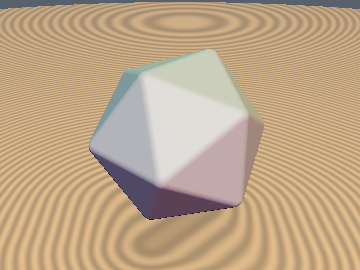
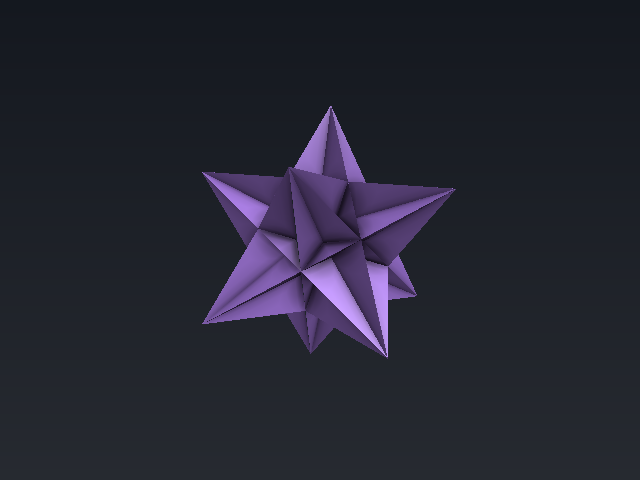
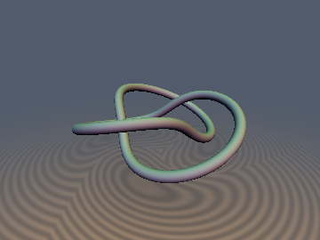
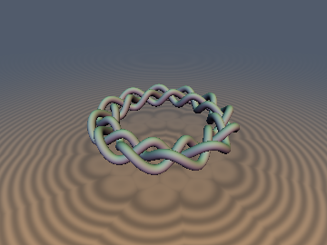
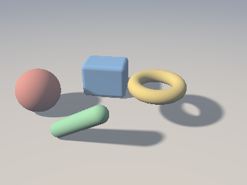
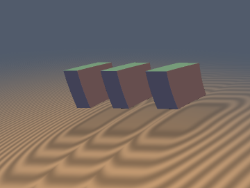
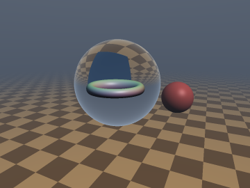
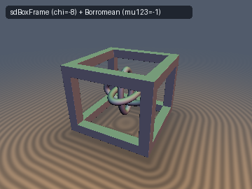

# `sdf-gems` — 2D & 3D Signed Distance Fields

`sdf-gems` is an **AI-assisted research and engineering collection of 339 modular Signed Distance Field (SDF) headers**—auditing classic formulations for numerical and geometric edge cases, finding instruction-level SFU optimizations (`0`-`sqrt` Voronoi regions, division-free projections), deriving exact closed-form solutions, and exploring advanced differential, algebraic, and volumetric SDF structures. Enjoy the slop!

Every primitive, operator, and research module includes:
1. **Standalone `.glsl` header** in [`glsl/<category>/<name>.glsl`](glsl/) (plus the single-include [`sdf_gems.glsl`](sdf_gems.glsl) umbrella header and shared [`glsl/common/common.glsl`](glsl/common/common.glsl) math utilities)
2. **Detailed Markdown derivation** in [`docs/<category>/<name>.md`](docs/) with proofs, attribution, numerical benchmarks, and before/after comparisons
3. **Rendered 3D & 2D level-set previews** in [`docs/images/<category>/`](docs/images/) verified on the GPU from the literal GLSL

---

## Browse by Category

Click any category below to open its full visual gallery, mathematical summaries, and `.glsl` links:

| Samples | Category | Description |
| :---: | :--- | :--- |
| &nbsp;&nbsp; | [**1. 3D Primitives & Surfaces**](docs/primitives3d/README.md) `56` headers · [`docs`](docs/primitives3d/README.md) · [`glsl`](glsl/primitives3d/) | Exact and certified-bound 3D solids, frustums, constant-width bodies, quadrics, cyclides, and minimal/ruled surfaces. |
| &nbsp;&nbsp; | [**2. Exact Polyhedra & 4D Polytopes**](docs/polyhedra/README.md) `47` headers · [`docs`](docs/polyhedra/README.md) · [`glsl`](glsl/polyhedra/) | Platonic, Archimedean, Catalan, Kepler–Poinsot, chiral snub, crystal-habit solids, Wythoffian cones, and 4-polytopes. |
| &nbsp;&nbsp; | [**3. 3D Curves, Knots & Fibrations**](docs/curves3d/README.md) `21` headers · [`docs`](docs/curves3d/README.md) · [`glsl`](glsl/curves3d/) | 3D Bézier splines, helices, coils, torus/hyperbolic knots, braids, spherical curves, ropelength tubes, and Hopf links. |
| &nbsp;&nbsp; | [**4. 2D Primitives & Algebraic Curves**](docs/primitives2d/README.md) `61` headers · [`docs`](docs/primitives2d/README.md) · [`glsl`](glsl/primitives2d/) | Exact 2D polygons, circular arcs, gears, spirals, trochoids, and classical cubic/quartic/sextic curves. |
| &nbsp;&nbsp; | [**5. Booleans, Fillets & Smooth Minimums**](docs/booleans/README.md) `26` headers · [`docs`](docs/booleans/README.md) · [`glsl`](glsl/booleans/) | Sharp CSG, polynomial/exponential smooth mins, angle-aware Gram fillets, chamfer/stairs/column joints, and free-boundary blends. |
| &nbsp;&nbsp; | [**6. Analytical Gradients & Curvature Jets (`sdg` / `sdh`)**](docs/gradients3d/README.md) `32` headers · [`docs`](docs/gradients3d/README.md) · [`glsl`](glsl/gradients3d/) | Single-pass distance + unit normal (`vec4(d, grad)`) and 2-jet Weingarten curvature (`sdh*`) for primitives and operators. |
| &nbsp;&nbsp; | [**7. Extrusions, Deformations & Metric Pullbacks**](docs/deform/README.md) `31` headers · [`docs`](docs/deform/README.md) · [`glsl`](glsl/deform/) | Orthogonal/molded extrusions, revolutions, sweeps, conformal/hyperbolic/CGA/Laguerre pullbacks, origami, and symplectic flows. |
| &nbsp;&nbsp; | [**8. Domain Repetition, Tilings & Fractals**](docs/repetition/README.md) `20` headers · [`docs`](docs/repetition/README.md) · [`glsl`](glsl/repetition/) | Cartesian, hexagonal, BCC/FCC/Diamond/HCP lattices, polar/spiral/Cairo tilings, quasicrystals, IFS fractals, and Ford horoballs. |
| &nbsp;&nbsp; | [**9. Volumetrics, Potentials & Analytical Shading**](docs/volume/README.md) `29` headers · [`docs`](docs/volume/README.md) · [`glsl`](glsl/volume/) | Closed-form ray slab integrals, radiative transfer, subsurface scattering, harmonic/Green potentials, and Gaussian prefiltering. |
| &nbsp;&nbsp; | [**10. Ray Space, Wavefronts & Accelerated Tracing**](docs/optics/README.md) `7` headers · [`docs`](docs/optics/README.md) · [`glsl`](glsl/optics/) | Ray-clearance fields, retarded-time relativistic tracing, GRIN curved rays, Snell/Legendrian wavefronts, caustics, and sample bounds. |
| &nbsp;&nbsp; | [**11. Convex Duality, Medial Axis, Topology & C-Space**](docs/duality/README.md) `9` headers · [`docs`](docs/duality/README.md) · [`glsl`](glsl/duality/) | Support-function GJK, bipolar gauges, hedgehogs, medial thickness, Steiner tube measure, Gauss–Bonnet invariants, amoebas, and C-space. |

---

## Quick Start & Developer Tooling

- **Include a single module**: copy or `#include` any header from [`glsl/<category>/`](glsl/) (shared root-finders and helpers live in [`glsl/common/common.glsl`](glsl/common/common.glsl)).
- **Include everything**: `#include "sdf_gems.glsl"` pulls in all 340 headers in a single translation unit.
- **Interactive WebGL2 Viewer**: serve the repo root locally (e.g., `python3 -m http.server`) and open [`tools/viewer/index.html`](tools/viewer/index.html) to orbit, inspect step-count heatmaps, and toggle over-relaxed or Taylor sphere tracing.
- **Verification & Rendering Suite ([`tools/`](tools/README.md))**:
  - `uv run tools/update_umbrella.py` — regenerates [`sdf_gems.glsl`](sdf_gems.glsl) and audits all docs, images, and GitHub-safe math.
  - `uv run tools/gpu_eval.py` — compiles all headers in forward/reverse order under OpenGL 4.1 and evaluates literal `.glsl` functions on the GPU.
  - [`tools/sdf_checks.py`](tools/sdf_checks.py), [`tools/ground_truth.py`](tools/ground_truth.py), & [`tools/render_sdf.py`](tools/render_sdf.py) — independent FP64 ground-truth builders, exactness certificates, and 3D/2D renderers.

---

## Complete Function Directory

<strong>Expand all 339 modules by category (quick search index)</strong>

### [1. 3D Primitives & Surfaces](docs/primitives3d/README.md) (56)
[`sdSphere`](docs/primitives3d/sdSphere.md) · [`sdBox`](docs/primitives3d/sdBox.md) · [`sdRoundBox`](docs/primitives3d/sdRoundBox.md) · [`sdBoxFrame`](docs/primitives3d/sdBoxFrame.md) · [`sdOctaBox`](docs/primitives3d/sdOctaBox.md) · [`sdCross3D`](docs/primitives3d/sdCross3D.md) · [`sdJack3D`](docs/primitives3d/sdJack3D.md) · [`sdTorus`](docs/primitives3d/sdTorus.md) · [`sdCappedTorus`](docs/primitives3d/sdCappedTorus.md) · [`sdCappedCylinder`](docs/primitives3d/sdCappedCylinder.md) · [`sdCappedCylinderSeg`](docs/primitives3d/sdCappedCylinderSeg.md) · [`sdRoundedCylinder`](docs/primitives3d/sdRoundedCylinder.md) · [`sdCapsule`](docs/primitives3d/sdCapsule.md) · [`sdCone`](docs/primitives3d/sdCone.md) · [`sdCappedCone`](docs/primitives3d/sdCappedCone.md) · [`sdCappedConeSeg`](docs/primitives3d/sdCappedConeSeg.md) · [`sdRoundCone`](docs/primitives3d/sdRoundCone.md) · [`sdHollowCone`](docs/primitives3d/sdHollowCone.md) · [`sdHexPrism`](docs/primitives3d/sdHexPrism.md) · [`sdTriPrism`](docs/primitives3d/sdTriPrism.md) · [`sdPyramid`](docs/primitives3d/sdPyramid.md) · [`sdPyramidFrustum`](docs/primitives3d/sdPyramidFrustum.md) · [`sdRectFrustum`](docs/primitives3d/sdRectFrustum.md) · [`sdSquareBucket`](docs/primitives3d/sdSquareBucket.md) · [`sdRhombus`](docs/primitives3d/sdRhombus.md) · [`udTriangle`](docs/primitives3d/udTriangle.md) · [`sdSolidAngle`](docs/primitives3d/sdSolidAngle.md) · [`sdCutSphere`](docs/primitives3d/sdCutSphere.md) · [`sdCutHollowSphere`](docs/primitives3d/sdCutHollowSphere.md) · [`sdSphericalSegmentSym`](docs/primitives3d/sdSphericalSegmentSym.md) · [`sdSphericalZone`](docs/primitives3d/sdSphericalZone.md) · [`sdDeathStar`](docs/primitives3d/sdDeathStar.md) · [`sdLens`](docs/primitives3d/sdLens.md) · [`sdVesicaSegment`](docs/primitives3d/sdVesicaSegment.md) · [`sdBarrel`](docs/primitives3d/sdBarrel.md) · [`sdSteinmetz`](docs/primitives3d/sdSteinmetz.md) · [`sdHelicalGear`](docs/primitives3d/sdHelicalGear.md) · [`sdReuleaux3D`](docs/primitives3d/sdReuleaux3D.md) · [`sdMeissnerTetrahedron`](docs/primitives3d/sdMeissnerTetrahedron.md) · [`sdOloid`](docs/primitives3d/sdOloid.md) · [`sdSphericon`](docs/primitives3d/sdSphericon.md) · [`sdEllipsoid`](docs/primitives3d/sdEllipsoid.md) · [`sdEllipsoidExact`](docs/primitives3d/sdEllipsoidExact.md) · [`sdSpheroid`](docs/primitives3d/sdSpheroid.md) · [`sdSquircleCube3D`](docs/primitives3d/sdSquircleCube3D.md) · [`sdParaboloid`](docs/primitives3d/sdParaboloid.md) · [`sdHyperbolicParaboloid`](docs/primitives3d/sdHyperbolicParaboloid.md) · [`sdDupinCyclideExact`](docs/primitives3d/sdDupinCyclideExact.md) · [`sdParabolicCyclide`](docs/primitives3d/sdParabolicCyclide.md) · [`sdSoddyHexlet`](docs/primitives3d/sdSoddyHexlet.md) · [`sdBohemianDome`](docs/primitives3d/sdBohemianDome.md) · [`sdMinimalSurface`](docs/primitives3d/sdMinimalSurface.md) · [`sdMobiusStrip`](docs/primitives3d/sdMobiusStrip.md) · [`sdPluckerConoid`](docs/primitives3d/sdPluckerConoid.md) · [`sdWallisConicalEdge`](docs/primitives3d/sdWallisConicalEdge.md) · [`sdPseudosphere`](docs/primitives3d/sdPseudosphere.md)

### [2. Exact Polyhedra & 4D Polytopes](docs/polyhedra/README.md) (47)
[`sdTetrahedron`](docs/polyhedra/sdTetrahedron.md) · [`sdOctahedron`](docs/polyhedra/sdOctahedron.md) · [`sdDodecahedron`](docs/polyhedra/sdDodecahedron.md) · [`sdIcosahedron`](docs/polyhedra/sdIcosahedron.md) · [`sdCuboctahedron`](docs/polyhedra/sdCuboctahedron.md) · [`sdIcosidodecahedron`](docs/polyhedra/sdIcosidodecahedron.md) · [`sdTruncatedTetrahedron`](docs/polyhedra/sdTruncatedTetrahedron.md) · [`sdTruncatedCube`](docs/polyhedra/sdTruncatedCube.md) · [`sdTruncatedOctahedron`](docs/polyhedra/sdTruncatedOctahedron.md) · [`sdTruncatedDodecahedron`](docs/polyhedra/sdTruncatedDodecahedron.md) · [`sdTruncatedIcosahedron`](docs/polyhedra/sdTruncatedIcosahedron.md) · [`sdRhombicuboctahedron`](docs/polyhedra/sdRhombicuboctahedron.md) · [`sdTruncatedCuboctahedron`](docs/polyhedra/sdTruncatedCuboctahedron.md) · [`sdRhombicosidodecahedron`](docs/polyhedra/sdRhombicosidodecahedron.md) · [`sdTruncatedIcosidodecahedron`](docs/polyhedra/sdTruncatedIcosidodecahedron.md) · [`sdSnubCube`](docs/polyhedra/sdSnubCube.md) · [`sdSnubDodecahedron`](docs/polyhedra/sdSnubDodecahedron.md) · [`sdRhombicDodecahedron`](docs/polyhedra/sdRhombicDodecahedron.md) · [`sdRhombicTriacontahedron`](docs/polyhedra/sdRhombicTriacontahedron.md) · [`sdTriakisTetrahedron`](docs/polyhedra/sdTriakisTetrahedron.md) · [`sdTetrakisHexahedron`](docs/polyhedra/sdTetrakisHexahedron.md) · [`sdTriakisOctahedron`](docs/polyhedra/sdTriakisOctahedron.md) · [`sdDeltoidalIcositetrahedron`](docs/polyhedra/sdDeltoidalIcositetrahedron.md) · [`sdDisdyakisDodecahedron`](docs/polyhedra/sdDisdyakisDodecahedron.md) · [`sdPentagonalIcositetrahedron`](docs/polyhedra/sdPentagonalIcositetrahedron.md) · [`sdPentakisDodecahedron`](docs/polyhedra/sdPentakisDodecahedron.md) · [`sdTriakisIcosahedron`](docs/polyhedra/sdTriakisIcosahedron.md) · [`sdDeltoidalHexecontahedron`](docs/polyhedra/sdDeltoidalHexecontahedron.md) · [`sdDisdyakisTriacontahedron`](docs/polyhedra/sdDisdyakisTriacontahedron.md) · [`sdStellaOctangula`](docs/polyhedra/sdStellaOctangula.md) · [`sdKeplerPoinsot`](docs/polyhedra/sdKeplerPoinsot.md) · [`sdGreatIcosahedron`](docs/polyhedra/sdGreatIcosahedron.md) · [`sdRhombicHexecontahedron`](docs/polyhedra/sdRhombicHexecontahedron.md) · [`sdPolyhedralCompounds`](docs/polyhedra/sdPolyhedralCompounds.md) · [`sdFiveCubesCompound`](docs/polyhedra/sdFiveCubesCompound.md) · [`sdHexFrustum`](docs/polyhedra/sdHexFrustum.md) · [`sdSquareAntiprism`](docs/polyhedra/sdSquareAntiprism.md) · [`sdTrapezohedron`](docs/polyhedra/sdTrapezohedron.md) · [`sdTetragonalTrapezohedron`](docs/polyhedra/sdTetragonalTrapezohedron.md) · [`sdGyrobifastigium`](docs/polyhedra/sdGyrobifastigium.md) · [`sdElongatedDodecahedron`](docs/polyhedra/sdElongatedDodecahedron.md) · [`sdPyritohedron`](docs/polyhedra/sdPyritohedron.md) · [`sdDurerSolid`](docs/polyhedra/sdDurerSolid.md) · [`cxWythoffUniversal`](docs/polyhedra/cxWythoffUniversal.md) · [`isPermutohedronPAVA`](docs/polyhedra/isPermutohedronPAVA.md) · [`sd4Polytopes`](docs/polyhedra/sd4Polytopes.md) · [`hiProjectiveMetric`](docs/polyhedra/hiProjectiveMetric.md)

### [3. 3D Curves, Knots & Fibrations](docs/curves3d/README.md) (21)
[`sdLink`](docs/curves3d/sdLink.md) · [`sdBorromeanRings`](docs/curves3d/sdBorromeanRings.md) · [`sdTrefoilKnot`](docs/curves3d/sdTrefoilKnot.md) · [`sdCinquefoilKnot`](docs/curves3d/sdCinquefoilKnot.md) · [`sdFigureEightKnot`](docs/curves3d/sdFigureEightKnot.md) · [`sdLissajousKnot`](docs/curves3d/sdLissajousKnot.md) · [`sdCircularBraid`](docs/curves3d/sdCircularBraid.md) · [`sdMilnorSeifertKnot`](docs/curves3d/sdMilnorSeifertKnot.md) · [`keRopelength`](docs/curves3d/keRopelength.md) · [`twHopfSubmersion`](docs/curves3d/twHopfSubmersion.md) · [`sdBezier3D`](docs/curves3d/sdBezier3D.md) · [`sdHelix`](docs/curves3d/sdHelix.md) · [`sdConicalSpiral`](docs/curves3d/sdConicalSpiral.md) · [`sdToroidalCoil`](docs/curves3d/sdToroidalCoil.md) · [`sdCrownCurve`](docs/curves3d/sdCrownCurve.md) · [`sdVivianiCurve`](docs/curves3d/sdVivianiCurve.md) · [`sdCleliaCurve`](docs/curves3d/sdCleliaCurve.md) · [`sdSphericalSpiral`](docs/curves3d/sdSphericalSpiral.md) · [`sdSphericalEpicycloid`](docs/curves3d/sdSphericalEpicycloid.md) · [`sdSphericalLissajous`](docs/curves3d/sdSphericalLissajous.md) · [`sdSphericalAstroid`](docs/curves3d/sdSphericalAstroid.md)

### [4. 2D Primitives & Algebraic Curves](docs/primitives2d/README.md) (61)
[`sdCircle`](docs/primitives2d/sdCircle.md) · [`sdBox2D`](docs/primitives2d/sdBox2D.md) · [`sdChamferBox2D`](docs/primitives2d/sdChamferBox2D.md) · [`sdSegment2D`](docs/primitives2d/sdSegment2D.md) · [`sdUnevenCapsule2D`](docs/primitives2d/sdUnevenCapsule2D.md) · [`sdEquilateralTriangle2D`](docs/primitives2d/sdEquilateralTriangle2D.md) · [`sdTriangle2D`](docs/primitives2d/sdTriangle2D.md) · [`sdQuad2D`](docs/primitives2d/sdQuad2D.md) · [`sdRhombus2D`](docs/primitives2d/sdRhombus2D.md) · [`sdTrapezoid2D`](docs/primitives2d/sdTrapezoid2D.md) · [`sdParallelogram2D`](docs/primitives2d/sdParallelogram2D.md) · [`sdPentagon2D`](docs/primitives2d/sdPentagon2D.md) · [`sdHexagon2D`](docs/primitives2d/sdHexagon2D.md) · [`sdOctagon2D`](docs/primitives2d/sdOctagon2D.md) · [`sdHexagram2D`](docs/primitives2d/sdHexagram2D.md) · [`sdStar2D`](docs/primitives2d/sdStar2D.md) · [`sdStairs2D`](docs/primitives2d/sdStairs2D.md) · [`sdCross2D`](docs/primitives2d/sdCross2D.md) · [`sdRoundedCross2D`](docs/primitives2d/sdRoundedCross2D.md) · [`sdRoundedX2D`](docs/primitives2d/sdRoundedX2D.md) · [`sdPie2D`](docs/primitives2d/sdPie2D.md) · [`sdRing2D`](docs/primitives2d/sdRing2D.md) · [`sdCutDisk2D`](docs/primitives2d/sdCutDisk2D.md) · [`sdMoon2D`](docs/primitives2d/sdMoon2D.md) · [`sdVesica2D`](docs/primitives2d/sdVesica2D.md) · [`sdTunnel2D`](docs/primitives2d/sdTunnel2D.md) · [`sdHorseshoe2D`](docs/primitives2d/sdHorseshoe2D.md) · [`sdHeart2D`](docs/primitives2d/sdHeart2D.md) · [`sdEgg2D`](docs/primitives2d/sdEgg2D.md) · [`sdCircleWave2D`](docs/primitives2d/sdCircleWave2D.md) · [`sdReuleaux2D`](docs/primitives2d/sdReuleaux2D.md) · [`sdEllipse2D`](docs/primitives2d/sdEllipse2D.md) · [`sdParabola2D`](docs/primitives2d/sdParabola2D.md) · [`sdHyperbola2D`](docs/primitives2d/sdHyperbola2D.md) · [`sdBezier2D`](docs/primitives2d/sdBezier2D.md) · [`sdCubicBezier2D`](docs/primitives2d/sdCubicBezier2D.md) · [`sdSquircle2D`](docs/primitives2d/sdSquircle2D.md) · [`sdArchimedeanSpiral2D`](docs/primitives2d/sdArchimedeanSpiral2D.md) · [`sdLogSpiral2D`](docs/primitives2d/sdLogSpiral2D.md) · [`sdInvoluteGear2D`](docs/primitives2d/sdInvoluteGear2D.md) · [`sdAstroid2D`](docs/primitives2d/sdAstroid2D.md) · [`sdCardioid2D`](docs/primitives2d/sdCardioid2D.md) · [`sdEpicycloid2D`](docs/primitives2d/sdEpicycloid2D.md) · [`sdCycloid2D`](docs/primitives2d/sdCycloid2D.md) · [`sdCatenary2D`](docs/primitives2d/sdCatenary2D.md) · [`sdRhodonea2D`](docs/primitives2d/sdRhodonea2D.md) · [`sdCassiniOvalExact2D`](docs/primitives2d/sdCassiniOvalExact2D.md) · [`sdBoothOval2D`](docs/primitives2d/sdBoothOval2D.md) · [`sdLimacon2D`](docs/primitives2d/sdLimacon2D.md) · [`sdPiriform2D`](docs/primitives2d/sdPiriform2D.md) · [`sdBeanCurve2D`](docs/primitives2d/sdBeanCurve2D.md) · [`sdBicorn2D`](docs/primitives2d/sdBicorn2D.md) · [`sdLemniscateGerono2D`](docs/primitives2d/sdLemniscateGerono2D.md) · [`sdDevilCurve2D`](docs/primitives2d/sdDevilCurve2D.md) · [`sdFishCurve2D`](docs/primitives2d/sdFishCurve2D.md) · [`sdCayleySextic2D`](docs/primitives2d/sdCayleySextic2D.md) · [`sdAgnesiWitch2D`](docs/primitives2d/sdAgnesiWitch2D.md) · [`sdStrophoid2D`](docs/primitives2d/sdStrophoid2D.md) · [`sdConchoidNicomedes2D`](docs/primitives2d/sdConchoidNicomedes2D.md) · [`sdKeplerFolium2D`](docs/primitives2d/sdKeplerFolium2D.md) · [`sdTschirnhausenCubic2D`](docs/primitives2d/sdTschirnhausenCubic2D.md)

### [5. Booleans, Fillets & Smooth Minimums](docs/booleans/README.md) (26)
[`opUnion`](docs/booleans/opUnion.md) · [`opSubtraction`](docs/booleans/opSubtraction.md) · [`opIntersection`](docs/booleans/opIntersection.md) · [`opXor`](docs/booleans/opXor.md) · [`opUnionChamfer`](docs/booleans/opUnionChamfer.md) · [`opUnionStairs`](docs/booleans/opUnionStairs.md) · [`opUnionColumns`](docs/booleans/opUnionColumns.md) · [`opEngrave`](docs/booleans/opEngrave.md) · [`opGroove`](docs/booleans/opGroove.md) · [`opUnionRound3`](docs/booleans/opUnionRound3.md) · [`opUnionAsym`](docs/booleans/opUnionAsym.md) · [`sminQuadratic`](docs/booleans/sminQuadratic.md) · [`sminCubic`](docs/booleans/sminCubic.md) · [`sminQuintic`](docs/booleans/sminQuintic.md) · [`sminCircular`](docs/booleans/sminCircular.md) · [`sminCircularApprox`](docs/booleans/sminCircularApprox.md) · [`sminCircularGeom`](docs/booleans/sminCircularGeom.md) · [`sminCubicGeom`](docs/booleans/sminCubicGeom.md) · [`sminLocalOblique`](docs/booleans/sminLocalOblique.md) · [`sminExp`](docs/booleans/sminExp.md) · [`sminVaradhan`](docs/booleans/sminVaradhan.md) · [`sdgSminGram3`](docs/booleans/sdgSminGram3.md) · [`sdgSminG2Gram`](docs/booleans/sdgSminG2Gram.md) · [`rmEigenRepulsion`](docs/booleans/rmEigenRepulsion.md) · [`obElasticEnvelope`](docs/booleans/obElasticEnvelope.md) · [`mpMoreauOpening`](docs/booleans/mpMoreauOpening.md)

### [6. Analytical Gradients & Curvature Jets (`sdg` / `sdh`)](docs/gradients3d/README.md) (32)
[`sdgSphere`](docs/gradients3d/sdgSphere.md) · [`sdgBox`](docs/gradients3d/sdgBox.md) · [`sdgBoxFrame`](docs/gradients3d/sdgBoxFrame.md) · [`sdgCross3D`](docs/gradients3d/sdgCross3D.md) · [`sdgCylinder`](docs/gradients3d/sdgCylinder.md) · [`sdgRoundedCylinder`](docs/gradients3d/sdgRoundedCylinder.md) · [`sdgCapsule`](docs/gradients3d/sdgCapsule.md) · [`sdgLink`](docs/gradients3d/sdgLink.md) · [`sdgCone`](docs/gradients3d/sdgCone.md) · [`sdgCappedCone`](docs/gradients3d/sdgCappedCone.md) · [`sdgRoundCone`](docs/gradients3d/sdgRoundCone.md) · [`sdgTorus`](docs/gradients3d/sdgTorus.md) · [`sdgCappedTorus`](docs/gradients3d/sdgCappedTorus.md) · [`sdgSolidAngle`](docs/gradients3d/sdgSolidAngle.md) · [`sdgCutHollowSphere`](docs/gradients3d/sdgCutHollowSphere.md) · [`sdgDeathStar`](docs/gradients3d/sdgDeathStar.md) · [`sdgEllipsoid`](docs/gradients3d/sdgEllipsoid.md) · [`sdgHexPrism`](docs/gradients3d/sdgHexPrism.md) · [`sdgTriPrism`](docs/gradients3d/sdgTriPrism.md) · [`sdgPyramid`](docs/gradients3d/sdgPyramid.md) · [`sdgOctahedron`](docs/gradients3d/sdgOctahedron.md) · [`sdgArchimedeanSolid`](docs/gradients3d/sdgArchimedeanSolid.md) · [`sdgSmoothUnion`](docs/gradients3d/sdgSmoothUnion.md) · [`sdgWedgeIntersection`](docs/gradients3d/sdgWedgeIntersection.md) · [`sdgChamfer`](docs/gradients3d/sdgChamfer.md) · [`sdgEngrave`](docs/gradients3d/sdgEngrave.md) · [`sdgStairs`](docs/gradients3d/sdgStairs.md) · [`sdgColumns`](docs/gradients3d/sdgColumns.md) · [`sdgExtrusion`](docs/gradients3d/sdgExtrusion.md) · [`sdgRevolution`](docs/gradients3d/sdgRevolution.md) · [`sdgMirrorFold`](docs/gradients3d/sdgMirrorFold.md) · [`sdhJet3D`](docs/gradients3d/sdhJet3D.md)

### [7. Extrusions, Deformations & Metric Pullbacks](docs/deform/README.md) (31)
[`opExtrusion`](docs/deform/opExtrusion.md) · [`opExtrudeRound`](docs/deform/opExtrudeRound.md) · [`opExtrudeChamfer`](docs/deform/opExtrudeChamfer.md) · [`opExtrudeStairs`](docs/deform/opExtrudeStairs.md) · [`opExtrudeTaper`](docs/deform/opExtrudeTaper.md) · [`opExtrudeMolding`](docs/deform/opExtrudeMolding.md) · [`opRevolution`](docs/deform/opRevolution.md) · [`opRevolutionLim`](docs/deform/opRevolutionLim.md) · [`opSphericalExtrude`](docs/deform/opSphericalExtrude.md) · [`opSweep`](docs/deform/opSweep.md) · [`opSweepBishop`](docs/deform/opSweepBishop.md) · [`opElongate`](docs/deform/opElongate.md) · [`opRound`](docs/deform/opRound.md) · [`opOnion`](docs/deform/opOnion.md) · [`opTwist`](docs/deform/opTwist.md) · [`opBend`](docs/deform/opBend.md) · [`opTaper`](docs/deform/opTaper.md) · [`opShear`](docs/deform/opShear.md) · [`opDiracBelt`](docs/deform/opDiracBelt.md) · [`orMiuraOri`](docs/deform/orMiuraOri.md) · [`opSphereInvert`](docs/deform/opSphereInvert.md) · [`cgaRounds`](docs/deform/cgaRounds.md) · [`opConformal2D`](docs/deform/opConformal2D.md) · [`blSchwarzPick`](docs/deform/blSchwarzPick.md) · [`opPoincareBall`](docs/deform/opPoincareBall.md) · [`opHyperbolicBrenier`](docs/deform/opHyperbolicBrenier.md) · [`opHopfPullback`](docs/deform/opHopfPullback.md) · [`opLaguerreBoost`](docs/deform/opLaguerreBoost.md) · [`syHamiltonianFlow`](docs/deform/syHamiltonianFlow.md) · [`srHeisenberg`](docs/deform/srHeisenberg.md) · [`thSolGeometry`](docs/deform/thSolGeometry.md)

### [8. Domain Repetition, Tilings & Fractals](docs/repetition/README.md) (20)
[`opRep`](docs/repetition/opRep.md) · [`opRepPerimeter`](docs/repetition/opRepPerimeter.md) · [`opRep2D`](docs/repetition/opRep2D.md) · [`opRepHex`](docs/repetition/opRepHex.md) · [`opRepCairo`](docs/repetition/opRepCairo.md) · [`opRep3D`](docs/repetition/opRep3D.md) · [`opRepBCC`](docs/repetition/opRepBCC.md) · [`opRepFCC`](docs/repetition/opRepFCC.md) · [`opRepDiamond`](docs/repetition/opRepDiamond.md) · [`sdKelvinFoam`](docs/repetition/sdKelvinFoam.md) · [`sdWeairePhelanFoam`](docs/repetition/sdWeairePhelanFoam.md) · [`opRepPolar`](docs/repetition/opRepPolar.md) · [`opRepLogPolar`](docs/repetition/opRepLogPolar.md) · [`opRepHelix`](docs/repetition/opRepHelix.md) · [`opRepIcosahedral`](docs/repetition/opRepIcosahedral.md) · [`opRepQuasicrystal`](docs/repetition/opRepQuasicrystal.md) · [`sdThetaLattice`](docs/repetition/sdThetaLattice.md) · [`sdFractalExact`](docs/repetition/sdFractalExact.md) · [`paUltrametricTree`](docs/repetition/paUltrametricTree.md) · [`moFordCircles`](docs/repetition/moFordCircles.md)

### [9. Volumetrics, Potentials & Analytical Shading](docs/volume/README.md) (29)
[`sdfCatastropheResidue`](docs/volume/sdfCatastropheResidue.md) · [`sdfYukawaColeHopf`](docs/volume/sdfYukawaColeHopf.md) · [`sdfPauliSpinorSoliton`](docs/volume/sdfPauliSpinorSoliton.md) · [`sdfFinslerSubsurface`](docs/volume/sdfFinslerSubsurface.md) · [`sdfBernsteinMomentRay`](docs/volume/sdfBernsteinMomentRay.md) · [`sdfStokesExactForms`](docs/volume/sdfStokesExactForms.md) · [`sdfWavefrontBragg`](docs/volume/sdfWavefrontBragg.md) · [`sdfDavidenkoHomotopy`](docs/volume/sdfDavidenkoHomotopy.md) · [`sdfChladniOrbitals`](docs/volume/sdfChladniOrbitals.md) · [`sdfLevyRieszClouds`](docs/volume/sdfLevyRieszClouds.md) · [`sdfWeylCovariantShell`](docs/volume/sdfWeylCovariantShell.md) · [`sdfPadeAutoIntSlab`](docs/volume/sdfPadeAutoIntSlab.md) · [`sdfPhaseSpaceLightField`](docs/volume/sdfPhaseSpaceLightField.md) · [`sdfEikonalRadiativeTransfer`](docs/volume/sdfEikonalRadiativeTransfer.md) · [`sdfSteklovYukawaSSS`](docs/volume/sdfSteklovYukawaSSS.md) · [`sdfOsculatingTomography`](docs/volume/sdfOsculatingTomography.md) · [`sdfEulerMieGodRays`](docs/volume/sdfEulerMieGodRays.md) · [`sdfBeltramiPhotoelastic`](docs/volume/sdfBeltramiPhotoelastic.md) · [`sdfFockAragoDiffraction`](docs/volume/sdfFockAragoDiffraction.md) · [`sdfWkbAiryCavity`](docs/volume/sdfWkbAiryCavity.md) · [`sdfPearceyCuspCaustic`](docs/volume/sdfPearceyCuspCaustic.md) · [`sdfKhinchinOppositionCloud`](docs/volume/sdfKhinchinOppositionCloud.md) · [`sdfMiePlasmonDichroic`](docs/volume/sdfMiePlasmonDichroic.md) · [`sdfWhithamMachSchlieren`](docs/volume/sdfWhithamMachSchlieren.md) · [`sdfSobolevDopplerTransfer`](docs/volume/sdfSobolevDopplerTransfer.md) · [`sdfCherenkovTransition`](docs/volume/sdfCherenkovTransition.md) · [`ptHarmonic`](docs/volume/ptHarmonic.md) · [`gfKelvinMultipole`](docs/volume/gfKelvinMultipole.md) · [`pfGaussOccupancy`](docs/volume/pfGaussOccupancy.md)

### [10. Ray Space, Wavefronts & Accelerated Tracing](docs/optics/README.md) (7)
[`rcPrimitives`](docs/optics/rcPrimitives.md) · [`stRetardedTrace`](docs/optics/stRetardedTrace.md) · [`grCurvedRays`](docs/optics/grCurvedRays.md) · [`lcBounds`](docs/optics/lcBounds.md) · [`fmRefractedWavefront`](docs/optics/fmRefractedWavefront.md) · [`ctLegendrianWavefront`](docs/optics/ctLegendrianWavefront.md) · [`biPonceletCaustic`](docs/optics/biPonceletCaustic.md)

### [11. Convex Duality, Medial Axis, Topology & C-Space](docs/duality/README.md) (9)
[`suSupport`](docs/duality/suSupport.md) · [`bpEulerGauge`](docs/duality/bpEulerGauge.md) · [`evSupportEnvelope`](docs/duality/evSupportEnvelope.md) · [`mdMedialRadius`](docs/duality/mdMedialRadius.md) · [`msSteinerTube`](docs/duality/msSteinerTube.md) · [`tpGaussBonnet`](docs/duality/tpGaussBonnet.md) · [`trAmoeba`](docs/duality/trAmoeba.md) · [`cxGrauertTube`](docs/duality/cxGrauertTube.md) · [`sdCSpaceRect`](docs/duality/sdCSpaceRect.md)

