# `sdf-gems` — 2D & 3D Signed Distance Fields

`sdf-gems` is an **AI-assisted research and engineering effort to systematically explore Signed Distance Fields (SDFs)**—auditing classic formulations for numerical and geometric edge cases, finding algebraic and instruction-level optimizations, deriving tighter bounds and exact closed-form/numerical solutions, and discovering new 2D/3D primitives, exact polyhedra, analytical-gradient booleans, orthogonal extrusions, deformations, and simplicial domain repetition operators. Enjoy the slop!

Every primitive and operator has:
1. **Its own standalone `.glsl` file** under [`glsl/<category>/<name>.glsl`](glsl/) (plus the single-include [`sdf_gems.glsl`](sdf_gems.glsl) umbrella header)
2. **Its own dedicated Markdown article** under [`docs/<category>/<name>.md`](docs/) with mathematical derivations, attribution, and before/after diffs
3. **Its own rendered 3D surface preview and 2D cross-section slices** under [`docs/images/<category>/`](docs/images/) and [`docs/images/comparisons/`](docs/images/comparisons/)

## Table of Contents

1. [**3D Primitives**](#1-3d-primitives-glslprimitives3d--docsprimitives3d) — [`glsl/primitives3d/`](glsl/primitives3d/) · [`docs/primitives3d/`](docs/primitives3d/)
2. [**Exact 3D Polyhedra**](#2-exact-3d-polyhedra-glslpolyhedra3d--docspolyhedra3d) — [`glsl/polyhedra3d/`](glsl/polyhedra3d/) · [`docs/polyhedra3d/`](docs/polyhedra3d/)
3. [**2D Primitives**](#3-2d-primitives-glslprimitives2d--docsprimitives2d) — [`glsl/primitives2d/`](glsl/primitives2d/) · [`docs/primitives2d/`](docs/primitives2d/)
4. [**Booleans & Smooth Minimums**](#4-booleans--smooth-minimums-glslbooleans--docsbooleans) — [`glsl/booleans/`](glsl/booleans/) · [`docs/booleans/`](docs/booleans/)
5. [**Analytical Gradients (`sdg`)**](#5-analytical-gradients-sdg-glslgradients3d--docsgradients3d) — [`glsl/gradients3d/`](glsl/gradients3d/) · [`docs/gradients3d/`](docs/gradients3d/)
6. [**Extrusions & Deformations**](#6-extrusions--deformations-glsldeform--docsdeform) — [`glsl/deform/`](glsl/deform/) · [`docs/deform/`](docs/deform/)
7. [**Domain Repetition**](#7-domain-repetition-glslrepetition--docsrepetition) — [`glsl/repetition/`](glsl/repetition/) · [`docs/repetition/`](docs/repetition/)
8. [**Volume, Ray-Tracing & Analytical Shading**](#8-volume-ray-tracing--analytical-shading-glslvolume--docsvolume) — [`glsl/volume/`](glsl/volume/) · [`docs/volume/`](docs/volume/)
9. [**Experimental Research Categories**](#9-experimental-research-categories) — one new category per experiment: [`glsl/`](glsl/) · [`docs/`](docs/)

---

## 1. 3D Primitives ([`glsl/primitives3d/`](glsl/primitives3d/) & [`docs/primitives3d/`](docs/primitives3d/))

| Preview | Function | Summary |
| :---: | :--- | :--- |
| 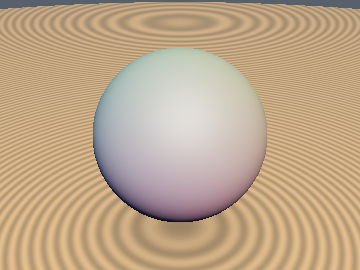&nbsp;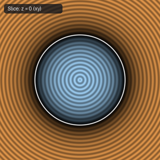 | [**`sdSphere`**](docs/primitives3d/sdSphere.md) [`glsl`](glsl/primitives3d/sdSphere.glsl) · **Exact** | Isotropic radial distance $`\Vert p\Vert - r`$ |
| 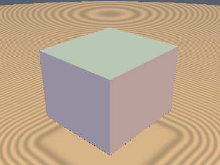&nbsp; | [**`sdBox`**](docs/primitives3d/sdBox.md) [`glsl`](glsl/primitives3d/sdBox.glsl) · **Exact** | 0/1-`sqrt` 3D box via median face-prism check (`0` `sqrt`s in interior + all 6 exterior face prisms [$`64.9\%`$]) |
| 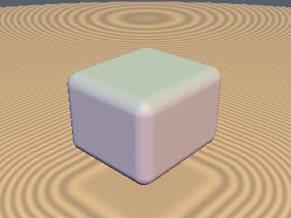&nbsp;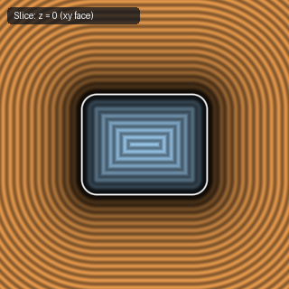 | [**`sdRoundBox`**](docs/primitives3d/sdRoundBox.md) [`glsl`](glsl/primitives3d/sdRoundBox.glsl) · **Exact** | 0/1-`sqrt` 3D rounded box (`0` `sqrt`s in interior + all 6 exterior face prisms, `1` on bevels) |
| 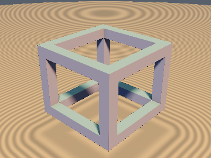&nbsp;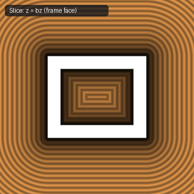 | [**`sdBoxFrame`**](docs/primitives3d/sdBoxFrame.md) [`glsl`](glsl/primitives3d/sdBoxFrame.glsl) · **Exact** | 1-`sqrt` closest-beam reduction (down from 3 `sqrt`s & 3 box evals; exact interior incl. corner cubes; includes `sdBoxEdges`) |
| 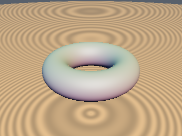&nbsp;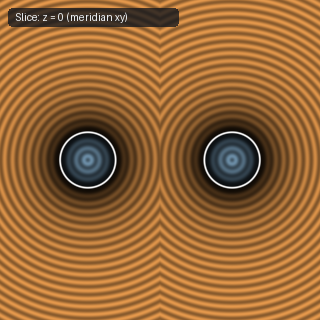 | [**`sdTorus`**](docs/primitives3d/sdTorus.md) [`glsl`](glsl/primitives3d/sdTorus.glsl) · **Exact** | Cylindrical reduction $`(\Vert p_{xz}\Vert - R, p_y)`$ followed by 2D circle distance |
| 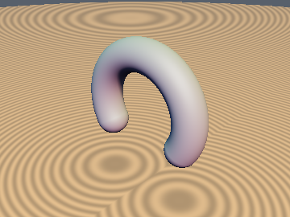&nbsp;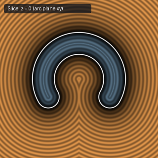 | [**`sdCappedTorus`**](docs/primitives3d/sdCappedTorus.md) [`glsl`](glsl/primitives3d/sdCappedTorus.glsl) · **Exact** | Clamped angular projection; avoids negative-radicand `NaN`s on the core circle |
| 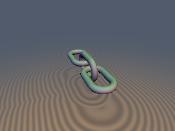&nbsp; | [**`sdLink`**](docs/primitives3d/sdLink.md) [`glsl`](glsl/primitives3d/sdLink.glsl) · **Exact** | **Also**: `sdChain`. 1/2-`sqrt` chain link (`1` `sqrt` in middle slab) & 1.83-`sqrt` screw-folded + squared-dominance infinite chain (`sdChain`, $`2.19\times`$ fewer `sqrt`s) |
| 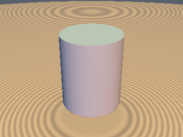&nbsp;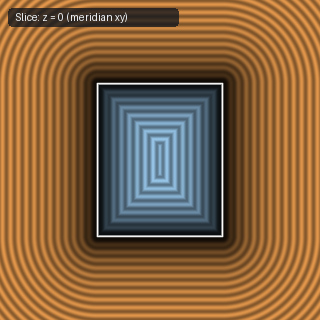 | [**`sdCappedCylinder`**](docs/primitives3d/sdCappedCylinder.md) [`glsl`](glsl/primitives3d/sdCappedCylinder.glsl) · **Exact** | 0/1/2-`sqrt` vertical capped cylinder via Unified Cap-Voronoi Radius Theorem (`0` `sqrt`s in cap zones) |
| 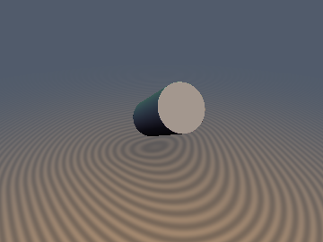&nbsp;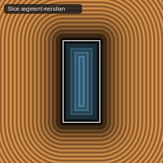 | [**`sdCappedCylinderSeg`**](docs/primitives3d/sdCappedCylinderSeg.md) [`glsl`](glsl/primitives3d/sdCappedCylinderSeg.glsl) · **Exact** | 1/2-`sqrt` arbitrary-segment cylinder (down from `3` `sqrt`s via $`L`$-cancellation; avoids $`O(\Vert b-a\Vert ^6)`$ FP16 overflow) |
| 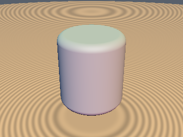&nbsp;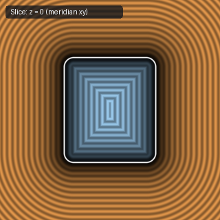 | [**`sdRoundedCylinder`**](docs/primitives3d/sdRoundedCylinder.md) [`glsl`](glsl/primitives3d/sdRoundedCylinder.glsl) · **Exact** | 0/1/2-`sqrt` revolved rounded rectangle with corner fillet radius $`r_b`$ (`0` `sqrt`s in cap zones) |
| 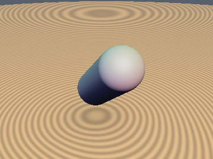&nbsp;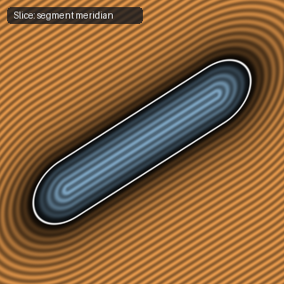 | [**`sdCapsule`**](docs/primitives3d/sdCapsule.md) [`glsl`](glsl/primitives3d/sdCapsule.glsl) · **Exact** | Clamped line-segment projection minus radius $`r`$ |
| 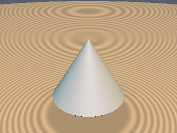&nbsp;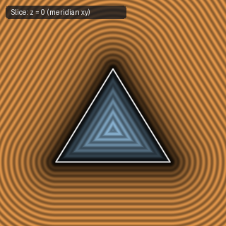 | [**`sdCone`**](docs/primitives3d/sdCone.md) [`glsl`](glsl/primitives3d/sdCone.glsl) · **Exact** | Orthonormal $`(c_x, c_y)`$ mantle projection (saves 1 division, 4 multiplies, and 2 additions vs. IQ's `sdCone`) |
| 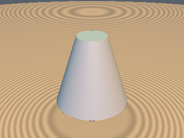&nbsp;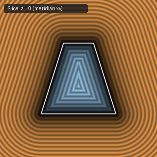 | [**`sdCappedCone`**](docs/primitives3d/sdCappedCone.md) [`glsl`](glsl/primitives3d/sdCappedCone.glsl) · **Exact** | Revolved right trapezoid with simplified normal-side sign test `max(-ca.y, dot(cb, k2) - 4*h^2) < 0` |
| 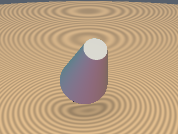&nbsp;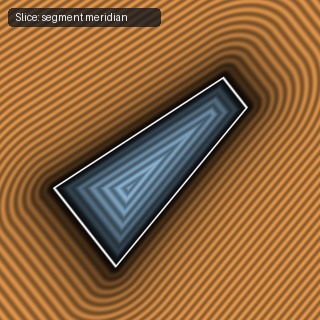 | [**`sdCappedConeSeg`**](docs/primitives3d/sdCappedConeSeg.md) [`glsl`](glsl/primitives3d/sdCappedConeSeg.glsl) · **Exact** | Arbitrary-endpoint frustum; guards against $`0/0`$ `NaN`s on the symmetry axis |
| 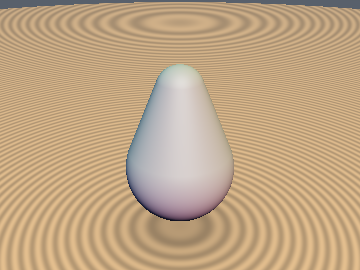&nbsp;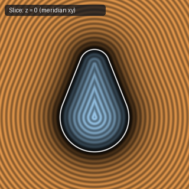 | [**`sdRoundCone`**](docs/primitives3d/sdRoundCone.md) [`glsl`](glsl/primitives3d/sdRoundCone.glsl) · **Exact** | 1-`sqrt` vertical round cone (down from 3 `sqrt`s) & $`O(L^2)`$ scale-safe `sdRoundConeSeg` (fixes $`O(L^8)`$ FP16 overflow) |
| 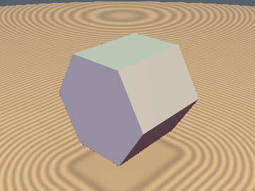&nbsp;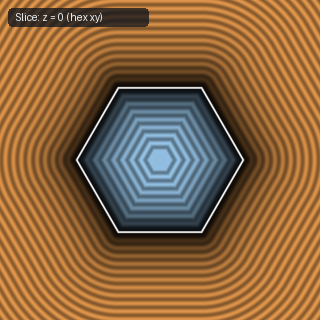 | [**`sdHexPrism`**](docs/primitives3d/sdHexPrism.md) [`glsl`](glsl/primitives3d/sdHexPrism.glsl) · **Exact** | $`D_6`$ fundamental-sector folding + orthogonal $`z`$-extrusion |
| 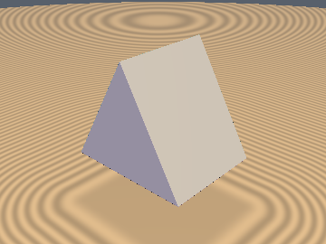&nbsp;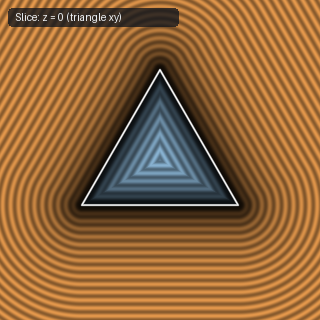 | [**`sdTriPrism`**](docs/primitives3d/sdTriPrism.md) [`glsl`](glsl/primitives3d/sdTriPrism.glsl) · **Exact** | Exact Euclidean SDF via $`D_3`$ folding + orthogonal $`z`$-extrusion (replaces plane bound) |
| 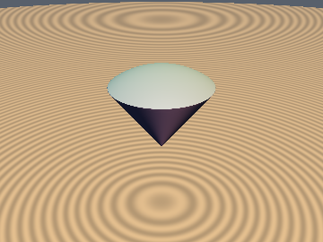&nbsp;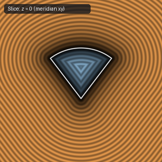 | [**`sdSolidAngle`**](docs/primitives3d/sdSolidAngle.md) [`glsl`](glsl/primitives3d/sdSolidAngle.glsl) · **Exact** | 2-`sqrt` orthonormal sector-dominance reduction (down from 3 `sqrt`s; `0.0` error across $`\mathbb{R}^3`$) |
| 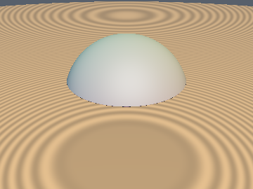&nbsp;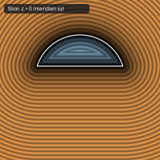 | [**`sdCutSphere`**](docs/primitives3d/sdCutSphere.md) [`glsl`](glsl/primitives3d/sdCutSphere.glsl) · **Exact** | Conjugate-square & signed-square reduction (`0` `sqrt`s in cap, `1` in sphere, `2` in rim; down from `2-3`) |
| 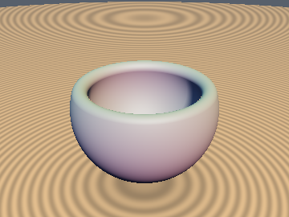&nbsp;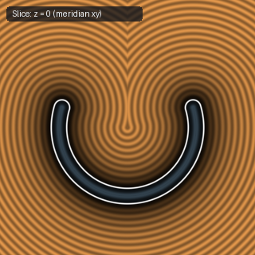 | [**`sdCutHollowSphere`**](docs/primitives3d/sdCutHollowSphere.md) [`glsl`](glsl/primitives3d/sdCutHollowSphere.glsl) · **Exact** | Conjugate-square & signed-square reduction (`1` `sqrt` in shell, `2` in rim; down from `3` `sqrt`s) |
| 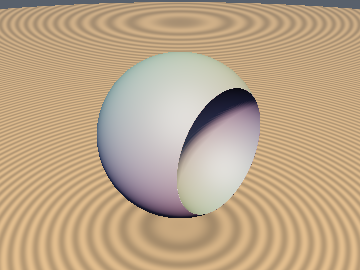&nbsp;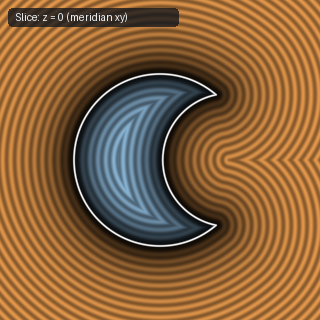 | [**`sdDeathStar`**](docs/primitives3d/sdDeathStar.md) [`glsl`](glsl/primitives3d/sdDeathStar.glsl) · **Exact** | 2-`length()` confocal-ellipse bisector reduction (down from 3 dynamic `length()` calls; `0.0` error) |
| 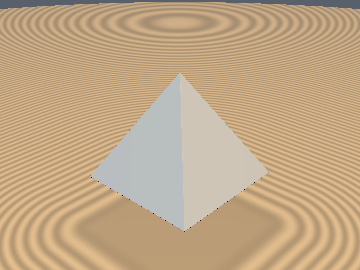&nbsp;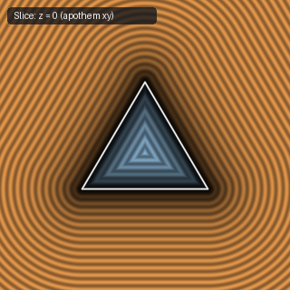 | [**`sdPyramid`**](docs/primitives3d/sdPyramid.md) [`glsl`](glsl/primitives3d/sdPyramid.glsl) · **Exact** | Includes exact $`y=0`$ base face and removes interior bisector fold distortion |
| 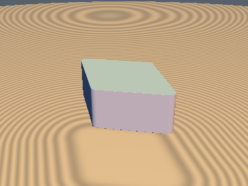&nbsp;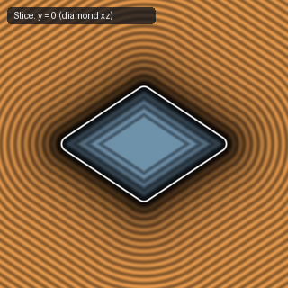 | [**`sdRhombus`**](docs/primitives3d/sdRhombus.md) [`glsl`](glsl/primitives3d/sdRhombus.glsl) · **Exact** | Direct diagonal-edge projection; eliminates `ndot` and fixes $`x=0`$ `sign(0.0)` collapse |
| 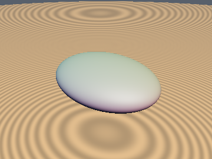&nbsp; | [**`sdEllipsoid`**](docs/primitives3d/sdEllipsoid.md) [`glsl`](glsl/primitives3d/sdEllipsoid.glsl) · Bound | 11-line unified interior/exterior concave-secular Halley bound (`~1e-6` mean error, `0` overstep, `0` NaNs) |
| &nbsp; | [**`sdEllipsoidExact`**](docs/primitives3d/sdEllipsoidExact.md) [`glsl`](glsl/primitives3d/sdEllipsoidExact.glsl) · **Exact** | True FP32-exact (`~1 ULP`) triaxial ellipsoid SDF across exterior, interior, and focal-ellipse medial surface |
| 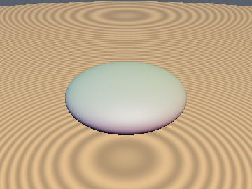&nbsp;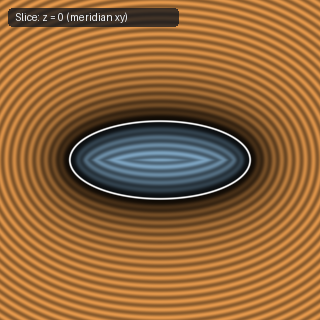 | [**`sdSpheroid`**](docs/primitives3d/sdSpheroid.md) [`glsl`](glsl/primitives3d/sdSpheroid.glsl) · **Exact** | Exact closed-form 3D oblate/prolate spheroid via pole-midpoint monic quartic |
| 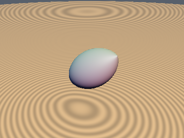&nbsp;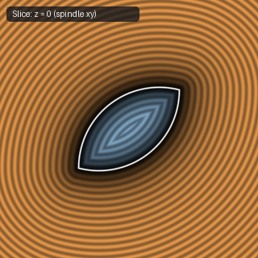 | [**`sdVesicaSegment`**](docs/primitives3d/sdVesicaSegment.md) [`glsl`](glsl/primitives3d/sdVesicaSegment.glsl) · **Exact** | 1-to-2 `sqrt` 3D revolved vesica spindle (eliminates `l = length(b-a)` & uses signed-square tip-cone test; down from 3 `sqrt`s) |
| 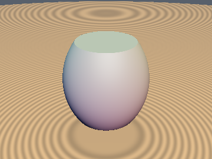&nbsp; | [**`sdBarrel`**](docs/primitives3d/sdBarrel.md) [`glsl`](glsl/primitives3d/sdBarrel.glsl) · **Exact** | Revolved circular-arc cask ($`r_{\text{mid}} > r_{\text{cap}}`$) and waisted spool ($`r_{\text{mid}} < r_{\text{cap}}`$) |
| &nbsp; | [**`sdLens`**](docs/primitives3d/sdLens.md) [`glsl`](glsl/primitives3d/sdLens.glsl) · **Exact** | 2-`length()` biconvex, plano-convex, and meniscus two-sphere optical lens via confocal-hyperbola bisector |
| &nbsp; | [**`sdSphericalSegmentSym`**](docs/primitives3d/sdSphericalSegmentSym.md) [`glsl`](glsl/primitives3d/sdSphericalSegmentSym.glsl) · **Exact** | Two-plane truncated sphere ($`y = \pm h`$) with conjugate-square reduction (`0/1/2` `sqrt`s) |
| &nbsp; | [**`sdSphericalZone`**](docs/primitives3d/sdSphericalZone.md) [`glsl`](glsl/primitives3d/sdSphericalZone.glsl) · **Exact** | Hollow spherical zone ($`y \in [h_1, h_2]`$) with conjugate-square reduction (`1/2` `sqrt`s, down from `4`) |
| &nbsp; | [**`sdPyramidFrustum`**](docs/primitives3d/sdPyramidFrustum.md) [`glsl`](glsl/primitives3d/sdPyramidFrustum.glsl) · **Exact** | Flat-topped square frustum via $`D_4`$ folding and ridge-edge decoupling |
| &nbsp; | [**`sdRectFrustum`**](docs/primitives3d/sdRectFrustum.md) [`glsl`](glsl/primitives3d/sdRectFrustum.glsl) · **Exact** | General rectangular frustum, rectangular pyramid, and hip roof |
| &nbsp; | [**`sdSquareBucket`**](docs/primitives3d/sdSquareBucket.md) [`glsl`](glsl/primitives3d/sdSquareBucket.glsl) · **Exact** | Open-ended hollow square frustum shell with rounded rim |
| &nbsp; | [**`sdCross3D`**](docs/primitives3d/sdCross3D.md) [`glsl`](glsl/primitives3d/sdCross3D.glsl) · **Exact** | 1-`sqrt` exact 3D orthogonal cross (`sdCross3D`) & infinite Menger cross (`sdInfCross3D`) via Weyl-chamber folding |
| &nbsp; | [**`sdJack3D`**](docs/primitives3d/sdJack3D.md) [`glsl`](glsl/primitives3d/sdJack3D.glsl) · **Exact** | **Also**: `sdAxisJack3D`, `sdFaceJack3D`. 1-`sqrt`, 0-sort exact 3D 8-pointed body-diagonal (2 lines!), 6-pointed axis, and 12-pointed face-diagonal capsule jacks |
| &nbsp; | [**`sdParaboloid`**](docs/primitives3d/sdParaboloid.md) [`glsl`](glsl/primitives3d/sdParaboloid.glsl) · **Exact** | Exact closed-form 3D solid capped paraboloid & parabolic reflector dish (`sdParaboloidDish`) via depressed cubic |
| &nbsp; | [**`udTriangle`**](docs/primitives3d/udTriangle.md) [`glsl`](glsl/primitives3d/udTriangle.glsl) · **Exact** | **Also**: `sdgTriangle3D`, `udQuad`, `sdTriangle2D`. Barycentric Partition-of-Unity ($`s_1+s_2+s_3 \equiv \Vert \mathbf{n}\Vert ^2`$) & Half-Space Edge Pruning (`1.12` avg edges vs `3.0`, `0` divs in face prism) |
| &nbsp; | [**`sdHelix`**](docs/primitives3d/sdHelix.md) [`glsl`](glsl/primitives3d/sdHelix.glsl) · **Exact** | **Also**: `sdCoilSpring`, `sdgHelix`. Exact 3D infinite helix & finite $`N`$-turn coil spring (`sdCoilSpring`, `sdgCoilSpring`); eliminates central-axis singularity & $`+0.68`$ to $`+2.13`$ overstep |
|  | [**`sdBezier3D`**](docs/primitives3d/sdBezier3D.md) [`glsl`](glsl/primitives3d/sdBezier3D.glsl) · **Exact** | **Also**: `udBezier3D`, `sdBezierCapsule3D`, `sdgBezier3D`. Collinear-safe, 1-`cbrt` conjugate-rationalized 3D quadratic Bézier curve, capsule, and analytical gradient via 3D-to-2D Gram reduction |
|  | [**`sdReuleaux3D`**](docs/primitives3d/sdReuleaux3D.md) [`glsl`](glsl/primitives3d/sdReuleaux3D.glsl) · **Exact** | **Also**: `sdReuleauxTetrahedron`, `sdReuleauxRotor3D`, `sdg*`. 0-trig, 1/2-`sqrt` 3D Reuleaux tetrahedron ($`T_d`$ vertex distance total-ordering) and constant-width Reuleaux rotor |
|  | [**`sdSquircleCube3D`**](docs/primitives3d/sdSquircleCube3D.md) [`glsl`](glsl/primitives3d/sdSquircleCube3D.glsl) · **Exact** | **Also**: `sdSquircleSphere3D`, `sdgSquircleCube3D`, `sdgSquircleSphere3D`. Machine-precision (`< 1e-7`) 3D $`\ell_4`$ Lamé squircle-cube and squircle-sphere via 2-step co-normal secular Newton-Halley solver |
| &nbsp; | [**`sdHollowCone`**](docs/primitives3d/sdHollowCone.md) [`glsl`](glsl/primitives3d/sdHollowCone.glsl) · **Exact** | **Also**: `sdHollowConeRound`, `sdHollowCylinder`, `sdHollowCylinderRound`, `sdgHollowCone`, `sdgHollowCylinder`. 0/1/2-`sqrt` open-ended cylindrical pipe (0-`sqrt` Annular Rim-Voronoi) & conical frustum funnel (Conformal Midpoint-Fold) |
| &nbsp; | [**`sdSteinmetz`**](docs/primitives3d/sdSteinmetz.md) [`glsl`](glsl/primitives3d/sdSteinmetz.glsl) · **Exact** | **Also**: `sdTricylinder`, `sdCylinderCross3D`, `sdCloisterVault`, `sdGroinVault`, `sdg*`. 1/2-`sqrt` Steinmetz bicylinder, 12-faced tricylinder (`1` `sqrt` in $`100\%`$ of interior), 3-cylinder cross (`1` `sqrt` in $`100\%`$ of exterior), & vaults |
| &nbsp; | [**`sdMeissnerTetrahedron`**](docs/primitives3d/sdMeissnerTetrahedron.md) [`glsl`](glsl/primitives3d/sdMeissnerTetrahedron.glsl) · **Exact** | **Also**: `sdMeissnerTetrahedronV`, `sdMeissnerTetrahedronF`, `sdg*`. 0-trig exact SDFs of both Meissner constant-width bodies via Constant-Width Farthest-Point Duality $`d = \max_{o \in M}\Vert p - o\Vert - s`$ & 1-evaluation sharp-point certificate (fixes $`12.8\%`$–$`16.0\%`$ naive-bound underestimation) |
| &nbsp; | [**`sdOloid`**](docs/primitives3d/sdOloid.md) [`glsl`](glsl/primitives3d/sdOloid.glsl) · **Exact** | **Also**: `sdgOloid`. 0-trig exact oloid (convex hull of two linked circles) via bitangent-plane family max + 240° edge-arc Voronoi & provably unimodal Chebyshev-bracketed solver (fixes $`50\%`$ support-plane underestimation) |
| &nbsp; | [**`sdHelicalGear`**](docs/primitives3d/sdHelicalGear.md) [`glsl`](glsl/primitives3d/sdHelicalGear.glsl) · **Exact** | **Also**: `sdInvoluteHelicoidGear`, `sdgHelicalGear`, `sdHelicalGearCapped` (bound near end edges). Closed-form involute helical gear via the Involute-Helicoid Parallel-Offset Theorem $`d = r_b\cos\beta_b(\varphi' - \psi(\rho))`$ & orbit-space chiral fold (replaces twist/Lipschitz: $`+13\%`$ overstep or $`1.1\times`$ understep) |
|  | [**`sdOctaBox`**](docs/primitives3d/sdOctaBox.md) [`glsl`](glsl/primitives3d/sdOctaBox.glsl) · **Exact** | **Also**: `sdgOctaBox`, `opExtrudeCone`, `sdgExtrudeCone`. Exact 26-faced crystal-beveled octa-box (Minkowski sum of box and octahedron) and conical chamfered extrusion in 1 `sqrt` |
|  | [**`sdBorromeanRings`**](docs/primitives3d/sdBorromeanRings.md) [`glsl`](glsl/primitives3d/sdBorromeanRings.glsl) · **Exact** | **Also**: `sdEllipticTorus`, `sdgEllipticTorus`, `sdgBorromeanRings`, `sdTorusKnot`. Exact 3D Euclidean elliptic torus, canonical orthogonal Borromean rings, and 0-loop branch-cut-free $`(p,q)`$ torus knot |
|  | [**`sdSphericon`**](docs/primitives3d/sdSphericon.md) [`glsl`](glsl/primitives3d/sdSphericon.glsl) · **Exact** | **Also**: `sdgSphericon`, `sdOctasphericon`, `sdgOctasphericon`, `opSphericonCoords`. Exact 3D Euclidean Sphericon, Octasphericon, and developable rollers via $`S_4`$ rotoreflection seam dominance (1 `sqrt`, 0 loops) |
|  | [**`sdDupinCyclideExact`**](docs/primitives3d/sdDupinCyclideExact.md) [`glsl`](glsl/primitives3d/sdDupinCyclideExact.glsl) · **Exact** | **Also**: `sdgDupinCyclideExact`, `sdCartesianOval2D`, `sdgCartesianOval2D`, `sdAplanaticLens3D`, `sdgAplanaticLens3D`. Exact 3D Euclidean Dupin cyclide via Maxwell's focal-ellipse canal theorem and Descartes aplanatic optical lenses |
|  | [**`sdHyperbolicParaboloid`**](docs/primitives3d/sdHyperbolicParaboloid.md) [`glsl`](glsl/primitives3d/sdHyperbolicParaboloid.glsl) · **Exact** | **Also**: `sdgHyperbolicParaboloid`, `sdPringleChip`, `sdHyperboloid1Sheet`, `sdgHyperboloid1Sheet`, `sdHyperboloid2Sheet`. Exact 3D hyperbolic paraboloid (Pringle saddle) and doubly-ruled hyperboloids via pole-cleared secular quadrics |
|  | [**`sdMinimalSurface`**](docs/primitives3d/sdMinimalSurface.md) [`glsl`](glsl/primitives3d/sdMinimalSurface.glsl) · **Exact / 1-Lipschitz** | **Also**: `sdCatenoid`, `sdgCatenoid`, `sdHelicoid`, `sdgHelicoid`, `sdScherkTower`, `sdgScherkTower`. Exact 3D Euclidean Catenoid, exact Ruled Helicoid, and overflow-free Hyperbolic-Secant Scherk minimal saddle tower |
|  | [**`sdMobiusStrip`**](docs/primitives3d/sdMobiusStrip.md) [`glsl`](glsl/primitives3d/sdMobiusStrip.glsl) · **Exact** | **Also**: `sdgMobiusStrip`, `sdTwistedRibbon`, `sdgTwistedRibbon`. Exact 3D Euclidean ruled Möbius strip and $`n`$-half-twist torus ribbon with 0 branch cuts via cylindrical Envelope-Theorem Newton reduction |
|  | [**`sdSoddyHexlet`**](docs/primitives3d/sdSoddyHexlet.md) [`glsl`](glsl/primitives3d/sdSoddyHexlet.glsl) · **Exact** | **Also**: `sdgSoddyHexlet`, `sdSoddyNecklace`, `sdgSoddyNecklace`, `sdSteinerChain2D`, `sdgSteinerChain2D`, `sdSteinerEnvelopes2D`. $`O(1)`$ exact 3D Euclidean Soddy's Hexlet, $`N`$-sphere Dupin necklace, and 2D Steiner porism chains via relativistic aberration |
|  | [**`sdPluckerConoid`**](docs/primitives3d/sdPluckerConoid.md) [`glsl`](glsl/primitives3d/sdPluckerConoid.glsl) · **Exact** | **Also**: `sdgPluckerConoid`, `sdRuledConoid`, `sdgRuledConoid`. Exact 3D Euclidean Plücker's conoid and harmonic $`n`$-fold ruled conoids with desingularized central spine |
|  | [**`sdParabolicCyclide`**](docs/primitives3d/sdParabolicCyclide.md) [`glsl`](glsl/primitives3d/sdParabolicCyclide.glsl) · **Exact** | **Also**: `sdgParabolicCyclide`, `sdParabolicCyclideShell`, `sdgParabolicCyclideShell`. 0-trig exact 3D Euclidean parabolic Dupin cyclide via Maxwell's dual focal-parabola distance identity and cubic secular collapse |
|  | [**`sdVivianiCurve`**](docs/primitives3d/sdVivianiCurve.md) [`glsl`](glsl/primitives3d/sdVivianiCurve.glsl) · **Exact** | **Also**: `sdgVivianiCurve`, `sdTennisBallSeam`, `sdgTennisBallSeam`. Exact 3D Euclidean Viviani curve and $`D_{2d}`$ tennis-ball seam curve via $`S^2`$ dot-product linearization (0 SFU `sqrt`s inside solver) |
|  | [**`sdBohemianDome`**](docs/primitives3d/sdBohemianDome.md) [`glsl`](glsl/primitives3d/sdBohemianDome.glsl) · **Exact** | **Also**: `sdgBohemianDome`. Exact 3D quartic Bohemian dome and translated circle vaults via vectorized circular cross-section envelope reduction + analytical gradient |
|  | [**`sdTrefoilKnot`**](docs/primitives3d/sdTrefoilKnot.md) [`glsl`](glsl/primitives3d/sdTrefoilKnot.glsl) · **Exact** | **Also**: `sdgTrefoilKnot`, `sdTorusKnotExact`, `sdgTorusKnotExact`. Exact 3D Euclidean trefoil knot and general $`(p,q)`$ torus knots via azimuthal strand seeding and harmonic cross-term cancellation |
|  | [**`sdCleliaCurve`**](docs/primitives3d/sdCleliaCurve.md) [`glsl`](glsl/primitives3d/sdCleliaCurve.glsl) · **Exact** | **Also**: `sdgCleliaCurve`, `sdSphericalLoxodrome`, `sdgSphericalLoxodrome`. Exact 3D spherical loxodrome (rhumb line) and Grandi's Clelia / Rhodonea curve via $`S^2`$ dot-product linearization |
|  | [**`sdConicalSpiral`**](docs/primitives3d/sdConicalSpiral.md) [`glsl`](glsl/primitives3d/sdConicalSpiral.glsl) · **Exact** | **Also**: `sdConicalHelix`, `sdgConicalHelix`, `sdGastropodShell`, `sdgGastropodShell`. Exact 3D Euclidean Pappus conical helix and Raup helicocone gastropod shell via orthogonal cone-generator turn projection |
|  | [**`sdFigureEightKnot`**](docs/primitives3d/sdFigureEightKnot.md) [`glsl`](glsl/primitives3d/sdFigureEightKnot.glsl) · **Exact** | **Also**: `sdgFigureEightKnot`, `sdTurkHeadKnot`, `sdgTurkHeadKnot`. Exact $`O(1)`$ 3D Thurston hyperbolic figure-eight knot ($`4_1`$) and Turk's head rosette knots via antisymmetric crossing parity and strand seeding |
|  | [**`sdPseudosphere`**](docs/primitives3d/sdPseudosphere.md) [`glsl`](glsl/primitives3d/sdPseudosphere.glsl) · **Exact** | **Also**: `sdgPseudosphere`, `sdTractrix2D`, `sdgTractrix2D`. Exact 3D Beltrami pseudosphere ($`K = -1/R^2`$) and Huygens tractrix via Pythagorean hyperbolic tangent-normal collapse |
|  | [**`sdToroidalCoil`**](docs/primitives3d/sdToroidalCoil.md) [`glsl`](glsl/primitives3d/sdToroidalCoil.glsl) · **Exact** | **Also**: `sdgToroidalCoil`. Exact $`O(1)`$ turn-independent 3D toroidal solenoid coil via poloidal-toroidal phase unwrapping & harmonic cross-term cancellation |
|  | [**`sdSphericalEpicycloid`**](docs/primitives3d/sdSphericalEpicycloid.md) [`glsl`](glsl/primitives3d/sdSphericalEpicycloid.glsl) · **Exact** | **Also**: `sdHippopede`, `sdgHippopede`, `sdgSphericalEpicycloid`. Exact $`O(1)`$ 3D Eudoxus hippopede (horse-fetter) & Camus spherical epicycloid bevel-gear curves via $`S^2`$ dot-product linearization |
|  | [**`sdSphericalSpiral`**](docs/primitives3d/sdSphericalSpiral.md) [`glsl`](glsl/primitives3d/sdSphericalSpiral.glsl) · **Exact** | **Also**: `sdgSphericalSpiral`. Exact $`O(1)`$ 3D Euclidean spherical spiral of Sinus (`sdSphericalSpiral`) and Seiffert's (1896) spherical spiral (`sdSeiffertSpiral`) on $`S^2(R)`$ via $`S^2`$ dot-product linearization and 0-`sqrt` Newton projection |
|  | [**`sdCrownCurve`**](docs/primitives3d/sdCrownCurve.md) [`glsl`](glsl/primitives3d/sdCrownCurve.glsl) · **Exact** | **Also**: `sdgCrownCurve`, `sdCylindricalSoliton`, `sdgCylindricalSoliton`. Exact $`O(1)`$ 3D Euclidean cylindrical sinusoidal crown waveguide and cylindrical Sine-Gordon soliton loop on $`S^1(R) \times \mathbb{R}`$ via cylinder dot-product linearization and $`D_n`$ dihedral half-wave folding |
|  | [**`sdSphericalSineWave`**](docs/primitives3d/sdSphericalLissajous.md) [`glsl`](glsl/primitives3d/sdSphericalLissajous.glsl) · **Exact** | **Also**: `sdgSphericalSineWave`, `sdSphericalLissajous`, `sdgSphericalLissajous`. Exact $`O(1)`$ 3D Euclidean $`N`$-wave spherical sinusoidal waveguide and spherical Bowditch $`(1,2)`$ figure-eight Lissajous curve on $`S^2(R)`$ via $`S^2`$ dot-product linearization and $`D_n`$ dihedral half-wave folding |
|  | [**`sdLissajousKnot3D`**](docs/primitives3d/sdLissajousKnot.md) [`glsl`](glsl/primitives3d/sdLissajousKnot.glsl) · **Exact** | **Also**: `sdgLissajousKnot3D`, `sdHoropterCurve`, `sdgHoropterCurve`. Exact $`O(1)`$ 3D Euclidean $`(1,2,3)`$ Chebyshev-Lissajous saddle curve and Hermann von Helmholtz's (1867) rational twisted-cubic horopter curve of binocular stereopsis |
|  | [**`sdCircularBraid`**](docs/primitives3d/sdCircularBraid.md) [`glsl`](glsl/primitives3d/sdCircularBraid.glsl) · **Exact** | **Also**: `sdgCircularBraid`, `sdLinearBraid3D`, `sdgLinearBraid3D`. Exact $`O(1)`$ 3D Euclidean $`N`$-wave circular 3-strand Celtic braid ring and linear 3-strand plait via Lemniscate-of-Gerono over-under crossings and $`D_{3N}`$ dihedral-strand folding |
|  | [**`sdConicalWedge`**](docs/primitives3d/sdWallisConicalEdge.md) [`glsl`](glsl/primitives3d/sdWallisConicalEdge.glsl) · **Exact** | **Also**: `sdgConicalWedge`, `sdWallisConicalEdge`, `sdgWallisConicalEdge`. Exact 3D Euclidean John Wallis's (1665) *Cuneus Conicus* ruled conoid and watertight ship-hull conical wedge via Envelope-Theorem ruling elimination and 0-trig, 0-`sqrt` quartic sign test |
|  | [**`sdSphericalAstroid`**](docs/primitives3d/sdSphericalAstroid.md) [`glsl`](glsl/primitives3d/sdSphericalAstroid.glsl) · **Exact** | **Also**: `sdSphericalCardioid`. Exact $`O(1)`$ 3D Euclidean 4-cusped spherical astroid and spherical cardioid on $`S^2(R)`$ via the 0-`sqrt` orthonormal equatorial rolling identity and $`S^2`$ dot-product linearization |
|  | [**`sdCinquefoilKnot`**](docs/primitives3d/sdCinquefoilKnot.md) [`glsl`](glsl/primitives3d/sdCinquefoilKnot.glsl) · **Exact** | **Also**: `sdSolomonLink`. Exact $`O(1)`$ 3D Euclidean $`(2,5)`$ cinquefoil torus knot ($`5_1`$ Solomon's seal knot) and King Solomon's $`(2,4)`$ doubly-linked rings ($`4^2_1`$) via antipodal torus $`D_k`$ fundamental-cell folding |
|  | [**`sdMilnorSeifertKnot`**](docs/primitives3d/sdMilnorSeifertKnot.md) [`glsl`](glsl/primitives3d/sdMilnorSeifertKnot.glsl) · **Exact** | **Also**: `sdMilnorTorusKnot`, `sdgMilnorTorusKnot`, `sdSeifertSurface`, `sdgSeifertSurface`. Algebraic $`(p,q)`$-torus knot via Milnor fibration $`u^p - v^q`$ on $`S^3 \subset \mathbb{C}^2`$ with 1-dot stereographic pullback & branch-cut-free Seifert minimal soap-film SDF |

---

## 2. Exact 3D Polyhedra ([`glsl/polyhedra3d/`](glsl/polyhedra3d/) & [`docs/polyhedra3d/`](docs/polyhedra3d/))
All polyhedra below fold $`p \in \mathbb{R}^3`$ into the fundamental Weyl chamber of their symmetry group ($`O_h`$, $`T_d`$, $`D_{nd}`$, or $`I_h`$), yielding **exact Euclidean SDFs** (valid for outer rounding `sdPoly(p) - r` and onion shelling).

| Preview | Function | Summary |
| :---: | :--- | :--- |
| &nbsp; | [**`sdOctahedron`**](docs/polyhedra3d/sdOctahedron.md) [`glsl`](glsl/polyhedra3d/sdOctahedron.glsl) · **Exact** | 4-line branchless sorted Weyl-chamber projection with weights $`(2, 1, 3)`$ |
| &nbsp; | [**`sdRhombicDodecahedron`**](docs/polyhedra3d/sdRhombicDodecahedron.md) [`glsl`](glsl/polyhedra3d/sdRhombicDodecahedron.glsl) · **Exact** | 4-line branchless sorted Weyl-chamber projection with weights $`(3, 1, 2)`$; FCC Voronoi cell |
| &nbsp; | [**`sdTetrahedron`**](docs/polyhedra3d/sdTetrahedron.md) [`glsl`](glsl/polyhedra3d/sdTetrahedron.glsl) · **Exact** | $`T_d`$ chamber fold ($`p_x \ge p_y \ge p_z`$, conditional sign flip of $`p_y + p_z`$) + 1-face/2-edge projection |
| &nbsp; | [**`sdCuboctahedron`**](docs/polyhedra3d/sdCuboctahedron.md) [`glsl`](glsl/polyhedra3d/sdCuboctahedron.glsl) · **Exact** | $`O_h`$ Weyl-chamber projection onto 1 square face, 1 triangle face, and 1 shared edge |
| &nbsp; | [**`sdTruncatedOctahedron`**](docs/polyhedra3d/sdTruncatedOctahedron.md) [`glsl`](glsl/polyhedra3d/sdTruncatedOctahedron.glsl) · **Exact** | Exact Kelvin cell (BCC Voronoi cell) via $`O_h`$ Weyl-chamber projection |
| &nbsp; | [**`sdDodecahedron`**](docs/polyhedra3d/sdDodecahedron.md) [`glsl`](glsl/polyhedra3d/sdDodecahedron.glsl) · **Exact** | 5-step $`I_h`$ reflection fold into the fundamental chamber + 1-face/1-edge projection |
| &nbsp; | [**`sdIcosahedron`**](docs/polyhedra3d/sdIcosahedron.md) [`glsl`](glsl/polyhedra3d/sdIcosahedron.glsl) · **Exact** | 5-step $`I_h`$ reflection fold into the fundamental chamber + 1-face/1-edge projection |
| &nbsp; | [**`sdRhombicTriacontahedron`**](docs/polyhedra3d/sdRhombicTriacontahedron.md) [`glsl`](glsl/polyhedra3d/sdRhombicTriacontahedron.glsl) · **Exact** | 30-face Catalan solid via $`I_h`$ chamber fold + golden-rhombus face/edge projection |
| &nbsp; | [**`sdIcosidodecahedron`**](docs/polyhedra3d/sdIcosidodecahedron.md) [`glsl`](glsl/polyhedra3d/sdIcosidodecahedron.glsl) · **Exact** | 32-face Archimedean solid via $`I_h`$ chamber fold + pentagon/triangle face separator |
| &nbsp; | [**`sdTetrakisHexahedron`**](docs/polyhedra3d/sdTetrakisHexahedron.md) [`glsl`](glsl/polyhedra3d/sdTetrakisHexahedron.glsl) · **Exact** | **Also**: `sdgTetrakisHexahedron`. 0/1-`sqrt` 24-face Catalan solid (`0` `sqrt`s in interior & 24 face strips, `1` `sqrt` at edges) via $`O_h`$ Weyl-chamber projection |
| &nbsp; | [**`sdTriakisOctahedron`**](docs/polyhedra3d/sdTriakisOctahedron.md) [`glsl`](glsl/polyhedra3d/sdTriakisOctahedron.glsl) · **Exact** | **Also**: `sdgTriakisOctahedron`. 0/1-`sqrt` 24-face Catalan solid (dual of truncated cube, `0` `sqrt`s in interior & face strips, `1` `sqrt` at edges) via $`O_h`$ Weyl-chamber projection |
| &nbsp; | [**`sdDeltoidalIcositetrahedron`**](docs/polyhedra3d/sdDeltoidalIcositetrahedron.md) [`glsl`](glsl/polyhedra3d/sdDeltoidalIcositetrahedron.glsl) · **Exact** | **Also**: `sdgDeltoidalIcositetrahedron`. 0/1-`sqrt` 24-face Catalan kite solid (dual of rhombicuboctahedron, `0` `sqrt`s in interior & face strips) via $`O_h`$ Weyl-chamber projection |
| &nbsp; | [**`sdTruncatedCube`**](docs/polyhedra3d/sdTruncatedCube.md) [`glsl`](glsl/polyhedra3d/sdTruncatedCube.glsl) · **Exact** | **Also**: `sdgTruncatedCube`. 0/1-`sqrt` 14-face Archimedean solid (`0` `sqrt`s in interior & triangle prisms, `1` `sqrt` in 2D octagon chain) + analytical gradient |
| &nbsp; | [**`sdRhombicuboctahedron`**](docs/polyhedra3d/sdRhombicuboctahedron.md) [`glsl`](glsl/polyhedra3d/sdRhombicuboctahedron.glsl) · **Exact** | **Also**: `sdgRhombicuboctahedron`. 0/1-`sqrt` 26-face Archimedean solid (`0` `sqrt`s in interior & triangle prisms, `1` `sqrt` in 2D octagon chain) + analytical gradient |
|  | [**`sdDeltoidalHexecontahedron`**](docs/polyhedra3d/sdDeltoidalHexecontahedron.md) [`glsl`](glsl/polyhedra3d/sdDeltoidalHexecontahedron.glsl) · **Exact** | **Also**: `sdgDeltoidalHexecontahedron`. 0/1-`sqrt` 60-kite Catalan solid (dual of rhombicosidodecahedron; all 60 kites collapse to 1 plane on the $`I_h`$ mirror wall) |
|  | [**`sdDisdyakisDodecahedron`**](docs/polyhedra3d/sdDisdyakisDodecahedron.md) [`glsl`](glsl/polyhedra3d/sdDisdyakisDodecahedron.glsl) · **Exact** | **Also**: `sdgDisdyakisDodecahedron`. 0/1-`sqrt` 48-triangle Catalan solid (dual of truncated cuboctahedron; 48 faces $`\to`$ 1 plane in $`O_h`$ Weyl chamber) |
|  | [**`sdDisdyakisTriacontahedron`**](docs/polyhedra3d/sdDisdyakisTriacontahedron.md) [`glsl`](glsl/polyhedra3d/sdDisdyakisTriacontahedron.glsl) · **Exact** | **Also**: `sdgDisdyakisTriacontahedron`. 0/1-`sqrt` 120-triangle Catalan solid (largest Archimedean/Catalan solid; all 120 faces collapse to 1 triangle in $`I_h`$ chamber) |
|  | [**`sdGreatIcosahedron`**](docs/polyhedra3d/sdGreatIcosahedron.md) [`glsl`](glsl/polyhedra3d/sdGreatIcosahedron.glsl) · **Exact** | **Also**: `sdgGreatIcosahedron`. 0/1-`sqrt` Kepler-Poinsot regular star polyhedron (180 visible outer triangles $`\to`$ 1 chamber facet + 2 interior valley seams) |
|  | [**`sdHexFrustum`**](docs/polyhedra3d/sdHexFrustum.md) [`glsl`](glsl/polyhedra3d/sdHexFrustum.glsl) · **Exact** | **Also**: `sdgHexFrustum`, `sdRegularFrustum`. 0-trig, 0/1-`sqrt` hexagonal frustum/pyramid ($`D_6`$ fold) and general $`N`$-gonal frustum |
|  | [**`sdKeplerPoinsot`**](docs/polyhedra3d/sdKeplerPoinsot.md) [`glsl`](glsl/polyhedra3d/sdKeplerPoinsot.glsl) · **Exact** | **Also**: `sdSmallStellatedDodecahedron`, `sdGreatDodecahedron`, `sdGreatStellatedDodecahedron`, `sdg*`. 0/1-`sqrt` Kepler-Poinsot regular star polyhedra (60 outer facets $`\to`$ 1 triangle, 1 ridge, & 1 valley seam in $`I_h`$ chamber) |
|  | [**`sdPentakisDodecahedron`**](docs/polyhedra3d/sdPentakisDodecahedron.md) [`glsl`](glsl/polyhedra3d/sdPentakisDodecahedron.glsl) · **Exact** | **Also**: `sdgPentakisDodecahedron`. 0/1-`sqrt` 60-triangle Catalan geodesic dome (dual of $`C_{60}`$ buckyball; 60 faces $`\to`$ 1 plane in $`I_h`$ chamber) |
|  | [**`sdPolyhedralCompounds`**](docs/polyhedra3d/sdPolyhedralCompounds.md) [`glsl`](glsl/polyhedra3d/sdPolyhedralCompounds.glsl) · **Exact** | **Also**: `sdCubeOctahedronCompound`, `sdDodecaIcosaCompound`, `sdg*`. 0/1-`sqrt` dual Platonic compounds via the Unclamped Interior Valley-Seam Theorem (eliminates $`5.3\%\text{--}11.2\%`$ CSG valley error) |
|  | [**`sdRhombicosidodecahedron`**](docs/polyhedra3d/sdRhombicosidodecahedron.md) [`glsl`](glsl/polyhedra3d/sdRhombicosidodecahedron.glsl) · **Exact** | **Also**: `sdgRhombicosidodecahedron`. 0/1-`sqrt` 62-face Archimedean solid (120 edges collapse to 2 axis-aligned edges along $`x`$ and $`y`$ in $`I_h`$ chamber) |
|  | [**`sdSquareAntiprism`**](docs/polyhedra3d/sdSquareAntiprism.md) [`glsl`](glsl/polyhedra3d/sdSquareAntiprism.glsl) · **Exact** | **Also**: `sdPentAntiprism`, `sdHexAntiprism`, `sdAntiprism`, `sdg*`. 0-trig, 0/1-`sqrt` square, pentagonal (icosahedral core), and hexagonal antiprisms via $`D_{nd}`$ involutory bisector folding |
|  | [**`sdStellaOctangula`**](docs/polyhedra3d/sdStellaOctangula.md) [`glsl`](glsl/polyhedra3d/sdStellaOctangula.glsl) · **Exact** | **Also**: `sdgStellaOctangula`. 0/1-`sqrt` Kepler's Stella Octangula (compound of two dual tetrahedra; 24 triangles $`\to`$ 1 face, 1 ridge, & 1 valley seam in $`O_h`$) |
|  | [**`sdTrapezohedron`**](docs/polyhedra3d/sdTrapezohedron.md) [`glsl`](glsl/polyhedra3d/sdTrapezohedron.glsl) · **Exact** | **Also**: `sdPentTrapezohedron`, `sdSquareTrapezohedron`, `sdgPentTrapezohedron`. 0-trig, 0/1-`sqrt` $`2n`$-kite trapezohedra including the 10-sided $`D_{10}`$ die (`sdPentTrapezohedron`) |
|  | [**`sdTriakisIcosahedron`**](docs/polyhedra3d/sdTriakisIcosahedron.md) [`glsl`](glsl/polyhedra3d/sdTriakisIcosahedron.glsl) · **Exact** | **Also**: `sdgTriakisIcosahedron`. 0/1-`sqrt` 60-triangle Catalan solid (dual of truncated dodecahedron; 60 faces $`\to`$ 1 plane in $`I_h`$ chamber) |
|  | [**`sdTriakisTetrahedron`**](docs/polyhedra3d/sdTriakisTetrahedron.md) [`glsl`](glsl/polyhedra3d/sdTriakisTetrahedron.glsl) · **Exact** | **Also**: `sdgTriakisTetrahedron`. 0/1-`sqrt` 12-triangle Catalan solid (dual of truncated tetrahedron) via 24-fold $`T_d`$ parity-sorted Weyl chamber |
|  | [**`sdTruncatedCuboctahedron`**](docs/polyhedra3d/sdTruncatedCuboctahedron.md) [`glsl`](glsl/polyhedra3d/sdTruncatedCuboctahedron.glsl) · **Exact** | **Also**: `sdgTruncatedCuboctahedron`. 0/1-`sqrt` 26-face great rhombicuboctahedron (48 vertices $`\to`$ 1 vertex & 3 mirror-normal edges in $`O_h`$ chamber) |
|  | [**`sdTruncatedDodecahedron`**](docs/polyhedra3d/sdTruncatedDodecahedron.md) [`glsl`](glsl/polyhedra3d/sdTruncatedDodecahedron.glsl) · **Exact** | **Also**: `sdgTruncatedDodecahedron`. 0/1-`sqrt` 32-face Archimedean solid (12 decagons + 20 triangles) via 120-fold $`I_h`$ Weyl-chamber projection |
|  | [**`sdTruncatedIcosahedron`**](docs/polyhedra3d/sdTruncatedIcosahedron.md) [`glsl`](glsl/polyhedra3d/sdTruncatedIcosahedron.glsl) · **Exact** | **Also**: `sdgTruncatedIcosahedron`. 0/1-`sqrt` 32-face soccer ball / $`C_{60}`$ buckyball (12 pentagons + 20 hexagons $`\to`$ 2 planes & 2 edges in $`I_h`$ chamber) |
|  | [**`sdTruncatedIcosidodecahedron`**](docs/polyhedra3d/sdTruncatedIcosidodecahedron.md) [`glsl`](glsl/polyhedra3d/sdTruncatedIcosidodecahedron.glsl) · **Exact** | **Also**: `sdgTruncatedIcosidodecahedron`. 0/1-`sqrt` 62-face great rhombicosidodecahedron (120 vertices $`\to`$ 1 vertex & 3 mirror-normal edges in $`I_h`$ chamber) |
|  | [**`sdTruncatedTetrahedron`**](docs/polyhedra3d/sdTruncatedTetrahedron.md) [`glsl`](glsl/polyhedra3d/sdTruncatedTetrahedron.glsl) · **Exact** | **Also**: `sdgTruncatedTetrahedron`. 0/1-`sqrt` 8-face Archimedean solid (4 hexagons + 4 triangles $`\to`$ 1 vertex & 2 edges in 24-fold $`T_d`$ chamber) |
|  | [**`sdGyrobifastigium`**](docs/polyhedra3d/sdGyrobifastigium.md) [`glsl`](glsl/polyhedra3d/sdGyrobifastigium.glsl) · **Exact** | **Also**: `sdgGyrobifastigium`. 0/1-`sqrt` space-filling Johnson solid $`J_{26}`$ (`0` `sqrt`s in interior, `1` in exterior via 2-line $`D_{2d}`$ fold & 4-Square Edge-Cover Theorem) |
|  | [**`sdRhombicHexecontahedron`**](docs/polyhedra3d/sdRhombicHexecontahedron.md) [`glsl`](glsl/polyhedra3d/sdRhombicHexecontahedron.glsl) · **Exact** | **Also**: `sdgRhombicHexecontahedron`. 0/1-`sqrt` Unkelbach 60-golden-rhombus stellation via Face-Normal Swizzle Identity $`\mathbf{n} \equiv -\mathbf{n}_3.\text{yzx}`$ & wall-aligned edges |
|  | [**`sdFiveCubesCompound`**](docs/polyhedra3d/sdFiveCubesCompound.md) [`glsl`](glsl/polyhedra3d/sdFiveCubesCompound.glsl) · **Exact** | **Also**: `sdFiveOctahedraCompound`, `sdgFiveOctahedraCompound`. 0/1-`sqrt` regular icosahedral compounds of 5 cubes (Swizzle-Frame) & 5 octahedra (Single-Octahedron Collapse) |
| &nbsp; | [**`sdSnubCube`**](docs/polyhedra3d/sdSnubCube.md) [`glsl`](glsl/polyhedra3d/sdSnubCube.glsl) · **Exact** | **Also**: `sdgSnubCube`. 0/1-`sqrt` chiral Archimedean snub cube via the Chiral Parity Fold (parity-tracked $`O_h`$ fold + 1 wall swizzle → rotation-group domain) & Nearest-Vertex Tangent-Cone Lemma (fixes $`9.6\%`$ plane-max underestimation) |
| &nbsp; | [**`sdPentagonalIcositetrahedron`**](docs/polyhedra3d/sdPentagonalIcositetrahedron.md) [`glsl`](glsl/polyhedra3d/sdPentagonalIcositetrahedron.glsl) · **Exact** | **Also**: `sdgPentagonalIcositetrahedron`. 0/1-`sqrt` chiral Catalan dual of the snub cube via Chiral Parity Fold + Argmax-Face Lemma (one fixed pentagon, 3 edges; fixes $`13.3\%`$ plane-max underestimation) |
|  | [**`sdElongatedDodecahedron`**](docs/polyhedra3d/sdElongatedDodecahedron.md) [`glsl`](glsl/polyhedra3d/sdElongatedDodecahedron.glsl) · **Exact** | **Also**: `sdgElongatedDodecahedron`. Exact 0-loop, 0-trig, 1-`sqrt` 3D Euclidean Fedorov's (1885) space-filling elongated dodecahedron (12 faces) and Bilinski's (1960) golden rhombic icosahedron (20 faces) with analytical unit gradients via octant-folded Voronoi feature pruning |
|  | [**`sdPyritohedron`**](docs/polyhedra3d/sdPyritohedron.md) [`glsl`](glsl/polyhedra3d/sdPyritohedron.glsl) · **Exact** | **Also**: `sdgPyritohedron`, `sdBilinskiDodecahedron`, `sdgBilinskiDodecahedron`. Exact 0-loop, 0-trig, 1-`sqrt` 3D Euclidean crystallographic $`T_h`$ pyritohedron family (iron pyrite $`\{210\}`$ habit) and Stanko Bilinski's (1960) golden rhombic dodecahedron with analytical unit gradients |
|  | [**`sdDurerSolid`**](docs/polyhedra3d/sdDurerSolid.md) [`glsl`](glsl/polyhedra3d/sdDurerSolid.glsl) · **Exact** | **Also**: `sdgDurerSolid`, `sdRhombohedron`, `sdgRhombohedron`. Exact 0-loop, 0-trig, 1-`sqrt` 3D Euclidean Albrecht Dürer's (1514) *Melencolia I* solid (6 pentagons + 2 triangles) and calcite trigonal rhombohedron via the $`D_{3d}`$ truncation commutation theorem |
|  | [**`sdTetragonalTrapezohedron`**](docs/polyhedra3d/sdTetragonalTrapezohedron.md) [`glsl`](glsl/polyhedra3d/sdTetragonalTrapezohedron.glsl) · **Exact** | **Also**: `sdGyroelongatedSquareBipyramid`. Exact 0-loop, 0-trig, 1-`sqrt` 3D Euclidean leucite/analcime tetragonal trapezohedron (8 kites) and Norman Johnson's (1966) solid $`J_{17}`$ gyroelongated square bipyramid (16 equilateral triangles) via the $`D_{4d}`$ commutation theorem |

---

## 3. 2D Primitives ([`glsl/primitives2d/`](glsl/primitives2d/) & [`docs/primitives2d/`](docs/primitives2d/))

| Preview | Function | Summary |
| :---: | :--- | :--- |
|  | [**`sdCircle`**](docs/primitives2d/sdCircle.md) [`glsl`](glsl/primitives2d/sdCircle.glsl) · **Exact** | Exact 2D disk $`\Vert p\Vert - r`$ |
|  | [**`sdBox2D`**](docs/primitives2d/sdBox2D.md) [`glsl`](glsl/primitives2d/sdBox2D.glsl) · **Exact** | **Also**: `sdRoundBox2D`, `sdgBox2D`, `sdgRoundBox2D`. 0/1-SFU 2D rectangle & rounded box + gradients (`0` SFUs in interior + 4 exterior face slabs) |
|  | [**`sdSegment2D`**](docs/primitives2d/sdSegment2D.md) [`glsl`](glsl/primitives2d/sdSegment2D.glsl) · **Exact** | **Also**: `sdCapsule2D`, `sdgSegment2D`, `sdgCapsule2D`. 1-`inversesqrt` 2D line segment & capsule + analytical gradients (`0` spine `NaN`s) |
|  | [**`sdUnevenCapsule2D`**](docs/primitives2d/sdUnevenCapsule2D.md) [`glsl`](glsl/primitives2d/sdUnevenCapsule2D.glsl) · **Exact** | 1-`sqrt` 2D uneven capsule everywhere via signed-square tangent-cone reduction (down from 2 `sqrt`s) |
|  | [**`sdEquilateralTriangle2D`**](docs/primitives2d/sdEquilateralTriangle2D.md) [`glsl`](glsl/primitives2d/sdEquilateralTriangle2D.glsl) · **Exact** | 0/1-`sqrt` $`D_3`$ fold via chamber double inequality (`0` `sqrt`s, `0` `clamp`s, `0` `sign`s in interior & face strips) |
|  | [**`sdPentagon2D`**](docs/primitives2d/sdPentagon2D.md) [`glsl`](glsl/primitives2d/sdPentagon2D.glsl) · **Exact** | **Also**: `sdPentagonalPrism`. 0/1-`sqrt` $`D_5`$ regular pentagon (`0` `sqrt`s in interior & 5 edge strips) & 1-`sqrt` 3D `sdPentagonalPrism` |
|  | [**`sdHexagon2D`**](docs/primitives2d/sdHexagon2D.md) [`glsl`](glsl/primitives2d/sdHexagon2D.glsl) · **Exact** | 0/1-`sqrt` $`D_6`$ fold via fundamental-chamber vertex dominance (0 sqrts in interior and face strips) |
|  | [**`sdHexagram2D`**](docs/primitives2d/sdHexagram2D.md) [`glsl`](glsl/primitives2d/sdHexagram2D.glsl) · **Exact** | **Also**: `sdPentagram2D`. 0/1-`sqrt` $`D_6`$/$`D_5`$ star polygons (`0` `sqrt`s in 12/10 edge strips) & 1-`sqrt` 3D non-convex `sdHexagramPrism` / `sdPentagramPrism` |
|  | [**`sdOctagon2D`**](docs/primitives2d/sdOctagon2D.md) [`glsl`](glsl/primitives2d/sdOctagon2D.glsl) · **Exact** | 1-fold 0/1-`sqrt` $`D_8`$ regular octagon (`sdOctagon2D`, cutting reflections from 2 to 1) & 3D `sdOctagonalPrism` |
|  | [**`sdPie2D`**](docs/primitives2d/sdPie2D.md) [`glsl`](glsl/primitives2d/sdPie2D.glsl) · **Exact** | 1-`sqrt` circular pie & annular ring sector via orthonormal ray-basis dominance (down from 2 `sqrt`s) |
|  | [**`sdRing2D`**](docs/primitives2d/sdRing2D.md) [`glsl`](glsl/primitives2d/sdRing2D.glsl) · **Exact** | **Also**: `sdArc2D`. 1-`sqrt` flat-capped annular ring sector (`sdRing2D`, down from 2 `sqrt`s in IQ's `sdRing`) & round-capped `sdArc2D` |
|  | [**`sdMoon2D`**](docs/primitives2d/sdMoon2D.md) [`glsl`](glsl/primitives2d/sdMoon2D.glsl) · **Exact** | 1-`length()` crescent moon (`sdMoon2D`) & asymmetric lens (`sdLens2D`) via confocal-conic bisector |
|  | [**`sdVesica2D`**](docs/primitives2d/sdVesica2D.md) [`glsl`](glsl/primitives2d/sdVesica2D.glsl) · **Exact** | 1-`sqrt`-body 2D vesica piscis (`sdVesica2D`) & 1-`sqrt`-everywhere width-parameterized `sdVesicaWidth2D` |
|  | [**`sdStairs2D`**](docs/primitives2d/sdStairs2D.md) [`glsl`](glsl/primitives2d/sdStairs2D.glsl) · **Exact** | 1-`sqrt` rotation-free 2D staircase; fixes IQ `7tKSWt` tall-step (`wh.x < wh.y`) sign-flip & Voronoi tear |
|  | [**`sdTrapezoid2D`**](docs/primitives2d/sdTrapezoid2D.md) [`glsl`](glsl/primitives2d/sdTrapezoid2D.glsl) · **Exact** | 0/1-`sqrt` 2D trapezoid (`sdTrapezoid2D`) & Lagrange cross-product `sdTrapezoidSeg2D` (fixes $`30.9\%`$ axis `NaN`s) |
|  | [**`sdCross2D`**](docs/primitives2d/sdCross2D.md) [`glsl`](glsl/primitives2d/sdCross2D.glsl) · **Exact** | 1-`sqrt` symmetric & rectangular 2D cross (`sdRectCross2D`); fixes IQ `sdCross` $`b_x < b_y`$ shape corruption |
|  | [**`sdRoundedX2D`**](docs/primitives2d/sdRoundedX2D.md) [`glsl`](glsl/primitives2d/sdRoundedX2D.glsl) · **Exact** | 0/1-`sqrt` 2D rounded X (`0` `sqrt`s in central diamond & arm strips $`p_x + p_y \le w`$) & 1-`sqrt` 3D `sdRoundedXPrism` |
|  | [**`sdTunnel2D`**](docs/primitives2d/sdTunnel2D.md) [`glsl`](glsl/primitives2d/sdTunnel2D.glsl) · **Exact** | 1-`sqrt` exact 2D arched tunnel via closed-form radial-vs-base square comparison (`max(q.x, q.y) < 0` sign) |
|  | [**`sdEllipse2D`**](docs/primitives2d/sdEllipse2D.md) [`glsl`](glsl/primitives2d/sdEllipse2D.glsl) · **Exact** | Singularity-free pole-midpoint quartic & trig-free algebraic Householder (fixes circle & evolute `NaN`s) |
|  | [**`sdParabola2D`**](docs/primitives2d/sdParabola2D.md) [`glsl`](glsl/primitives2d/sdParabola2D.glsl) · **Exact** | Singularity-free 2D parabola & segment (`sdParabolaSeg2D`); fixes focal `0/0` `NaN` and $`x=0`$ sign inversion |
|  | [**`sdParallelogram2D`**](docs/primitives2d/sdParallelogram2D.md) [`glsl`](glsl/primitives2d/sdParallelogram2D.glsl) · **Exact** | 1-`sqrt` 2D parallelogram (`sdParallelogram2D`) & 1-`sqrt` 3D skewed prism (`sdParallelogramPrism`) |
|  | [**`sdHeart2D`**](docs/primitives2d/sdHeart2D.md) [`glsl`](glsl/primitives2d/sdHeart2D.glsl) · **Exact** | **Also**: `sdEgg2D`, `sdHorseshoe2D`. 0/1-`sqrt` heart (`0` `sqrt`s in $`24.4\%`$ of domain, `NaN`-free `sdgHeart2D`) & 1-`sqrt` `sdEgg2D` / `sdHorseshoe2D` (down from 2 `sqrt`s) |
|  | [**`sdHyperbola2D`**](docs/primitives2d/sdHyperbola2D.md) [`glsl`](glsl/primitives2d/sdHyperbola2D.glsl) · **Exact** | **Also**: `sdBlobbyCross2D`, `sdQuadraticCircle2D`. 1-`cbrt` conjugate-rationalized curves; fixes origin/vertex `NaN`s in `sdHyperbola2D` ($`2.6\times 10^6\times`$ lower FP32 error) & cuts `pow` in half |
|  | [**`sdCircleWave2D`**](docs/primitives2d/sdCircleWave2D.md) [`glsl`](glsl/primitives2d/sdCircleWave2D.glsl) · **Exact** | **Also**: `sdCircleWaveSigned2D`, `sdgArc2D`. 1-`sqrt` unsigned & signed circular wave (down from 4 `sqrt`s via inflection-normal dead-code collapse) & 1-SFU `inversesqrt` `sdgCircleWave2D` / `sdgArc2D` |
|  | [**`sdRhombus2D`**](docs/primitives2d/sdRhombus2D.md) [`glsl`](glsl/primitives2d/sdRhombus2D.glsl) · **Exact** | **Also**: `sdTriangleIsosceles2D`. 0-division, 0/1-`sqrt` 2D rhombus & isosceles triangle (`0` `sqrt`s in interior & face strips), 1-SFU `sdgRhombus2D` / `sdgTriangleIsosceles2D`, & 3D `sdIsoscelesPrism` |
|  | [**`sdCutDisk2D`**](docs/primitives2d/sdCutDisk2D.md) [`glsl`](glsl/primitives2d/sdCutDisk2D.glsl) · **Exact** | **Also**: `sdCutHollowDisk2D`, `sdgCutDisk2D`. 0/1-`sqrt` 2D cut disk (`0` `sqrt`s in chord strip, `1` `sqrt` in disk region; down from 1–2 `sqrt`s via signed-square reduction) |
|  | [**`sdRoundedCross2D`**](docs/primitives2d/sdRoundedCross2D.md) [`glsl`](glsl/primitives2d/sdRoundedCross2D.glsl) · **Exact** | **Also**: `sdRoundedCrossPrism`. Division-free region test, 1-`dot2` corner selector, & 0/1-`sqrt` 3D `sdRoundedCrossPrism` |
|  | [**`sdStar2D`**](docs/primitives2d/sdStar2D.md) [`glsl`](glsl/primitives2d/sdStar2D.glsl) · **Exact** | **Also**: `sdRegularPolygon2D`, `sdRegularPrism`. 1-`sqrt` orthonormal-Weyl 2D star (`0` post-fold `sqrt`s in $`2n`$ edge strips) & regular $`n`$-gon (`0` post-fold `sqrt`s in interior & $`n`$ strips) |
|  | [**`sdChamferBox2D`**](docs/primitives2d/sdChamferBox2D.md) [`glsl`](glsl/primitives2d/sdChamferBox2D.glsl) · **Exact** | **Also**: `sdChamferBoxPrism`, `sdCoolS2D`. 0/1-`sqrt` 2D & 3D chamfer box (`0` `sqrt`s in interior & 10 face/chamfer prisms), 0-div `sdOrientedBox2D`, & round/clamp-free `sdCoolS2D` |
|  | [**`sdArchimedeanSpiral2D`**](docs/primitives2d/sdArchimedeanSpiral2D.md) [`glsl`](glsl/primitives2d/sdArchimedeanSpiral2D.glsl) · **Exact** | **Also**: `sdgArchimedeanSpiral2D`, `sdSpiral3D`. 0-loop, 1-`atan`, 1-`sqrt` exact $`N`$-turn 2D & 3D Archimedean spiral ($`r = a\theta`$) via 2-turn rational Newton-Halley projection |
|  | [**`sdAstroid2D`**](docs/primitives2d/sdAstroid2D.md) [`glsl`](glsl/primitives2d/sdAstroid2D.glsl) · **Exact** | **Also**: `sdgAstroid2D`, `sdAstroidRevolved3D`. Machine-precision (`< 1e-7`) 4-cusped astroid ($`\Vert x\Vert ^{2/3} + \Vert y\Vert ^{2/3} = r^{2/3}`$) via tangent-angle secular quadratic + 1 Halley step |
|  | [**`sdBezier2D`**](docs/primitives2d/sdBezier2D.md) [`glsl`](glsl/primitives2d/sdBezier2D.glsl) · **Exact** | **Also**: `udBezier2D`, `sdgBezier2D`. Collinear-safe, 1-`cbrt` conjugate-rationalized 2D signed/unsigned quadratic Bézier curve & gradient (fixes collinear `0/0` `NaN`) |
|  | [**`sdEgg2D`**](docs/primitives2d/sdEgg2D.md) [`glsl`](glsl/primitives2d/sdEgg2D.glsl) · **Exact** | **Also**: `sdgEgg2D`, `sdEgg3D`, `sdgEgg3D`. 1-`sqrt` 2D Moss's egg & 3D egg solid of revolution via confocal-hyperbola cap bisector and signed-square cone test (down from 3 `sqrt`s) |
|  | [**`sdHorseshoe2D`**](docs/primitives2d/sdHorseshoe2D.md) [`glsl`](glsl/primitives2d/sdHorseshoe2D.glsl) · **Exact** | **Also**: `sdgHorseshoe2D`, `sdHorseshoe3D`. 1-`sqrt` obtuse-safe 2D & 3D horseshoe (fixes IQ's `sdHorseshoe` $`\theta > \pi/2`$ sign bug and non-Euclidean interior wedge) |
|  | [**`sdQuad2D`**](docs/primitives2d/sdQuad2D.md) [`glsl`](glsl/primitives2d/sdQuad2D.glsl) · **Exact** | **Also**: `sdgQuad2D`. 0-division-interior, half-space edge-pruned 2D convex quad & 1-SFU gradient via Barycentric Partition-of-Unity (down from 4 `sqrt`s) |
|  | [**`sdReuleaux2D`**](docs/primitives2d/sdReuleaux2D.md) [`glsl`](glsl/primitives2d/sdReuleaux2D.glsl) · **Exact** | **Also**: `sdReuleauxTriangle2D`, `sdReuleauxPentagon2D`, `sdReuleauxPolygon2D`, `sdg*`. 0-trig, 0-div, 1-`sqrt` constant-width 2D Reuleaux triangle & pentagon (eliminates $`13.4\%`$ corner error & 3–5 `sqrt`s of naive CSG) |
|  | [**`sdSquircle2D`**](docs/primitives2d/sdSquircle2D.md) [`glsl`](glsl/primitives2d/sdSquircle2D.glsl) · **Exact** | **Also**: `sdgSquircle2D`, `sdSquircleBox2D`, `sdgSquircleBox2D`. Machine-precision (`< 1e-7`) 2D quartic Lamé squircle & unequal-axes squircle-box via 2-step co-normal secular solver |
|  | [**`sdTriangle2D`**](docs/primitives2d/sdTriangle2D.md) [`glsl`](glsl/primitives2d/sdTriangle2D.glsl) · **Exact** | **Also**: `sdgTriangle2D`, `sdTriangleIsosceles2D`, `sdgTriangleIsosceles2D`. 100% 0-division, 0-clamp disjoint-Voronoi 2D triangle & 1-`inversesqrt` gradient (down from 3 divs & 4–6 SFUs in IQ) |
|  | [**`sdCardioid2D`**](docs/primitives2d/sdCardioid2D.md) [`glsl`](glsl/primitives2d/sdCardioid2D.glsl) · **Exact** | **Also**: `sdgCardioid2D`, `sdCardioid3D`, `sdDeltoid2D`, `sdgDeltoid2D`, `sdLemniscate2D`. 0-trig, 0-`cbrt` 2D & 3D cardioid (`2.78e-9` error via Cotangent Convex-Branch cubic), Steiner deltoid, & Bernoulli lemniscate |
|  | [**`sdInvoluteGear2D`**](docs/primitives2d/sdInvoluteGear2D.md) [`glsl`](glsl/primitives2d/sdInvoluteGear2D.glsl) · **Exact** | **Also**: `sdSpurGear2D`, `sdgInvoluteGear2D`, `sdInvoluteSpiral2D`. 0-iteration exact involute spur gear via the Involute Parallel-Offset Theorem $`d = r_b(\varphi - \psi(\rho))`$ (fixes $`+19.1\%`$ overstep of CSG involute implicits) & exact constant-pitch involute spiral |
|  | [**`sdEpicycloid2D`**](docs/primitives2d/sdEpicycloid2D.md) [`glsl`](glsl/primitives2d/sdEpicycloid2D.glsl) · **Exact** | **Also**: `sdgEpicycloid2D`, `sdHypocycloid2D`, `sdgHypocycloid2D`, `sdNephroid2D`, `sdSteinerDeltoid2D`. Exact cusp-desingularized 2D epicycloids, hypocycloids, Nephroid caustics, and Steiner deltoids via Euler's half-angle theorem |
|  | [**`sdLogSpiral2D`**](docs/primitives2d/sdLogSpiral2D.md) [`glsl`](glsl/primitives2d/sdLogSpiral2D.glsl) · **Exact** | **Also**: `sdgLogSpiral2D`, `sdNautilusShell3D`, `sdgNautilusShell3D`. Exact 2D logarithmic spiral ($`r = a e^{b\theta}`$) and 3D self-similar Nautilus shell via $`O(1)`$ turn-index bracketing and 2-step Halley root-finding |
|  | [**`sdCassiniOvalExact2D`**](docs/primitives2d/sdCassiniOvalExact2D.md) [`glsl`](glsl/primitives2d/sdCassiniOvalExact2D.glsl) · **Exact** | **Also**: `sdgCassiniOvalExact2D`, `sdLemniscateExact2D`, `sdgLemniscateExact2D`, `sdBiconcaveCell3D`, `sdgBiconcaveCell3D`. Exact 2D Cassini ovals across all 4 topological regimes, Bernoulli lemniscate, and 3D biconcave red blood cell via quartic secular reduction |
|  | [**`sdPiriform2D`**](docs/primitives2d/sdPiriform2D.md) [`glsl`](glsl/primitives2d/sdPiriform2D.glsl) · **Exact** | **Also**: `sdgPiriform2D`, `sdTeardrop2D`, `sdgTeardrop2D`, `sdTeardrop3D`, `sdgTeardrop3D`, `sdPiriform3D`, `sdgPiriform3D`. Exact 0-trig nodal cubic teardrop, Wallis quartic piriform, and 3D raindrop of revolution via co-normal cubic/quartic reduction |
|  | [**`sdCatenary2D`**](docs/primitives2d/sdCatenary2D.md) [`glsl`](glsl/primitives2d/sdCatenary2D.glsl) · **Exact** | **Also**: `sdgCatenary2D`, `sdCatenaryDome3D`, `sdgCatenaryDome3D`. Exact 2D catenary arch and Hooke-Gaudí revolved 3D catenary dome via hyperbolic arc-length unit-tangent desingularization |
|  | [**`sdCycloid2D`**](docs/primitives2d/sdCycloid2D.md) [`glsl`](glsl/primitives2d/sdCycloid2D.glsl) · **Exact** | **Also**: `sdgCycloid2D`, `sdCycloidSpindle3D`, `sdgCycloidSpindle3D`. Exact 2D Huygens-Bernoulli cycloid arch and 3D Torricelli-Wren revolved cycloidal spindle via half-angle cusp desingularization |
|  | [**`sdAgnesiWitch2D`**](docs/primitives2d/sdAgnesiWitch2D.md) [`glsl`](glsl/primitives2d/sdAgnesiWitch2D.glsl) · **Exact** | **Also**: `sdgAgnesiWitch2D`, `sdAgnesiBell3D`, `sdgAgnesiBell3D`, `sdCissoid2D`, `sdgCissoid2D`. Exact 0-trig 2D Witch of Agnesi, 3D Cauchy-Lorentz bell spire, & Diocles cissoid via cubic/quartic co-normal reduction |
|  | [**`sdRhodonea2D`**](docs/primitives2d/sdRhodonea2D.md) [`glsl`](glsl/primitives2d/sdRhodonea2D.glsl) · **Exact** | **Also**: `sdgRhodonea2D`, `sdOrbitalDz2`, `sdgOrbitalDz2`. $`O(1)`$ exact 2D Grandi Rhodonea rose curves and 3D quantum $`3d_{z^2}`$ atomic orbital via fundamental petal sector folding & 0-trig interior sign test |
|  | [**`sdLimacon2D`**](docs/primitives2d/sdLimacon2D.md) [`glsl`](glsl/primitives2d/sdLimacon2D.glsl) · **Exact** | **Also**: `sdgLimacon2D`, `sdTrisectrix2D`, `sdgTrisectrix2D`, `sdLimacon3D`, `sdgLimacon3D`. Exact 2D Étienne Pascal's (1650) limaçon across all 4 regimes, Maclaurin's (1742) self-intersecting trisectrix, and 3D revolved limaçon via 0-trig, 0-`sqrt` factored quartic algebraic sign test |
|  | [**`sdStrophoid2D`**](docs/primitives2d/sdStrophoid2D.md) [`glsl`](glsl/primitives2d/sdStrophoid2D.glsl) · **Exact** | **Also**: `sdgStrophoid2D`, `sdFolium2D`, `sdgFolium2D`, `sdFoliumLeaf3D`, `sdgFoliumLeaf3D`. Exact 0-trig 2D Barrow-Torricelli right strophoid nodal loop, René Descartes's (1638) folium loop, and 3D revolved folium leaf via diagonal strophoid isomorphism and 0-`sqrt` polynomial sign test |
|  | [**`sdLemniscateGerono2D`**](docs/primitives2d/sdLemniscateGerono2D.md) [`glsl`](glsl/primitives2d/sdLemniscateGerono2D.glsl) · **Exact** | **Also**: `sdgLemniscateGerono2D`, `sdLemniscateGerono3D`, `sdgLemniscateGerono3D`. Exact 0-trig 2D Huygens-Gerono figure-eight lemniscate ($`x^4 = a^2(x^2 - y^2)`$), Cramer's (1750) general besace, and 3D hourglass via rational Chebyshev parameterization and 0-`sqrt` quartic sign test |
|  | [**`sdBicorn2D`**](docs/primitives2d/sdBicorn2D.md) [`glsl`](glsl/primitives2d/sdBicorn2D.glsl) · **Exact** | **Also**: `sdgBicorn2D`, `sdBicornDome3D`, `sdgBicornDome3D`. Exact 2D Sylvester-Cayley (1864) quartic bicorn (cocked-hat curve) and 3D revolved bicorn dome via rational-sine branch decomposition and 0-trig, 0-`sqrt` quartic polynomial sign test |
|  | [**`sdBoothOval2D`**](docs/primitives2d/sdBoothOval2D.md) [`glsl`](glsl/primitives2d/sdBoothOval2D.glsl) · **Exact** | **Also**: `sdgBoothOval2D`, `sdBoothLemniscate2D`, `sdgBoothLemniscate2D`, `sdBoothSpindle3D`, `sdgBoothSpindle3D`. Exact 2D James Booth's (1852) elliptic hippopede oval, hyperbolic Booth lemniscate, and 3D dipolar peanut spindle via inverse-conic 0-`sqrt` parameterization and 4-multiply polynomial sign test |
|  | [**`sdBeanCurve2D`**](docs/primitives2d/sdBeanCurve2D.md) [`glsl`](glsl/primitives2d/sdBeanCurve2D.glsl) · **Exact** | **Also**: `sdgBeanCurve2D`, `sdBifolium2D`, `sdgBifolium2D`, `sdBean3D`, `sdgBean3D`. Exact 2D Cundy-Rollett (1961) quartic bean curve, Longchamps-Viviani quartic bifolium double leaf, and 3D revolved kidney-bean solid with 0-trig, 0-`sqrt` polynomial sign tests |
|  | [**`sdConchoidNicomedes2D`**](docs/primitives2d/sdConchoidNicomedes2D.md) [`glsl`](glsl/primitives2d/sdConchoidNicomedes2D.glsl) · **Exact** | **Also**: `sdgConchoidNicomedes2D`, `sdConchoidSpindle3D`, `sdgConchoidSpindle3D`. Exact 0-trig 2D Nicomedes (c. 200 BC) conchoid nodal loop and 3D revolved teardrop spindle via scaled half-angle rational parameterization and 0-trig, 0-`sqrt` factored quartic interior test |
|  | [**`sdFishCurve2D`**](docs/primitives2d/sdFishCurve2D.md) [`glsl`](glsl/primitives2d/sdFishCurve2D.glsl) · **Exact** | **Also**: `sdgFishCurve2D`, `sdFishLoop2D`, `sdgFishLoop2D`, `sdFish3D`, `sdgFish3D`. Exact 0-trig 2D Steiner-Plateau fish curve (astroid pedal / ellipse negative pedal), closed teardrop body loop, and 3D streamlined fish fuselage via Weierstrass branch unification |
|  | [**`sdCayleySextic2D`**](docs/primitives2d/sdCayleySextic2D.md) [`glsl`](glsl/primitives2d/sdCayleySextic2D.glsl) · **Exact** | **Also**: `sdgCayleySextic2D`, `sdCayleyOuter2D`, `sdgCayleyOuter2D`, `sdCayleyShell3D`, `sdgCayleyShell3D`. Exact 0-trig 2D Arthur Cayley's (1859) sextic cardioid pedal curve, closed outer kidney loop, and 3D revolved shell via rational cubic-tangent substitution and circle-separator identity |
|  | [**`sdDevilCurve2D`**](docs/primitives2d/sdDevilCurve2D.md) [`glsl`](glsl/primitives2d/sdDevilCurve2D.glsl) · **Exact** | **Also**: `sdDevilLoop2D`, `sdDevilSpindle3D`. Exact 0-trig 2D Gabriel Cramer's (1750) Devil's curve (*Courbe du Diable* / electric motor curve), central rotor loop, and 3D hourglass spindle via dual-root stator-rotor factorization and 0-`sqrt` quartic sign test |
|  | [**`sdKeplerFolium2D`**](docs/primitives2d/sdKeplerFolium2D.md) [`glsl`](glsl/primitives2d/sdKeplerFolium2D.glsl) · **Exact** | **Also**: `sdDoubleFolium2D`, `sdTrifolium2D`, `sdKeplerEgg3D`. Exact 0-trig 2D Johannes Kepler's (1609) oviform folium, Albrecht Dürer's (1525) double folium, $`D_3`$-folded regular trifolium, and 3D revolved Kepler egg |
|  | [**`sdTschirnhausenCubic2D`**](docs/primitives2d/sdTschirnhausenCubic2D.md) [`glsl`](glsl/primitives2d/sdTschirnhausenCubic2D.glsl) · **Exact** | **Also**: `sdTschirnhausenLoop2D`, `sdTschirnhausenDrop3D`. Exact 0-trig, 0-division pure degree-3 polynomial 2D Tschirnhaus's (1690) cubic teardrop loop, full crunodal cubic, and 3D revolved drop spindle |

---

## 4. Booleans & Smooth Minimums ([`glsl/booleans/`](glsl/booleans/) & [`docs/booleans/`](docs/booleans/))

| Preview | Function | Summary |
| :---: | :--- | :--- |
|  | [**`opUnion`**](docs/booleans/opUnion.md) [`glsl`](glsl/booleans/opUnion.glsl) · Exterior | Sharp union $`\min(d_1, d_2)`$; exact in exterior, lower bound inside overlap |
|  | [**`opSubtraction`**](docs/booleans/opSubtraction.md) [`glsl`](glsl/booleans/opSubtraction.glsl) · Bound | Sharp subtraction $`\max(-d_1, d_2)`$; conservative lower bound |
|  | [**`opIntersection`**](docs/booleans/opIntersection.md) [`glsl`](glsl/booleans/opIntersection.glsl) · Bound | Sharp intersection $`\max(d_1, d_2)`$; underestimates in exterior corner wedges |
|  | [**`opXor`**](docs/booleans/opXor.md) [`glsl`](glsl/booleans/opXor.glsl) · **Exact** | **Also**: `opXorRound`, `opXorChamfer`, `opXorRoundOblique`, `sdgXorRound`. Exact signed XOR & 1-`sqrt` isometric bisector-fold rounded/chamfered/oblique XOR (resolves 4-way contact singularity) |
|  | [**`sminQuadratic`**](docs/booleans/sminQuadratic.md) [`glsl`](glsl/booleans/sminQuadratic.glsl) · Bound | **Also**: `smaxQuadratic`, `sminQuadraticBlend`, `sdgSmoothQuadratic`. $`C^1`$ polynomial smooth minimum, material blend, & 3D gradient |
|  | [**`sminCubic`**](docs/booleans/sminCubic.md) [`glsl`](glsl/booleans/sminCubic.glsl) · Bound | **Also**: `sminCubicBlend`, `sdgSmoothCubic`, `sminQuartic`, `sdgSmoothQuartic`. $`C^2`$ cubic & $`C^2`$-symmetric quartic smooth minimums + 3D gradients |
|  | [**`sminCircular`**](docs/booleans/sminCircular.md) [`glsl`](glsl/booleans/sminCircular.glsl) · Bound | **Also**: `smaxCircular`, `sdgSmoothCircular`. Circular profile along $`\Vert a - b\Vert`$ with 1-shared-`sqrt` analytical 3D gradient |
|  | [**`sminExp`**](docs/booleans/sminExp.md) [`glsl`](glsl/booleans/sminExp.glsl) · **Conservative** | **Also**: `sdgSmoothExp`, `sminExp3`, `sminExp4`, `sminSigmoid`, `sminRoot`, `sdgSmoothRoot`. Overflow-free 1-`exp2` shift-stabilized LogSumExp ($`50\%`$ fewer `exp2`, $`0\%`$ FP32/FP16 `Inf`/`NaN`), seam-safe sigmoid, & conjugate root smooth minimums |
|  | [**`sminCircularApprox`**](docs/booleans/sminCircularApprox.md) [`glsl`](glsl/booleans/sminCircularApprox.glsl) · Bound | Algebraic `[3/1]` Padé rational circular smooth minimum ($`11\times`$ lower error, 1 fewer multiply) |
|  | [**`sminCircularGeom`**](docs/booleans/sminCircularGeom.md) [`glsl`](glsl/booleans/sminCircularGeom.glsl) · Orthogonal | Corner-local circular fillet for $`\nabla a \perp \nabla b`$; overestimates when $`\nabla a \cdot \nabla b > 0`$ |
|  | [**`sminCubicGeom`**](docs/booleans/sminCubicGeom.md) [`glsl`](glsl/booleans/sminCubicGeom.glsl) · **Conservative** | Corner-local, associative, $`C^2`$ ($`G^2`$ curvature-continuous) $`\ell_3`$ Lamé smooth minimum ($`2^{-1/6} \le \Vert \nabla f\Vert _2 \le 1`$) |
|  | [**`sminLocalOblique`**](docs/booleans/sminLocalOblique.md) [`glsl`](glsl/booleans/sminLocalOblique.glsl) · Bound | Pure-scalar corner-local, rigid, conservative smooth minimum parameterized by $`c \ge \nabla a \cdot \nabla b`$ |
|  | [**`opUnionChamfer`**](docs/booleans/opUnionChamfer.md) [`glsl`](glsl/booleans/opUnionChamfer.glsl) · **Exact** | Corner-local exact Euclidean $`45^\circ`$ & oblique chamfer booleans (fixes interior $`a=b \to -\infty`$ distortion) |
|  | [**`opUnionStairs`**](docs/booleans/opUnionStairs.md) [`glsl`](glsl/booleans/opUnionStairs.glsl) · **Exact** | 1-`sqrt` exact Euclidean $`n`$-tier stairs booleans (replaces $`\ell_\infty`$ square corners & unbounded interior zig-zag) |
|  | [**`opUnionColumns`**](docs/booleans/opUnionColumns.md) [`glsl`](glsl/booleans/opUnionColumns.glsl) · **Exact** | 1-`sqrt` exact Euclidean columned union, subtraction, and intersection (fixes `hg_sdf` $`a=r,b=r`$ jump & $`+24.1\%`$ overstep) |
|  | [**`opEngrave`**](docs/booleans/opEngrave.md) [`glsl`](glsl/booleans/opEngrave.glsl) · **Exact** | **Also**: `opPipe`. 0/1-`sqrt` exact Euclidean V-groove engraving, oblique `opEngraveOblique`, & Gram-Schmidt `opPipeOblique` |
|  | [**`opGroove`**](docs/booleans/opGroove.md) [`glsl`](glsl/booleans/opGroove.glsl) · **Exact** | **Also**: `opTongue`. 4-line 1-`sqrt` exact Euclidean carpenter's tongue, De Morgan dual groove, & oblique `opTongueOblique` / `opGrooveOblique` |
|  | [**`sminQuintic`**](docs/booleans/sminQuintic.md) [`glsl`](glsl/booleans/sminQuintic.glsl) · Bound | **Also**: `sdgSmoothQuintic`, `sminSeptic`, `sdgSmoothSeptic`, `sdgSmoothQuinticOblique`. Division-free $`C^3`$-continuous quintic and $`C^4`$-continuous septic polynomial smooth minimums with $`C^2`$/$`C^3`$ normals |
|  | [**`opUnionRound3`**](docs/booleans/opUnionRound3.md) [`glsl`](glsl/booleans/opUnionRound3.glsl) · **Exact** | **Also**: `opUnionChamfer3`, `opUnionChamferOct3`, `sdgRound3`, `sdgChamfer3`, `sminCubicGeom3`. 0/1-`sqrt` $`S_3`$-symmetric ternary 3-way corner booleans (eliminates $`9.74^\circ`$ normal tilt & $`41.4\%`$ skew of chained binary chamfers) |
|  | [**`opUnionAsym`**](docs/booleans/opUnionAsym.md) [`glsl`](glsl/booleans/opUnionAsym.glsl) · **Exact** | **Also**: `opUnionFilletAsym`, `opUnionChamferAsym`, `opRabbet`, `opUnionRabbet`, `sdgFilletAsym`, `sdgChamferAsym`, `sdgRabbet`. 0-trig exact Euclidean $`G^1`$ bi-arc asymmetric fillet ($`r_a \ne r_b`$), unequal-leg chamfer, & stepped rabbet + 3D gradients (`0%` overstep vs $`+53.3\%`$ for elliptical scaling) |
|  | [**`sminVaradhan`**](docs/booleans/sminVaradhan.md) [`glsl`](glsl/booleans/sminVaradhan.glsl) · **Exact** | **Also**: `sdgSminGram`, `sdgSmaxGram`, `sdgSminGram2D`, `sdgSmaxGram2D`, `sminGram`, `smaxGram`, `sdgSminVaradhan`, `sminKelvin`. Exact Gram-metric constant-radius rolling-ball fillets and angle-aware Varadhan–Eikonal smooth booleans across all $`\theta \in (0, \pi)`$ |
|  | [**`sdgSminGram3`**](docs/booleans/sdgSminGram3.md) [`glsl`](glsl/booleans/sdgSminGram3.glsl) · **Exact** | **Also**: `sdgSmaxGram3`, `sdhSminGram`, `sdhSminGram3`. Order-independent $`S_3`$-symmetric exact 3-way contravariant Gram-metric trihedral rolling-ball fillets and 2-jet Weingarten curvature-propagating booleans |

---

## 5. Analytical Gradients (`sdg`) ([`glsl/gradients3d/`](glsl/gradients3d/) & [`docs/gradients3d/`](docs/gradients3d/))
Functions returning `vec4(d, grad.xyz)` in 3D (or `vec3(d, grad.xy)` in 2D) enable single-pass analytical normals and angle-aware boolean operations depending on $`\cos\theta = \nabla a \cdot \nabla b`$.

| Preview | Function | Summary |
| :---: | :--- | :--- |
| &nbsp; | [**`sdgSphere`**](docs/gradients3d/sdgSphere.md) [`glsl`](glsl/gradients3d/sdgSphere.glsl) · **Exact** | Returns `vec4(d, p / length(p))` |
| &nbsp; | [**`sdgBox`**](docs/gradients3d/sdgBox.md) [`glsl`](glsl/gradients3d/sdgBox.glsl) · **Exact** | **Also**: `sdgRoundBox`. 0/1-SFU 3D box & rounded box + gradient (`0` SFUs & `0` divs in interior + all 6 exterior face prisms) |
| &nbsp; | [**`sdgCylinder`**](docs/gradients3d/sdgCylinder.md) [`glsl`](glsl/gradients3d/sdgCylinder.glsl) · **Exact** | **Also**: `sdgCylinderSeg`. 0/1/2-`sqrt` vertical & 1/2-`sqrt` segment cylinder + gradient; fixes $`100\%`$ exterior axis `0.0 * NaN` bug in IQ's `3fcyz2` |
| &nbsp; | [**`sdgOctahedron`**](docs/gradients3d/sdgOctahedron.md) [`glsl`](glsl/gradients3d/sdgOctahedron.glsl) · **Exact** | **Also**: `sdgRhombicDodecahedron`. 1-`sqrt` branchless-formula analytical 3D distance + gradient via Orthogonal Weyl-Vector Decomposition |
| &nbsp; | [**`sdgHexPrism`**](docs/gradients3d/sdgHexPrism.md) [`glsl`](glsl/gradients3d/sdgHexPrism.glsl) · **Exact** | **Also**: `sdgTriPrism`. 0/1-`sqrt` hexagonal and triangular prisms with analytical 3D gradient (`0` `sqrt`s in interior & caps, `1` in walls) |
| &nbsp; | [**`sdgLink`**](docs/gradients3d/sdgLink.md) [`glsl`](glsl/gradients3d/sdgLink.glsl) · **Exact** | **Also**: `sdgCapsule`. 1/2-`sqrt` chain link & 1-`sqrt` capsule + 3D gradient; fixes $`100\%`$ 2D planar strip `0.0/0.0 = NaN` bug in IQ's `wc3yD7` |
| &nbsp; | [**`sdgCappedCone`**](docs/gradients3d/sdgCappedCone.md) [`glsl`](glsl/gradients3d/sdgCappedCone.glsl) · **Exact** | 1/2-`sqrt` 3D capped cone + gradient; fixes $`56.91\%`$ rim gradient failure in IQ's `sdgCappedCone` (`3ctcW7`) |
| &nbsp; | [**`sdgRoundCone`**](docs/gradients3d/sdgRoundCone.md) [`glsl`](glsl/gradients3d/sdgRoundCone.glsl) · **Exact** | **Also**: `sdgTorus`. 1-`sqrt` vertical & $`O(L^2)`$ segment round cone gradients (`sdgRoundConeSeg`) and 2-`sqrt` `sdgTorus` |
| &nbsp; | [**`sdgWedgeIntersection`**](docs/gradients3d/sdgWedgeIntersection.md) [`glsl`](glsl/gradients3d/sdgWedgeIntersection.glsl) · **Exact** | Exact Euclidean Gram-Schmidt wedge intersection, union, and subtraction for any angle $`\theta`$ |
| &nbsp; | [**`sdgSmoothUnion`**](docs/gradients3d/sdgSmoothUnion.md) [`glsl`](glsl/gradients3d/sdgSmoothUnion.glsl) · **Exact** | Corner-local, angle-invariant rolling-ball fillet with exact Eikonal distance $`\Vert \nabla d\Vert = 1`$ ($`0\%`$ overstep) |
| &nbsp; | [**`sdgChamfer`**](docs/gradients3d/sdgChamfer.md) [`glsl`](glsl/gradients3d/sdgChamfer.glsl) · **Exact** | Angle-exact Euclidean chamfer union, intersection, and subtraction with unit 3D gradient for any angle $`\theta`$ |
| &nbsp; | [**`sdgEngrave`**](docs/gradients3d/sdgEngrave.md) [`glsl`](glsl/gradients3d/sdgEngrave.glsl) · **Exact** | **Also**: `sdgTongue`, `sdgGroove`, `sdgPipe`. Angle-exact Gram-Schmidt surface-anchored V-engraving, tongue, groove, and pipe with unit 3D gradient ($`\Vert \nabla d\Vert = 1`$) |
| &nbsp; | [**`sdgStairs`**](docs/gradients3d/sdgStairs.md) [`glsl`](glsl/gradients3d/sdgStairs.glsl) · **Exact** | 1-`sqrt` stepped stairs union, intersection, and subtraction with sign-cancelled analytical 3D unit gradient |
| &nbsp; | [**`sdgColumns`**](docs/gradients3d/sdgColumns.md) [`glsl`](glsl/gradients3d/sdgColumns.glsl) · **Exact** | 1-`sqrt` columned union, subtraction, and intersection with $`45^\circ`$ orthonormal-basis analytical 3D unit gradient |
| &nbsp; | [**`sdgExtrusion`**](docs/gradients3d/sdgExtrusion.md) [`glsl`](glsl/gradients3d/sdgExtrusion.glsl) · **Exact** | Lifts any 2D `vec3(d, gx, gy)` into an exact 3D `vec4(d, grad.xyz)` under sharp, round, chamfer, or $`n`$-stepped ziggurat extrusion |
| &nbsp; | [**`sdgRevolution`**](docs/gradients3d/sdgRevolution.md) [`glsl`](glsl/gradients3d/sdgRevolution.glsl) · **Exact** | Lifts any 2D `vec3(d, gx, gy)` into an exact 3D `vec4(d, grad.xyz)` under full $`360^\circ`$ or limited-angle partial revolution |
| &nbsp; | [**`sdgPyramid`**](docs/gradients3d/sdgPyramid.md) [`glsl`](glsl/gradients3d/sdgPyramid.glsl) · **Exact** | 0/1-per-pixel-SFU 3D square pyramid distance + gradient via Euclidean-Vector Decomposition (`0` SFU in base & slanted face, `1` `inversesqrt` at edges) |
| &nbsp; | [**`sdgSolidAngle`**](docs/gradients3d/sdgSolidAngle.md) [`glsl`](glsl/gradients3d/sdgSolidAngle.glsl) · **Exact** | **Also**: `sdgCappedTorus`, `sdgCutSphere`. 0/1/2-SFU 3D solid angle (`1` `inversesqrt` in $`65\%\text{--}81\%`$ of space via Cap-Voronoi), capped torus, & cut/hollow sphere gradients |
|  | [**`sdgBoxFrame`**](docs/gradients3d/sdgBoxFrame.md) [`glsl`](glsl/gradients3d/sdgBoxFrame.glsl) · **Exact** | **Also**: `sdgBoxEdges`. 1-`sqrt` analytical 3D distance + unit gradient for a hollow 12-beam box frame via Weyl-chamber closest-beam reduction |
|  | [**`sdgCappedTorus`**](docs/gradients3d/sdgCappedTorus.md) [`glsl`](glsl/gradients3d/sdgCappedTorus.glsl) · **Exact** | 1/2-SFU singularity-free 3D capped torus distance + gradient (`1` `inversesqrt` in $`63.2\%`$ of space; $`5\times`$ tighter spine FP32 accuracy) |
|  | [**`sdgCapsule`**](docs/gradients3d/sdgCapsule.md) [`glsl`](glsl/gradients3d/sdgCapsule.glsl) · **Exact** | **Also**: `sdgCapsuleY`. 1-`inversesqrt` singularity-free 3D capsule distance + unit gradient (`0` divisions in `sdgCapsuleY`, `0` medial-spine `NaN`s) |
| &nbsp; | [**`sdgCone`**](docs/gradients3d/sdgCone.md) [`glsl`](glsl/gradients3d/sdgCone.glsl) · **Exact** | **Also**: `sdgConeBound`. 0/1/2-SFU 3D exact cone distance + unit gradient (`0` SFU in base & apex Voronoi cones, `1` SFU in mantle, `2` in rim) |
|  | [**`sdgCutHollowSphere`**](docs/gradients3d/sdgCutHollowSphere.md) [`glsl`](glsl/gradients3d/sdgCutHollowSphere.glsl) · **Exact** | 1/2-SFU 3D cut hollow sphere distance + gradient (`1` `inversesqrt` in $`65.4\%`$ of space via 0-`sqrt` signed-square test + conjugate rim) |
|  | [**`sdgEllipsoid`**](docs/gradients3d/sdgEllipsoid.md) [`glsl`](glsl/gradients3d/sdgEllipsoid.glsl) · **Exact** | **Also**: `sdgEllipsoidExact`, `sdgSpheroid`. 0-extra-`sqrt` analytical 3D triaxial ellipsoid & spheroid gradients via Secular Co-Normal Reuse ($`\nabla d = \mathbf{u} / \Vert \mathbf{u}\Vert`$) |
|  | [**`sdgRoundedCylinder`**](docs/gradients3d/sdgRoundedCylinder.md) [`glsl`](glsl/gradients3d/sdgRoundedCylinder.glsl) · **Exact** | 0/1/2-SFU 3D rounded cylinder distance + gradient (`0` SFU in flat-cap Voronoi cylinder/paraboloid, `1` in wall, `2` in rim) |
| &nbsp; | [**`sdgTorus`**](docs/gradients3d/sdgTorus.md) [`glsl`](glsl/gradients3d/sdgTorus.glsl) · **Exact** | **Also**: `sdTorusAllRegime`, `sdgTorusAllRegime`, `sdLemonTorus`, `sdgLemonTorus`. Singularity-free 3D ring, self-intersecting apple ($`R < r`$), and spindle-core lemon torus SDFs + gradients (eliminates internal phantom sheet) |
|  | [**`sdgTriPrism`**](docs/gradients3d/sdgTriPrism.md) [`glsl`](glsl/gradients3d/sdgTriPrism.glsl) · **Exact** | 0/1-SFU equilateral triangular prism 3D distance + unit gradient (`0` SFU across $`51.4\%`$ of space via 2D/3D face-prism early exit) |
| &nbsp; | [**`sdgDeathStar`**](docs/gradients3d/sdgDeathStar.md) [`glsl`](glsl/gradients3d/sdgDeathStar.glsl) · **Exact** | **Also**: `sdgLens`, `sdgVesicaSegment`. 1/2-SFU sphere-subtracted-by-sphere, optical lens, and 3D revolved vesica gradients (`1` `inversesqrt` in $`88\%\text{--}91\%`$ of space + conjugate rim) |
| &nbsp; | [**`sdgCross3D`**](docs/gradients3d/sdgCross3D.md) [`glsl`](glsl/gradients3d/sdgCross3D.glsl) · **Exact** | **Also**: `sdgInfCross3D`, `sdgJack3D`, `sdgAxisJack3D`, `sdgFaceJack3D`. 0/1-SFU 3D orthogonal & Menger cross gradients (`0` SFU on 18 faces & arms via reversible 3-swap) and 1-SFU 0-swap capsule jacks |
| &nbsp; | [**`sdgMirrorFold`**](docs/gradients3d/sdgMirrorFold.md) [`glsl`](glsl/gradients3d/sdgMirrorFold.glsl) · **Exact** | **Also**: `sdgMirrorExact`, `sdgMirrorFillet`, `sdgMirrorChamfer`, `sdgMirrorEngrave`, `sdgMirrorFilletPlane`, `opMirror*`. 1-tap, 1-`sqrt` exact seam-corrected mirror-fold union, fillet, chamfer, & V-engraving from a single `sdgPrim(vec3(abs(p.x), p.y, p.z))` evaluation (eliminates $`29.3\%`$ crease underestimation & $`+41.4\%`$ miter-spike inflation) |
|  | [**`sdhJet3D`**](docs/gradients3d/sdhJet3D.md) [`glsl`](glsl/gradients3d/sdhJet3D.glsl) · **Exact** | **Also**: `sdhSphere`, `sdhPlane`, `sdhBox`, `sdhRoundBox`, `sdhCylinder`, `sdhTorus`, `sdhSmoothUnion`, `sdhOsculatingStep`. 6-float Weingarten 2-jet propagating distance, gradient, and ambient principal curvatures $`(\kappa_1, \kappa_2)`$ with evolute-safe osculating-sphere raymarching |
|  | [**`sdgArchimedeanSolid`**](docs/gradients3d/sdgArchimedeanSolid.md) [`glsl`](glsl/gradients3d/sdgArchimedeanSolid.glsl) · **Exact** | **Also**: `sdgTruncatedOctahedron`, `sdgCuboctahedron`, `sdgRhombicDodecahedron`. 0-loop, 0-trig, 1-`sqrt` exact analytical unit gradients and Euclidean SDFs for Archimedean truncated octahedron, cuboctahedron, & Catalan rhombic dodecahedron |

---

## 6. Extrusions & Deformations ([`glsl/deform/`](glsl/deform/) & [`docs/deform/`](docs/deform/))

| Preview | Function | Summary |
| :---: | :--- | :--- |
| &nbsp; | [**`opExtrusion`**](docs/deform/opExtrusion.md) [`glsl`](glsl/deform/opExtrusion.glsl) · **Exact** | **Also**: `opExtrusionSq`. Orthogonal composition of any 2D SDF with $`[-h, h]`$, plus 1-`sqrt` `opExtrusionSq(d2, s, z, h)` |
| &nbsp; | [**`opExtrudeRound`**](docs/deform/opExtrudeRound.md) [`glsl`](glsl/deform/opExtrudeRound.glsl) · **Exact** | Orthogonal composition with a 2D rounded-box profile; bevels only the top/bottom rims |
| &nbsp; | [**`opExtrudeChamfer`**](docs/deform/opExtrudeChamfer.md) [`glsl`](glsl/deform/opExtrudeChamfer.glsl) · **Exact** | 5-line corner-local orthogonal composition with an exact $`45^\circ`$ chamfered cap profile ($`\Vert \nabla d\Vert = 1`$) |
| &nbsp; | [**`opExtrudeStairs`**](docs/deform/opExtrudeStairs.md) [`glsl`](glsl/deform/opExtrudeStairs.glsl) · **Exact** | 1-`sqrt` orthogonal composition sculpting an exact $`n`$-tier ziggurat / stepped rim around any 2D SDF |
| &nbsp; | [**`opExtrudeTaper`**](docs/deform/opExtrudeTaper.md) [`glsl`](glsl/deform/opExtrudeTaper.glsl) · **Exact** | **Also**: `opExtrudeBulge`. 0/1-`sqrt` exact draft-angle / slanted extrusion (`opExtrudeTaper`) and barrel/spool extrusion (`opExtrudeBulge`) |
| &nbsp; | [**`opRevolution`**](docs/deform/opRevolution.md) [`glsl`](glsl/deform/opRevolution.glsl) · **Exact** | Revolves a 2D SDF around the $`y`$-axis via $`(\Vert p_{xz}\Vert - o, p_y)`$ |
| &nbsp; | [**`opRevolutionLim`**](docs/deform/opRevolutionLim.md) [`glsl`](glsl/deform/opRevolutionLim.glsl) · **Exact** | Exact 1-tap limited-angle partial revolution $`\phi \in [-\theta, \theta]`$ of any 2D SDF (flat or round end-caps) |
| &nbsp; | [**`opSphericalExtrude`**](docs/deform/opSphericalExtrude.md) [`glsl`](glsl/deform/opSphericalExtrude.glsl) · **Exact** | Lifts any angular SDF on $`S^2`$ to an exact 3D spherical shell $`[R_1, R_2]`$ via polar-to-Cartesian conversion |
| &nbsp; | [**`opElongate`**](docs/deform/opElongate.md) [`glsl`](glsl/deform/opElongate.glsl) · **Exact** | Splits a primitive and inserts straight extrusions along each axis; exact in 3D via `min(max(q), 0.0)` |
| &nbsp; | [**`opRound`**](docs/deform/opRound.md) [`glsl`](glsl/deform/opRound.glsl) · **Exact** | Isotropic Minkowski offset $`d - r`$; requires an exact underlying SDF for spherical corners |
| &nbsp; | [**`opOnion`**](docs/deform/opOnion.md) [`glsl`](glsl/deform/opOnion.glsl) · **Exact** | **Also**: `opOnionCap`, `opOnionRound`, `opOnionLayers`, `sdgOnionCap`. Concentric hollow shell $`\Vert d\Vert -t`$, 1-`sqrt` Euclidean cut-shell (`opOnionCap`), oblique/rounded rims, & 0-loop $`N`$-layer shells (`opOnionLayers`) |
| &nbsp; | [**`opTwist`**](docs/deform/opTwist.md) [`glsl`](glsl/deform/opTwist.glsl) · Bound | Torsional rotation around $`y`$; includes exact Jacobian singular-value Lipschitz factor |
| &nbsp; | [**`opBend`**](docs/deform/opBend.md) [`glsl`](glsl/deform/opBend.glsl) · **Exact** | Exact circular arc bend (`opArcBend`) and `atan`-free arch with straight tangent legs (`opBendArch`) |
|  | [**`opExtrudeMolding`**](docs/deform/opExtrudeMolding.md) [`glsl`](glsl/deform/opExtrudeMolding.glsl) · **Exact** | **Also**: `opExtrudeCove`, `opExtrudeBead`, `opExtrudeOgee`, `sdgExtrude*`. 1-`sqrt` orthogonal Cove (cavetto), Bead (astragal), and $`G^1`$ S-curve Roman Ogee (cyma reversa) architectural molding extrusions + 3D gradients |
| &nbsp; | [**`opTaper`**](docs/deform/opTaper.md) [`glsl`](glsl/deform/opTaper.glsl) · **Exact** / Bound | **Also**: `opTaperBox`, `sdgTaperBox`, `opTaperBound`, `sdgTaperFinalize`. 0/1-`sqrt` exact tapered 3D box/frustum (`opTaperBox`) and closed-form singular-value Lipschitz bound (`opTaperBound`) for general linear tapering |
| &nbsp; | [**`opSweep`**](docs/deform/opSweep.md) [`glsl`](glsl/deform/opSweep.glsl) · **Exact** | **Also**: `opSweepPlanar`, `sdgSweepPlanar`, `opSweepArcSpine`, `opSweepSegment*`, `opSweepArc*`, `sdgSweep*`. Exact Eikonal planar-spine, finite-segment, & circular-arc 2D-profile sweeps + 0-SFU 3D gradient composition |
| &nbsp; | [**`opSphereInvert`**](docs/deform/opSphereInvert.md) [`glsl`](glsl/deform/opSphereInvert.glsl) · **Exact** / **Conservative** | **Also**: `sdSphereInvertMetric`, `sdgSphereInvertFinalize`, `sdInvertPlane`, `sdInvertSphere`, `sdDupinCyclide`, `sdgDupinCyclide`. Globally 1-Lipschitz Apollonius–Kelvin spherical inversion (`0%` overstep vs $`100\%`$ for $`(r^2/R^2)d_q`$), 0-SFU Householder normal pullback, & Dupin cyclides |
| &nbsp; | [**`opShear`**](docs/deform/opShear.md) [`glsl`](glsl/deform/opShear.glsl) · **Exact** / **Conservative** | **Also**: `opShearBound`, `sdgShearFinalize`, `opShearBox`, `sdgShearBox`, `sdRhombohedron`, `sdgRhombohedron`. Exact singular-value Lipschitz shear bound (`0%` overstep vs $`+14.4\%`$ for `1/sqrt(1+k^2)`), 0/1-`sqrt` exact 3D sheared box (`0` `sqrt`s in interior + 6 face prisms), & $`D_{3d}`$ rhombohedron |
|  | [**`opHopfPullback`**](docs/deform/opHopfPullback.md) [`glsl`](glsl/deform/opHopfPullback.glsl) · **Exact / 1-Lipschitz** | **Also**: `opHopfMap`, `sdHopfFiber`, `sdgHopfFiber`, `sdHopfLink`, `sdHopfRingFibration`. Exact 3D Euclidean Villarceau circle fibers, Hopf links, and globally 1-Lipschitz stereographic-Hopf $`S^2`$ pullback |
|  | [**`opConformal2D`**](docs/deform/opConformal2D.md) [`glsl`](glsl/deform/opConformal2D.glsl) · **1-Lipschitz** | **Also**: `opComplexSq2D`, `opPullbackSq`, `sdgPullbackSq`, `opComplexPow2D`, `opPullbackPow`, `sdCassiniOval2D`, `sdgCassiniOval2D`, `sdJoukowskiAirfoil2D`. Complex-analytic conformal pullbacks with global concave-secant bounds (`0.0%` overstep at critical points) and 1-`sqrt` Cassini ovals |
|  | [**`opPoincareBall`**](docs/deform/opPoincareBall.md) [`glsl`](glsl/deform/opPoincareBall.glsl) · **Exact / 1-Lipschitz** | **Also**: `sdPoincareMetric`, `sdgPoincareFinalize`, `opMobiusTranslate`, `sdPoincareGeodesicBall`, `sdPoincareHoneycomb435`. Globally 1-Lipschitz Poincaré ball secant pullback (`0.0%` overstep), 0-trig Möbius gyrovector translation, and $`\{4,3,5\}`$ hyperbolic honeycomb |
|  | [**`opDiracBelt`**](docs/deform/opDiracBelt.md) [`glsl`](glsl/deform/opDiracBelt.glsl) · **1-Lipschitz** | **Also**: `opDiracBeltScale`, `sdgDiracBelt`, `sdDiracBeltDemo`. Dirac's $`720^\circ`$ $`\mathrm{SU}(2)`$ spinor belt-trick homotopy and incompressible spherical-shell deformation ($`\det \mathbf{J} \equiv 1`$, exact Shear-SVD bound) |
|  | [**`opHyperbolicBrenier`**](docs/deform/opHyperbolicBrenier.md) [`glsl`](glsl/deform/opHyperbolicBrenier.glsl) · **1-Lipschitz** | **Also**: `opSchwarzPickSafeStep`, `opBrenierTransportMap`, `opMobiusAdd`, `opPoincareLogMap`. Poincaré ball Schwarz-Pick safe step bounds & strictly convex Monge-Ampère $`W_2`$ optimal transport warps |

---

## 7. Domain Repetition ([`glsl/repetition/`](glsl/repetition/) & [`docs/repetition/`](docs/repetition/))

| Preview | Function | Summary |
| :---: | :--- | :--- |
| &nbsp; | [**`opRep`**](docs/repetition/opRep.md) [`glsl`](glsl/repetition/opRep.glsl) · Symmetric | **Also**: `opRepLim`. 1-tap Cartesian repetition, pure-float `opRepMirror`, and clamped-floor `opRepLimBase` |
| &nbsp; | [**`opRepIcosahedral`**](docs/repetition/opRepIcosahedral.md) [`glsl`](glsl/repetition/opRepIcosahedral.glsl) · **Exact** | 1-to-3-tap spherical polyhedral ($`I_h`$ order 120 & $`O_h`$ order 48) repetition for 12/20/30/32/62 geodesic instances |
| &nbsp; | [**`opRepHex`**](docs/repetition/opRepHex.md) [`glsl`](glsl/repetition/opRepHex.glsl) · **Symmetric** | 1-tap 2D hexagonal ($`A_2`$) Voronoi folding via linear test $`\Vert d_x\Vert + 3\Vert d_y\Vert > 1`$ (`1` `round`, `0` `dot2`) |
| &nbsp; | [**`opRep2D`**](docs/repetition/opRep2D.md) [`glsl`](glsl/repetition/opRep2D.glsl) · **Exact** | **Also**: `opRepHex3`. 3-tap 1-`round` 2D hexagonal Delaunay repetition (`100%` simplex containment, `0` `dot2`, $`25\%`$ fewer taps) |
| &nbsp; | [**`opRep3D`**](docs/repetition/opRep3D.md) [`glsl`](glsl/repetition/opRep3D.glsl) · **Exact** | **Also**: `opRepBCC4`. 4-tap 3D BCC Kuhn-simplex Delaunay repetition ($`2\times`$ faster than 8-tap Cartesian) |
| &nbsp; | [**`opRepBCC`**](docs/repetition/opRepBCC.md) [`glsl`](glsl/repetition/opRepBCC.glsl) · Symmetric | 1-tap 3D BCC Kelvin-cell folding via linear L1 test $`\Vert r_x\Vert +\Vert r_y\Vert +\Vert r_z\Vert > 0.75`$ ($`68.02\%`$ sphere packing) |
| &nbsp; | [**`opRepFCC`**](docs/repetition/opRepFCC.md) [`glsl`](glsl/repetition/opRepFCC.glsl) · Symmetric | 1-tap 3D FCC Rhombic-Dodecahedron parity folding ($`74.05\%`$ optimal sphere packing) |
| &nbsp; | [**`opRepPolar`**](docs/repetition/opRepPolar.md) [`glsl`](glsl/repetition/opRepPolar.glsl) · **Exact** | **Also**: `opRepPolarLim`, `opFoldPolar3..12`, `opRepPolar3..12`. 0-`sqrt` direct-rotation polar repetition (`mat2(c,-s,s,c)*p`), 2-tap limited polar, & 0-trig constructible $`D_n`$/$`C_n`$ sector folds |
| &nbsp; | [**`opRepPerimeter`**](docs/repetition/opRepPerimeter.md) [`glsl`](glsl/repetition/opRepPerimeter.glsl) · **Exact** | **Also**: `opRepPerimeter2Tap`. 1-tap & corner-aware 2-tap rectangular perimeter repetition (fixes $`200\%`$ non-square $`l_x \ne l_y`$ error in IQ's `sdfrepetition`) |
|  | [**`opRepHelix`**](docs/repetition/opRepHelix.md) [`glsl`](glsl/repetition/opRepHelix.glsl) · **Exact** | **Also**: `opRepHelixLim`, `opRepHelix2Tap`, `opRepHelix4Tap`. Neighbor-corrected 3D helical & spiral-staircase repetition via parabolic secant-chord projection (`0.0` error across along-helix & cross-turn seams) |
|  | [**`opRepLogPolar`**](docs/repetition/opRepLogPolar.md) [`glsl`](glsl/repetition/opRepLogPolar.glsl) · **Exact** | **Also**: `opRepLogPolarLim`, `opRepLogSpiral`, `opRepLogSpiral4Tap`, `sdLogPolarMetric`. Conformal log-polar & branch-cut-free Gaussian-integer golden-spiral / phyllotaxis repetition with exact exponential metric ($`0.0\%`$ overstep) |
| &nbsp; | [**`opRepCairo`**](docs/repetition/opRepCairo.md) [`glsl`](glsl/repetition/opRepCairo.glsl) · **Exact** | **Also**: `sdCairoCell2D`, `opRepCairo4TapIDs`, `opRepKagome`, `opRepFibonacciSphere`. 0-trig, 0-`sqrt` seamless Cairo pentagonal & Trihexagonal Kagome tilings, plus $`O(1)`$ 0-loop Spherical Fibonacci lattice repetition ($`100\%`$ nearest-point match) |
| &nbsp; | [**`opRepDiamond`**](docs/repetition/opRepDiamond.md) [`glsl`](glsl/repetition/opRepDiamond.glsl) · **Exact** | **Also**: `opRepDiamondID`, `sdDiamondVoronoiCell`, `sdDiamondLattice3D`, `sdgDiamondLattice3D`, `opRepHCP`, `opRepHCPID`, `sdHCPVoronoiCell`. 0-loop, 0-`sqrt` Diamond Cubic ($`Fd\bar{3}m`$) & HCP ($`P6_3/mmc`$) Voronoi repetition, exact 1-`sqrt` diamond-strut TPMS lattice, & 16-/12-face Voronoi polyhedra |
|  | [**`sdKelvinFoam`**](docs/repetition/sdKelvinFoam.md) [`glsl`](glsl/repetition/sdKelvinFoam.glsl) · **Exact** | **Also**: `sdgKelvinFoam`, `sdRhombicFoam`, `sdgRhombicFoam`, `sdOctetTruss`, `sdgOctetTruss`, `sdBCCTruss`, `sdgBCCTruss`. 0-loop, 1-`sqrt` exact 3D Euclidean Kelvin BCC tetrakaidecahedral foam (36 struts), FCC rhombic dodecahedral foam (24 struts), and 0-clamp FCC octet truss |

---

## 8. Volume, Ray-Tracing & Analytical Shading ([`glsl/volume/`](glsl/volume/) & [`docs/volume/`](docs/volume/))

| Preview | Function | Summary |
| :---: | :--- | :--- |
|  | [**`sdfCatastropheResidue`**](docs/volume/sdfCatastropheResidue.md) [`glsl`](glsl/volume/sdfCatastropheResidue.glsl) · **Exact** | **Also**: `sdfFoldCatastrophe`, `sdfComplexPoleResidue`, `sdfComplexPoleSlab`, `sdfAiryCaustic`, `sdfMorseEulerTerm`. 1-tap Cauchy residue volume integration, Arnold fold invariant, Airy caustic diffraction, and Euler-Morse overlap cancellation |
|  | [**`sdfYukawaColeHopf`**](docs/volume/sdfYukawaColeHopf.md) [`glsl`](glsl/volume/sdfYukawaColeHopf.glsl) · **Exact / Semiclassical** | **Also**: `sdgMaslovSmin`, `sdfMaslovCurvature`, `sdfBesselK0`, `sdfYukawaRayIntegral`, `sdYukawaPotential`, `sdfColeHopfScaleSpace`. Semiclassical log-exp duality: tropical Maslov smooth min, Varadhan Screened-Poisson ray integrals (0 marching steps via Bessel $`K_0`$), and Cole-Hopf 1-SPP heat cone tracing |
|  | [**`sdfPauliSpinorSoliton`**](docs/volume/sdfPauliSpinorSoliton.md) [`glsl`](glsl/volume/sdfPauliSpinorSoliton.glsl) · **Exact** | **Also**: `sdgPauliSpinorUnion`, `sdfPauliEigenvalues`, `sdfPauliBlochFrame`, `sdfPauliBirefringence`, `sdfHirotaSoliton4`, `sdfHirotaSolitonRayIntegral`. Non-Abelian Hermitian Pauli-spinor SDFs, $`\mathrm{SL}(2,\mathbb{C})`$ photoelastic stress birefringence, and Hirota $`\det(\text{mat4})`$ 0-loop ray collapse |
|  | [**`sdfFinslerSubsurface`**](docs/volume/sdfFinslerSubsurface.md) [`glsl`](glsl/volume/sdfFinslerSubsurface.glsl) · **Exact** | **Also**: `sdfFinslerRandersStep`, `sdfDirectionalTaylorStep`, `sdfYukawaSubsurface`, `sdfSGGXExtinction`. Directional $`O(\sqrt{d})`$ step stretching, Finsler-Randers metric, SGGX microflake extinction & 1-step Walk-on-Spheres Screened-Poisson BSSRDF |
|  | [**`sdfBernsteinMomentRay`**](docs/volume/sdfBernsteinMomentRay.md) [`glsl`](glsl/volume/sdfBernsteinMomentRay.glsl) · **Exact** | **Also**: `sdfRayHermiteToBernstein`, `sdfRayHermiteToBernsteinPos`, `sdfBernsteinIntegral1`, `sdfBernsteinGramIntegral`, `sdChristoffelSOS`, `sdfChristoffelRayIntegral`. 1D Bernstein-Bézier ray basis, exact `mat4` Gram quadrature, and 0-step 1-`atan` Christoffel-Darboux Moment-SOS ray integrals |
|  | [**`sdfStokesExactForms`**](docs/volume/sdfStokesExactForms.md) [`glsl`](glsl/volume/sdfStokesExactForms.glsl) · **Exact** | **Also**: `sdfStokesExactRaySlab`, `sdfStokesTriangleBeamFlux`, `sdfStokesTurningPointU`, `sdfStokesMinDistance`. Exterior differential forms $`\Omega^k(\mathbb{R}^3)`$, Hodge decomposition, and 0-step Stokes-exact ray slab and pixel-frustum beam integrals |
|  | [**`sdfWavefrontBragg`**](docs/volume/sdfWavefrontBragg.md) [`glsl`](glsl/volume/sdfWavefrontBragg.glsl) · **Exact** | **Also**: `sdfSurfaceShapeOperator`, `sdfGullstrandTransfer`, `sdfWavefrontCausticPropagate`, `sdfGyroidBraggIridescence`. $`2\times 2`$ Gullstrand-Hamilton wavefront curvature caustics, WKB Maslov index, and $`O(1)`$ TPMS Gyroid structural Bragg iridescence |
|  | [**`sdfDavidenkoHomotopy`**](docs/volume/sdfDavidenkoHomotopy.md) [`glsl`](glsl/volume/sdfDavidenkoHomotopy.glsl) · **Exact** | **Also**: `sdfDavidenkoSurfacePredict`, `sdfDavidenkoSurfaceCorrect`, `sdfDavidenkoClosestApproachPredict`. 2nd-order screen-space homotopy continuation ($`O(h^3)`$ depth prediction), Arnold $`A_2`$ fold bifurcation detection, and volumetric halo tracking |
|  | [**`sdfChladniOrbitals`**](docs/volume/sdfChladniOrbitals.md) [`glsl`](glsl/volume/sdfChladniOrbitals.glsl) · **Exact** | **Also**: `sdgChladniEigen`, `sdChladniEigen`, `sdfChladniBornRayIntegral`. Spectral Courant nodal domains, unit-gradient Chladni eigen-SDFs & $`O(1)`$ quantum Born cloud ray integrals |
|  | [**`sdfLevyRieszClouds`**](docs/volume/sdfLevyRieszClouds.md) [`glsl`](glsl/volume/sdfLevyRieszClouds.glsl) · **Exact** | **Also**: `sdgRieszMetaball2`, `sdfPlummerRieszRayIntegral`, `sdfDavisMineevTransmittance`. Fractional Laplacian, 1-`inversesqrt` metaball SDF + gradient, 0-loop slab ray integral, and Davis-Mineev Pareto cloud transmittance |
|  | [**`sdfWeylCovariantShell`**](docs/volume/sdfWeylCovariantShell.md) [`glsl`](glsl/volume/sdfWeylCovariantShell.glsl) · **Exact** | **Also**: `sdfWeylExtinction`, `sdfOpacityWeylShell`, `sdfOpacityWeylHermite`, `sdfWeylShellBound`. Zero-bias Weyl-covariant heterogeneous logistic volume shells, cancellation of parasitic gauge dilation $`\dot{s} d`$, geometric-mean slab opacity, and conformal Lipschitz shell bounds |
|  | [**`sdfPadeAutoIntSlab`**](docs/volume/sdfPadeAutoIntSlab.md) [`glsl`](glsl/volume/sdfPadeAutoIntSlab.glsl) · **Exact** | **Also**: `SDF_STIELTJES_BERNSTEIN_MAT4`, `sdfTransmittanceBernstein`, `sdfStieltjesSlabIntegral`, `sdfPadeLaplaceVolumeSlab`. Exact $`4\times 4`$ Stieltjes-Bernstein radiative transfer, cubic transmittance contraction, and $`O(1)`$ closed-form volume slabs |
|  | [**`sdfPhaseSpaceLightField`**](docs/volume/sdfPhaseSpaceLightField.md) [`glsl`](glsl/volume/sdfPhaseSpaceLightField.glsl) · **Exact** | **Also**: `sdfDarbouxFrame`, `sdfPhaseSpaceInvariants`, `sdfZonalSpecularBasis`, `sdfCSGPhaseBlend`. Intrinsic $`\mathrm{SO}(3)`$ Plücker-Darboux coordinates, 4-lobe convex zonal specular basis (0 vanishing gradients), and radiative-transfer smooth CSG blending |
|  | [**`sdfEikonalRadiativeTransfer`**](docs/volume/sdfEikonalRadiativeTransfer.md) [`glsl`](glsl/volume/sdfEikonalRadiativeTransfer.glsl) · **Exact** | **Also**: `sdfEikonalFootpoint`, `sdfEikonalViewFactor`, `sdfZonalSH3Weights`, `sdfEikonalBentNormal`, `sdfEikonalIndirectBounce`. 0-ray Eikonal footpoint projection, Legendre zonal harmonic cap moments, and closed-form 1-bounce diffuse GI |
|  | [**`sdfSteklovYukawaSSS`**](docs/volume/sdfSteklovYukawaSSS.md) [`glsl`](glsl/volume/sdfSteklovYukawaSSS.glsl) · **PDE / Asymptotic** | **Also**: `sdfSteklovYukawaQtilde`, `sdfSteklovSphereBSSRDF`, `sdfAntipodalSlabProbe`, `sdfRobinSlabBSSRDF`, `sdfGeodesicRingBSSRDF`. Spherical-Wronskian Marshak-Robin subsurface scattering, subtraction-free Lambert DtN continued fraction, 1-tap antipodal slab transmission, and 0-march geodesic-ring BSSRDF (`9.7x`–`32.7x` lower sphere RMSE vs `sdfBSSRDFYukawa`; fixes `0.0` terminator band) |
|  | [**`sdfOsculatingTomography`**](docs/volume/sdfOsculatingTomography.md) [`glsl`](glsl/volume/sdfOsculatingTomography.glsl) · **Exact** (Sph/Cyl) / Slab | **Also**: `sdfBesselK1Scaled`, `sdfEikonalClosestApproach`, `sdfOsculatingEikonalProfile`, `sdfOsculatingChordSlab`, `sdfChapmanShellRay`, `sdfAttenuatedRadonCore`. Projectively invariant 1-tap Eikonal closest approach (`0.0` sphere/cylinder error vs `256` median overshoot in `sdfFoldCatastrophe`), medial-safe osculating hyperbola, Chapman $`K_1`$ limb brightening, and 1-`exp` Attenuated Radon core integrals |
|  | [**`sdfEulerMieGodRays`**](docs/volume/sdfEulerMieGodRays.md) [`glsl`](glsl/volume/sdfEulerMieGodRays.glsl) · **Exact** (Thin/Cone) / `vec4` | **Also**: `sdfAirlightRationalExact`, `sdfEulerMieNodeParams`, `sdfEulerMieAirlight`, `sdfEulerMieWeightedAirlight`, `sdfSphereShadowConeSpan`, `sdfCrepuscularGodRay`. LUT-free 1-`vec4` Beer-Lambert Henyey-Greenstein point-light airlight (`47x` more accurate than 16-step & `3x` > 64-step raymarching at $`g=0.99`$), 1-`atan` Schlick phase integral, and 0-march shadow-cone crepuscular god-rays |

## 9. Experimental Research Categories

Exploratory experiments that attach a new kind of mathematical object to an SDF. Each row is its own category (`glsl/<category>/`, `docs/<category>/`). The label states what was measured: **Exact** only where the literal GLSL matched an independent ground truth, otherwise **Bound** or **Approximate**. Every article has a *Findings* section that lists what held, what failed, and open questions.

| Preview | Function | Summary |
| :---: | :--- | :--- |
|  | [**`sdCSpaceRect`**](docs/cspace/sdCSpaceRect.md) [`glsl`](glsl/cspace/sdCSpaceRect.glsl) · `cspace` · **Exact** slice / Bound in 3D | **Also**: `sdgCSpaceRectRectPose`, `sdCSpaceRectRect`, `stepCSpaceRectRectCA`. Piano-mover configuration-space obstacle (rotating rectangle vs rectangle) in $`(x, y, \rho\theta)`$: exact slice SDF with pose gradient, conservative 3D bound with the tight Lipschitz constant, and continuous collision detection by sphere tracing (0 tunnelling measured) |
|  | [**`stRetardedTrace`**](docs/spacetime/stRetardedTrace.md) [`glsl`](glsl/spacetime/stRetardedTrace.glsl) · `spacetime` · **Exact** (uniform motion) / Bound | **Also**: `stLorentzToRest`, `stDoppler`, `stRetardedStep2`, `stRotatingStep`, `stGalileanAim`. Retarded-time sphere tracing with a finite speed of light: exact Galilean re-aim and Lorentz rest-frame trace (Terrell rotation, Doppler factor), plus conservative first- and second-order steps for rotating and oscillating bodies (0 overstep measured) |
|  | [**`msSteinerTube`**](docs/measure/msSteinerTube.md) [`glsl`](glsl/measure/msSteinerTube.glsl) · `measure` · Closed form (valid inside the reach) | **Also**: `msSphere` … `msSpheroid`, `msOffset`, `msOnion`, `msTubeVolume`, `msGlowExp`, `msMeanProjectedArea`. Intrinsic volumes $`(V, A, M, \chi)`$ of 13 primitives, Steiner/Weyl tube polynomial, and closed-form integrals of $`g(d)`$ over space; Monte Carlo verified to about 1e-4, not a bound outside the reach |
|  | [**`opRepQuasicrystal`**](docs/quasicrystal/opRepQuasicrystal.md) [`glsl`](glsl/quasicrystal/opRepQuasicrystal.glsl) · `quasicrystal` · Bound / **Exact** for r ≥ 1/2 (measured) | **Also**: `opRepQuasi6`, `sdQuasicrystalBalls`, `sdQuasicrystalBallsCorners`, `sdQuasicrystalCells`, `opRepPenrose2D`, `opRepAmmannBeenker2D`. Cut-and-project repetition: an irrational 3D slice of $`\mathbb{Z}^6`$ gives seam-free icosahedral quasicrystals; 1-`sqrt` 1-Lipschitz bound, plus a certified 64-corner search that matches brute force for $`r \ge 1/2`$ |
|  | [**`opLaguerreBoost`**](docs/liesphere/opLaguerreBoost.md) [`glsl`](glsl/liesphere/opLaguerreBoost.glsl) · `liesphere` · Bound / **Exact** under a generator criterion | **Also**: `sdgLaguerreBoostFinalize`, `opLaguerreBoostProbe`, `sdLaguerreCapsule`, `sdLaguerreBox`, `sdLaguerreTorus`. Lorentz boost of the SDF graph (Laguerre transformation) solved in 3–8 taps with an aberrated analytic gradient; always 1-Lipschitz, exact only where boosted medial radii stay non-negative (capsule → round cone, torus → Dupin cyclide) |
|  | [**`rcPrimitives`**](docs/rayspace/rcPrimitives.md) [`glsl`](glsl/rayspace/rcPrimitives.glsl) · `rayspace` · **Exact** (torus iterative) / Approximate shading | **Also**: `rcSphere`, `rcCapsule`, `rcBox`, `rcRoundBox`, `rcTorus`, `rcSoftShadow`, `rcPenumbra`. Ray-clearance fields `vec2(C, t*)`: signed closest approach or deepest penetration of a ray with no marching; exact union under `min`, 1-Lipschitz under ray translation, and 0-tap soft shadows (approximate, not faster than a 32-step march in the test scene) |
|  | [**`sdThetaLattice`**](docs/latticesum/sdThetaLattice.md) [`glsl`](glsl/latticesum/sdThetaLattice.glsl) · `latticesum` · Bound (SC proven, BCC/FCC measured) | **Also**: `sdgThetaLatticeSC`, `sdThetaLatticeBCC`, `sdThetaLatticeFCC`, `thetaLatticeSoftSq1D`. Seamless smooth union of an entire SC / BCC / FCC sphere lattice via Jacobi theta sums with a closed-form Lipschitz normalisation; the softness morphs spheres into the Schwarz-P nodal surface. Conservative and loose on fused surfaces, not an exact SDF |
|  | [**`mdMedialRadius`**](docs/medial/mdMedialRadius.md) [`glsl`](glsl/medial/mdMedialRadius.glsl) · `medial` · **Exact** (ellipsoids less firmly) | **Also**: `mdBox`, `mdCylinder`, `mdTorus`, `mdCone`, `mdSpheroid`, `mdOffsetIsExact`, `mdThickness`. `vec2(d, rho)`: closed-form medial radius (inscribed-ball radius at the foot point) beside the SDF, giving local thickness $`2\rho`$ and a pointwise exactness test for inward offsets; not an opening operator, and $`\rho + d`$ is only an upper bound on distance to the medial axis |
|  | [**`tpGaussBonnet`**](docs/topology/tpGaussBonnet.md) [`glsl`](glsl/topology/tpGaussBonnet.glsl) · `topology` · Integrands **Exact**; integrals by Monte Carlo | **Also**: `tpGaussCurvatureImplicit`, `tpGaussCurvatureSDF`, `tpGenusChain`, `tpLinkingSegSeg`, `tpSolidAngleTri`. Integer invariants from SDFs: Euler characteristic by coarea Gauss–Bonnet Monte Carlo (smooth surfaces correct within 2 s.e.; fails on sharp non-convex shapes) and the closed-form polygonal linking number (integers to 9e-6 in FP32) |
|  | [**`sdFractalExact`**](docs/fractals/sdFractalExact.md) [`glsl`](glsl/fractals/sdFractalExact.glsl) · `fractals` · **Exact** (Menger to level 5; bound beyond) | **Also**: `sdSierpinski2D`, `sdSierpinskiTetra`, `sdMengerExact`, `sdMengerGreedy`, `sdMengerExactLod`. Exact level-$`n`$ SDFs of self-similar sets by symmetry-pruned descent of the IFS tree: Sierpinski triangle and tetrahedron on a single path, Menger sponge on a 2-way folded tree with a signed interior; the classic max-of-crosses estimator is off by up to 0.14 |
|  | [**`pfGaussOccupancy`**](docs/prefilter/pfGaussOccupancy.md) [`glsl`](glsl/prefilter/pfGaussOccupancy.glsl) · `prefilter` · **Exact** closed forms / Approximate correction | **Also**: `pfErf`, `pfBox3D`, `pfBall3D`, `pfDisk2D`, `pfPolygon2D`, `pfOwenT`, `pfCurvatureCorrected`, `pfDistance`. Gaussian-blurred occupancy $`G_s * 1_K`$ of box, ball, disk and polygon (FP32 error about 1e-6), a curvature correction to $`\Phi(-d/s)`$ for any SDF with a Laplacian, and a 1-Lipschitz probit distance to the blurred surface |
|  | [**`suSupport`**](docs/duality/suSupport.md) [`glsl`](glsl/duality/suSupport.glsl) · `duality` · Bound (box ⊕ box interior **Exact**) | **Also**: `sdMinkowskiBoxBox`, `sdgMinkowskiBoxCylinder`, `sdMinkowskiEllipsoidBox`, `sdgHullSphereBox`, `suRayStep`. Support-point library for 15 convex primitives (Minkowski sum, hull, offset) with a 3-point GJK that returns a certified bracket; every iterate is a conservative sphere-tracing step, and warm starts cut cost to about 3.7 support evaluations per pixel. Generic interior is approximate |
|  | [**`grCurvedRays`**](docs/grin/grCurvedRays.md) [`glsl`](glsl/grin/grCurvedRays.glsl) · `grin` · **Exact** paths / Conservative march | **Also**: `grFishEyeAdvance`, `grLuneburgAdvance`, `grCircleSphere`, `grCirclePlane`, `grFishEyeMarch`, `grLuneburgTauStep`. Closed-form curved rays in Maxwell fish-eye (circles) and Luneburg (ellipse arcs) media, sphere-traced along the curve with no ODE solver, plus analytic circle–sphere and circle–plane hits; 0 oversteps on 20k rays per medium at about straight-ray step counts |
|  | [**`lcBounds`**](docs/lipschitzcache/lcBounds.md) [`glsl`](glsl/lipschitzcache/lcBounds.glsl) · `lipschitzcache` · Certified bounds (convex-only where stated) | **Also**: `lcLower`, `lcUpperClosest`, `lcLowerConvex`, `lcIntervalConvex`, `lcRayStepConvex`, `lcRaySpanConvex`, `lcRaySkip`. Two-sided bounds on an exact SDF from cached samples (value, normal, closest point); the convex half-space ray step needs 2.6–2.9x fewer steps with no overstep on convex bodies, and is invalid on non-convex ones or with inside samples near the medial axis |
|  | [**`sd4Polytopes`**](docs/polytopes4d/sd4Polytopes.md) [`glsl`](glsl/polytopes4d/sd4Polytopes.glsl) · `polytopes4d` · **Exact** in 4D / Bound for 3D slices | **Also**: `sd4Cell5`, `sd4Tesseract`, `sd4Cell16`, `sd4Cell24`, `sd4Cell120`, `sd4Cell600`, `sd4RegularEdges`, `sdRegularSlice`. Exact 4D SDFs of the six regular 4-polytopes and their edge skeletons by Coxeter folding (FP32 error at most 2e-6); 3D slices are 1-Lipschitz conservative bounds with the exact zero set, not exact SDFs |
|  | [**`ptHarmonic`**](docs/potentials/ptHarmonic.md) [`glsl`](glsl/potentials/ptHarmonic.glsl) · `potentials` · **Exact** (ellipsoid to 10:1) / Approximate (two spheres) | **Also**: `ptSphere`, `ptSpheroid`, `ptDisk`, `ptSegment`, `ptEllipsoid`, `ptTwoSpheres`, `ptConvexBound`, `ptCapacityFit`. Closed-form capacitary potentials $`u`$ (probability that Brownian motion hits the body) with gradients, as a diffusion-based occlusion term $`1 - u`$; this is not cosine-weighted ray ambient occlusion |
|  | [**`cgaRounds`**](docs/cga/cgaRounds.md) [`glsl`](glsl/cga/cgaRounds.glsl) · `cga` · **Exact** (circle inversion fails near its axis) | **Also**: `cgaInvert`, `sdCgaRound`, `sdgCgaRound`, `udCgaCircle`, `sdCgaTorus`, `udCgaPointPair`, `sdCgaSteinerChain`. Exact distances to spheres, planes, circles, lines and their images under sphere inversion by transforming the object instead of the query point (FP32 error about 1e-6); the usual point-pullback overestimates at 87% of points |
|  | [**`isPermutohedronPAVA`**](docs/isotonic/isPermutohedronPAVA.md) [`glsl`](glsl/isotonic/isPermutohedronPAVA.glsl) · `isotonic` · **Exact** | **Also**: `isPavaWeyl3D`, `sdPermutohedron`, `sdgPermutohedron`, `sdBrunnMinkowskiGeodesic`, `sdgBrunnMinkowskiGeodesic`. Branchless 3-element Pool-Adjacent-Violators (PAVA) isotonic regression on the Weyl chamber cone (`0` `sqrt`s in interior + all 6/18/26 face prisms, `1` `sqrt` at edges) for 48-vertex signed permutohedra and continuous Brunn-Minkowski Minkowski-sum geodesics (FP32 error $`\le 2.7\times10^{-7}`$) |
|  | [**`blSchwarzPick`**](docs/blaschke/blSchwarzPick.md) [`glsl`](glsl/blaschke/blSchwarzPick.glsl) · `blaschke` · Certified Bound | **Also**: `blFactor`, `blEval3`, `sdBlaschkeSchwarzPick2D`, `sdBlaschkeDSP2D`, `sdBlaschkeHalley2D`, `sdDarbouxLemniscate3D`. Finite Blaschke product pullbacks and Darboux multipole lemniscates via 0-derivative Schwarz-Pick and 1-derivative Dieudonné-Schwarz-Pick hyperbolic bounds (`0.0%` overstep across all critical points $`B'(z)=0`$ where naive Koebe oversteps by `911.9`) |
|  | [**`biPonceletCaustic`**](docs/billiards/biPonceletCaustic.md) [`glsl`](glsl/billiards/biPonceletCaustic.glsl) · `billiards` · **Exact** (exterior) / Bound | **Also**: `biEllipseCausticParam`, `biEllipsoidCaustics`, `sdPonceletTriangle2D`, `sdPonceletPolygon2D`, `sdWhisperingGallery3D`, `sdConfocalWaveguide3D`. Jacobi-Chasles confocal billiard caustic invariants, 0-trig Cayley Poncelet porism closed polygons ($`N=3,4,6`$ with invariant perimeter $`L_N`$), and 2-`sqrt` 1-Lipschitz confocal whispering-gallery waveguides |
|  | [**`paUltrametricTree`**](docs/padic/paUltrametricTree.md) [`glsl`](glsl/padic/paUltrametricTree.glsl) · `padic` · **Exact** (Cantor & $`2\alpha-\alpha^n\le 1`$ trees) | **Also**: `sdCantorDust1D`, `sdgCantorDust1D`, `sdCantorDust3D`, `sdgCantorDust3D`, `sdBruhatTitsTree2D`, `sdBruhatTitsTree3D`, `sdBruhatTitsCanopy3D`, `sdMonnaTerrain3D`. Exact 1-`sqrt` 3D $`p`$-adic Cantor dust ($`8^n`$ cubes with 0 backtracking), Bruhat-Tits tree skeletons with exact Voronoi bisector containment ($`2\alpha-\alpha^n\le 1`$), and 1-Lipschitz Monna wavelet terrains |
|  | [**`rmEigenRepulsion`**](docs/randommatrix/rmEigenRepulsion.md) [`glsl`](glsl/randommatrix/rmEigenRepulsion.glsl) · `randommatrix` · Globally 1-Lipschitz Bound | **Also**: `rmEigenStates3`, `opEigenUnion3`, `sdgEigenUnion3`, `opEigenIntersection3`, `sdVandermondeTube3D`, `sdEigenTripod3D`. $`S_3`$-symmetric $`3\times 3`$ Hermitian eigenvalue repulsion smooth booleans, 0-`sqrt` adjugate Hellmann-Feynman gradients, and frustrated Vandermonde half-gap tubes isolating 1D Weyl diabolical degeneracy curves |
|  | [**`evSupportEnvelope`**](docs/envelopes/evSupportEnvelope.md) [`glsl`](glsl/envelopes/evSupportEnvelope.glsl) · `envelopes` · **Exact** (convex & deltoid) | **Also**: `sdSupportRotor2D`, `sdgSupportRotor2D`, `sdHedgehogHypocycloid2D`, `sdgHedgehogHypocycloid2D`, `evSupportCurvatureRadii`, `sdSupportHarmonic3D`, `sdgSupportHarmonic3D`. Basis-free Cayley-Hamilton Riemannian Newton support-function solver on $`S^2`$ (0 trig), constant-width rotors, and Steiner's 3-cusped deltoid hedgehog via a depressed cubic in $`\sin^2\theta`$ |
|  | [**`cxWythoffUniversal`**](docs/coxeter/cxWythoffUniversal.md) [`glsl`](glsl/coxeter/cxWythoffUniversal.glsl) · `coxeter` · **Exact** | **Also**: `cxProjectRootWeightCone`, `sdWythoffIcosahedral`, `sdgWythoffIcosahedral`, `sdBuckyballC60`, `sdgBuckyballC60`, `sdWythoffOctahedral`, `sdWythoffTetrahedral`. Universal 0/1-`sqrt` root-weight simplicial cone projector unifying all uniform and continuous Wythoffian polyhedra across $`H_3`$ ($`I_h`$, including the 60-vertex buckyball and 120-vertex great rhombicosidodecahedron), $`B_3`$ ($`O_h`$), and $`A_3`$ ($`T_d`$) |
|  | [**`fmRefractedWavefront`**](docs/fermat/fmRefractedWavefront.md) [`glsl`](glsl/fermat/fmRefractedWavefront.glsl) · `fermat` · **Exact** | **Also**: `fmgRefractedWavefront`, `fmRefractedLens`, `fmgRefractedLens`. Exact Euclidean SDF and analytical gradient of non-paraxial Snell-refracted optical wavefronts $`(T(\mathbf{p}) - t_0)/n_2`$ via the Envelope Theorem ($`\Vert\nabla d\Vert \equiv 1`$), 0-iteration aperture rim Voronoi cone, and 1-`inversesqrt` Halley solver |
|  | [**`hiProjectiveMetric`**](docs/hilbert/hiProjectiveMetric.md) [`glsl`](glsl/hilbert/hiProjectiveMetric.glsl) · `hilbert` · **Exact** (tetra balls & chords) / Bound | **Also**: `hiChordDistanceCube`, `hiFunkDistanceCube`, `sdHilbertBallTetra`, `sdgHilbertBallTetra`, `sdSymFunkBallTetra`, `sdHilbertBallAt`. 0-`sqrt` projective Hilbert & Funk metrics, exact 12-faced deltoidal dodecahedral Hilbert balls in a tetrahedron, and 18-faced off-center Hilbert balls in a cube |
|  | [**`trAmoeba`**](docs/tropical/trAmoeba.md) [`glsl`](glsl/tropical/trAmoeba.glsl) · `tropical` · **Exact** (spines) / 1-Lipschitz (amoebas) | **Also**: `sdTropicalLine2D`, `sdTropicalPlane3D`, `sdTropicalEllipticCurve2D`, `sdTropicalQuartic3D`, `sdAmoebaLine2D`, `sdAmoebaPlane3D`, `sdAmoebaOctahedron3D`. Exact tropical hypersurface spines via De Morgan convex-vacuum duality and phase-free Maslov-dequantized algebraic amoebas |
|  | [**`orMiuraOri`**](docs/origami/orMiuraOri.md) [`glsl`](glsl/origami/orMiuraOri.glsl) · `origami` · **Exact** | **Also**: `orMiuraFrame`, `opMiuraOriCell`, `sdMiuraOriSheet`, `sdgMiuraOriSheet`, `opMiuraOriUnfold`, `sdYoshimuraCylinder`. Exact rigid isometric Kawasaki-Maekawa degree-4 Miura-ori sheet SDF via 2-chamber glide-reflection pairing (`1.6e-7` error), intrinsic paper unfolding coordinates, and Yoshimura/Kresling buckled cylinders |
|  | [**`keRopelength`**](docs/knotenergy/keRopelength.md) [`glsl`](glsl/knotenergy/keRopelength.glsl) · `knotenergy` · **Exact** ($`r\le r_{\max}`$) / 1-Lipschitz | **Also**: `kePointTangentRadius`, `keSurfaceTangentRadius`, `keMobiusPairEnergy`, `keHopfLinkInjectivityRadius`, `sdTightHopfLink3D`, `sdgTightHopfLink3D`, `keApolloniusContactTube`, `sdSwollenHopfLink3D`. Gonzalez-Maddocks point-tangent global radius of curvature, Möbius-invariant cross-ratio energy, tight Gehring Hopf link ropelength, and 1-Lipschitz Apollonius contact-partitioned tubes |
|  | [**`cxGrauertTube`**](docs/complexified/cxGrauertTube.md) [`glsl`](glsl/complexified/cxGrauertTube.glsl) · `complexified` · **Exact** (rings/disks) / 1-Lipschitz | **Also**: `cxSqrt`, `sdComplexSphereSlice3D`, `sdgComplexSphereSlice3D`, `sdComplexQuadricIntersection3D`, `sdComplexNullRing3D`, `sdRiemannSqrtSurface3D`. Analytic continuation of SDFs to $`\mathbb{C}^3`$, bifocal Eikonal partition $`\Vert\nabla a\Vert^2 + \Vert\nabla c\Vert^2 \equiv 1`$ (`0` oversteps vs `66.3%` for raw $`\mathrm{Re}\sqrt{\mathbf{z}\cdot\mathbf{z}}`$), and Riemann surface branch sheets |
|  | [**`twHopfSubmersion`**](docs/twistor/twHopfSubmersion.md) [`glsl`](glsl/twistor/twHopfSubmersion.glsl) · `twistor` · **Exact** | **Also**: `twFiberCircleCenter`, `twFiberCircleNormal`, `sdTwistorFiberCircle`, `sdgTwistorFiberCircle`, `sdTwistorPullbackBound`, `sdTwistorPolyhedralLinks3D`. Closed-form 3D Euclidean circle formula for any stereographic-Hopf fiber $`\eta^{-1}(\mathbf{q})`$, south-pole-stabilized conjugate evaluation, and 6-ring Villarceau bouquets |
|  | [**`moFordCircles`**](docs/modular/moFordCircles.md) [`glsl`](glsl/modular/moFordCircles.glsl) · `modular` · **Exact** | **Also**: `sdFordCircles2D`, `sdgFordCircles2D`, `sdFordHoroballs2D`, `sdFordSpheres3D`, `sdgFordSpheres3D`, `sdFareyArch3D`. Exact Euclidean SDF to $`\mathrm{PSL}(2,\mathbb{Z})`$ Ford circles and 3D horoballs via Stern-Brocot horocycle dominance (`0` off-path misses) and 0-SFU Laguerre-horocycle polynomial pruning |
|  | [**`syHamiltonianFlow`**](docs/symplectic/syHamiltonianFlow.md) [`glsl`](glsl/symplectic/syHamiltonianFlow.glsl) · `symplectic` · **Exact** (Duffing) / Certified Bound | **Also**: `sySingularValue2D`, `sySingularValueShear2D`, `opSymplecticHenon`, `opSymplecticChirikov`, `sdDuffingSeparatrix2D`, `sdPhaseSpaceVortex3D`. Cancellation-free $`\mathrm{SL}(2,\mathbb{R})`$ Frobenius singular values, self-bounding ball bounds for Hénon and Chirikov flows (`0%` overstep), and rational Weierstrass Duffing separatrices |
|  | [**`ctLegendrianWavefront`**](docs/contact/ctLegendrianWavefront.md) [`glsl`](glsl/contact/ctLegendrianWavefront.glsl) · `contact` · **Exact** | **Also**: `ctParabolaMultiSDF2D`, `ctParabolaWavefront2D`, `ctEllipseWavefront2D`, `sdSwallowtailPocket2D`, `sdSwallowtailWavefront3D`, `sdSemiCubicalEvolute2D`, `sdParaboloidCaustic3D`. Multi-valued Legendrian wavefront sheets $`(d_1 \le d_2 \le d_3)`$ past the medial shock, Huygens cusp stationarity, Arnold $`A_3`$ swallowtail pockets, and Darboux-convex evolute caustics |
|  | [**`bpEulerGauge`**](docs/bipolar/bpEulerGauge.md) [`glsl`](glsl/bipolar/bpEulerGauge.glsl) · `bipolar` · Certified Bound / **Exact** ($`k=8`$) | **Also**: `bpPolarMinkowski`, `bpFireyIntersect`, `sdBpEllipsoid`, `sdBpFireyCubeOctahedron`, `sdBpPolarDualBoxes`, `sdgBp*`. Bipolar Euler-Legendre supporting-plane theorem ($`h_K(\nabla\gamma_K(\mathbf{z})) \equiv 1`$) and Weingarten-secant cascade for polar duals of Minkowski sums and Firey $`L_p`$ intersections |
|  | [**`obElasticEnvelope`**](docs/obstacle/obElasticEnvelope.md) [`glsl`](glsl/obstacle/obElasticEnvelope.glsl) · `obstacle` · **Exact** | **Also**: `obTautBridge`, `sdgTautBridge`, `obHarmonicCap3D`, `sdgHarmonicCap3D`, `obLogCap2D`, `obBiharmonicPlate`, `opObstacleBridge`. Classical variational inequality $`\min(-\Delta u, u - \psi) = 0`$ and $`C^{1,1}`$ free-boundary shrink-wrap membranes with radical-cancelled contact radii and 0 outer-cap bloating |
|  | [**`srHeisenberg`**](docs/subriemannian/srHeisenberg.md) [`glsl`](glsl/subriemannian/srHeisenberg.glsl) · `subriemannian` · **Exact** | **Also**: `srHeisenbergMul`, `srHorizontalGrad`, `srCarnotDistance`, `sdKoranyiBall`, `sdgKoranyiBall`, `sdCarnotBall`, `sdgCarnotBall`, `opHeisenbergTranslate`. Sub-Riemannian Heisenberg group $`\mathbb{H}^1`$, Korányi gauge vs exact Euclidean projection, and Pansu's apple-shaped Carnot-Carathéodory geodesic sphere |
|  | [**`gfKelvinMultipole`**](docs/greensfunc/gfKelvinMultipole.md) [`glsl`](glsl/greensfunc/gfKelvinMultipole.glsl) · `greensfunc` · Certified Bound / 2nd-Order | **Also**: `gfElectrostaticJet`, `gfMultipoleDefectTensor`, `sdGreenKelvinCauchyBound`, `sdGreenKelvinMultipole`, `sdgGreenKelvinMultipole`. Electrostatic Green's function equipotentials via Kelvin reciprocal potential ($`W=1/V`$), 0-derivative Kelvin-Cauchy lower bound (`0.0%` overstep), and trace-free Multipole-Defect Tensor $`\mathbf{M}(\mathbf{p})`$ |
