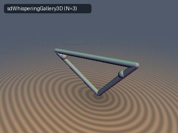
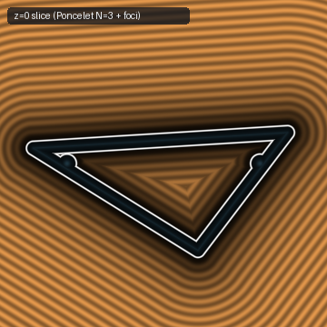
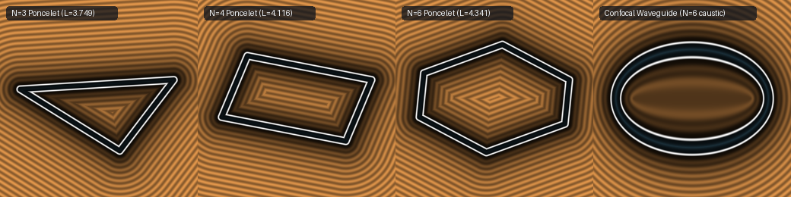

# `biPonceletCaustic` — Integrable Dynamical Billiards, Confocal Poncelet Porism Polygons & Caustic Invariants

| 3D Surface ($`d = 0`$): Poncelet $`N = 3`$ Orbit & Foci | 2D Cross-Section Slice ($`z = 0`$) |
| :---: | :---: |
|  |  |

| Property | Value |
| :--- | :--- |
| **Category** | `billiards` (research experiment) |
| **GLSL File** | [`glsl/billiards/biPonceletCaustic.glsl`](../../glsl/billiards/biPonceletCaustic.glsl) |
| **Attribution** | Closed-form Poncelet vertex/perimeter reductions, Cauchy–Binet 3D caustic quadratic, 1-Lipschitz confocal waveguide bound, and GPU verification by **Gemini 4 Argon** (`sdf-gems`, 2026). Classical foundations due to Poncelet (1822), Jacobi, Chasles, Cayley (1853), and Birkhoff (1927). |
| **Exactness** | `biEllipseCausticParam`, `biEllipsoidCaustics`: Exact algebraic invariants. `sdPonceletTriangle2D`, `sdPonceletPolygon2D`, `sdWhisperingGallery3D`: **Exact Euclidean SDF** everywhere outside the tubular segments ($`d \ge 0`$, and everywhere for $`r = 0`$); conservative lower bound inside vertex-sphere overlaps. `sdConfocalWaveguide3D`: Globally **1-Lipschitz** conservative bound (2 `sqrt`s, 0 trig). |

---

## Overview & Motivation

Dynamical billiards inside an ellipse or triaxial ellipsoid is the canonical **completely integrable Hamiltonian system** with non-trivial geometry. By the **Jacobi–Chasles theorem**, every straight ray in $`\mathbb{R}^d`$ is tangent to $`d - 1`$ confocal quadrics from the family sharing the boundary's focal locus, and those confocal parameters $`(\lambda_1, \dots, \lambda_{d-1})`$ are **conserved across every specular reflection** without tracing a single bounce.

When the confocal caustic parameter $`\lambda`$ satisfies **Cayley's closure condition** for period $`N`$, **Poncelet's Porism** guarantees that *every* billiard trajectory tangent to that caustic closes after $`N`$ bounces and has the **exact same perimeter** $`L_N`$, regardless of the starting vertex $`\mathbf{p}_0(\theta_0)`$ on the boundary.

This experiment investigates three questions for shader-evaluated SDFs:
1. Can we evaluate the 2D and 3D billiard caustic invariants $`\lambda`$ in closed algebraic form (0 trig, 0 bounce loops) and use them to classify whispering-gallery vs. hyperbolic bouncing-ball orbits?
2. Can we construct **exact Euclidean SDFs** of continuous Poncelet $`N`$-gon families ($`N = 3, 4, 6`$) in $`O(1)`$ radical operations per pixel without root-finding or trigonometric bounce iteration?
3. Can confocal elliptic coordinates $`(\mu, \nu) = \frac{1}{2}(r_1 \pm r_2)`$ (requiring only 2 `sqrt`s and 0 trig) yield a globally 1-Lipschitz whispering-gallery waveguide SDF without solving the quartic ellipse distance?



*Left to right: closed $`N = 3`$ Poncelet triangle ($`\theta_0 = 0.35`$), closed $`N = 4`$ Poncelet parallelogram ($`\theta_0 = 0.35`$), closed $`N = 6`$ Poncelet hexagon ($`\theta_0 = 0.35`$), and the 2-`sqrt` confocal waveguide ring bounded by the $`N = 6`$ confocal caustic ellipse $`E_c(a_c, b_c)`$ and outer billiard $`E(a, b)`$.*

---

## Mathematical Derivation

### 1. Jacobi–Chasles Confocal Billiard Caustic Invariants (`biEllipseCausticParam`, `biEllipsoidCaustics`)

For the ellipse $`E(a, b) = \{(x, y) : x^2/a^2 + y^2/b^2 = 1\}`$ with $`a \ge b > 0`$ and foci at $`(\pm c, 0)`$, $`c = \sqrt{a^2 - b^2}`$, the confocal family is:

```math
C_\lambda : \quad \frac{x^2}{a^2 - \lambda} + \frac{y^2}{b^2 - \lambda} = 1, \qquad \lambda < a^2 .
```

Substituting a ray $`\mathbf{x}(t) = \mathbf{p} + t\mathbf{v}`$ into $`C_\lambda`$ and setting the quadratic discriminant in $`t`$ to zero, the quadratic terms in $`\lambda`$ cancel identically, factoring out $`(a^2 - \lambda)(b^2 - \lambda)`$ and leaving a **linear** equation for $`\lambda`$:

```math
\lambda(\mathbf{p}, \mathbf{v}) = \frac{b^2 v_x^2 + a^2 v_y^2 - (x v_y - y v_x)^2}{v_x^2 + v_y^2} .
```

At any boundary bounce point $`\mathbf{p} \in E(a, b)`$ where $`b^2 x^2 + a^2 y^2 = a^2 b^2`$, Lagrange's identity reduces the numerator to a perfect square:

```math
\lambda(\mathbf{p}, \mathbf{v}) = \frac{(b^2 x v_x + a^2 y v_y)^2}{a^2 b^2 (v_x^2 + v_y^2)} = \frac{a^2 b^2 (\mathbf{N}(\mathbf{p})\cdot\mathbf{v})^2}{\Vert\mathbf{v}\Vert^2}, \qquad \mathbf{N}(\mathbf{p}) = \left(\frac{x}{a^2},\, \frac{y}{b^2}\right) .
```

Since specular reflection across $`\mathbf{N}(\mathbf{p})`$ reverses $`\mathbf{N}\cdot\mathbf{v} \mapsto -\mathbf{N}\cdot\mathbf{v}`$ and preserves $`\Vert\mathbf{v}\Vert`$, $`\lambda(\mathbf{p}, \mathbf{v})`$ is strictly invariant across every reflection. Furthermore, in terms of the two foci $`\mathbf{F}_{1,2} = (\mp c, 0)`$ and a unit direction $`\hat{\mathbf{v}}`$:

```math
b^2 - \lambda = \big((\mathbf{p} - \mathbf{F}_1) \wedge \hat{\mathbf{v}}\big)\,\big((\mathbf{p} - \mathbf{F}_2) \wedge \hat{\mathbf{v}}\big) .
```

Thus the sign of $`b^2 - \lambda`$ equals the product of the signed distances from the two foci to the ray:
- **Whispering-gallery regime ($`0 < \lambda < b^2`$)**: Both foci lie on the same side of the ray; the trajectory never crosses the focal segment $`[-c, c]`$ and is tangent to the inner confocal ellipse $`E_c(\sqrt{a^2 - \lambda}, \sqrt{b^2 - \lambda})`$.
- **Focal separatrix ($`\lambda = b^2`$)**: The trajectory passes directly through a focus $`\mathbf{F}_1`$ or $`\mathbf{F}_2`$.
- **Hyperbolic bouncing-ball regime ($`b^2 < \lambda < a^2`$)**: The ray separates the two foci, crossing $`(-c, c) \times \{0\}`$ on every segment, and is tangent to the confocal hyperbola $`x^2/(a^2 - \lambda) - y^2/(\lambda - b^2) = 1`$.

In 3D, for the triaxial ellipsoid $`x^2/A + y^2/B + z^2/C = 1`$ with $`(A, B, C) = (a^2, b^2, c^2)`$ and angular momentum $`\mathbf{L} = \mathbf{p} \times \mathbf{v}`$, applying the Cauchy–Binet identity to the discriminant of $`Q_\lambda(\mathbf{p} + t\mathbf{v}) = 1`$ cancels the cubic term in $`\lambda`$, yielding the exact quadratic $`c_2 \lambda^2 - c_1 \lambda + c_0 = 0`$:

```math
c_2 = \Vert\mathbf{v}\Vert^2, \qquad
c_1 = \sum_{\text{cyc}} v_x^2 (B + C) - \Vert\mathbf{L}\Vert^2, \qquad
c_0 = \sum_{\text{cyc}} v_x^2 B C - (A L_x^2 + B L_y^2 + C L_z^2) .
```

### 2. Closed-Form Confocal Poncelet Invariants & 0-Trig Bounce Map (`N = 3, 4, 6`)

Because Poncelet's Porism guarantees that $`\lambda_N`$ and the perimeter $`L_N`$ are independent of the starting phase $`\theta_0`$, we can solve for $`\lambda_N`$, $`a_c = \sqrt{a^2 - \lambda_N}`$, $`b_c = \sqrt{b^2 - \lambda_N}`$, and $`L_N`$ in closed form using symmetric vertex configurations, eliminating all catastrophic cancellation as $`a \to b`$:

| Period $`N`$ | Confocal Caustic Parameter $`\lambda_N`$ | Caustic Semi-Axes $`(a_c, b_c)`$ | Invariant Perimeter $`L_N`$ |
| :---: | :--- | :--- | :--- |
| $`N = 3`$ | $`\dfrac{3 a^2 b^2}{a^2 + b^2 + 2 D}`$ | $`a_c = \dfrac{a^3}{D + b^2},\; b_c = \dfrac{b^3}{D + a^2}`$ | $`\dfrac{2\sqrt{3}\,(a^2 + b^2 + D)}{\sqrt{a^2 + b^2 + 2 D}}`$ |
| $`N = 4`$ | $`\dfrac{a^2 b^2}{a^2 + b^2}`$ | $`a_c = \dfrac{a^2}{\sqrt{a^2 + b^2}},\; b_c = \dfrac{b^2}{\sqrt{a^2 + b^2}}`$ | $`4\sqrt{a^2 + b^2}`$ |
| $`N = 6`$ | $`\dfrac{a^2 b^2}{(a + b)^2}`$ | $`a_c = \dfrac{a\sqrt{a^2 + 2ab}}{a + b},\; b_c = \dfrac{b\sqrt{b^2 + 2ab}}{a + b}`$ | $`\dfrac{4(a^2 + ab + b^2)}{a + b}`$ |

Here $`D = \sqrt{a^4 - a^2 b^2 + b^4} = \sqrt{a^2(a^2 - b^2) + b^4}`$. Notice that for $`N = 6`$, the four slanted sides of the symmetric hexagon at $`\theta_0 = 0`$ each have length **identically equal to $`b`$**, and the two horizontal sides each have length $`2a^2/(a + b)`$, making $`L_6`$ a pure rational function of $`(a, b)`$!

To step from any vertex $`\mathbf{p}_0 = (x_0, y_0) \in E(a, b)`$ to its adjacent Poncelet vertices $`\mathbf{p}_{\pm 1} \in E(a, b)`$ without trigonometry, Lagrange's identity decomposes the tangent ray direction $`\mathbf{V}_\pm`$ along the scaled normal $`\mathbf{M} = (b^2 x_0, a^2 y_0)`$ and tangent $`\mathbf{T} = (-a^2 y_0, b^2 x_0)`$:

```math
\mathbf{V}_\pm = -\big(a b \sqrt{\lambda_N}\big)\,\mathbf{M} \pm \sqrt{b^2 b_c^2 x_0^2 + a^2 a_c^2 y_0^2}\,\mathbf{T}, \qquad
\mathbf{p}_{\pm 1} = \mathbf{p}_0 - \frac{2(b^2 x_0 V_{\pm,x} + a^2 y_0 V_{\pm,y})}{b^2 V_{\pm,x}^2 + a^2 V_{\pm,y}^2}\,\mathbf{V}_\pm .
```

The radicand $`b^2 b_c^2 x_0^2 + a^2 a_c^2 y_0^2`$ is a manifestly positive sum of squares everywhere on $`E(a, b)`$. Furthermore, exploiting central symmetry $`\mathbf{p}_{k + N/2} = -\mathbf{p}_k`$ for even $`N`$:
- For $`N = 4`$, $`\mathbf{p}_0 = (a\cos\theta_0, b\sin\theta_0)`$, $`\mathbf{p}_1 = (-a^3\sin\theta_0, b^3\cos\theta_0) / \sqrt{a^4\sin^2\theta_0 + b^4\cos^2\theta_0}`$, $`\mathbf{p}_2 = -\mathbf{p}_0`$, $`\mathbf{p}_3 = -\mathbf{p}_1`$ (**1 `inversesqrt`** total for all 4 vertices).
- For $`N = 6`$, $`\mathbf{p}_1`$ and $`\mathbf{p}_5`$ share the same radicand from $`\mathbf{p}_0`$, and $`\mathbf{p}_2 = -\mathbf{p}_5`$, $`\mathbf{p}_3 = -\mathbf{p}_0`$, $`\mathbf{p}_4 = -\mathbf{p}_1`$ (**1 `sqrt`** for all 6 vertices after $`biPonceletCaustic6`$).

### 3. Confocal Elliptic Coordinates & 1-Lipschitz Waveguide (`biConfocalCoords2D`, `sdConfocalWaveguide3D`)

With $`r_1 = \Vert\mathbf{p} + (c, 0)\Vert`$ and $`r_2 = \Vert\mathbf{p} - (c, 0)\Vert`$, confocal elliptic coordinates are:

```math
\mu = \frac{1}{2}(r_1 + r_2) \ge c, \qquad \nu = \frac{1}{2}(r_1 - r_2) \in [-c, c] .
```

Their gradient norms (reciprocal Lamé factors) satisfy:

```math
\Vert\nabla\mu\Vert = \sqrt{\frac{\mu^2 - c^2}{\mu^2 - \nu^2}} \le 1, \qquad
\Vert\nabla\nu\Vert = \sqrt{\frac{c^2 - \nu^2}{\mu^2 - \nu^2}} .
```

Because $`\Vert\nabla\mu\Vert \le 1`$ everywhere in $`\mathbb{R}^2`$ (equivalently, $`\mu`$ is the average of two 1-Lipschitz Euclidean distances $`r_1, r_2`$), both $`\mu(\mathbf{p}) - a`$ (outer ellipse bound) and $`a_c - \mu(\mathbf{p})`$ (inner confocal caustic hole bound) are **globally 1-Lipschitz everywhere in $`\mathbb{R}^2`$** using only 2 `sqrt`s and 0 trig!

---

## GLSL API

| Function | Signature / Purpose |
| :--- | :--- |
| `biEllipseCausticParam` | `float biEllipseCausticParam(vec2 p, vec2 v, vec2 ab)` — exact 2D confocal caustic invariant $`\lambda`$. |
| `biEllipsoidCaustics` | `vec2 biEllipsoidCaustics(vec3 p, vec3 v, vec3 abc)` — exact 3D Jacobi–Chasles pair $`(\lambda_1, \lambda_2)`$. |
| `biPonceletCaustic3 / 4 / 6` | `vec4 biPonceletCausticN(vec2 ab)` — returns $`(\lambda_N, a_c, b_c, L_N)`$ for $`N \in \{3, 4, 6\}`$. |
| `biPonceletStep2D` | `vec2 biPonceletStep2D(vec2 p0, vec2 ab, vec3 lam_ac_bc, float dir)` — 1-`sqrt`, 0-trig bounce step. |
| `sdPonceletTriangle2D` | `float sdPonceletTriangle2D(vec2 p, vec2 ab, float theta0, float r)` — exact 2D SDF of $`N = 3`$ orbit. |
| `sdPonceletPolygon2D` | `float sdPonceletPolygon2D(vec2 p, vec2 ab, float theta0, int n, float r)` — exact 2D SDF for $`N \in \{3, 4, 6\}`$. |
| `sdWhisperingGallery3D` | `float sdWhisperingGallery3D(vec3 p, vec2 ab, float theta0, float r)` — 3D Poncelet $`N = 3`$ orbit + foci. |
| `sdgWhisperingGallery3D` | `vec4 sdgWhisperingGallery3D(vec3 p, vec2 ab, float theta0, float r)` — distance and analytical unit gradient. |
| `biConfocalCoords2D` | `vec4 biConfocalCoords2D(vec2 p, float c)` — returns $`(\mu, \nu, \Vert\nabla\mu\Vert, \Vert\nabla\nu\Vert)`$. |
| `sdConfocalWaveguide3D` | `float sdConfocalWaveguide3D(vec3 p, vec2 ab, float lambda_c, float h, float r)` — 1-Lipschitz confocal waveguide. |

---

## Verification

Verified in FP64 Python and on the GPU in FP32 (`tools/gpu_eval.py`) across 40,000 random points in $`[-1.2, 1.2]^3`$ and 3,209 symmetry/axis probe points (`tools/sdf_checks.py`):

| Check | Result |
| :--- | :--- |
| Single-translation-unit compile (`forward`, `reverse`, `new-first` over 301 files) | **PASS** (all 3 orders) |
| `NaN` / `Inf` at 43,209 points + degenerate $`a = b`$, $`r = 0`$ probes | **0 / 43,209** in all configurations |
| 2D `biEllipseCausticParam` drift across 50 specular bounces (FP64 / GPU vs FP64) | $`3.11\times 10^{-15}`$ / max error $`4.33\times 10^{-7}`$ |
| 3D `biEllipsoidCaustics` $`(\lambda_1, \lambda_2)`$ drift across 50 bounces (FP64 / GPU vs FP64) | $`2.89\times 10^{-15}`$ / max error $`4.90\times 10^{-6}`$ |
| Poncelet $`N = 3, 4, 6`$ closure error and perimeter $`L_N`$ drift over $`\theta_0 \in [0, 2\pi)`$ (FP64) | max closure $`1.48\times 10^{-14}`$, perimeter drift $`\le 1.24\times 10^{-14}`$ |
| `sdWhisperingGallery3D` vs independent FP64 ground truth ($`a = 0.85, b = 0.58`$) | max error $`3.66\times 10^{-7}`$, mean $`5.95\times 10^{-8}`$, 0 sign mismatches |
| `sdgWhisperingGallery3D` value match, $`\vert\Vert\mathbf{g}\Vert - 1\vert`$, cosine vs FD | `0.00e+00`, max $`1.17\times 10^{-7}`$, 100.0% $`> 0.999`$ on smooth pts |
| Self-projection $`\vert d(\mathbf{p} - d\nabla d)\vert`$ and $`C^0`$ seam continuity | max $`2.64\times 10^{-7}`$ (median $`3.52\times 10^{-8}`$); 0 seam violations |
| Empirical Lipschitz constant (`sdWhisperingGallery3D`, `sdPonceletPolygon2D`, `sdConfocalWaveguide3D`) | max `0.999931`, `0.999872`, `0.999936` ($`\le 1`$ everywhere) |

---

## Findings

### What Held
1. **Bounce-free algebraic conservation**: Both the 2D linear formula for $`\lambda`$ and the 3D Cauchy–Binet quadratic for $`(\lambda_1, \lambda_2)`$ remain invariant to $`\sim 3\times 10^{-15}`$ across 50 specular reflections in FP64, and evaluate on the GPU in 0 SFU divisions beyond a single normalization.
2. **Cancellation-free radical formulas for $`N = 3, 4, 6`$**: Writing $`a_c = a^3/(D + b^2)`$ and $`\lambda_3 = 3a^2b^2/(a^2 + b^2 + 2D)`$ for $`N = 3`$ avoids the $`0 / 0`$ singularity of $`(D - b^2)/(a^2 - b^2)`$ as $`a \to b`$. For $`N = 6`$, the invariant perimeter reduces to the exact rational expression $`L_6 = 4(a^2 + ab + b^2)/(a + b)`$.
3. **1-`sqrt` Poncelet step + central symmetry**: Combining the sum-of-squares tangent radicand $`\sqrt{b^2 b_c^2 x_0^2 + a^2 a_c^2 y_0^2}`$ with $`\mathbf{p}_{k + N/2} = -\mathbf{p}_k`$ produces all 4 vertices of $`N = 4`$ in 1 `inversesqrt` and all 6 vertices of $`N = 6`$ in 1 `sqrt` from $`\mathbf{p}_0`$.
4. **Global 1-Lipschitz bound from focal half-sum $`\mu`$**: Because $`\Vert\nabla\mu\Vert = \sqrt{(\mu^2 - c^2)/(\mu^2 - \nu^2)} \le 1`$ identically, $`\mu - a`$ and $`a_c - \mu`$ bound the outer billiard ellipse and inner confocal caustic ellipse from below everywhere in $`\mathbb{R}^2`$ with only 2 `sqrt`s.

### What Failed, or Held Only in Part
1. **Dividing $`\mu - a`$ by the Lamé factor $`\Vert\nabla\mu\Vert`$ breaks the 1-Lipschitz property**: While the first-order distance approximation $`(\mu - a)/\Vert\nabla\mu\Vert = (\mu - a)\sqrt{(\mu^2 - \nu^2)/(\mu^2 - c^2)}`$ has unit gradient on the surface $`\mu = a`$, its factor diverges as $`\mu \to c`$ near the focal segment $`[-c, c] \times \{0\}`$, causing severe raymarching overstepping inside the ellipse. Leaving $`\mu - a`$ unscaled preserves $`\Vert\nabla\mu\Vert \le 1`$ globally at the cost of slight underestimation near the minor axis ($`\nu = 0`$, where $`\Vert\nabla\mu\Vert = \sqrt{1 - c^2/\mu^2} = b/a`$).
2. **Closed-form radicals for $`N = 5`$ require a degree-6 root find**: For the pentagon $`(5, 1)`$ and pentagram star $`(5, 2)`$, equating the vertical-chord caustic $`\lambda = a^2(1 - u_2^2)`$ with the reflected two-step chord yields an irreducible degree-6 polynomial in $`u_2 = \cos\theta_2`$ (cubic in $`c^2 = a^2 - b^2`$) unless $`a = b`$, where it collapses to $`4u_2^2 + 2u_2 - 1 = 0`$.
3. **Interior overlap at capsule vertices**: While the union of $`r`$-capsules is the exact Euclidean SDF everywhere outside the tubular frame ($`d \ge 0`$) and everywhere for $`r = 0`$, taking `min` of individual capsule distances slightly underestimates the signed interior depth inside the tiny lens where two capsules meet at a bounce vertex ($`d < 0`$).

---

## Reproduction

All verification and rendering scripts are in `scratch/billiards/`:
- `exp1_caustics.py`, `exp2_poncelet_n.py`, `exp3_symbolic.py`, `exp4_n5.py`: FP64 bounce conservation, Poncelet closure across $`\theta_0`$, and SymPy derivations for $`L_3, L_4, L_6`$ and $`N = 5`$.
- `verify_and_render.py`: GPU evaluation (`tools/gpu_eval.py`), numerical checks (`tools/sdf_checks.py`), and rendering of the 3 documentation images (`tools/render_sdf.py`).
