# 5. Booleans, Fillets & Smooth Minimums

[**← Back to Main `sdf-gems` README**](../../README.md) · **GLSL Headers**: [`glsl/booleans/`](../../glsl/booleans/) (26 headers)

CSG boolean operators, polynomial and LogSumExp smooth minimums, architectural corner profiles (chamfers, stairs, columns, rabbets, engravings), angle-invariant Gram-metric rolling-ball fillets, Hermitian eigenvalue repulsion, and obstacle-problem envelopes.

## Contents

- **Sharp CSG & Architectural Joint Profiles** (11)
- **Smooth Minimums, Gram Fillets & Variational Blends** (15)

## Sharp CSG & Architectural Joint Profiles

| Preview | Function | Summary |
| :---: | :--- | :--- |
| 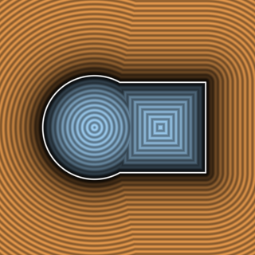 | [**`opUnion`**](opUnion.md) [`glsl`](../../glsl/booleans/opUnion.glsl) · Exterior | Sharp union $`\min(d_1, d_2)`$; exact in exterior, lower bound inside overlap |
| 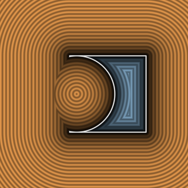 | [**`opSubtraction`**](opSubtraction.md) [`glsl`](../../glsl/booleans/opSubtraction.glsl) · Bound | Sharp subtraction $`\max(-d_1, d_2)`$; conservative lower bound |
| 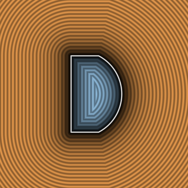 | [**`opIntersection`**](opIntersection.md) [`glsl`](../../glsl/booleans/opIntersection.glsl) · Bound | Sharp intersection $`\max(d_1, d_2)`$; underestimates in exterior corner wedges |
|  | [**`opXor`**](opXor.md) [`glsl`](../../glsl/booleans/opXor.glsl) · **Exact** | **Also**: `opXorRound`, `opXorChamfer`, `opXorRoundOblique`, `sdgXorRound`. Exact signed XOR & 1-`sqrt` isometric bisector-fold rounded/chamfered/oblique XOR (resolves 4-way contact singularity) |
| 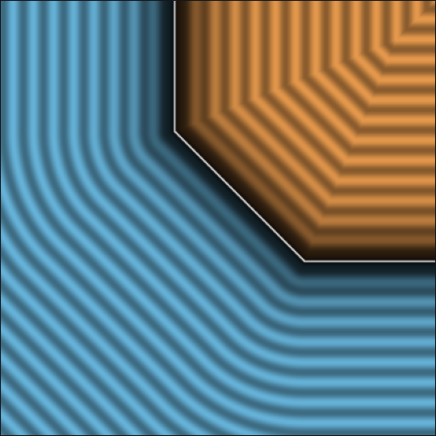 | [**`opUnionChamfer`**](opUnionChamfer.md) [`glsl`](../../glsl/booleans/opUnionChamfer.glsl) · **Exact** | Corner-local exact Euclidean $`45^\circ`$ & oblique chamfer booleans (fixes interior $`a=b \to -\infty`$ distortion) |
| 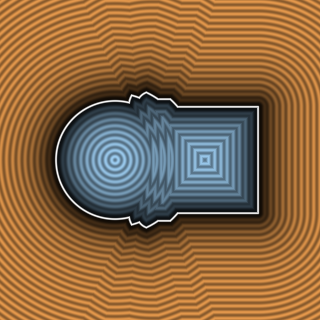 | [**`opUnionStairs`**](opUnionStairs.md) [`glsl`](../../glsl/booleans/opUnionStairs.glsl) · **Exact** | 1-`sqrt` exact Euclidean $`n`$-tier stairs booleans (replaces $`\ell_\infty`$ square corners & unbounded interior zig-zag) |
| 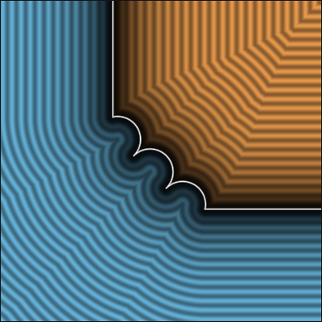 | [**`opUnionColumns`**](opUnionColumns.md) [`glsl`](../../glsl/booleans/opUnionColumns.glsl) · **Exact** | 1-`sqrt` exact Euclidean columned union, subtraction, and intersection (fixes `hg_sdf` $`a=r,b=r`$ jump & $`+24.1\%`$ overstep) |
| 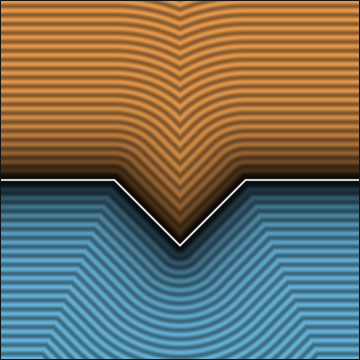 | [**`opEngrave`**](opEngrave.md) [`glsl`](../../glsl/booleans/opEngrave.glsl) · **Exact** | **Also**: `opPipe`. 0/1-`sqrt` exact Euclidean V-groove engraving, oblique `opEngraveOblique`, & Gram-Schmidt `opPipeOblique` |
| 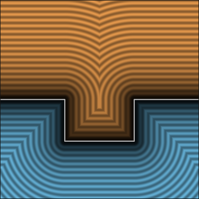 | [**`opGroove`**](opGroove.md) [`glsl`](../../glsl/booleans/opGroove.glsl) · **Exact** | **Also**: `opTongue`. 4-line 1-`sqrt` exact Euclidean carpenter's tongue, De Morgan dual groove, & oblique `opTongueOblique` / `opGrooveOblique` |
|  | [**`opUnionRound3`**](opUnionRound3.md) [`glsl`](../../glsl/booleans/opUnionRound3.glsl) · **Exact** | **Also**: `opUnionChamfer3`, `opUnionChamferOct3`, `sdgRound3`, `sdgChamfer3`, `sminCubicGeom3`. 0/1-`sqrt` $`S_3`$-symmetric ternary 3-way corner booleans (eliminates $`9.74^\circ`$ normal tilt & $`41.4\%`$ skew of chained binary chamfers) |
| 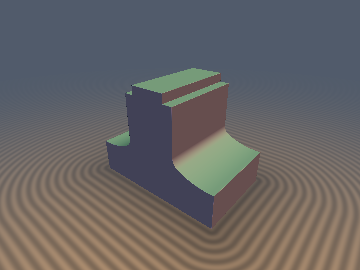 | [**`opUnionAsym`**](opUnionAsym.md) [`glsl`](../../glsl/booleans/opUnionAsym.glsl) · **Exact** | **Also**: `opUnionFilletAsym`, `opUnionChamferAsym`, `opRabbet`, `opUnionRabbet`, `sdgFilletAsym`, `sdgChamferAsym`, `sdgRabbet`. 0-trig exact Euclidean $`G^1`$ bi-arc asymmetric fillet ($`r_a \ne r_b`$), unequal-leg chamfer, & stepped rabbet + 3D gradients (`0%` overstep vs $`+53.3\%`$ for elliptical scaling) |

## Smooth Minimums, Gram Fillets & Variational Blends

| Preview | Function | Summary |
| :---: | :--- | :--- |
|  | [**`sminQuadratic`**](sminQuadratic.md) [`glsl`](../../glsl/booleans/sminQuadratic.glsl) · Bound | **Also**: `smaxQuadratic`, `sminQuadraticBlend`, `sdgSmoothQuadratic`. $`C^1`$ polynomial smooth minimum, material blend, & 3D gradient |
|  | [**`sminCubic`**](sminCubic.md) [`glsl`](../../glsl/booleans/sminCubic.glsl) · Bound | **Also**: `sminCubicBlend`, `sdgSmoothCubic`, `sminQuartic`, `sdgSmoothQuartic`. $`C^2`$ cubic & $`C^2`$-symmetric quartic smooth minimums + 3D gradients |
| 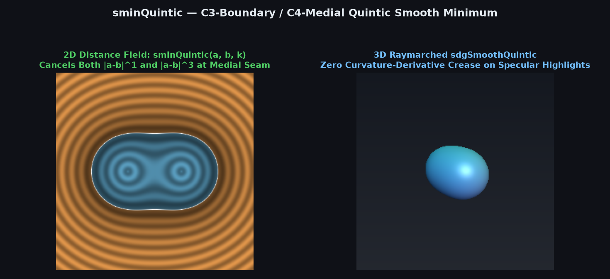 | [**`sminQuintic`**](sminQuintic.md) [`glsl`](../../glsl/booleans/sminQuintic.glsl) · Bound | **Also**: `sdgSmoothQuintic`, `sminSeptic`, `sdgSmoothSeptic`, `sdgSmoothQuinticOblique`. Division-free $`C^3`$-continuous quintic and $`C^4`$-continuous septic polynomial smooth minimums with $`C^2`$/$`C^3`$ normals |
|  | [**`sminCircular`**](sminCircular.md) [`glsl`](../../glsl/booleans/sminCircular.glsl) · Bound | **Also**: `smaxCircular`, `sdgSmoothCircular`. Circular profile along $`\Vert a - b\Vert`$ with 1-shared-`sqrt` analytical 3D gradient |
| 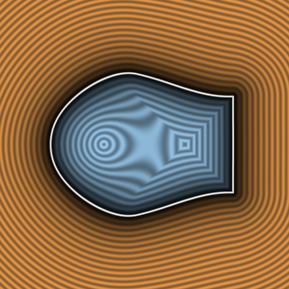 | [**`sminCircularApprox`**](sminCircularApprox.md) [`glsl`](../../glsl/booleans/sminCircularApprox.glsl) · Bound | Algebraic `[3/1]` Padé rational circular smooth minimum ($`11\times`$ lower error, 1 fewer multiply) |
|  | [**`sminCircularGeom`**](sminCircularGeom.md) [`glsl`](../../glsl/booleans/sminCircularGeom.glsl) · Orthogonal | Corner-local circular fillet for $`\nabla a \perp \nabla b`$; overestimates when $`\nabla a \cdot \nabla b > 0`$ |
| 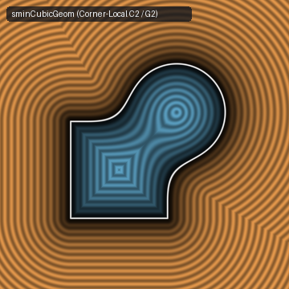 | [**`sminCubicGeom`**](sminCubicGeom.md) [`glsl`](../../glsl/booleans/sminCubicGeom.glsl) · **Conservative** | Corner-local, associative, $`C^2`$ ($`G^2`$ curvature-continuous) $`\ell_3`$ Lamé smooth minimum ($`2^{-1/6} \le \Vert \nabla f\Vert _2 \le 1`$) |
| 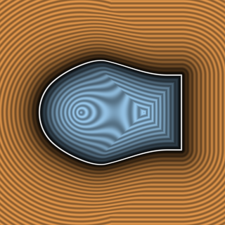 | [**`sminLocalOblique`**](sminLocalOblique.md) [`glsl`](../../glsl/booleans/sminLocalOblique.glsl) · Bound | Pure-scalar corner-local, rigid, conservative smooth minimum parameterized by $`c \ge \nabla a \cdot \nabla b`$ |
| 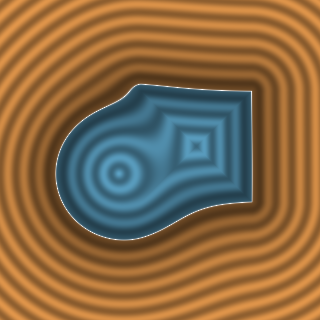 | [**`sminExp`**](sminExp.md) [`glsl`](../../glsl/booleans/sminExp.glsl) · **Conservative** | **Also**: `sdgSmoothExp`, `sminExp3`, `sminExp4`, `sminSigmoid`, `sminRoot`, `sdgSmoothRoot`. Overflow-free 1-`exp2` shift-stabilized LogSumExp ($`50\%`$ fewer `exp2`, $`0\%`$ FP32/FP16 `Inf`/`NaN`), seam-safe sigmoid, & conjugate root smooth minimums |
| 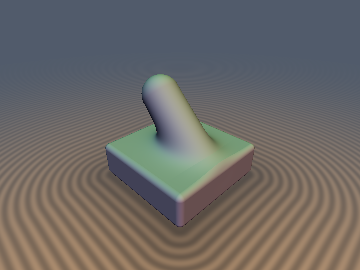 | [**`sminVaradhan`**](sminVaradhan.md) [`glsl`](../../glsl/booleans/sminVaradhan.glsl) · **Exact** | **Also**: `sdgSminGram`, `sdgSmaxGram`, `sdgSminGram2D`, `sdgSmaxGram2D`, `sminGram`, `smaxGram`, `sdgSminVaradhan`, `sminKelvin`. Exact Gram-metric constant-radius rolling-ball fillets and angle-aware Varadhan–Eikonal smooth booleans across all $`\theta \in (0, \pi)`$ |
| 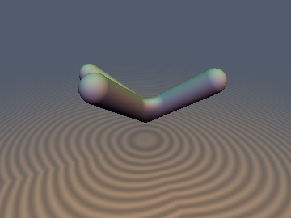 | [**`sdgSminGram3`**](sdgSminGram3.md) [`glsl`](../../glsl/booleans/sdgSminGram3.glsl) · **Exact** | **Also**: `sdgSmaxGram3`, `sdhSminGram`, `sdhSminGram3`. Order-independent $`S_3`$-symmetric exact 3-way contravariant Gram-metric trihedral rolling-ball fillets and 2-jet Weingarten curvature-propagating booleans |
| 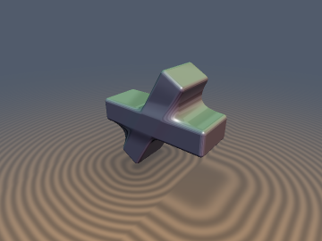 | [**`sdgSminG2Gram`**](sdgSminG2Gram.md) [`glsl`](../../glsl/booleans/sdgSminG2Gram.glsl) · **Exact** | **Also**: `sdgSmaxG2Gram`, `sdgSubG2Gram`, `sdgSminG2Gram2D`, `sdgSmaxG2Gram2D`, `sminG2Gram`, `smaxG2Gram`. Angle-invariant, corner-local, `0-SFU`-early-exit $`G^2`$ curvature-continuous exact Eikonal smooth booleans ($`\Vert\nabla d\Vert = 1`$, $`\Delta\kappa = 0`$ across all $`\alpha \in (0, \pi)`$) |
| 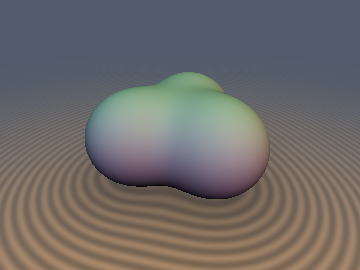 | [**`rmEigenRepulsion`**](rmEigenRepulsion.md) [`glsl`](../../glsl/booleans/rmEigenRepulsion.glsl) · Globally 1-Lipschitz Bound | **Also**: `rmEigenStates3`, `opEigenUnion3`, `sdgEigenUnion3`, `opEigenIntersection3`, `sdVandermondeTube3D`, `sdEigenTripod3D`. $`S_3`$-symmetric $`3\times 3`$ Hermitian eigenvalue repulsion smooth booleans, 0-`sqrt` adjugate Hellmann-Feynman gradients, and frustrated Vandermonde half-gap tubes isolating 1D Weyl diabolical degeneracy curves |
| 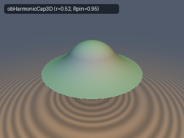 | [**`obElasticEnvelope`**](obElasticEnvelope.md) [`glsl`](../../glsl/booleans/obElasticEnvelope.glsl) · **Exact** | **Also**: `obTautBridge`, `sdgTautBridge`, `obHarmonicCap3D`, `sdgHarmonicCap3D`, `obLogCap2D`, `obBiharmonicPlate`, `opObstacleBridge`. Classical variational inequality $`\min(-\Delta u, u - \psi) = 0`$ and $`C^{1,1}`$ free-boundary shrink-wrap membranes with radical-cancelled contact radii and 0 outer-cap bloating |
| 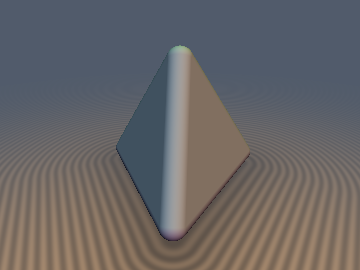 | [**`mpMoreauOpening`**](mpMoreauOpening.md) [`glsl`](../../glsl/booleans/mpMoreauOpening.glsl) · Certified Bound / **Exact** (convex) | **Also**: `mpOpeningFromJets3`, `mpOpeningFromJets4`, `sdOpenedTetrahedron`, `sdOpenedPolyhedron`, `sdClosedCross3D`, `mpWulffCrystalOffset`. Black-box morphological opening & closing via dual-Gram active-set supporting-plane QPs (`8.5e-7` GPU err across topological edge collapse; 4-jet Farkas total-erosion certificate) and 0-overstep proximal Wulff crystal offsets |
