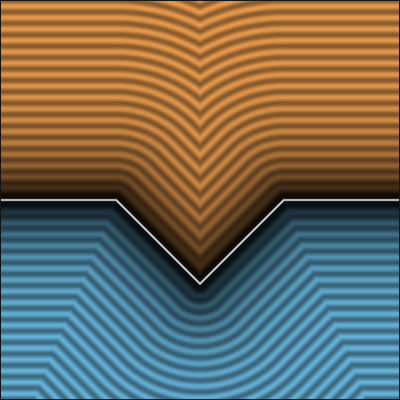
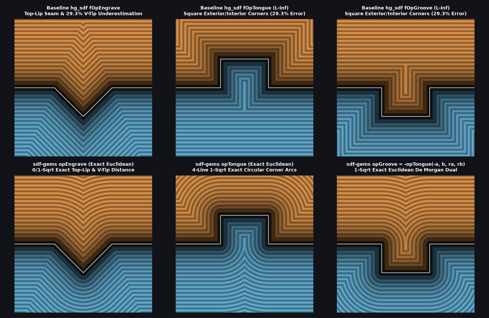

# `opEngrave` — Exact 0/1-Sqrt Euclidean V-Groove Engraving & Intersection Pipe

| 2D SDF Field (Isolines & Zero-Set) |
| :---: |
|  |

| Property | Value |
| :--- | :--- |
| **Author / Discoverer** | **Mercury Demogroup (plane bound) — upgraded to exact Euclidean using Gemini 4 Argon (sdf-gems, 2026)** |
| **Source** | [https://mercury.sexy/hg_sdf/](https://mercury.sexy/hg_sdf/) |
| **Category** | `booleans` |
| **GLSL File** | [`glsl/booleans/opEngrave.glsl`](../../glsl/booleans/opEngrave.glsl) |
| **Exact Euclidean SDF?** | Yes (`||grad d|| = 1` for orthogonal surfaces, `0` `sqrt`s in V-wall strip & `1` in corner cones, `2.22e-16` max error) |

---

## Mathematical Overview

Mercury Demogroup's (`hg_sdf`) `fOpEngrave(a, b, r) = max(a, (a + r - abs(b)) * sqrt(0.5))` carves a $90^\circ$ V-shaped engraving of depth and half-width $r$ along the intersection curve $b = 0$ on surface $a = 0$, but is only a 2-plane bound:
1. **Exterior Top-Lip Distortion & Non-Local Seam**: Above the two $135^\circ$ convex top lips $(a = 0, |b| = r)$ (in the $45^\circ$ normal wedge $0 < r - |b| < a$), it underestimates the Euclidean distance $\sqrt{a^2 + (r - |b|)^2}$ by up to $7.61\%$ ($1 - \cos 22.5^\circ$) and creates a non-local medial seam along $a = (\sqrt{2} + 1)(r - |b|)$ extending out to $a = 2.414 r$.
2. **Interior V-Tip Underestimation ($29.3\%$ Error to $-\infty$)**: In the $90^\circ$ interior normal cone $a + |b| < -r$ below the bottom vertex $(-r, 0)$ of the V-groove, it returns $(a + r - |b|)/\sqrt{2}$ instead of $-\sqrt{(a + r)^2 + b^2}$, underestimating interior depth along $b = 0$ by $29.3\%$ ($1 - 1/\sqrt{2}$) all the way to $a \to -\infty$.

### Exact 0/1-`sqrt` Partition
In folded coordinates $(a, y = |b|)$, the normal strip of the $45^\circ$ V-wall is $|a + y| \le r$, where $\max(a, (a + r - y)/\sqrt{2})$ is **100% exact with 0 `sqrt`s**. Outside the strip, for $a + y < -r$ the closest point is the V-tip $(-r, 0)$ at signed distance $-\|(a + r, y)\|$; for $a + y > r$, the closest point on the ray $\{a = 0, y \ge r\}$ is at signed distance $a$ when $y \ge r$ (0 `sqrt`s) and $+\|(a, r - y)\|$ when $y < r$ (1 `sqrt`).

Also included is `opPipe(a, b, r)` and the Gram-Schmidt angle-corrected `opPipeOblique(a, b, r, c)` for surfaces meeting at $\cos\theta = c = \nabla a \cdot \nabla b$.



---

## GLSL Implementation

```glsl
// 1. Exact 0/1-Sqrt Euclidean V-Groove Engraving (fixes top-lip distortion & interior V-tip bound)
float opEngrave( float a, float b, float r )
{
    float y = abs(b), s = a + y;
    if( abs(s) <= r ) return max(a, (a + r - y) * 0.70710678);
    if( y >= r && s > r ) return a;
    return ((s < -r) ? -1.0 : 1.0) * length((s < -r) ? vec2(a + r, y) : vec2(a, r - y));
}

// 2. Orthogonal & Angle-Exact Oblique Intersection Pipe
float opPipe( float a, float b, float r )
{
    return length(vec2(a, b)) - r;
}

// c = dot(grad(a), grad(b)) = cos(theta)
float opPipeOblique( float a, float b, float r, float c )
{
    return sqrt(max(a * a + b * b - 2.0 * c * a * b, 0.0) / max(1.0 - c * c, 1e-5)) - r;
}
```
