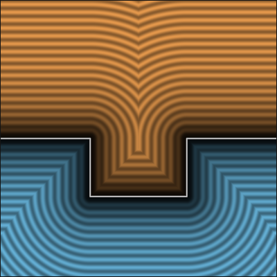
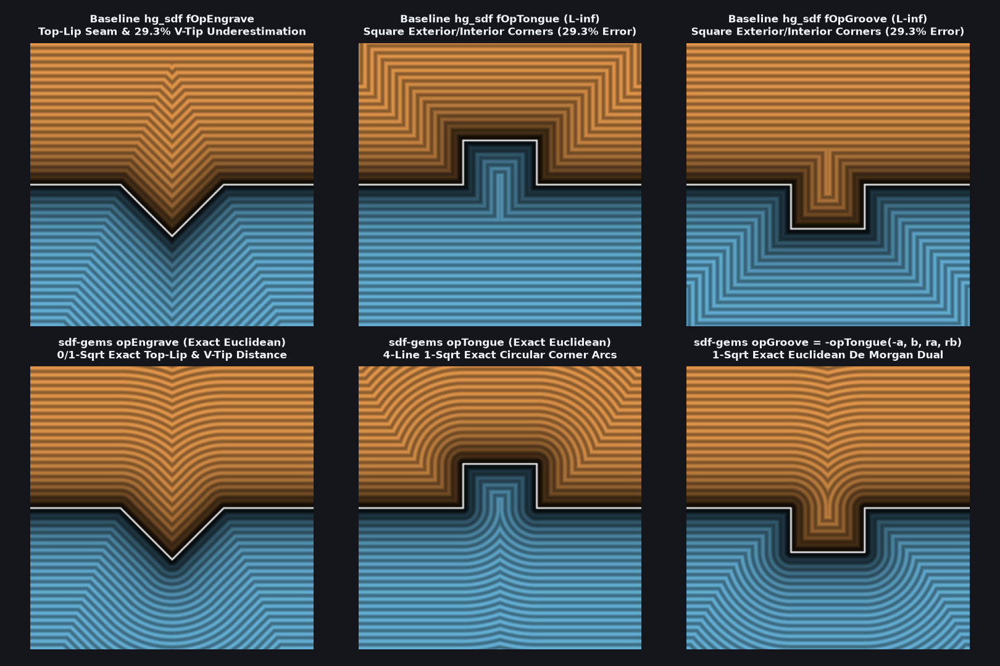

# `opGroove` & `opTongue` — Exact 1-Sqrt Euclidean Carpenter's Tongue & Groove Joints

| 2D SDF Field (Isolines & Zero-Set) |
| :---: |
|  |

| Property | Value |
| :--- | :--- |
| **Author / Discoverer** | **Mercury Demogroup ($\ell_\infty$ bound) — upgraded to exact Euclidean using Gemini 4 Argon (sdf-gems, 2026)** |
| **Source** | [https://mercury.sexy/hg_sdf/](https://mercury.sexy/hg_sdf/) |
| **Category** | `booleans` |
| **GLSL File** | [`glsl/booleans/opGroove.glsl`](../../glsl/booleans/opGroove.glsl) |
| **Exact Euclidean SDF?** | Yes (`||grad d|| = 1` for orthogonal surfaces, `1` `sqrt`, `0.0` error vs. `29.3%` in `hg_sdf`) |

---

## Mathematical Overview

Mercury Demogroup's (`hg_sdf`) `fOpTongue(a, b, ra, rb) = min(a, max(a - ra, abs(b) - rb))` and `fOpGroove(a, b, ra, rb) = max(a, min(a + ra, rb - abs(b)))` form a rectangular carpenter's tenon/tongue of height $r_a$ and half-width $r_b$ (or mortise/groove of depth $r_a$ and half-width $r_b$) along the intersection $b = 0$ on surface $a = 0$. However, because they use pure `min`/`max` ($\ell_\infty$ Chebyshev metrics) with no Euclidean corner distance, they **underestimate exterior and interior $90^\circ$ corner distances by $29.3\%$ ($1 - 1/\sqrt{2}$)**, produce square offset contours instead of circular fillets, and create $45^\circ$ medial seams extending to infinity.

### Exact 4-Line, 1-`sqrt` Corner Duality & De Morgan Identity
In folded coordinates $(a, y = |b|)$:
1. **`opTongue(a, b, ra, rb)`**: The boundary has one convex outward $90^\circ$ corner at $O = (r_a, r_b)$ with local offset $q = (a - r_a, |b| - r_b)$ and one concave inward $90^\circ$ corner at $I = (0, r_b)$ with local offset $i = (-a, r_b - |b|)$. A point lies outside the solid iff $e = \min(a, \max(q_x, q_y)) > 0$. Evaluating a single `l = length(max(e ? q : i, 0.0))` returns `e ? min(a, l) : -min(ra - a, l)` with **`0.0` error across all of $\mathbb{R}^2$**.
2. **`opGroove(a, b, ra, rb)`**: Because a groove of depth $r_a$ and half-width $r_b$ cut into $a \le 0$ is the exact complement of a tongue protruding from $-a \le 0$, `opGroove(a, b, ra, rb) = -opTongue(-a, b, ra, rb)` is 100% exact across both exterior and interior!



### Benchmark Comparison ($r_a = 0.5, r_b = 0.4$ on $[-1.5, 1.5]^2$)

| Operator | `hg_sdf` Max Exterior Error | `hg_sdf` Max Interior Error | `sdf-gems` Max Exterior Error | `sdf-gems` Max Interior Error | `sqrt` Count |
| :--- | :---: | :---: | :---: | :---: | :---: |
| **`opTongue`** | `0.4142` (`29.3%`) | `0.1657` (`29.3%`) | **`0.00e+00`** | **`0.00e+00`** | **`1`** |
| **`opGroove`** | `0.1657` (`29.3%`) | `0.4142` (`29.3%`) | **`0.00e+00`** | **`0.00e+00`** | **`1`** |
| **`opEngrave`** | `0.0992` (`7.6%`) | `0.2929` (`29.3%`) | **`1.11e-16`** | **`2.22e-16`** | **`0` / `1`** |

---

## GLSL Implementation

```glsl
// 1. Exact 4-Line 1-Sqrt Euclidean Carpenter's Tongue
float opTongue( float a, float b, float ra, float rb )
{
    vec2  q = vec2(a - ra, abs(b) - rb), i = vec2(-a, -q.y);
    bool  e = min(a, max(q.x, q.y)) > 0.0;
    float l = length(max(e ? q : i, 0.0));
    return e ? min(a, l) : -min(ra - a, l);
}

// 2. Exact 1-Sqrt Euclidean Carpenter's Groove (exact De Morgan dual of opTongue)
float opGroove( float a, float b, float ra, float rb )
{
    return -opTongue(-a, b, ra, rb);
}

// 3. Angle-Exact Oblique Carpenter's Tongue & Groove via Gram-Schmidt Surface-Anchored Orthonormal Map
// c = dot(grad(a), grad(b)) = cos(theta)
float opTongueOblique( float a, float b, float ra, float rb, float c )
{
    return opTongue(a, (b - c * a) * inversesqrt(max(1.0 - c * c, 1e-5)), ra, rb);
}

float opGrooveOblique( float a, float b, float ra, float rb, float c )
{
    return -opTongueOblique(-a, b, ra, rb, -c);
}
```
