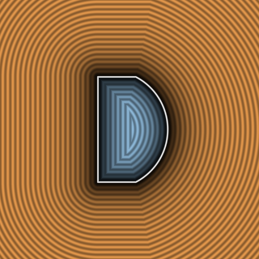

# `opIntersection` — Hard Boolean Intersection



| Property | Value |
| :--- | :--- |
| **Author / Discoverer** | **Inigo Quilez** |
| **Source** | [https://iquilezles.org/articles/distfunctions/](https://iquilezles.org/articles/distfunctions/) |
| **Category** | `booleans` |
| **GLSL File** | [`glsl/booleans/opIntersection.glsl`](../../glsl/booleans/opIntersection.glsl) |
| **Exact Euclidean SDF?** | No (bound in exterior corner) |

---

## Mathematical Overview

Computes $\max(d_1, d_2)$. Note: underestimates the true Euclidean distance in the exterior normal cone where both $d_1 > 0$ and $d_2 > 0$; see [`sdgWedgeIntersection`](../gradients3d/sdgWedgeIntersection.md) for the exact Euclidean fix.

---

## GLSL Implementation

```glsl
float opIntersection( float d1, float d2 ) { return max(d1, d2); }
```
