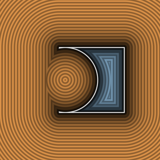

# `opSubtraction` — Hard Boolean Subtraction



| Property | Value |
| :--- | :--- |
| **Author / Discoverer** | **Inigo Quilez** |
| **Source** | [https://iquilezles.org/articles/distfunctions/](https://iquilezles.org/articles/distfunctions/) |
| **Category** | `booleans` |
| **GLSL File** | [`glsl/booleans/opSubtraction.glsl`](../../glsl/booleans/opSubtraction.glsl) |
| **Exact Euclidean SDF?** | No (bound near seam) |

---

## Mathematical Overview

Computes $`\max(-d_1, d_2)`$.

---

## GLSL Implementation

```glsl
float opSubtraction( float d1, float d2 ) { return max(-d1, d2); }
```
