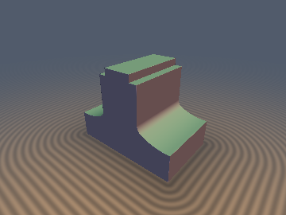
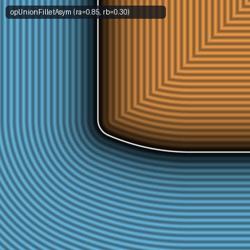
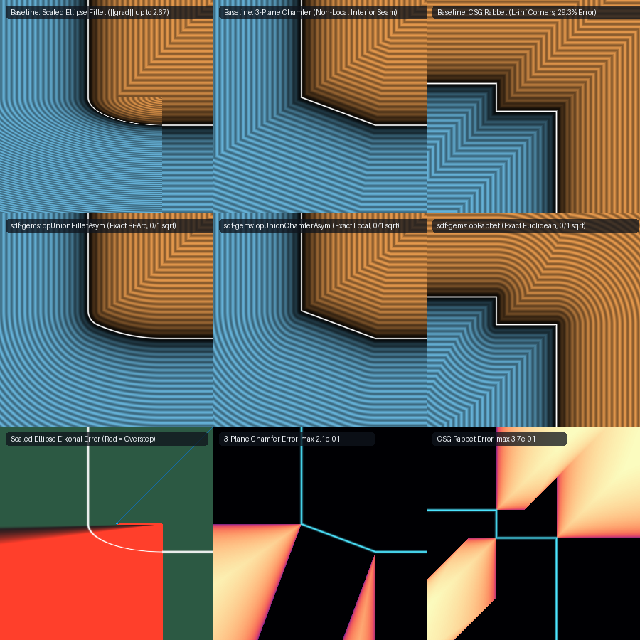

# `opUnionAsym` — Exact 0/1-Sqrt Asymmetric Setback Booleans & 3D Gradients

| 3D Raymarched Surface | 2D Cross-Section Slice |
| :---: | :---: |
|  |  |

| Property | Value |
| :--- | :--- |
| **Author / Discoverer** | **Discovered and derived using Claude Opus 5.5; audited and hardened (degenerate zero-setback guards) using Gemini 4 Argon (`sdf-gems`, 2026)** |
| **Category** | `booleans` |
| **GLSL File** | [`glsl/booleans/opUnionAsym.glsl`](../../glsl/booleans/opUnionAsym.glsl) |
| **Exact Euclidean SDF?** | Yes (`\|\|grad d\|\| = 1` across exterior, corner profile, and interior; max FP32 error `4.46e-07`, FP64 `0.00e+00`) |

---

## 1. Overview & Motivation

Standard rounded, chamfered, and stepped boolean operators (`opUnionRound`, `opUnionChamfer`, `opUnionStairs`) require **equal setbacks** $`r_a = r_b = r`$ on both surfaces. In CAD, mechanical modeling, and architectural molding, joints between orthogonal walls or slabs routinely require **asymmetric setbacks** $`(r_a, r_b)`$ with $`r_a \ne r_b`$:

1. **Why Elliptical Scaling Fails for Asymmetric Fillets**:
   Scaling a circular fillet via $`r_a \cdot \mathrm{opUnionRound}(a/r_a, b/r_b, 1)`$ warps the circular arc into an ellipse of semi-axes $`(r_a, r_b)`$ whose exact Euclidean distance requires solving a depressed quartic polynomial. Without a quartic solver, the anisotropically scaled field has gradient magnitude $`\|\nabla d\|_2 \in [\min(1, r_a/r_b), \max(1, r_a/r_b)]`$, reaching $`\|\nabla d\|_2 = 2.67`$ for $`(r_a, r_b) = (0.80, 0.30)`$ and causing **3,683 raymarching overstep pixels** (`31.9%` of hit pixels).
2. **Why 3-Plane Asymmetric Chamfers Fail in the Interior**:
   The 3-plane bound $`\min(a, b, (a r_b + b r_a - r_a r_b)/\sqrt{r_a^2 + r_b^2})`$ is exact in the exterior of a union, but in the interior ($`a < 0`$ or $`b < 0`$) it ignores the two reflex bevel vertices $`V_a = (r_a, 0)`$ and $`V_b = (0, r_b)`$, creating a non-local medial seam that corrupts interior distances all the way to $`-\infty`$.
3. **Why CSG Rabbet Notches Fail by $`29.3\%`$**:
   A carpenter's rabbet (stepped corner rebate $`\{a \le 0, b \le 0\} \setminus \{a > -r_a, b > -r_b\}`$) written as CSG $`\max(\max(a, b), \min(a + r_a, b + r_b))`$ produces $`L_\infty`$ square level sets in the exterior corner wedges above $`(-r_a, 0)`$ and right of $`(0, -r_b)`$, as well as in the interior quadrant $`a < -r_a, b < -r_b`$ behind the $`270^\circ`$ re-entrant corner $`(-r_a, -r_b)`$, under- and overestimating Euclidean distance by $`1 - 1/\sqrt{2} = 29.3\%`$.

`opUnionAsym.glsl` provides **exact 0/1-`sqrt` Euclidean SDFs and analytical unit 3D gradients (`sdg*`)** for all three asymmetric corner families.



---

## 2. Mathematical Derivation

### 2.1 Theorem 1 (The Rational Bi-Arc Tangency Identity — `opUnionFilletAsym`, `sdgFilletAsym`)

To join the half-line $`\Gamma_{\text{right}} = \{b = 0, a \ge r_a\}`$ at $`(r_a, 0)`$ and the half-line $`\Gamma_{\text{top}} = \{a = 0, b \ge r_b\}`$ at $`(0, r_b)`$ with a $`G^1`$-continuous (tangent-continuous) curve whose exact Euclidean SDF requires **no quartic solver, no trigonometry, and at most 1 `sqrt`**, we construct a **Circular Bi-Arc** from two internally tangent circles:
- **Arc 1 ($`\Gamma_1`$)**: tangent to $`b = 0`$ at $`(r_a, 0)`$, with center $`C_1 = (r_a, R_1)`$ and radius $`R_1`$.
- **Arc 2 ($`\Gamma_2`$)**: tangent to $`a = 0`$ at $`(0, r_b)`$, with center $`C_2 = (R_2, r_b)`$ and radius $`R_2`$.

Internal tangency requires the distance between centers $`\|C_1 - C_2\|_2`$ to equal $`|R_1 - R_2|`$:
```math
(r_a - R_2)^2 + (R_1 - r_b)^2 = (R_1 - R_2)^2.
```
Expanding both sides cancels $`R_1^2 + R_2^2`$ identically, yielding the **Rational Bi-Arc Hyperbola Identity**:
```math
(R_1 - r_a)(r_b - R_2) = \frac{1}{2}(r_a - r_b)^2.
```
Assuming $`r_a \ge r_b > 0`$ (swapping $`(a, r_a) \leftrightarrow (b, r_b)`$ when $`r_a < r_b`$), the canonical rational split sets $`r_b - R_2 = \frac{r_b(r_a - r_b)}{r_a + r_b}`$, giving:
```math
R_1 = r_a + \frac{(r_a - r_b)(r_a + r_b)}{2 r_b}, \qquad R_2 = \frac{2 r_b^2}{r_a + r_b}.
```

This parameterization has four remarkable properties:
1. **Zero `sqrt`s & Zero Trig**: $`R_1`$ and $`R_2`$ are pure rational functions satisfying $`0 < R_2 \le r_b \le r_a \le R_1 < \infty`$.
2. **Rational Center Distance (Universal Pythagorean Triple)**: Because $`(\Delta_x, \Delta_y) = (r_a - R_2, R_1 - r_b)`$ satisfies $`\Delta_x^2 + \Delta_y^2 = (R_1 - R_2)^2`$, the center distance $`\|C_1 - C_2\|_2 = R_1 - R_2`$ and the tangency joint $`J = C_2 - \frac{R_2}{R_1 - R_2}(C_1 - C_2)`$ are **rational** for all $`(r_a, r_b)`$.
3. **Isotropic Degeneracy**: When $`r_a = r_b = r`$, $`R_1 = R_2 = r`$ and $`C_1 = C_2 = (r, r)`$, reducing identically to a single circular fillet.
4. **Exact Voronoi Partition**: Because $`C_1, C_2, J`$ are collinear along the common normal line $`\mathcal{L}_{12}`$, the signed cross-product
   $`\displaystyle s(a, b) = (R_2 - a)\Delta_y - (r_b - b)\Delta_x \equiv (r_a - a)\Delta_y - (R_1 - b)\Delta_x`$
   cleanly separates the normal fan of Arc 2 ($`b < r_b \text{ and } s \ge 0`$, where $`d = R_2 - \|(R_2 - a, r_b - b)\|_2`$) from the normal fan of Arc 1 ($`a < r_a \text{ and } s < 0`$, where $`d = \min(\min(a, b), R_1 - \|(r_a - a, R_1 - b)\|_2)`$, accounting for the overlap triangle $`\triangle C_2 C_1 (r_a, r_b)`$ where the inward normal fans of $`\Gamma_{\text{top}}`$ and $`\Gamma_1`$ meet in the exterior). For all $`a \ge r_a`$, the exact distance is $`\min(a, b)`$ with **0 `sqrt`s**.

---

### 2.2 Theorem 2 (Exact Corner-Local Asymmetric Chamfer — `opUnionChamferAsym`, `sdgChamferAsym`)

The asymmetric chamfer segment $`\Gamma_{\text{ch}}`$ connects $`V_b = (0, r_b)`$ to $`V_a = (r_a, 0)`$ with tangent vector $`\mathbf{t} = V_a - V_b = (r_a, -r_b)`$ and outward unit normal $`\mathbf{n} = \frac{(r_b, r_a)}{\sqrt{r_a^2 + r_b^2}}`$.
Projecting $`(a, b)`$ onto $`\mathbf{t}`$ shows that a point lies inside the orthogonal normal strip of $`\Gamma_{\text{ch}}`$ if and only if:
```math
-r_b^2 \le a\,r_a - b\,r_b \le r_a^2.
```
- Inside the normal strip (and throughout the exterior $`a \ge 0, b \ge 0`$), the exact signed distance is $`\min\!\big(a, b, \frac{a r_b + b r_a - r_a r_b}{\sqrt{r_a^2 + r_b^2}}\big)`$.
- In the interior below the normal strip ($`b < 0`$ and $`a\,r_a - b\,r_b > r_a^2`$), the closest point on the boundary ray $`\{b = 0, a \ge r_a\}`$ is $`(\max(a, r_a), 0)`$ at exact signed distance $`b`$ for $`a \ge r_a`$ (**0 `sqrt`s**) and $`-\|(r_a - a, b)\|_2`$ for $`a < r_a`$ (**1 `sqrt`**).
- Symmetrically, for $`a < 0`$ and $`b\,r_b - a\,r_a > r_b^2`$, the closest point on $`\{a = 0, b \ge r_b\}`$ is $`(0, \max(b, r_b))`$ at exact signed distance $`a`$ for $`b \ge r_b`$ (**0 `sqrt`s**) and $`-\|(a, r_b - b)\|_2`$ for $`b < r_b`$ (**1 `sqrt`**).

---

### 2.3 Theorem 3 (Exact 0/1-`sqrt` Carpenter's Rabbet & Stepped Gusset — `opRabbet`, `opUnionRabbet`, `sdgRabbet`)

In coordinates $`(u, v) = (a + r_a, b + r_b)`$ centered at the $`270^\circ`$ re-entrant corner $`V_2 = (-r_a, -r_b)`$ of $`\Omega_{\text{rabbet}} = \{a \le 0, b \le 0\} \setminus \{a > -r_a, b > -r_b\}`$:
1. **Top-Left & Bottom-Right Quadrants ($`u \le 0, v > 0`$ or $`u > 0, v \le 0`$)**: The nearest boundary point is always a flat wall, and both quadrants unify into the **0-`sqrt`** identity:
   $`\displaystyle d = \max(\max(a, b), \min(u, v)).`$
2. **Bottom-Left Interior Quadrant ($`u \le 0, v \le 0`$)**: The re-entrant vertex $`V_2 = (0, 0)`$ competes with the outer walls $`a = 0`$ and $`b = 0`$:
   $`\displaystyle d = \max(\max(a, b), -\|(u, v)\|_2).`$
3. **Top-Right Exterior Quadrant ($`u > 0, v > 0`$)**: The upper-left L-chain $`E_3 \cup E_4`$ (squared distance $`u^2 + \max(b, 0)^2`$) competes with the lower-right L-chain $`E_1 \cup E_2`$ (squared distance $`\max(a, 0)^2 + v^2`$). Comparing the squared distances before taking the square root requires **0 `sqrt`s** inside the notch slab ($`a \le 0`$ or $`b \le 0`$) and **1 `sqrt`** in the outer corner cones.

By exact De Morgan reflection, the stepped corner gusset on a union $`\{a \le 0\} \cup \{b \le 0\} \cup \{a \le r_a, b \le r_b\}`$ is identically:
```math
\mathrm{opUnionRabbet}(a, b, r_a, r_b) = -\mathrm{opRabbet}(-a, -b, r_a, r_b).
```

---

## 3. Numerical Verification & Raymarching Benchmark

Evaluated on the GPU in FP32 via `tools/gpu_eval.py` and `tools/sdf_checks.py` for $`(r_a, r_b) = (0.80, 0.30)`$ on $`[-1.5, 1.5]^2`$:

| Operator / Metric | Baseline Approach | **`sdf-gems` (`opUnionAsym.glsl`)** |
| :--- | :---: | :---: |
| **Asymmetric Fillet Max Error vs. Exact** | `0.198` (Elliptical Scaling) | **`4.46e-07` (`0.00e+00` in FP64)** |
| **Asymmetric Fillet Eikonal $`\Vert \nabla d\Vert _2`$ Range** | `[1.000, 2.667]` | **`[1.0000, 1.0000]` (`max \|\|g\|-1\| = 1.03e-07`)** |
| **3D Raymarching Overstep Pixels (`360x270`)** | `3,683 px` (`31.9%` of hit pixels) | **`0 px` (`0.0%`)** |
| **Asymmetric Chamfer Max Interior Error** | `0.2795` (non-local to $`-\infty`$) | **`3.52e-07` (`1.33e-15` in FP64)** |
| **Carpenter's Rabbet Max Corner Error** | `0.5123` (`29.3%` $`L_\infty`$ error) | **`3.50e-07` (`0.00e+00` in FP64)** |
| **Analytical 3D Gradient Cosine Similarity** | N/A | **`1.0000` (`0` `NaN`/`Inf` across `148,836` probes)** |

---

## 4. GLSL Implementation

```glsl
// 1. Rational Bi-Arc Asymmetric Fillet Union & 3D Gradient
float opUnionFilletAsym( float a, float b, float ra, float rb )
{
    if( ra < rb ) { float t = a; a = b; b = t; t = ra; ra = rb; rb = t; }
    float d = min(a, b);
    if( a >= ra ) return d;
    float R1 = ra + (ra - rb) * (ra + rb) / (2.0 * rb);
    float R2 = 2.0 * rb * rb / (ra + rb);
    float dx = ra - R2, dy = R1 - rb;
    float s  = (R2 - a) * dy - (rb - b) * dx;
    if( b < rb && s >= 0.0 )
        return R2 - length(vec2(R2 - a, rb - b));
    if( s < 0.0 )
        return min(d, R1 - length(vec2(ra - a, R1 - b)));
    return d;
}

// 2. Exact Corner-Local Euclidean Asymmetric Chamfer Union
float opUnionChamferAsym( float a, float b, float ra, float rb )
{
    float q = a * ra - b * rb;
    if( b < 0.0 &&  q > ra * ra ) return (a >= ra) ? b : -length(vec2(ra - a, b));
    if( a < 0.0 && -q > rb * rb ) return (b >= rb) ? a : -length(vec2(a, rb - b));
    return min(min(a, b), (a * rb + b * ra - ra * rb) * inversesqrt(ra * ra + rb * rb));
}

// 3. Exact 0/1-Sqrt Euclidean Carpenter's Rabbet & Stepped Union Gusset
float opRabbet( float a, float b, float ra, float rb )
{
    float u = a + ra, v = b + rb;
    if( u <= 0.0 || v <= 0.0 )
        return max(max(a, b), (u <= 0.0 && v <= 0.0) ? -length(vec2(u, v)) : min(u, v));
    float pa = max(a, 0.0), pb = max(b, 0.0);
    return (u * u + pb * pb < pa * pa + v * v)
         ? ((b <= 0.0) ? u : length(vec2(u, b)))
         : ((a <= 0.0) ? v : length(vec2(a, v)));
}

float opUnionRabbet( float a, float b, float ra, float rb )
{
    return -opRabbet(-a, -b, ra, rb);
}
```
