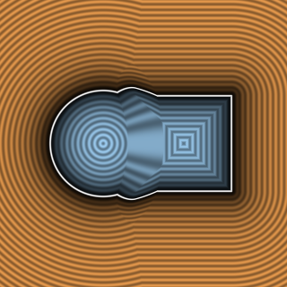

# `opUnionChamfer` — 45-Degree Chamfer Union



| Property | Value |
| :--- | :--- |
| **Author / Discoverer** | **Mercury Demogroup** |
| **Source** | [https://mercury.sexy/hg_sdf/](https://mercury.sexy/hg_sdf/) |
| **Category** | `booleans` |
| **GLSL File** | [`glsl/booleans/opUnionChamfer.glsl`](../../glsl/booleans/opUnionChamfer.glsl) |
| **Exact Euclidean SDF?** | Bound |

---

## Mathematical Overview

Adds a $45^\circ$ bevel chamfer of size $r$ at the intersection seam of two SDFs.

---

## GLSL Implementation

```glsl
float opUnionChamfer( float a, float b, float r )
{
    return min(min(a, b), (a - r + b)*sqrt(0.5));
}
```
