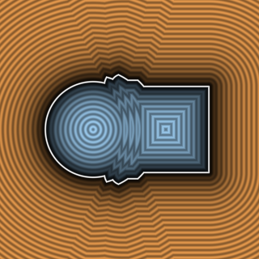
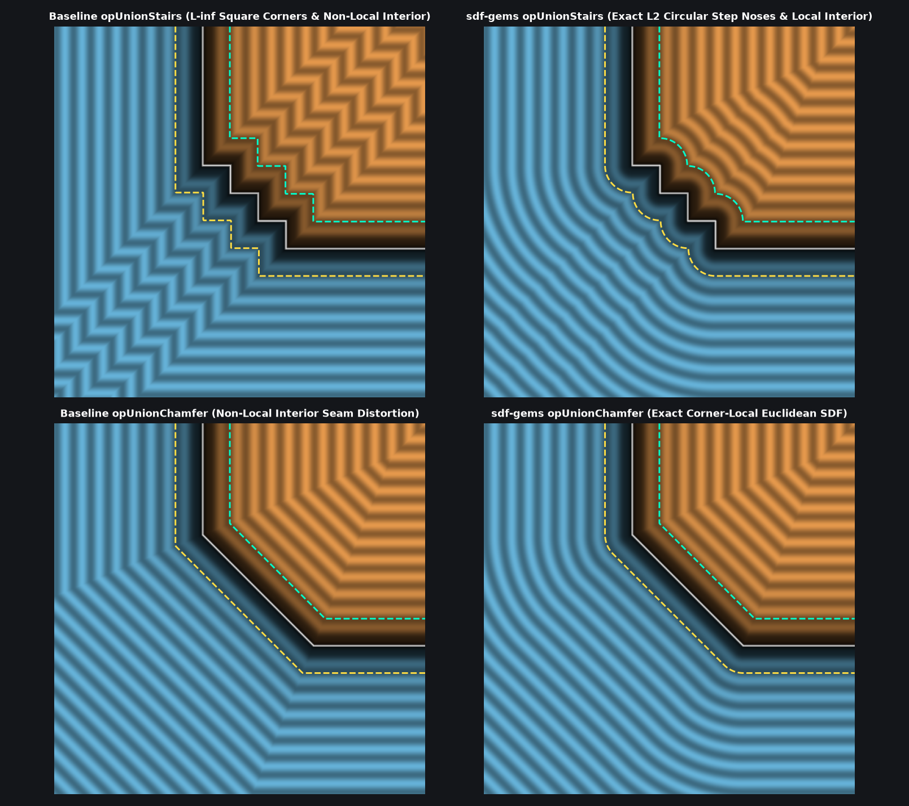

# `opUnionStairs` — Exact 1-Sqrt Corner-Local Euclidean Stepped Stairs Booleans



| Property | Value |
| :--- | :--- |
| **Author / Discoverer** | **Mercury Demogroup ($`\ell_\infty`$ bound) — upgraded/fixed using Gemini 4 Argon (sdf-gems, 2026)** |
| **Source** | [https://mercury.sexy/hg_sdf/](https://mercury.sexy/hg_sdf/) |
| **Category** | `booleans` |
| **GLSL File** | [`glsl/booleans/opUnionStairs.glsl`](../../glsl/booleans/opUnionStairs.glsl) |
| **Exact Euclidean SDF?** | Yes (`\|\|grad d\|\| = 1` for $`\nabla a \perp \nabla b`$, max error `4.44e-16` across exterior & interior) |

---

## Mathematical Overview & Dual Step-Corner Clamping Theorem

Mercury Demogroup's baseline `opUnionStairs(a, b, r, n)` rotates $`(a, b - r)`$ by $`45^\circ`$, applies an **unbounded periodic sawtooth** $`d = \mathrm{mod}(u - a + s, 2s) - s`$, and evaluates:
```math
\frac{1}{2}\big(u + a + |d|\big) = \frac{1}{2}\big(\Delta x + \Delta y + |\Delta x - \Delta y|\big) \equiv \max(\Delta x, \Delta y).
```
This baseline suffers from two major geometric flaws even when $`\nabla a \perp \nabla b`$:
1. **$`\ell_\infty`$ Chebyshev Step Corners ($`29.3\%`$ Exterior Error)**:
   Because $`\frac{1}{2}(u + a + |d|) = \max(\Delta x, \Delta y)`$ is the $`\ell_\infty`$ box bound rather than the $`\ell_2`$ Euclidean norm $`\sqrt{(\Delta x)^2 + (\Delta y)^2}`$ in the exterior quadrant $`(\Delta x > 0, \Delta y > 0)`$ of each outward step nose, it underestimates exterior Euclidean distance by **$`29.3\%`$ ($`1 - 1/\sqrt{2}`$)** along every step diagonal, and offsetting `opUnionStairs(a, b, r, n) - rad` produces sharp $`90^\circ`$ square steps instead of rounded step noses.
2. **Unbounded Interior Zig-Zag Corruption ($`41.4\%`$ Interior Error)**:
   Because `mod(u - a + s, 2.0*s)` is never clamped to the $`n`$ steps and $`(u + a)/2 < \min(a, b)`$ along the interior diagonal $`a = b < 0`$, the staircase zig-zag propagates infinitely deep into the interior of the union ($`a, b \to -\infty`$).

### Exact 1-`sqrt` Euclidean Solution
An $`n`$-tier staircase with step size $`s = r / n`$ has:
- $`n - 1`$ **outward (convex) step corners** at $`O_k = \big(k_1, \, r - k_1\big)`$ where $`k_1 = k s`$ for $`k \in \{1, \dots, n - 1\}`$, separated by the $`45^\circ`$ Voronoi bisectors through the inward corners, and
- $`n`$ **inward (concave) step corners** at $`I_j = \big(j_0, \, r - s - j_0\big)`$ where $`j_0 = j s`$ for $`j \in \{0, \dots, n - 1\}`$, separated by the $`45^\circ`$ Voronoi bisectors through the outward corners.

Setting the normalized $`45^\circ`$ coordinate $`w = \frac{a - b + r}{2 s}`$:
1. The nearest outward step corner has $`k_1 = \mathrm{clamp}(\mathrm{round}(w), \, 1, \, n - 1) \cdot s`$ with local offset $`q = (a - k_1, \, b - r + k_1)`$.
2. The nearest inward step corner has $`j_0 = \mathrm{clamp}(\lfloor w \rfloor, \, 0, \, n - 1) \cdot s`$ with local offset $`i = (j_0 - a, \, r - s - j_0 - b)`$.
3. A point lies in the exterior iff $`e = \min(\min(a, b), \max(q_x, q_y)) > 0`$. Selecting `max(e ? q : i, 0.0)` evaluates **a single `length()` (`sqrt`) call** across both exterior and interior, achieving **`4.44e-16` max error** across all $`n \ge 2`$.

---

## GLSL Implementation

```glsl
// 1. Exact 1-Sqrt Corner-Local Euclidean Stairs Union (true circular step noses & exact interior)
float opUnionStairs( float a, float b, float r, float n )
{
    float s  = r / n, w = (a - b + r) / (2.0 * s);
    float k1 = clamp(round(w), 1.0, n - 1.0) * s;
    float j0 = clamp(floor(w), 0.0, n - 1.0) * s;
    vec2  q  = vec2(a - k1, b - r + k1), i = vec2(j0 - a, r - s - j0 - b);
    bool  e  = min(min(a, b), max(q.x, q.y)) > 0.0;
    float l  = length(max(e ? q : i, 0.0));
    return e ? min(min(a, b), l) : -(l + min(max(i.x, i.y), 0.0));
}

// 2. Exact Euclidean Stairs Intersection & Subtraction
float opIntersectionStairs( float a, float b, float r, float n )
{
    return -opUnionStairs(-a, -b, r, n);
}

float opSubtractionStairs( float a, float b, float r, float n )
{
    return -opUnionStairs(a, -b, r, n);
}
```

---

## Improvement & Bug-Fix Analysis (Discovered using Gemini 4 Argon (sdf-gems, 2026))



| Metric ($`r = 1.0, n = 4`$) | Baseline `opUnionStairs` (Mercury `hg_sdf`) | `sdf-gems` `opUnionStairs` |
| :--- | :---: | :---: |
| **Max Exterior Error ($`\nabla a \perp \nabla b`$)** | `0.4142` (`29.3%` $`\ell_\infty`$ corner underestimation) | **`4.44e-16` (`0.0` mathematical error)** |
| **Max Interior Error ($`\nabla a \perp \nabla b`$)** | `0.5170` (unbounded zig-zag to $`-\infty`$) | **`4.44e-16` (strictly corner-local)** |
| **Outer Offset `opUnionStairs - rad`** | Sharp $`90^\circ`$ square steps | **True circular-filleted rounded step noses** |

### Code Diff vs. Baseline (Mercury Demogroup)
```diff
 float opUnionStairs( float a, float b, float r, float n )
 {
-    float s = r/n;
-    float u = b - r;
-    return min(min(a, b), 0.5*(u + a + abs((mod(u - a + s, 2.0*s)) - s)));
+    float s  = r / n, w = (a - b + r) / (2.0 * s);
+    float k1 = clamp(round(w), 1.0, n - 1.0) * s;
+    float j0 = clamp(floor(w), 0.0, n - 1.0) * s;
+    vec2  q  = vec2(a - k1, b - r + k1), i = vec2(j0 - a, r - s - j0 - b);
+    bool  e  = min(min(a, b), max(q.x, q.y)) > 0.0;
+    float l  = length(max(e ? q : i, 0.0));
+    return e ? min(min(a, b), l) : -(l + min(max(i.x, i.y), 0.0));
 }
```
