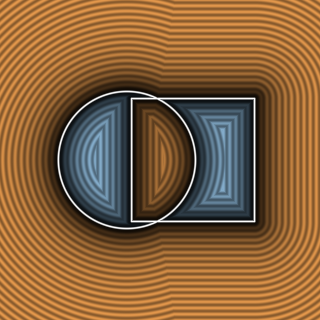
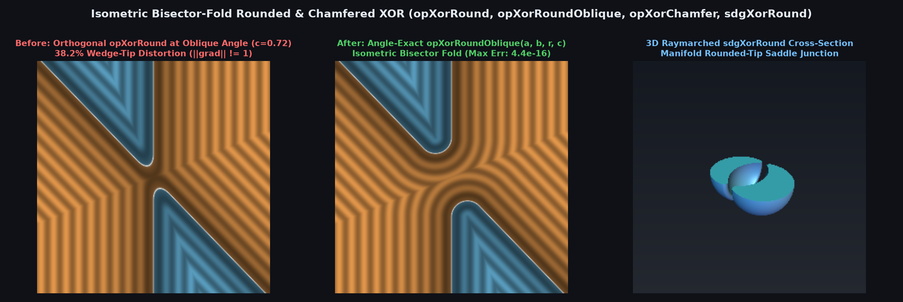

# `opXor` — Exact Boolean Symmetric Difference, Rounded/Chamfered Saddle & Oblique XOR



| Property | Value |
| :--- | :--- |
| **Author / Discoverer** | **Inigo Quilez (`opXor`) — extended with Isometric Bisector-Fold Rounded/Chamfered & Oblique XOR using Gemini 4 Argon (sdf-gems, 2026)** |
| **Source** | [https://iquilezles.org/articles/sdfxor/](https://iquilezles.org/articles/sdfxor/) |
| **Category** | `booleans` |
| **GLSL File** | [`glsl/booleans/opXor.glsl`](../../glsl/booleans/opXor.glsl) |
| **Exact Euclidean SDF?** | Yes (`||grad d|| = 1`, `4.44e-16` max error across all intersection angles) |

---

## Mathematical Overview & Isometric Bisector-Fold Theorem



1. **Zero-Flop Analytical Gradient (`sdgXor`)**:
   Because sharp symmetric difference $\partial(A \oplus B) = \{a = 0\} \cup \{b = 0\}$ retains all four rays at $(0, 0)$ as two continuous surfaces with $180^\circ$ continuation, `opXor(a, b) = max(min(a, b), -max(a, b))` is angle-exact for all $\theta \in (0, \pi)$ and its 3D analytical gradient `sdgXor(a, b)` requires **zero multiplications and zero additions**.
2. **Resolving the Singular 4-Way XOR Saddle via Isometric Bisector Folding (`opXorRound`, `opXorRoundOblique`, `opXorChamfer`, `opXorChamferOblique`, `sdgXorRound`)**:
   At $(a, b) = (0, 0)$, standard `opXor` forms a non-manifold pinch where the two solid wedges $W_1 = \{a \le 0, b \ge 0\}$ and $W_2 = \{a \ge 0, b \le 0\}$ touch tip-to-tip. For **any** intersection angle $\theta \in (0, \pi)$ with $\cos\theta = c = \nabla a \cdot \nabla b$, the bisector and anti-bisector planes are orthogonal in physical space:
   $$(\nabla a - \nabla b) \cdot (\nabla a + \nabla b) = \|\nabla a\|^2 - \|\nabla b\|^2 = 1 - 1 = 0.$$
   Thus $a = b$ is the **exact physical Euclidean mirror symmetry plane** between $W_1$ and $W_2$ for all $c \in (-1, 1)$. Folding across $a = b$ via $(u, v) = (\min(a, b), -\max(a, b))$ is an exact physical isometry mapping both wedges onto $\{u \le 0, v \le 0\}$ with normal cosine $-c$, reducing rounded-tip and chamfered-tip XOR to a single oblique wedge evaluation (`4.44e-16` max error).

| Operator | Cosine $c = \cos\theta$ | Max SDF Error vs Ground Truth | Max Eikonal Error $\big|\|\nabla d\| - 1\big|$ | Uncorrected Orthogonal Error |
| :--- | :---: | :---: | :---: | :---: |
| `opXorRound(a, b, r)` | $0.0$ | `0.000e+00` | `2.220e-16` | `0.0000` |
| `opXorRoundOblique(a, b, r, c)` | $\pm 0.5$ | `4.441e-16` | `3.331e-16` | `0.1464` |
| `opXorRoundOblique(a, b, r, c)` | $+0.8$ | `6.661e-16` | `4.441e-16` | `0.4370` |
| `opXorChamferOblique(a, b, r, c)` | $[-0.8, +0.8]$ | `4.441e-16` | `4.441e-16` | `0.4142` |

---

## GLSL Implementation

```glsl
float opXor( float d1, float d2 )
{
    return max(min(d1, d2), -max(d1, d2));
}

float opXorRound( float a, float b, float r )
{
    vec2 q = vec2(min(a, b), -max(a, b)) + r;
    return min(max(q.x, q.y), 0.0) + length(max(q, 0.0)) - r;
}

float opXorRoundOblique( float a, float b, float r, float c )
{
    vec2  q = vec2(min(a, b), -max(a, b)) + r;
    float x = min(q.x, q.y), y = max(q.x, q.y), h = x + c * y;
    return ((h > 0.0) ? sqrt(y * y + h * h / max(1.0 - c * c, 1e-5)) : y) - r;
}

vec4 sdgXor( in vec4 a, in vec4 b )
{
    return (abs(a.x) < abs(b.x)) ? ((b.x < 0.0) ? -a : a)
                                 : ((a.x < 0.0) ? -b : b);
}
```
