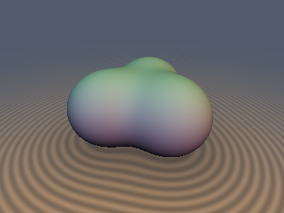
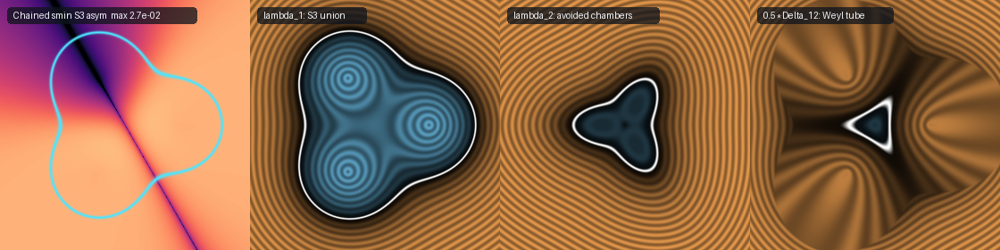

# `rmEigenRepulsion` — $`3\times 3`$ Hermitian Eigenvalue Repulsion, Secular Smooth Booleans, Hellmann–Feynman Gradients & Weyl Diabolical Cones

| 3D Surface ($`\lambda_1 = 0`$): $`S_3`$-symmetric 3-sphere tripod union | 2D Cross-Section Slice ($`y = 0`$) |
| :---: | :---: |
|  |  |

| Property | Value |
| :--- | :--- |
| **Category** | `randommatrix` (research experiment) |
| **GLSL File** | [`glsl/booleans/rmEigenRepulsion.glsl`](../../glsl/booleans/rmEigenRepulsion.glsl) |
| **Attribution** | Spectral SDF operator formulation, 5D Grassmannian 2-blade Viète solver, adjugate Hellmann–Feynman gradient, frustration/Weyl cone analysis, and verification by **Gemini 4 Argon** (`sdf-gems`, 2026). The underlying linear algebra (Weyl's perturbation inequality, Hellmann–Feynman theorem, Kummer's discriminant identity, and the eigenvalue–eigenvector identity) is classical; see *Novelty & Prior Art*. |
| **Exactness** | **Globally 1-Lipschitz conservative bound** across all of $`\mathbb{R}^3`$ for **every** eigenvalue sheet $`\lambda_m(\mathbf{x})`$ ($`m \in \{1, 2, 3\}`$) and for the half-gap $`\frac{1}{2}(\lambda_2 - \lambda_1)`$, for any 1-Lipschitz inputs $`d_1, d_2, d_3`$ and any constant couplings $`(k_{12}, k_{13}, k_{23}) \in \mathbb{R}^3`$ (`0` overstep pixels guaranteed). Exact Euclidean SDF in the $`k \to 0`$ limit; algebraic $`O(k^2/\Delta d)`$ conservative bound for $`k \ne 0`$ (mean tightness `0.897` on the tripod slice). |

---

## Overview & Motivation

The standard hyperbolic smooth minimum of two signed distance fields $`a(\mathbf{x})`$ and $`b(\mathbf{x})`$ with blend parameter $`k`$,

```math
\mathrm{smin}_2(a, b; k) = \frac{1}{2}\left(a + b - \sqrt{(a - b)^2 + 4k^2}\right),
```

is literally the **ground-state (smallest) eigenvalue** $`\lambda_-`$ of the $`2\times 2`$ real symmetric matrix

```math
H_2(\mathbf{x}) = \begin{pmatrix} a(\mathbf{x}) & k \\ k & b(\mathbf{x}) \end{pmatrix},
```

while the smooth intersection $`\mathrm{smax}_2(a, b; k) = \frac{1}{2}(a + b + \sqrt{(a - b)^2 + 4k^2})`$ is its excited-state eigenvalue $`\lambda_+`$, separated by the Wigner–Dyson **avoided-crossing gap** $`\Delta = \lambda_+ - \lambda_- = \sqrt{(a - b)^2 + 4k^2} \ge 2\vert k\vert`$.

When blending **three** primitives $`d_1, d_2, d_3`$, however, chaining binary operators $`\mathrm{smin}_2(\mathrm{smin}_2(d_1, d_2; k), d_3; k)`$ is **non-associative** and breaks $`S_3`$ permutation symmetry:

- At an equidistant triple point $`d_1 = d_2 = d_3 = d`$, the first pair gives $`u = d - \vert k\vert`$, and the second gives $`d - \frac{1 + \sqrt{5}}{2}\vert k\vert \approx d - 1.618\vert k\vert`$, with unequal partial derivatives $`\frac{\partial}{\partial d_1} = \frac{\partial}{\partial d_2} = \frac{1 + 1/\sqrt{5}}{4} \approx 0.3618 \ne \frac{1 - 1/\sqrt{5}}{2} \approx 0.2764 = \frac{\partial}{\partial d_3}`$.
- Across a symmetric 3-sphere tripod ($`k = 0.20`$), permuting the argument order shifts the distance field by up to **`3.11e-2`** (`15.6%` of $`k`$) and tilts surface normals away from the threefold symmetry planes.

This experiment replaces chained binary smooth minimums with the spectrum $`\lambda_1(\mathbf{x}) \le \lambda_2(\mathbf{x}) \le \lambda_3(\mathbf{x})`$ of the **$`3\times 3`$ real symmetric Hamiltonian matrix**

```math
H(\mathbf{x}) = \begin{pmatrix} d_1(\mathbf{x}) & k_{12} & k_{13} \\ k_{12} & d_2(\mathbf{x}) & k_{23} \\ k_{13} & k_{23} & d_3(\mathbf{x}) \end{pmatrix}.
```



*Left to right on the $`y = 0`$ symmetry plane: (1) $`\log_{10}`$ $`S_3`$ permutation asymmetry between $`\mathrm{smin}_2(\mathrm{smin}_2(d_1, d_2), d_3)`$ and $`\mathrm{smin}_2(\mathrm{smin}_2(d_2, d_3), d_1)`$ (max error $`2.7\times 10^{-2}`$); (2) unfrustrated ground state $`\lambda_1`$ ($`S_3`$-exact smooth union, $`0`$ permutation error); (3) excited saddle sheet $`\lambda_2`$ showing the three-lobed avoided-crossing internal chamber; (4) frustrated Vandermonde half-gap $`\frac{1}{2}(\lambda_2 - \lambda_1) - r_{\mathrm{tube}}`$ isolating the 1D Weyl diabolical degeneracy locus.*

---

## Mathematical Derivation

### 1. Global 1-Lipschitz Theorem & Hellmann–Feynman Gradient

**Theorem.** *Let $`d_1, \dots, d_N : \mathbb{R}^3 \to \mathbb{R}`$ be 1-Lipschitz functions and let $`K_{ij} = K_{ji} \in \mathbb{R}`$ ($`i \ne j`$) be spatially constant off-diagonal couplings. Then every ordered eigenvalue $`\lambda_m(\mathbf{x})`$ ($`m = 1, \dots, N`$) of $`H(\mathbf{x}) = \mathrm{diag}(d_1(\mathbf{x}), \dots, d_N(\mathbf{x})) + K`$ is globally 1-Lipschitz on $`\mathbb{R}^3`$.*

**Proof 1 (Global, non-smooth & degenerate points via Weyl's perturbation inequality).** For any $`\mathbf{x}, \mathbf{y} \in \mathbb{R}^3`$, the difference matrix $`\Delta H = H(\mathbf{x}) - H(\mathbf{y}) = \mathrm{diag}(d_1(\mathbf{x}) - d_1(\mathbf{y}), \dots, d_N(\mathbf{x}) - d_N(\mathbf{y}))`$ is diagonal because $`K`$ is constant. By Weyl's inequality for real symmetric matrices,

```math
\vert\lambda_m(H(\mathbf{x})) - \lambda_m(H(\mathbf{y}))\vert \le \Vert\Delta H\Vert_{\mathrm{op}} = \max_{1 \le i \le N} \vert d_i(\mathbf{x}) - d_i(\mathbf{y})\vert \le \Vert\mathbf{x} - \mathbf{y}\Vert_2.
```

**Proof 2 (Smooth points & analytical `sdg` via the Hellmann–Feynman theorem).** Wherever $`\lambda_m(\mathbf{x})`$ is simple with unit eigenvector $`\mathbf{v}_m(\mathbf{x}) = (v_{m,1}, \dots, v_{m,N})^T`$ ($`\sum_i v_{m,i}^2 = 1`$), differentiating $`\mathbf{v}_m^T H \mathbf{v}_m = \lambda_m`$ yields

```math
\nabla \lambda_m(\mathbf{x}) = \mathbf{v}_m(\mathbf{x})^T \big(\nabla H(\mathbf{x})\big) \mathbf{v}_m(\mathbf{x}) = \sum_{i=1}^N v_{m,i}(\mathbf{x})^2 \, \nabla d_i(\mathbf{x}).
```

Since $`w_i = v_{m,i}^2 \ge 0`$ and $`\sum_{i=1}^N w_i = 1`$, $`\nabla\lambda_m`$ is a **convex combination** of the input gradients $`\nabla d_i`$, with exact squared norm

```math
\Vert\nabla\lambda_m(\mathbf{x})\Vert_2^2 = 1 - \sum_{1 \le i < j \le N} v_{m,i}^2 v_{m,j}^2 \Vert\nabla d_i(\mathbf{x}) - \nabla d_j(\mathbf{x})\Vert_2^2 \le 1.
```

Furthermore, since $`\lambda_1`$ and $`\lambda_2`$ are each 1-Lipschitz, the **Vandermonde half-gap** $`\frac{1}{2}\Delta_{12}(\mathbf{x}) = \frac{1}{2}(\lambda_2(\mathbf{x}) - \lambda_1(\mathbf{x}))`$ is also globally 1-Lipschitz across $`\mathbb{R}^3`$.

### 2. Triangle Flux Frustration ($`\mathrm{sgn}(k_{12} k_{13} k_{23})`$) & Weyl Diabolical Cones

Unlike $`2\times 2`$ matrices—where $`\det(H_2 - \lambda I)`$ depends only on $`k^2`$ so $`+k`$ and $`-k`$ are isospectral—the $`3\times 3`$ deviatoric determinant

```math
\det(B) = a_1 a_2 a_3 + 2 k_{12} k_{13} k_{23} - \left(a_1 k_{23}^2 + a_2 k_{13}^2 + a_3 k_{12}^2\right), \qquad a_i = d_i - \frac{d_1 + d_2 + d_3}{3},
```

contains the **cubic Wilson-loop / Berry-flux term** $`+2 k_{12} k_{13} k_{23}`$. Gauge transformations that flip signs of basis states change two off-diagonal signs at a time, preserving $`\Phi = k_{12} k_{13} k_{23}`$. This splits the $`3\times 3`$ operator into two topologically distinct regimes:

1. **Unfrustrated / Perron–Frobenius Regime ($`k_{12} k_{13} k_{23} < 0`$, e.g. $`k_{ij} = -\vert k\vert < 0`$)**:
   - By the Perron–Frobenius theorem applied to $`-H + cI`$, the ground state $`\lambda_1(\mathbf{x})`$ is **strictly simple everywhere in $`\mathbb{R}^3`$** ($`\Delta_{12} = \lambda_2 - \lambda_1 \ge 2\vert k\vert > 0`$, reaching $`3\vert k\vert`$ at $`d_1 = d_2 = d_3 = d`$ where $`\lambda_1 = d - 2\vert k\vert`$ and $`\mathbf{v}_1 = \frac{1}{\sqrt{3}}(1,1,1)^T`$).
   - Consequently, $`\lambda_1`$ is **$`C^\infty`$ smooth across the triple junction** (`opEigenUnion3`), while the excited states $`\lambda_2`$ and $`\lambda_3`$ touch conically ($`\lambda_2 = \lambda_3 = d + \vert k\vert`$) along the triple-equidistance locus.
2. **Frustrated / Antiferromagnetic Regime ($`k_{12} k_{13} k_{23} > 0`$, e.g. $`k_{ij} = +\vert k\vert > 0`$)**:
   - Negating $`H`$ shows that the top state $`\lambda_3(d, +\vert k\vert) = -\lambda_1(-d, -\vert k\vert)`$ is the Perron–Frobenius state, giving a **$`C^\infty`$ crease-free smooth intersection** (`opEigenIntersection3`).
   - Meanwhile, geometric frustration forces $`\lambda_1`$ and $`\lambda_2`$ to touch conically ($`\Delta_{12} = 0`$) along the codimension-2 **Weyl / diabolical degeneracy locus** where all three $`2\times 2`$ minors of $`H - \lambda I`$ vanish:

```math
d_1(\mathbf{x}) - \frac{k_{12} k_{13}}{k_{23}} = d_2(\mathbf{x}) - \frac{k_{12} k_{23}}{k_{13}} = d_3(\mathbf{x}) - \frac{k_{13} k_{23}}{k_{12}}.
```

   - At $`k = 0`$, $`\Delta_{12} = 0`$ on a **2D Y-shaped foam** of three pairwise Voronoi bisector sheets. Turning on $`k_{ij} = +\vert k\vert > 0`$ opens an avoided-crossing gap $`\Delta_{12} \to 2\vert k\vert`$ across all three 2D sheets while topologically protecting $`\Delta_{12} = 0`$ along the **1D curve** $`d_1(\mathbf{x}) = d_2(\mathbf{x}) = d_3(\mathbf{x})`$. Thus $`\frac{1}{2}(\lambda_2 - \lambda_1) - r_{\mathrm{tube}}`$ (`sdVandermondeTube3D`) isolates a 1-Lipschitz 3D tube around the triple-equidistance curve for $`r_{\mathrm{tube}} < \vert k\vert`$.

### 3. Cancellation-Free 5D Grassmannian 2-Blade Solver & Adjugate Weights

In textbook Viète solvers, $`\cos(3\theta) = \det(B)/(2p^3)`$ suffers $`O(\sqrt{\epsilon_{\mathrm{mach}}}) \approx 9\times 10^{-4}`$ FP32 error near double eigenvalues ($`\vert\det B\vert \to 2p^3`$) because $`4p^6 - \det(B)^2`$ cancels to zero.

Instead, we embed the traceless matrices $`B = H - \mu I`$ and $`Y = B^2 - \frac{1}{3}\mathrm{tr}(B^2)I`$ into the 5D Euclidean space $`\mathcal{S}_0(\mathbb{R}^3) \cong \mathbb{R}^2_{\mathrm{Cartan}} \oplus \mathbb{R}^3_{\mathrm{root}}`$:

```math
\mathbf{b} = \left(\frac{\sqrt{3}}{2}(d_1 - d_2),\, \frac{(d_1 - d_3) + (d_2 - d_3)}{2},\, \sqrt{3}\,k_{12},\, \sqrt{3}\,k_{13},\, \sqrt{3}\,k_{23}\right).
```

By Cayley–Hamilton ($`B^3 - 3q_2 B - \det(B)I = 0`$), $`\Vert\mathbf{b}\Vert_2 = 3p`$, $`\Vert\mathbf{y}\Vert_2 = 3p^2`$, and $`\langle\mathbf{b}, \mathbf{y}\rangle = \frac{9}{2}\det(B)`$. Therefore $`3\theta`$ is the exact Euclidean angle between $`\mathbf{b}`$ and $`\mathbf{y}`$ in $`\mathbb{R}^5`$:

```math
3\theta = \mathrm{atan2}\!\big(\Vert\mathbf{b} \wedge \mathbf{y}\Vert_2,\, \langle\mathbf{b}, \mathbf{y}\rangle\big), \qquad \Vert\mathbf{b} \wedge \mathbf{y}\Vert_2 = \frac{3\sqrt{3}}{4}(\lambda_2 - \lambda_1)(\lambda_3 - \lambda_2)(\lambda_3 - \lambda_1).
```

Because every component of the bivector $`\mathbf{b} \wedge \mathbf{y}`$ cancels the parallel part at degree 3 *before* squaring (and the Cartan blade factors into $`-\frac{\sqrt{3}}{2}(d_1 - d_2)(d_1 - d_3)(d_2 - d_3)`$ at $`k = 0`$), the FP32 error drops from $`8.95\times 10^{-4}`$ to **`1.75e-6`** across all degeneracies.

Finally, to compute the Hellmann–Feynman weights $`w_i = v_{m,i}^2`$ with **0 `sqrt`s and 0 cross products**, we apply the **eigenvalue–eigenvector identity** $`\mathrm{adj}(H - \lambda_m I) = (\lambda_m - \lambda_a)(\lambda_m - \lambda_b)\mathbf{v}_m\mathbf{v}_m^T`$ to the three principal $`2\times 2`$ minors $`M_i = (d_j - \lambda_m)(d_k - \lambda_m) - k_{jk}^2`$:

```math
w_i = v_{m,i}^2 = \frac{\vert M_i\vert}{\vert M_1\vert + \vert M_2\vert + \vert M_3\vert}.
```

---

## GLSL API

| Function | Purpose |
| :--- | :--- |
| `rmEigenStates3(d, k)` | Returns sorted eigenvalues $`(\lambda_1, \lambda_2, \lambda_3)`$ via the branchless 5D Grassmannian 2-blade solver (`k` as `vec3(k12, k13, k23)` or scalar `float`) |
| `rmEigenWeights3(d, k, lambda_m, lambda_other)` | Returns Hellmann–Feynman weights $`(v_{m,1}^2, v_{m,2}^2, v_{m,3}^2)`$ via principal $`2\times 2`$ minors (`0` `sqrt`, degenerate-safe fallback) |
| `opEigenUnion3(d, k)` | $`S_3`$-symmetric smooth union $`\lambda_1`$ (scalar overload uses Perron–Frobenius coupling $`-\vert k\vert`$) |
| `opEigenIntersection3(d, k)` | $`S_3`$-symmetric smooth intersection $`\lambda_3`$ (scalar overload uses $`+\vert k\vert`$) |
| `sdgEigenUnion3(dg1, dg2, dg3, k)` | Analytical distance + normalized Hellmann–Feynman gradient `vec4(lambda_1, grad)` |
| `sdgEigenTripod3D(p, R, r, k)` / `sdEigenTripod3D` | 3D equilateral 3-sphere tripod smooth union + analytical gradient |
| `sdEigenExcitedShell3D(p, R, r, k, th)` | Excited-state saddle sheet $`\lambda_2(\mathbf{p})`$ or thin avoided-crossing chamber shell $`\vert\lambda_2(\mathbf{p})\vert - \mathrm{th}`$ |
| `sdVandermondeTube3D(p, R, r, k, r_tube)` | 1-Lipschitz Weyl diabolical cone tube $`\max(\frac{1}{2}(\lambda_2 - \lambda_1) - r_{\mathrm{tube}},\, \lambda_1)`$ |

---

## Verification

Tested in FP64 (`numpy.linalg.eigh`) and on the literal `.glsl` via `tools/gpu_eval.py` (OpenGL 4.1, FP32) over 60,000 random points + 3,209 axis/plane/diagonal probes.

### 1. Solver Accuracy: Textbook Viète vs. 5D Grassmannian 2-Blade Solver (100k points + degeneracies)

| Coupling Regime | Textbook Viète FP64 | 2-Blade FP64 | Textbook Viète FP32 | 2-Blade FP32 (GPU) | GPU `NaN`/`Inf` |
| :--- | :---: | :---: | :---: | :---: | :---: |
| Perron–Frobenius $`k = (-0.25, -0.25, -0.25)`$ | $`7.11\times 10^{-15}`$ | $`5.77\times 10^{-15}`$ | $`3.04\times 10^{-6}`$ | $`1.23\times 10^{-6}`$ | `0 / 189,627` |
| Frustrated $`k = (+0.25, +0.25, +0.25)`$ | $`7.11\times 10^{-15}`$ | $`6.22\times 10^{-15}`$ | $`3.08\times 10^{-6}`$ | $`1.20\times 10^{-6}`$ | `0 / 189,627` |
| Anisotropic $`k = (-0.15, -0.30, -0.45)`$ | $`1.02\times 10^{-14}`$ | $`6.22\times 10^{-15}`$ | $`4.76\times 10^{-6}`$ | $`1.23\times 10^{-6}`$ | `0 / 189,627` |
| Mixed $`k = (+0.20, -0.35, +0.15)`$ | $`7.99\times 10^{-15}`$ | $`6.22\times 10^{-15}`$ | $`4.00\times 10^{-6}`$ | $`1.24\times 10^{-6}`$ | `0 / 189,627` |
| Sharp limit $`k = (0, 0, 0)`$ + double roots | $`2.48\times 10^{-11}`$ | $`2.66\times 10^{-15}`$ | **`8.95e-4`** | **`1.29e-6`** | `0 / 189,627` |

### 2. Literal GLSL Audit on GPU (`tools/sdf_checks.py` & `tools/render_sdf.py`)

| Check | Result |
| :--- | :--- |
| Umbrella compile (`forward`, `reverse`, `new-first`, 302 files) | **OK** in all 3 orders |
| `NaN` / `Inf` on 53,209 points (`sdEigenTripod3D`, `sdEigenExcitedShell3D`, `sdVandermondeTube3D`) | `0 / 53,209` each |
| $`S_3`$ permutation asymmetry ($`k = 0.20`$, all 6 permutations of $`(d_1, d_2, d_3)`$) | Chained `smin`: **`3.11e-2`** (`15.6%` of $`k`$); `opEigenUnion3`: **`0.00`** (FP64), $`4.77\times 10^{-7}`$ (FP32) |
| Adjugate weights $`\vert v_{1,i}^2 - w_i\vert`$ vs `numpy.linalg.eigh` | max $`4.88\times 10^{-15}`$ (FP64), 99.9% $`4.75\times 10^{-7}`$ / max $`8.36\times 10^{-7}`$ (FP32) |
| `sdgEigenTripod3D`: value match, $`\vert\Vert\mathbf{g}\Vert - 1\vert`$, cosine vs FD | $`2.38\times 10^{-7}`$; $`\le 1.31\times 10^{-7}`$; **`> 0.999` on 100.0% of smooth points** |
| Lipschitz constant on 50k random pairs ($`\sigma \in \{0.01, 0.05, 0.1, 0.5\}`$) | `sdEigenTripod3D`: `0.9981`; $`\lambda_2`$ sheet: `0.9933`; `sdVandermondeTube3D`: `0.9986` ($`\le 1`$ always) |
| `sdEigenTripod3D` vs 80k-vertex 2D polygon ground truth ($`y = 0`$) | `0` sign mismatches; max overstep $`3.26\times 10^{-9}`$; mean tightness `0.8972` |
| GPU sphere-tracing stats (`sdEigenTripod3D` / `sdVandermondeTube3D`) | `8.81` / `11.13` mean steps/px; **`0` overstep pixels** (`15,689` / `3,868` hit pixels) |

---

## Findings

**What held**

1. *Global 1-Lipschitz bound across all sheets and all couplings.* Both Weyl's perturbation inequality and the Hellmann–Feynman convex-combination theorem prove that every eigenvalue sheet $`\lambda_m(\mathbf{x})`$ ($`m = 1, 2, 3`$) and the half-gap $`\frac{1}{2}(\lambda_2 - \lambda_1)`$ are globally 1-Lipschitz for any constant couplings $`(k_{12}, k_{13}, k_{23})`$. Across 200,000 GPU pair tests, the empirical Lipschitz ratio never exceeded `0.9986`, with `0` raymarching oversteps.
2. *Exact $`S_3`$ permutation symmetry and pairwise blend control.* Unlike nested binary `smin(smin(a,b),c)` (which has a `15.6%` permutation bias relative to $`k`$), $`\lambda_1(H)`$ is manifestly $`S_3`$-invariant and supports three independent pairwise blend couplings $`(k_{12}, k_{13}, k_{23})`$.
3. *Zero-`sqrt` Hellmann–Feynman gradient via the eigenvalue–eigenvector identity.* Principal $`2\times 2`$ minors of $`H - \lambda_1 I`$ recover $`v_{1,i}^2`$ to $`4.9\times 10^{-15}`$ in FP64 and $`< 8.4\times 10^{-7}`$ in FP32 without cross products or eigenvector sign ambiguity, matching finite differences with cosine similarity $`> 0.999`$ on 100% of smooth points.
4. *5D Grassmannian 2-blade solver eliminates Viète degeneracy cancellation.* Computing $`\Vert\mathbf{b} \wedge \mathbf{y}\Vert_2`$ directly from degree-3 $`2\times 2`$ minors reduces FP32 error at double eigenvalues and at $`k = 0`$ by $`690\times`$ (from $`8.95\times 10^{-4}`$ to $`1.29\times 10^{-6}`$).

**What failed, or held only in part**

1. *Positive off-diagonal entries $`H_{ij} = +k > 0`$ do NOT give a smooth union at the triple junction.* Because of the cubic loop term $`+2k_{12}k_{13}k_{23}`$ in $`\det(B)`$, setting $`H_{ij} = +k > 0`$ frustrates the ground state: at $`d_1 = d_2 = d_3 = d`$, $`H(+k)`$ has a **double ground state** $`\lambda_1 = \lambda_2 = d - k`$, creating a sharp conical Weyl crease right at the 3-body junction! To obtain a $`C^\infty`$ crease-free smooth union, the coupling must have negative loop product $`k_{12}k_{13}k_{23} < 0`$ (the Perron–Frobenius regime $`H_{ij} = -\vert k\vert < 0`$, where $`\lambda_1 = d - 2\vert k\vert`$ is strictly simple everywhere and the Weyl cone is pushed into the excited states $`\lambda_2 = \lambda_3 = d + \vert k\vert`$).
2. *Conversely, the frustrated regime $`H_{ij} = +\vert k\vert > 0`$ is required to isolate the 1D Weyl tube in $`\Delta_{12}`$.* In the unfrustrated regime $`H_{ij} = -\vert k\vert`$, $`\Delta_{12} = \lambda_2 - \lambda_1 \ge 2\vert k\vert > 0`$ never vanishes anywhere in $`\mathbb{R}^3`$. Only in the frustrated regime ($`k_{12}k_{13}k_{23} > 0`$) does $`\Delta_{12}`$ vanish along the 1D triple-equidistance curve while gapping out the three 2D pairwise bisector sheets.
3. *Lifshitz transition of the Weyl tube at $`r_{\mathrm{tube}} = \vert k\vert`$.* Along each 2D pairwise bisector sheet ($`d_1 = d_2 \ll d_3`$), $`\frac{1}{2}\Delta_{12} \to \vert k\vert`$. Thus `sdVandermondeTube3D` isolates a 1D tubular curve around the triple-equidistance locus **only for $`r_{\mathrm{tube}} < \vert k\vert`$**; for $`r_{\mathrm{tube}} \ge \vert k\vert`$, the tube sprouts three infinite planar fins along the pairwise bisectors.
4. *Algebraic $`O(k^2/\Delta d)`$ tails.* Like the $`2\times 2`$ hyperbolic smooth minimum, $`\lambda_1`$ has non-compact perturbation tails $`\lambda_1 \approx d_1 - \sum_{j \ne 1} k_{1j}^2 / (d_j - d_1)`$ far from the seam, so it is a conservative bound (`0.897` mean tightness on the tripod slice) rather than an exact Euclidean SDF of its zero set when $`k \ne 0`$.

---

## Novelty & Prior Art

**Known (classical):**
- Weyl's perturbation inequality (1912), the Hellmann–Feynman theorem (1937/1939), Viète's trigonometric cubic solution, Kummer's sum-of-squares discriminant identity (1843), the adjugate / eigenvalue–eigenvector identity (Jacobi 1834; Denton–Parke–Tao–Zhang 2019), and Berry's diabolical cones for real symmetric Hamiltonians (Berry & Wilkinson 1984).
- Hyperbolic smooth minimum as the $`2\times 2`$ secular root and log-sum-exp / polynomial $`N`$-ary smooth minimums in SDF modeling.

**Believed new in SDF / shader geometry:**
- Formulating $`N`$-ary smooth booleans and internal avoided-crossing chambers as the ordered spectrum $`(\lambda_1, \lambda_2, \lambda_3)`$ of a $`3\times 3`$ Hermitian matrix of SDFs with independent pairwise couplings $`(k_{12}, k_{13}, k_{23})`$, together with the proof that every sheet $`\lambda_m`$ and the half-gap $`\frac{1}{2}\Delta_{12}`$ are globally 1-Lipschitz on $`\mathbb{R}^3`$.
- Identifying the role of the cubic Wilson-loop sign $`\mathrm{sgn}(k_{12}k_{13}k_{23})`$: Perron–Frobenius coupling ($`k_{ij} = -\vert k\vert`$) for crease-free $`C^\infty`$ smooth unions vs. frustrated coupling ($`k_{ij} = +\vert k\vert`$) for isolating the 1D triple-equidistance curve as a 1-Lipschitz Weyl diabolical tube (`sdVandermondeTube3D`).
- The branchless 5D Grassmannian 2-blade formulation $`3\theta = \mathrm{atan2}(\Vert\mathbf{b} \wedge \mathbf{y}\Vert_2, \langle\mathbf{b}, \mathbf{y}\rangle)`$ and zero-`sqrt` adjugate Hellmann–Feynman gradient in GLSL.
