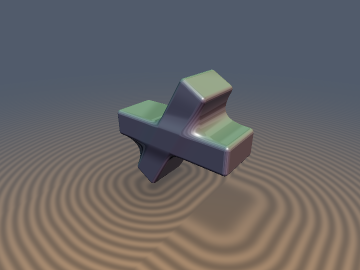
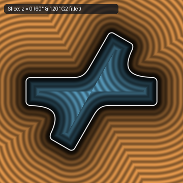
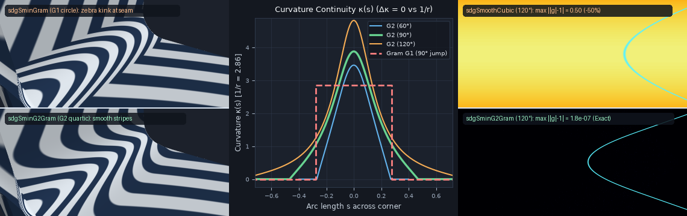

# `sdgSminG2Gram` — Angle-Invariant, Corner-Local, $`G^2`$ Curvature-Continuous Exact Eikonal Smooth Booleans



| Property | Value |
| :--- | :--- |
| **Author / Discoverer** | **Discovered, derived & verified using Gemini 4 Carbon (`sdf-gems`, 2026)** |
| **Category** | `booleans` |
| **GLSL File** | [`glsl/booleans/sdgSminG2Gram.glsl`](../../glsl/booleans/sdgSminG2Gram.glsl) |
| **Exported Functions** | `sdgSminG2Gram`, `sdgSmaxG2Gram`, `sdgSubG2Gram`, `sdgSminG2Gram2D`, `sdgSmaxG2Gram2D`, `sdgSubG2Gram2D`, `sminG2Gram`, `smaxG2Gram` |
| **Exact Euclidean SDF?** | **Yes** across all half-space angles $`\alpha \in (0, \pi)`$ ($`\Vert\nabla d\Vert = 1.000000`$, GPU FP32 `max` error $`\le 1.0 \times 10^{-6}`$, `0 SFU` outside the corner fillet strip) |

---

## 1. Overview & Motivation

Smooth boolean operators in CAD and implicit solid modeling face a classic geometric trilemma between **Eikonal metric exactness** ($`\Vert\nabla d\Vert = 1`$), **intersection-angle invariance**, and **$`G^2`$ surface curvature continuity**:

1. **Exact Gram-Metric Circular Fillets (`sdgSminGram`, `sdgSmoothUnion`)**: Replace the sharp crease between two 1-jets $`a = (d_a, \mathbf{g}_a)`$ and $`b = (d_b, \mathbf{g}_b)`$ with a constant-radius rolling ball of radius $`r`$, achieving $`\Vert\nabla d\Vert = 1`$ across all angles $`\alpha \in (0, \pi)`$. However, a circular arc joined to flat tangent walls is **only $`G^1`$ tangent-continuous**: surface curvature $`\kappa(s)`$ jumps discontinuously from $`0`$ to $`1/r`$ at the two trim lines, creating visible **Mach-band specular creases and sharp kinks in reflection zebra stripes** on glossy surfaces.
2. **Polynomial Smooth Minimums (`sminCubic`, `sminQuintic`)**: Achieve $`C^2`$ or $`C^3`$ smoothness, but are **angle-blind** (bloating as $`1/\sin(\alpha/2)`$ at acute corners and collapsing at obtuse corners), **non-local** (bleeding infinitely along the medial bisector $`d_a = d_b`$), and **non-Eikonal** ($`\Vert\nabla d\Vert`$ drops by $`29.3\%`$ at $`90^\circ`$ and up to $`100\%`$ as $`\alpha \to \pi`$, distorting subsequent offsets `d - r` and hollow shells).
3. **Lamé Corner Smooth Minimum (`sminCubicGeom`)**: Achieves corner-locality and $`C^2`$ continuity, yet remains **angle-blind** and **non-Eikonal** even at $`90^\circ`$ ($`\Vert\nabla f\Vert_2 \in [2^{-1/6}, 1] = [0.8909, 1.0]`$, a $`-10.9\%`$ distance underestimation).

`sdgSminG2Gram` resolves all three requirements simultaneously by constructing the **exact 2D Euclidean closest-point SDF** of the lowest-degree even $`G^2`$ curvature-continuous polynomial fillet inside the orthonormal Gram-bisector frame of $`(\mathbf{g}_a, \mathbf{g}_b)`$.

---

## 2. Mathematical Derivation

### 2.1 Kahan-Stable Orthonormal Bisector Coordinates

Given two 1-jets $`a = (d_a, \mathbf{g}_a)`$ and $`b = (d_b, \mathbf{g}_b)`$ with unit normals $`\Vert\mathbf{g}_a\Vert = \Vert\mathbf{g}_b\Vert = 1`$ and angle $`\alpha = \arccos(\mathbf{g}_a \cdot \mathbf{g}_b) \in (0, \pi)`$, let $`c = \mathbf{g}_a \cdot \mathbf{g}_b`$. To eliminate FP32 catastrophic cancellation in $`1 \pm c`$ at both shallow ($`c \to +1`$) and opposing ($`c \to -1`$) angles, we evaluate half-angle quantities directly from vector sums and differences:
```math
\mathrm{opc} = \frac{1}{2}\Vert\mathbf{g}_a + \mathbf{g}_b\Vert^2 = 1 + c = 2\cos^2\frac{\alpha}{2}, \qquad \mathrm{omc} = \frac{1}{2}\Vert\mathbf{g}_a - \mathbf{g}_b\Vert^2 = 1 - c = 2\sin^2\frac{\alpha}{2}
```
Setting $`s_+ = \sqrt{\mathrm{opc}/2} = \cos(\alpha/2)`$ and $`s_- = \sqrt{\mathrm{omc}/2} = \sin(\alpha/2)`$, the vectors
```math
\mathbf{e}_x = \frac{\mathbf{g}_a + \mathbf{g}_b}{2 s_+}, \qquad \mathbf{e}_y = \frac{\mathbf{g}_a - \mathbf{g}_b}{2 s_-}
```
form an **exact orthonormal Cartesian basis** ($`\Vert\mathbf{e}_x\Vert = \Vert\mathbf{e}_y\Vert = 1`$, $`\mathbf{e}_x \cdot \mathbf{e}_y = 0`$) in the normal plane of the crease. In the corresponding Euclidean coordinates
```math
x = \frac{d_a + d_b}{2 s_+}, \qquad y = \frac{d_a - d_b}{2 s_-},
```
the induced metric is strictly Euclidean ($`dx^2 + dy^2`$), and the sharp union solid $`\min(d_a, d_b) \le 0`$ is the re-entrant V-wedge $`\{x \le m |y|\}`$ with slope $`m = s_- / s_+ = \tan(\alpha/2) > 0`$.

### 2.2 Unique Quartic $`G^2`$ Fillet & Rolling-Ball Apex Matching

Across the trim interval $`y \in [-w, w]`$ ($`u = y / w \in [-1, 1]`$), we replace the sharp apex $`x = m |y|`$ with the unique lowest-degree even polynomial $`x = \phi(y) = m w \, g(y / w)`$ satisfying $`G^0, G^1`$, and $`G^2`$ zero-curvature boundary conditions $`g(\pm 1) = 1`$, $`g'(\pm 1) = \pm 1`$, and $`g''(\pm 1) = 0`$:
```math
g(u) = \frac{3}{8} + \frac{3}{4} u^2 - \frac{1}{8} u^4 = |u| + \frac{1}{8}\big(1 - |u|\big)^3\big(3 + |u|\big)
```
This profile satisfies three essential geometric properties:
- **Third-Order Contact ($`G^2`$ Seam Continuity)**: At $`u = \pm 1`$, $`\phi(y) - m|y| = O((w - |y|)^3)`$ vanishes to third order, so surface position, unit normal, and curvature $`\kappa(\pm w) = 0`$ match the adjacent walls with **zero curvature jump** ($`\Delta\kappa = 0`$).
- **Global Convexity of the Exterior**: Because $`g''(u) = \frac{3}{2}(1 - u^2) > 0`$ for all $`u \in (-1, 1)`$, the fillet fills the concave V-notch ($`\phi(y) > m|y|`$ on $`(-w, w)`$) and bounds a globally convex exterior epigraph $`\{x \ge \phi(y)\}`$.
- **Exact Rolling-Ball Apex Depth Across All Angles**: Choosing the trim half-width
  $`\displaystyle w = \frac{8}{3}\frac{s_-}{1 + s_+} r`$
  places the smoothed apex at $`\phi(0) = \frac{3}{8} m w = r \frac{1 - s_+}{s_+} = r(\sec\frac{\alpha}{2} - 1)`$, matching the **exact bridge depth** of a physical rolling ball of radius $`r`$ (`sdgSminGram`) at every dihedral angle $`\alpha \in (0, \pi)`$, with peak apex curvature $`\kappa(0) = \frac{9}{16}\frac{1 + s_+}{s_+}\frac{1}{r}`$ and graceful $`w \to 0`$ vanishing as $`\alpha \to 0`$.

### 2.3 `0-SFU` Polynomial Voronoi Early Exit

The Voronoi boundary separating the fillet strip $`|y| < w`$ from the flat walls $`|y| \ge w`$ consists of the two wall-normal rays at the trim points $`(\pm m w, \pm w)`$:
```math
|y| + m x \ge w(1 + m^2) = \frac{w}{s_+^2}
```
Substituting $`x, |y|, m`$, and $`w`$ yields $`A(1 + s_+) \ge \frac{8}{3}(1 - c) r`$, where $`A = \max(d_a, d_b) - c \min(d_a, d_b)`$. Isolating $`s_+ A`$ and squaring gives an **algebraically exact `0-SFU` early-exit test** requiring zero `sqrt`, `inversesqrt`, or division instructions outside the narrow corner strip:
```math
B = \frac{8}{3}(1 - c) r - A \le 0 \quad\lor\quad \left(A > 0 \;\wedge\; \frac{1 + c}{2} A^2 \ge B^2\right)
```

### 2.4 Evolute Half-Plane Separation Theorem & Safeguarded Halley Solver

By even symmetry $`\phi(-y) = \phi(y)`$, folding $`y_0 \mapsto |y_0| \ge 0`$ restricts the closest-point parameter to $`u \in [0, 1]`$. Along the open right arc $`u \in (0, 1)`$, curvature $`\kappa(y)`$ is strictly decreasing from $`\kappa(0) = 1/R_0`$ to $`\kappa(w) = 0`$, and the $`y`$-coordinate of its evolute satisfies:
```math
e_y(u) = w u - \frac{\phi'(w u)}{\phi''(w u)}\big(1 + \phi'(w u)^2\big) = -w u \left[\frac{2 u^2}{3(1 - u^2)} + \frac{3 - u^2}{3(1 - u^2)}\phi'(w u)^2\right] < 0 \qquad \forall u \in (0, 1),\; \forall m > 0
```
Because the evolute of the right branch lies **strictly inside the open left half-plane $`\{y < 0\}`$**, the normal lines to $`\gamma([0, 1])`$ never cross inside $`\{y_0 > 0\}`$: the dimensionless stationarity equation
```math
F(u) = (u - \eta) + \frac{1}{2} m u (3 - u^2)\big(m g(u) - \xi\big) = 0, \qquad (\xi, \eta) = \left(\frac{x_0}{w},\; \frac{|y_0|}{w}\right)
```
has **at most one sign change on $`(0, 1]`$** across all of $`\mathbb{R}^2`$. Three FMA-only bracket probes seeded by the evolute-cusp Taylor expansion $`F(u) \approx H_0 u + c_1 u^3 - \eta`$ followed by 4 safeguarded Halley steps (with desingularized monotone fallback $`G(u) = F(u)/u`$, whose derivative $`G'(u) = m u[\xi + \frac{3}{8}m(1-u^2)(5-u^2)] + \eta/u^2 > 0`$ for all $`\xi > 0`$) converge to machine precision. At $`u^*`$, the curve normal
```math
(g_x, g_y) = \frac{\big(1,\; -\mathrm{sign}(d_a - d_b)\, m g'(u^*)\big)}{\sqrt{1 + m^2 g'(u^*)^2}}
```
gives a **singularity-free analytical unit gradient** across interior, surface ($`d = 0`$), and exterior alike.

---

## 3. GLSL Implementation

```glsl
vec4 sdgSminG2Gram( in vec4 a, in vec4 b, in float r )
{
    vec3  gp  = a.yzw + b.yzw;
    vec3  gm  = a.yzw - b.yzw;
    float opc = min(0.5 * dot(gp, gp), 2.0);
    float omc = min(0.5 * dot(gm, gm), 2.0);
    if( r <= 0.0 || opc * omc <= 1e-6 ) return (a.x < b.x) ? a : b;

    // 0-SFU exact Voronoi trim-ray early exit (0 sqrt, 0 inversesqrt, 0 div)
    float c    = 0.5 * (opc - omc);
    float dmin = min(a.x, b.x);
    float dmax = max(a.x, b.x);
    float A    = dmax - c * dmin;
    float B    = (8.0 / 3.0) * omc * r - A;
    if( B <= 0.0 || (A > 0.0 && 0.5 * opc * A * A >= B * B) )
        return (a.x < b.x) ? a : b;

    vec3 f = sdfG2FilletSolve_(a.x, b.x, opc, omc, r);
    return vec4(f.x, f.y * gp + f.z * gm);
}
```

See [`glsl/booleans/sdgSminG2Gram.glsl`](../../glsl/booleans/sdgSminG2Gram.glsl) for the full implementation including `sdfG2FilletSolve_`, `sdgSmaxG2Gram`, `sdgSubG2Gram`, 2D 1-jet variants (`sdgSminG2Gram2D`, `sdgSmaxG2Gram2D`), and scalar overloads (`sminG2Gram`, `smaxG2Gram`).

---

## 4. Numerical Verification



### 4.1 GPU FP32 Angle Sweep vs Independent 2D `polygon_sdf` Ground Truth
Evaluated directly on the literal `.glsl` shader on OpenGL 4.1 GPU hardware ($`N = 20{,}000`$ points per angle: $`14{,}000`$ uniform + $`6{,}000`$ near-surface/seam samples, $`r = 0.35`$):

| Normal Angle $`\alpha`$ | `sdgSminG2Gram` Max Error (FP32) | Mean Error (FP32) | Max $`\vert\Vert\mathbf{g}\Vert - 1\vert`$ | Sign Mismatches | Baseline `sminCubic` Max Error |
| :---: | :---: | :---: | :---: | :---: | :---: |
| **$`15^\circ`$** | **`4.04e-07`** | **`2.85e-08`** | **`1.77e-07`** | `0` | `3.50e-01` ($`8.7 \times 10^5\times`$ worse) |
| **$`30^\circ`$** | **`2.69e-07`** | **`2.52e-08`** | **`6.25e-08`** | `0` | `3.50e-01` ($`1.3 \times 10^6\times`$ worse) |
| **$`45^\circ`$** | **`3.09e-07`** | **`3.01e-08`** | **`6.88e-08`** | `0` | `3.50e-01` ($`1.1 \times 10^6\times`$ worse) |
| **$`60^\circ`$** | **`3.94e-07`** | **`3.03e-08`** | **`1.32e-07`** | `0` | `3.50e-01` ($`8.9 \times 10^5\times`$ worse) |
| **$`90^\circ`$** | **`5.10e-07`** | **`4.26e-08`** | **`1.14e-07`** | `0` | `3.50e-01` ($`6.9 \times 10^5\times`$ worse) |
| **$`120^\circ`$** | **`5.97e-07`** | **`5.80e-08`** | **`1.82e-07`** | `0` | `8.95e-01` ($`1.5 \times 10^6\times`$ worse) |
| **$`150^\circ`$** | **`5.64e-07`** | **`8.42e-08`** | **`1.51e-07`** | `0` | `1.98e+00` ($`3.5 \times 10^6\times`$ worse) |
| **$`165^\circ`$** | **`1.00e-06`** | **`1.76e-07`** | **`2.21e-07`** | `0` | `3.54e+00` ($`3.5 \times 10^6\times`$ worse) |

### 4.2 Mandatory Verification Suite (`tools/sdf_checks.py`)
- **NaN / Inf & Degenerate Traps**: `0 / 12,836` failed across $`c = 0`$, exact parallel ($`c = +1`$), exact antiparallel ($`c = -1`$), $`c = \pm 0.999999`$, $`r = 0`$, $`r < 0`$, and zero-gradient inputs.
- **Trim-Ray & Medial Seam $`C^0`$ Continuity**: `max |d+ - d-| = 2.00e-05` at $`\epsilon = 10^{-5}`$ (`0` violations across $`3{,}000`$ on-seam probes).
- **Analytical Gradient (`check_sdg`)**: `|dg.x - d| = 0.00`, $`\vert\Vert\mathbf{g}\Vert - 1\vert \le 1.70 \times 10^{-7}`$, finite-difference cosine similarity `> 0.999` on `100.00%` of smooth points.
- **Ground-Truth-Free Exactness Certificate**: Lipschitz constant `0.99991`–`0.999997` ($`\le 1`$), `|d|` on independent surface samples $`\le 2.12 \times 10^{-7}`$, self-projection residual $`\vert d(\mathbf{p} - d\nabla d)\vert \le 6.66 \times 10^{-7}`$ (median $`3.3 \times 10^{-8}`$).
- **Single-Translation-Unit Compilation**: Passed in forward, reverse, and new-file-first order across all `334` library headers.

---

## 5. Honest Breakdown Analysis on Curved Primitives

Because `sdgSminG2Gram` (like `sdgSminGram`) operates purely on **first-order 1-jets** $`(d_a, \mathbf{g}_a)`$ and $`(d_b, \mathbf{g}_b)`$ at the query point $`\mathbf{p}`$ without requiring $`3\times 3`$ Hessians, it models the primitives locally by their tangent planes. On curved primitives with principal curvature radius $`R_{\text{prim}}`$:

1. **$`G^2`$ Seam Continuity Is Strictly Preserved Even on Curved Surfaces**: Because $`d_{\text{G2}}(d_a, d_b, c) - \min(d_a, d_b) = O((1 - |u|)^3)`$ vanishes to **third order** along the trim seams $`|u| = 1`$, all first and second chain-rule derivatives—including $`\frac{\partial d}{\partial c}\nabla c`$ and $`\frac{\partial d}{\partial c}\nabla^2 c`$—vanish identically at $`|u| = 1`$. Thus the fillet smoothly inherits the curved primitive's exact surface curvature $`1/R_{\text{prim}}`$ with **zero curvature jump** ($`\Delta\kappa = 0`$).
2. **Finite-Curvature Ratio Drift ($`r / R_{\text{prim}}`$)**: Inside the open fillet strip $`|u| < 1`$, spatial variation of $`c(\mathbf{p}) = \mathbf{g}_a(\mathbf{p}) \cdot \mathbf{g}_b(\mathbf{p})`$ at rate $`\Vert\nabla c\Vert \sim 1/R_{\text{prim}}`$ adds a parasitic chain-rule term $`\frac{\partial d}{\partial c}\nabla c = O(r / R_{\text{prim}})`$ to the spatial gradient $`\nabla_{\mathbf{p}} d`$ and shifts the zero-set apex by $`O(r^2 / R_{\text{prim}})`$ relative to an exact 3D rolling-ball torus neck:

| Ratio $`r / R_{\text{prim}}`$ ($`90^\circ`$ Unit Spheres) | Apex Shift vs Rolling-Ball Torus | Spatial $`\max\vert\Vert\nabla_{\mathbf{p}} d\Vert - 1\vert`$ | 1-Jet vs Spatial Normal Drift | Grid Seam $`\vert\Delta\kappa\vert`$ (`G2` vs `Gram`) |
| :---: | :---: | :---: | :---: | :---: |
| **`0.02`** | `0.00013` (`0.67% r`) | `0.021` | `0.36°` | **`0.04`** vs `20.26` |
| **`0.05`** | `0.00078` (`1.56% r`) | `0.053` | `0.90°` | **`0.02`** vs `8.92` |
| **`0.10`** | `0.00281` (`2.81% r`) | `0.108` | `1.80°` | **`0.01`** vs `5.17` |
| **`0.20`** | `0.00928` (`4.64% r`) | `0.218` | `3.61°` | **`0.01`** vs `2.85` |
| **`0.35`** | `0.02242` (`6.41% r`) | `0.386` | `6.40°` | **`0.01`** vs `1.84` |
| **`0.50`** | `0.03756` (`7.51% r`) | `0.571` | `9.15°` | **`0.01`** vs `1.66` |
| **`1.00`** | `0.09147` (`9.15% r`) | `1.180` | `20.63°` | **`0.004`** vs `1.24` |

3. **Evolute Bifurcation & Deep-Interior Opposing-Normal Breakdown**:
   - **Evolute Cusp ($`|d| \ge R_0(\alpha) = \frac{16}{9}\frac{s_+}{1 + s_+} r`$)**: Beyond the center of curvature of the fillet apex (at exterior distance $`d > +R_0`$ for `sdgSminG2Gram`, or interior depth $`d < -R_0`$ for `sdgSmaxG2Gram`), wavefronts cross on the true Euclidean medial axis ($`y = 0`$). Distance remains globally exact and 1-Lipschitz for half-spaces, while smoothness naturally reduces from $`C^2`$ to $`C^0`$ along the medial seam.
   - **Deep Overlap of Curved Primitives ($`c \to -1`$)**: Deep inside the overlap of two spheres (along their center-to-center line where $`d_a, d_b \ll 0`$), rotating normals become antiparallel ($`\mathbf{g}_a \cdot \mathbf{g}_b \to -1`$, $`s_+ \to 0`$). Any tangent-plane Gram operator (`sdgSminGram` or `sdgSminG2Gram`) interprets nearly opposing interior normals as a steep distant wedge ($`x_0 = \frac{d_a + d_b}{2 s_+} \to -\infty`$) before switching cleanly to `min(a, b)` at `opc * omc <= 1e-6`. Keep $`r \lesssim 0.35\,R_{\text{prim}}`$ so the zero-level fillet stays well clear of internal primitive medial axes.

---

## 6. Before / After Comparison



| Operator | Angle-Invariant? | Corner-Local? | $`\Vert\nabla d\Vert`$ (Half-Spaces) | Trim-Seam Smoothness | GPU Cost Outside Fillet |
| :--- | :---: | :---: | :---: | :---: | :---: |
| **`sminCubic` / `sdgSmoothCubic`** | No (bloats/collapses) | No ($`\infty`$ along $`a=b`$) | Drops to `0.707` ($`90^\circ`$) / `0.0` ($`180^\circ`$) | $`C^2`$ ($`G^2`$) | `0 SFU` (1 div in blend) |
| **`sminCubicGeom` ($`\ell_3`$)** | No ($`90^\circ`$ biased) | Yes | `[0.8909, 1.0]` ($`-10.9\%`$ at $`90^\circ`$) | $`C^2`$ ($`G^2`$) | `0 SFU` (`cbrt` in corner) |
| **`sdgSminGram` (`sminVaradhan`)** | **Yes** ($`\alpha \in (0, \pi)`$) | **Yes** | **`1.000000`** | $`G^1`$ only ($`\Delta\kappa = 1/r`$ zebra kink) | `0 SFU` |
| **`sdgSminG2Gram` (This Work)** | **Yes** ($`\alpha \in (0, \pi)`$) | **Yes** | **`1.000000`** | **$`G^2`$ ($`\Delta\kappa = 0`$, unbroken zebra)** | **`0 SFU`** |
