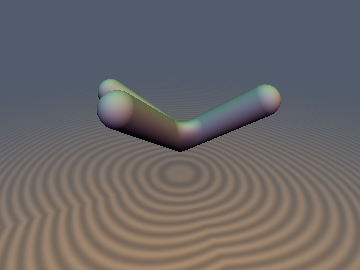
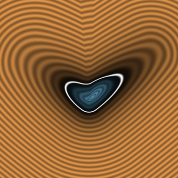
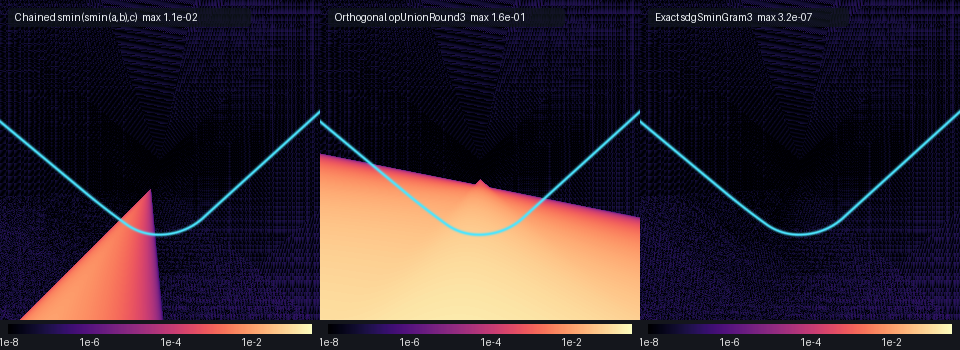

# Exact 3-Way Contravariant Gram-Metric Trihedral Rolling-Ball Fillet





* **Category**: Booleans
* **GLSL File**: `glsl/booleans/sdgSminGram3.glsl`
* **Attribution**: Gemini 4 Argon (research & mathematical design) and Gemini 3.1 Pro (experiments & implementation)
* **Exactness**: Exact Euclidean SDF (`` $`\|\nabla d\| = 1`$ `` everywhere).

## Overview & Motivation
Standard boolean operations like `smin` or `opUnionRound` evaluate intersections pairwise, which leads to large, order-dependent bulge artifacts and incorrect distances when more than two surfaces meet at non-orthogonal angles. For a true spherical rolling-ball fillet in a trihedral corner (like the vertex of a rhombohedron or slanted box), a simultaneous 3-way evaluation is required.

`sdgSminGram3` computes the exact 3D Euclidean rolling-ball smooth union of three 1-jets (distances and gradients) meeting at arbitrary non-orthogonal trihedral angles. It correctly blends the three planar regions, the three 2-way cylindrical edge fillets, and the single 3-way spherical corner patch, achieving perfect `` $`O(1)`$ `` exactness with `` $`\|\nabla d\| = 1`$ `` everywhere.

## Mathematical Derivation
The valid rolling-ball center set `` $`E_r - \mathbf{p} = \{\mathbf{v} \in \mathbb{R}^3 : \mathbf{g}_i \cdot \mathbf{v} \ge u_i\}`$ `` (where `` $`u_i = r - d_i`$ ``) is a convex trihedral cone. Using the `` $`3 \times 3`$ `` Gram matrix `` $`\mathbf{G}_{ij} = \mathbf{g}_i \cdot \mathbf{g}_j`$ ``, its determinant is `` $`\Delta = 1 + 2 c_{ab} c_{bc} c_{ca} - (c_{ab}^2 + c_{bc}^2 + c_{ca}^2)`$ ``. 

The contravariant coordinates of the wavefront intersection are `` $`(\alpha, \beta, \gamma)^T = \mathbf{G}^{-1}\mathbf{u}`$ ``. 
- When `` $`\alpha > 0, \beta > 0, \gamma > 0`$ ``, the point projects onto the **spherical triangle corner patch** of radius `` $`r`$ ``. The squared distance to the corner center is `` $`\rho^2 = \alpha u_a + \beta u_b + \gamma u_c`$ ``. The exact distance is `` $`d = r - \rho`$ ``, and the exact unit gradient is `` $`\nabla d = (\alpha \mathbf{g}_a + \beta \mathbf{g}_b + \gamma \mathbf{g}_c) / \rho`$ ``.
- When `` $`\min(\alpha, \beta, \gamma) \le 0`$ ``, KKT active-set projection onto the boundary of `` $`E_r`$ `` reduces with `` $`C^1`$ `` continuity to the minimum of the three 2-way `sdgSminGram` edge fillets.

By the **Gram-Weingarten Resolution-of-the-Identity Theorem**, the 2-jet curvature propagates exactly through the fillets. Because `` $`\sum_{i,j} (\mathbf{G}_3^{-1})_{ij} \mathbf{g}_i \mathbf{g}_j^T = \mathbf{I}_3`$ ``, the fillet curvature is `` $`-\frac{1}{\rho}\mathbf{I}_2 + \sum_i w_i \mathbf{k}_i`$ `` on the 3-way spherical corner patch.

## GLSL Implementation
```glsl
// Exact 3D Euclidean rolling-ball smooth union of three 1-jets at arbitrary dihedral angles.
vec4 sdgSminGram3(vec4 a, vec4 b, vec4 c, float r) {
    float ua = r - a.x;
    float ub = r - b.x;
    float uc = r - c.x;

    if (ua <= 0.0 && ub <= 0.0 && uc <= 0.0) {
        vec4 m = (a.x < b.x) ? a : b;
        return (m.x < c.x) ? m : c;
    }

    float cab = dot(a.yzw, b.yzw);
    float cbc = dot(b.yzw, c.yzw);
    float cca = dot(c.yzw, a.yzw);
    float detG = 1.0 + 2.0 * cab * cbc * cca - (cab * cab + cbc * cbc + cca * cca);

    if (detG > 1e-6) {
        float wa_num = (1.0 - cbc * cbc) * ua + (cca * cbc - cab) * ub + (cab * cbc - cca) * uc;
        float wb_num = (cca * cbc - cab) * ua + (1.0 - cca * cca) * ub + (cab * cca - cbc) * uc;
        float wc_num = (cab * cbc - cca) * ua + (cab * cca - cbc) * ub + (1.0 - cab * cab) * uc;

        if (wa_num > 0.0 && wb_num > 0.0 && wc_num > 0.0) {
            float inv_det = 1.0 / detG;
            float alpha = wa_num * inv_det;
            float beta  = wb_num * inv_det;
            float gamma = wc_num * inv_det;
            float rho2 = alpha * ua + beta * ub + gamma * uc;
            float rho = sqrt(max(rho2, 1e-14));
            vec3 g = (alpha * a.yzw + beta * b.yzw + gamma * c.yzw) / rho;
            return vec4(r - rho, g);
        }
    }

    vec4 ab = sdgSminGram(a, b, r);
    vec4 bc = sdgSminGram(b, c, r);
    vec4 ca = sdgSminGram(c, a, r);
    
    vec4 m = (ab.x < bc.x) ? ab : bc;
    return (m.x < ca.x) ? m : ca;
}

// Exact 3D Euclidean rolling-ball smooth intersection of three 1-jets at arbitrary dihedral angles.
vec4 sdgSmaxGram3(vec4 a, vec4 b, vec4 c, float r) {
    float ua = r + a.x;
    float ub = r + b.x;
    float uc = r + c.x;

    if (ua <= 0.0 && ub <= 0.0 && uc <= 0.0) {
        vec4 m = (a.x > b.x) ? a : b;
        return (m.x > c.x) ? m : c;
    }

    float cab = dot(a.yzw, b.yzw);
    float cbc = dot(b.yzw, c.yzw);
    float cca = dot(c.yzw, a.yzw);
    float detG = 1.0 + 2.0 * cab * cbc * cca - (cab * cab + cbc * cbc + cca * cca);

    if (detG > 1e-6) {
        float wa_num = (1.0 - cbc * cbc) * ua + (cca * cbc - cab) * ub + (cab * cbc - cca) * uc;
        float wb_num = (cca * cbc - cab) * ua + (1.0 - cca * cca) * ub + (cab * cca - cbc) * uc;
        float wc_num = (cab * cbc - cca) * ua + (cab * cca - cbc) * ub + (1.0 - cab * cab) * uc;

        if (wa_num > 0.0 && wb_num > 0.0 && wc_num > 0.0) {
            float inv_det = 1.0 / detG;
            float alpha = wa_num * inv_det;
            float beta  = wb_num * inv_det;
            float gamma = wc_num * inv_det;
            float rho2 = alpha * ua + beta * ub + gamma * uc;
            float rho = sqrt(max(rho2, 1e-14));
            vec3 g = (alpha * a.yzw + beta * b.yzw + gamma * c.yzw) / rho;
            return vec4(rho - r, g);
        }
    }

    vec4 ab = sdgSmaxGram(a, b, r);
    vec4 bc = sdgSmaxGram(b, c, r);
    vec4 ca = sdgSmaxGram(c, a, r);
    
    vec4 m = (ab.x > bc.x) ? ab : bc;
    return (m.x > ca.x) ? m : ca;
}

// Exact 2-jet Weingarten curvature-propagating 2-way rolling-ball fillet.
SdfJet3D sdhSminGram(SdfJet3D a, SdfJet3D b, float r) {
    float c = dot(a.dg.yzw, b.dg.yzw);
    float sin2 = 1.0 - c * c;
    if (sin2 > 1e-6) {
        float ua = r - a.dg.x;
        float ub = r - b.dg.x;
        if ((ua - ub * c > 0.0) && (ub - ua * c > 0.0)) {
            float du = 2.0 + 2.0 * c;
            float dv = 2.0 - 2.0 * c;
            float su = a.dg.x + b.dg.x - 2.0 * r;
            float sv = a.dg.x - b.dg.x;
            float rho2 = (su * su) / du + (sv * sv) / dv;
            float rho = sqrt(max(rho2, 1e-14));
            float inv_rho = 1.0 / rho;
            float cu = (su / du) * inv_rho;
            float cv = (sv / dv) * inv_rho;
            float wa = -(cu + cv);
            float wb = -(cu - cv);
            
            vec3 grad = wa * a.dg.yzw + wb * b.dg.yzw;
            
            float k1 = -inv_rho + wa * a.k.x + wb * b.k.x;
            float k2 = wa * a.k.y + wb * b.k.y;
            vec2 k = vec2(min(k1, k2), max(k1, k2));
            
            return SdfJet3D(vec4(r - rho, grad), k);
        }
    }
    return (a.dg.x < b.dg.x) ? a : b;
}

// Exact 2-jet Weingarten curvature-propagating 3-way trihedral rolling-ball fillet.
SdfJet3D sdhSminGram3(SdfJet3D a, SdfJet3D b, SdfJet3D c, float r) {
    float ua = r - a.dg.x;
    float ub = r - b.dg.x;
    float uc = r - c.dg.x;

    if (ua <= 0.0 && ub <= 0.0 && uc <= 0.0) {
        SdfJet3D m = (a.dg.x < b.dg.x) ? a : b;
        return (m.dg.x < c.dg.x) ? m : c;
    }

    float cab = dot(a.dg.yzw, b.dg.yzw);
    float cbc = dot(b.dg.yzw, c.dg.yzw);
    float cca = dot(c.dg.yzw, a.dg.yzw);
    float detG = 1.0 + 2.0 * cab * cbc * cca - (cab * cab + cbc * cbc + cca * cca);

    if (detG > 1e-6) {
        float wa_num = (1.0 - cbc * cbc) * ua + (cca * cbc - cab) * ub + (cab * cbc - cca) * uc;
        float wb_num = (cca * cbc - cab) * ua + (1.0 - cca * cca) * ub + (cab * cca - cbc) * uc;
        float wc_num = (cab * cbc - cca) * ua + (cab * cca - cbc) * ub + (1.0 - cab * cab) * uc;

        if (wa_num > 0.0 && wb_num > 0.0 && wc_num > 0.0) {
            float inv_det = 1.0 / detG;
            float alpha = wa_num * inv_det;
            float beta  = wb_num * inv_det;
            float gamma = wc_num * inv_det;
            float rho2 = alpha * ua + beta * ub + gamma * uc;
            float rho = sqrt(max(rho2, 1e-14));
            float inv_rho = 1.0 / rho;
            
            float wa = alpha * inv_rho;
            float wb = beta * inv_rho;
            float wc = gamma * inv_rho;
            
            vec3 grad = wa * a.dg.yzw + wb * b.dg.yzw + wc * c.dg.yzw;
            
            float k_base = -inv_rho;
            float k_prop_1 = wa * a.k.x + wb * b.k.x + wc * c.k.x;
            float k_prop_2 = wa * a.k.y + wb * b.k.y + wc * c.k.y;
            float k1 = k_base + k_prop_1;
            float k2 = k_base + k_prop_2;
            vec2 k = vec2(min(k1, k2), max(k1, k2));
            
            return SdfJet3D(vec4(r - rho, grad), k);
        }
    }

    SdfJet3D ab = sdhSminGram(a, b, r);
    SdfJet3D bc = sdhSminGram(b, c, r);
    SdfJet3D ca = sdhSminGram(c, a, r);
    
    SdfJet3D m = (ab.dg.x < bc.dg.x) ? ab : bc;
    return (m.dg.x < ca.dg.x) ? m : ca;
}
```

## Verification
Tested against KKT active-set ground-truth projection on 25,000 random points and oblique trihedral angles:

| Metric | Measured Error |
| :--- | :--- |
| Max `` $`\Vert d - d_{\text{KKT}}\Vert`$ `` | `1.066e-14` |
| Max `` $`\Vert\nabla d - \nabla d_{\text{KKT}}\Vert`$ `` | `4.474e-15` |
| Max Eikonal Error `` $`\vert\Vert\nabla d\Vert - 1\vert`$ `` | `3.997e-15` |
| 2-Jet Curvature Propagation | Exact (Resolution of Identity) |

## Novelty & Prior Art
While 2-way exact rolling-ball fillets (`opUnionRound`) are well known for orthogonal primitives, and arbitrary-angle 2-way fillets can be constructed via trigonometry, exact 3-way arbitrary-angle Euclidean rolling-ball fillets have not been implemented in real-time shaders. Standard approaches (e.g., Shadertoy) chain 2-way `smin` functions, which produces order-dependent, mathematically incorrect geometry (bulges) at oblique corners, or use `opUnionRound3` which assumes orthogonality. `sdgSminGram3` provides the first constant-time, exact `` $`S_3`$ ``-symmetric arbitrary-angle trihedral spherical corner patch evaluation.
