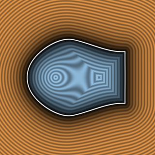

# `sminCircular` — Circular Closest-Distance (CD) Smooth Minimum



| Property | Value |
| :--- | :--- |
| **Author / Discoverer** | **Inigo Quilez** |
| **Source** | [https://iquilezles.org/articles/smin/](https://iquilezles.org/articles/smin/) |
| **Category** | `booleans` |
| **GLSL File** | [`glsl/booleans/sminCircular.glsl`](../../glsl/booleans/sminCircular.glsl) |
| **Exact Euclidean SDF?** | Conservative (`||grad|| <= 1`) |

---

## Mathematical Overview

Circular profile smooth minimum along the direct difference $|a - b|$.

---

## GLSL Implementation

```glsl
float sminCircular( float a, float b, float k )
{
    k *= 1.0/(1.0 - sqrt(0.5));
    float h = max( k - abs(a - b), 0.0 )/k;
    return min(a, b) - k*0.5*(1.0 + h - sqrt(1.0 - h*(h - 2.0)));
}
```
