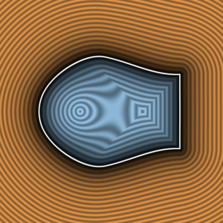

# `sminCircularApprox` — Polynomial Approximation of Circular CD Smooth Minimum



| Property | Value |
| :--- | :--- |
| **Author / Discoverer** | **Inigo Quilez** |
| **Source** | [https://iquilezles.org/articles/smin/](https://iquilezles.org/articles/smin/) |
| **Category** | `booleans` |
| **GLSL File** | [`glsl/booleans/sminCircularApprox.glsl`](../../glsl/booleans/sminCircularApprox.glsl) |
| **Exact Euclidean SDF?** | Conservative |

---

## Mathematical Overview

Degree-4 polynomial approximation of the circular CD kernel (`max_err = 1.08e-2`).

---

## GLSL Implementation

```glsl
float sminCircularApprox( float a, float b, float k )
{
    k *= 1.0/(1.0 - sqrt(0.5));
    float x = max( k - abs(a - b), 0.0 )/k;
    return min(a, b) - k*0.5*x*x*(x*(x*(1.0 - sqrt(0.5)) - (2.0 - sqrt(2.0))) + 1.0);
}
```
