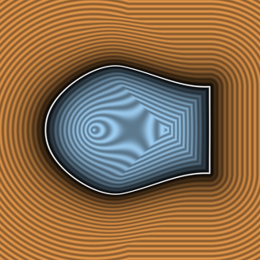

# `sminCircularGeom` — Circular Geometrical Smooth Minimum



| Property | Value |
| :--- | :--- |
| **Author / Discoverer** | **Inigo Quilez** |
| **Source** | [https://iquilezles.org/articles/smin/](https://iquilezles.org/articles/smin/) |
| **Category** | `booleans` |
| **GLSL File** | [`glsl/booleans/sminCircularGeom.glsl`](../../glsl/booleans/sminCircularGeom.glsl) |
| **Exact Euclidean SDF?** | Exact at 90 deg (non-conservative for acute angles) |

---

## Mathematical Overview

Strictly local (`a < k && b < k`), rigid, and associative circular fillet, but overestimates distance (`||grad d|| > 1`) when $\nabla a \cdot \nabla b > 0$.

---

## GLSL Implementation

```glsl
float sminCircularGeom( float a, float b, float k )
{
    k *= 1.0/(1.0 - sqrt(0.5));
    return max(k, min(a, b)) - length(max(k - vec2(a, b), 0.0));
}
```
