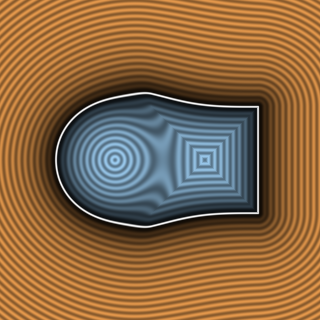

# `sminCubic` — $C^2$ Cubic & $C^2$-Symmetric Quartic Smooth Minimums, Material Blend & 3D Gradients



| Property | Value |
| :--- | :--- |
| **Author / Discoverer** | **Inigo Quilez** — extended with Quartic & 3D Gradients using **Gemini 4 Argon** (`sdf-gems`, 2026) |
| **Source** | [https://iquilezles.org/articles/smin/](https://iquilezles.org/articles/smin/) |
| **Category** | `booleans` |
| **GLSL File** | [`glsl/booleans/sminCubic.glsl`](../../glsl/booleans/sminCubic.glsl) |
| **Exact Euclidean SDF?** | Conservative (`||grad|| <= 1`, $C^2$ at blend boundaries; `sminQuartic` is $C^\infty$ across $a = b$) |

---

## Mathematical Overview

- **`sminCubic`, `sminCubicBlend`, `sdgSmoothCubic`**: $C^2$ cubic Closest-Distance (CD) polynomial smooth minimum with material blend weight and analytical 3D gradient (`2.74e-9` max central-FD error).
- **`sminQuartic`, `smaxQuartic`, `sdgSmoothQuartic`**: $C^2$-continuous quartic polynomial smooth minimum $h^3(4 - h) k / 16$ on $k_{\text{span}} = \frac{16}{3} k$. Because $h^3(4 - h) = 1 - 6 u^2 + 8 u^3 - 3 u^4$ (with $u = 1 - h = |a - b| / k_{\text{span}}$) has zero linear and cubic terms at $u = 0$, it eliminates the $|a - b|^3$ third-derivative cusp of `sminCubic` along the medial seam $a = b$.

---

## GLSL Implementation

```glsl
float sminCubic( float a, float b, float k )
{
    k *= 6.0;
    float h = max( k - abs(a - b), 0.0 ) / k;
    return min(a, b) - h * h * h * k * (1.0 / 6.0);
}

vec4 sdgSmoothCubic( in vec4 a, in vec4 b, in float k )
{
    k *= 6.0;
    float h = max( k - abs(a.x - b.x), 0.0 ) / k;
    float m = 0.5 * h * h;
    return vec4( min(a.x, b.x) - h * h * h * k * (1.0 / 6.0),
                 mix(a.yzw, b.yzw, (a.x < b.x) ? m : 1.0 - m) );
}

float sminQuartic( float a, float b, float k )
{
    k *= 16.0 / 3.0;
    float h = max( k - abs(a - b), 0.0 ) / k;
    return min(a, b) - h * h * h * (4.0 - h) * k * (1.0 / 16.0);
}

vec4 sdgSmoothQuartic( in vec4 a, in vec4 b, in float k )
{
    k *= 16.0 / 3.0;
    float h = max( k - abs(a.x - b.x), 0.0 ) / k;
    float m = 0.25 * h * h * (3.0 - h);
    float d = min(a.x, b.x) - h * h * h * (4.0 - h) * k * (1.0 / 16.0);
    return vec4( d, mix(a.yzw, b.yzw, (a.x < b.x) ? m : 1.0 - m) );
}
```
