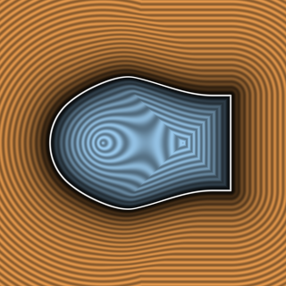

# `sminLocalOblique` — Pure-Scalar Local Oblique Smooth Minimum



| Property | Value |
| :--- | :--- |
| **Author / Discoverer** | **Dillon Cower (sdf-gems, 2026)** |
| **Source** | [https://github.com/dcower/sdf-gems](https://github.com/dcower/sdf-gems) |
| **Category** | `booleans` |
| **GLSL File** | [`glsl/booleans/sminLocalOblique.glsl`](../../glsl/booleans/sminLocalOblique.glsl) |
| **Exact Euclidean SDF?** | Conservative for theta >= acos(c0) & Strictly Local |

---

## Mathematical Overview

Parameterized by design cosine $c_0 \in (-1, 1)$: strictly local to the corner region $\max(a,b) - c_0\min(a,b) < 2k(1+\sqrt{(1+c_0)/2})$, rigid, and conservative for all intersection angles $\theta \ge \arccos(c_0)$.

---

## GLSL Implementation

```glsl
float sminLocalOblique( float a, float b, float k, float c0 )
{
    float a_s = min( a, b ), b_s = max( a, b );
    float c2  = sqrt( 0.5 + 0.5 * c0 );
    float h   = max( 2.0 * k * ( 1.0 + c2 ) - ( b_s - c0 * a_s ), 0.0 );
    if( h <= 0.0 ) return a_s;
    float w   = 0.5 * h * h / ( ( 1.0 + c0 ) * ( 1.0 + c2 ) );
    float u   = k - ( 1.0 - c2 ) * a_s;
    return a_s - w / ( u + sqrt( u * u + ( 1.0 - c2 ) * w ) );
}
```
