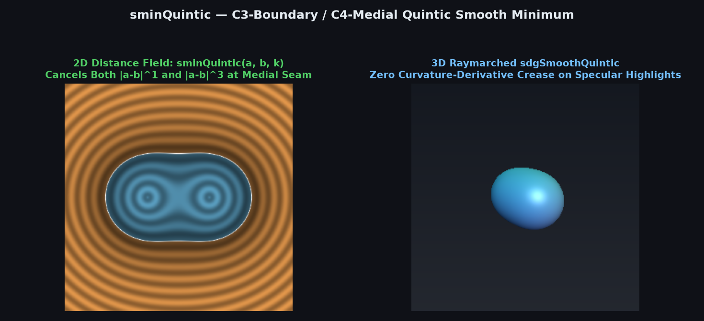
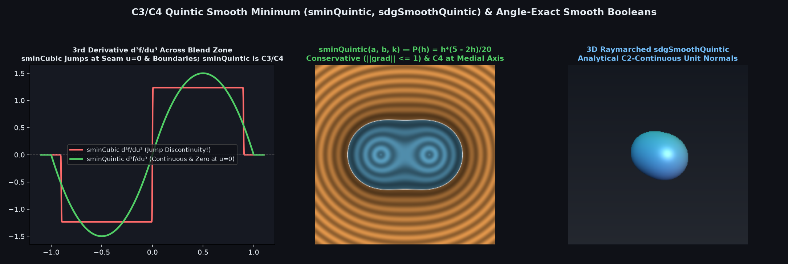

# `sminQuintic` — $C^3$-Boundary / $C^4$-Medial Quintic Polynomial Smooth Minimum



| Property | Value |
| :--- | :--- |
| **Author / Discoverer** | **Discovered and derived using Gemini 4 Argon (sdf-gems, 2026)** |
| **Source** | [https://iquilezles.org/articles/smin/](https://iquilezles.org/articles/smin/) |
| **Category** | `booleans` |
| **GLSL File** | [`glsl/booleans/sminQuintic.glsl`](../../glsl/booleans/sminQuintic.glsl) |
| **Exact Euclidean SDF?** | Conservative ($\|\nabla f\| \in [1/\sqrt{2}, 1]$, $C^3$-continuous at blend boundaries, $C^4$-continuous across medial seam $a = b$) |

---

## Mathematical Overview



In the Closest-Distance (CD) polynomial smooth minimum $f(a, b) = \min(a, b) - R \, P(h)$ with $h = \max(1 - |a - b|/R, 0)$ and $u = 1 - h = |a - b|/R$:
$$\min(a, b) - R \, P(1 - u) = \frac{a + b}{2} - R \left[\frac{u}{2} + P(1 - u)\right].$$
In [`sminCubic`](sminCubic.md), $P(h) = \frac{1}{6} h^3$ leaves a non-zero cubic singular term $+\frac{|a - b|^3}{6 R^2}$ across the medial bisector $a = b$, causing a jump discontinuity of $2/R^2$ in $\partial^3 f / \partial u^3$ at both $|a - b| = R$ and $a = b$ (visible as curvature-derivative creases on glossy specular surfaces).

Requiring $P(0) = P'(0) = P''(0) = P'''(0) = 0$ ($C^3$ continuity at $|a - b| = R$) **and** vanishing odd derivatives $P'(1) = \frac{1}{2}$ and $P'''(1) = 0$ ($C^4$ continuity across $a = b$) uniquely determines the degree-5 polynomial:
$$P(h) = \frac{h^4 (5 - 2 h)}{20}, \qquad P'(h) = \frac{h^3 (2 - h)}{2} \in \left[0, \frac{1}{2}\right], \qquad P''(h) = h^2 (3 - 2 h) \ge 0, \qquad P'''(h) = 6 h (1 - h).$$
Normalizing $f(0, 0) = -k$ sets $R = \frac{20}{3} k$. Around $a = b$, the Taylor expansion is:
$$f(a, b) = \frac{a + b}{2} - k - \frac{(a - b)^2}{2 R} + \frac{(a - b)^4}{4 R^3} - \frac{|a - b|^5}{5 R^4},$$
cancelling **both** $|a - b|^1$ and $|a - b|^3$ identically.

---

## GLSL Implementation

```glsl
float sminQuintic( float a, float b, float k )
{
    k *= 20.0 / 3.0;
    float h = max( k - abs(a - b), 0.0 ) / k;
    return min(a, b) - h * h * h * h * (5.0 - 2.0 * h) * k * (1.0 / 20.0);
}

vec4 sdgSmoothQuintic( in vec4 a, in vec4 b, in float k )
{
    k *= 20.0 / 3.0;
    float h = max( k - abs(a.x - b.x), 0.0 ) / k;
    float m = 0.5 * h * h * h * (2.0 - h);
    float d = min(a.x, b.x) - h * h * h * h * (5.0 - 2.0 * h) * k * (1.0 / 20.0);
    return vec4( d, mix(a.yzw, b.yzw, (a.x < b.x) ? m : 1.0 - m) );
}
```
