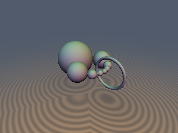
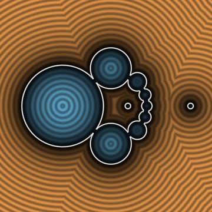
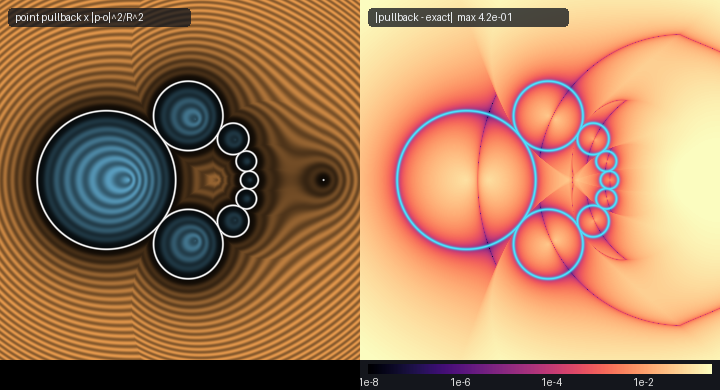

# cgaRounds: transform the object, not the query point

 


*Left: the usual "invert the point, rescale by $`|p-o|^2/R^2`$" estimate of a Steiner chain. Right: its error against the exact object transform (same zero set, wrong distances).*

| Property | Value |
|---|---|
| Category | `cga` (research experiment) |
| GLSL file | [`glsl/cga/cgaRounds.glsl`](../../glsl/cga/cgaRounds.glsl) |
| Attribution | Claude Fable 5.2 (the geometry itself is classical) |
| `sdCgaRound`, `sdgCgaRound`, `sdCgaDual` | Exact (sphere / plane / ball complement) |
| `udCgaCircle`, `sdCgaTorus`, `udCgaPointPair` | Exact (circle / line / torus / two points) |
| `cgaInvert(CgaRound)`, `cgaMove` | Exact image, including the degenerate case (sphere through the inversion centre) |
| `cgaInvert(CgaCircle)` | Exact image **except near the circle's axis**, where it fails (see Findings) |
| `sdCgaSteinerChain` | Exact outside the solid; inside: sign correct, magnitude not verified |

## Idea

Sphere inversion $`x \mapsto o + R^2 (x-o)/|x-o|^2`$ maps spheres and planes to spheres and planes, and circles and lines to circles and lines. So instead of inverting the query point and patching the distance with a Jacobian factor (an estimate, not a distance), invert the *object* once and evaluate an exact distance to the image. A sphere or plane is stored "anchored": a surface point $`a`$, the unit normal $`u`$ there and a signed curvature $`k`$ ($`k=0`$ is a plane, $`k<0`$ a ball complement), with $`y = p - a`$:

```math
f = y\cdot(\tfrac12 k\,y + u), \qquad d = \frac{2f}{1 + |k\,y + u|}
```

This has no $`0/0`$ at $`k = 0`$. A circle or line is stored as a curve point, the unit direction to the centre, the plane normal and a curvature $`k \ge 0`$. The object transforms do not depend on $`p`$ and can be hoisted out of per-pixel code.

## Verification

Literal GLSL on the GPU (FP32), 5,000 points per case (4,000 uniform in $`[-2,2]^3`$, 1,000 near the surface), **one parameter set per case**. Ground truth is FP64 from the definition: points of the original object pushed through the inversion, nearest by KD-tree (400,000 points), refined along the curve parameter for circles and lines. Spheres and planes are also compared with the textbook closed-form image. NaN/Inf count was 0 in every case.

| Case | max abs error |
|---|---|
| Inverted sphere, centre outside / inside (ball complement), closed form | 4.9e-7 / 4.9e-7 |
| Same against the point cloud (limited by cloud spacing) | 4.2e-3 / 1.2e-2 |
| Sphere missing the centre by $`10^{-4} r`$ / exactly through it (image is a plane) | 8.7e-7 / 1.5e-7 |
| Inverted plane / plane missing the centre by $`10^{-4}`$, closed form | 6.4e-7 / 6.5e-7 |
| `sdgCgaRound` distance / gradient | 4.9e-7 / 3.1e-7 |
| `sdCgaDual` of the image / `cgaMove` of the sphere image | 5.6e-7 / 5.3e-7 |
| Inverted circle / circle missing the centre by $`10^{-3}`$ | 7.7e-7 / 8.5e-7 |
| `sdCgaTorus` (tube 0.05) / `cgaMove` of the circle image | 8.2e-7 / 9.8e-7 |
| Inverted line / line missing the centre by $`10^{-3}`$ (closed form) | 1.2e-6 / 9.6e-7 |
| Untransformed circle / line | 6.8e-7 / 6.5e-7 |
| `udCgaPointPair` of two inverted points | 4.0e-7 |
| `sdCgaSteinerChain`, 4,939 exterior points (sign agreement 100% on all 5,000) | 6.3e-7 |
| **Inverted circle, centre $`o`$ on the circle's axis** | **0.41 (wrong)** |
| Same, $`o`$ at 0.3 / 0.1 / 0.01 / 1e-3 / 1e-4 / 1e-5 / 1e-6 from the axis | 7.0e-7 / 1.5e-6 / 2.1e-6 / 7.9e-5 / 7.9e-4 / 7.9e-3 / 0.11 |

The plane-vs-cloud check gave 6.0e-2 because that cloud was a sparse Gaussian patch; it is a weak check and the closed form is the one to trust there. Single-translation-unit compile passed in all three orders (300 files).

## Findings

**Held.** Exact distances to the images of spheres, planes, circles, lines and point pairs agree with ground truth to about 1e-6 in FP32, including objects passing through or almost through the inversion centre (image radius up to about 12,000), with no NaN. The point-pullback estimate is not a usable distance: on 196,277 exterior points of the chain, estimate / exact ranged from 0.057 to 1.856 (median 1.27) and it overestimated at 86.9% of them, so it oversteps without a safety factor.

**Failed.** `cgaInvert(CgaCircle)` anchors the image at the point of the circle farthest from $`o`$. On the circle's axis every point is equally far and the choice is rounding noise: the error is 0.41 on the axis and roughly $`8\cdot10^{-8}/\delta`$ at distance $`\delta`$ from it (circle radius 0.7). It is not fixed here; keep $`\delta \gtrsim 0.01`$ or treat the result as unverified.

**Limit of the idea.** Only zero-thickness circles and lines transform exactly. The Möbius image of a *thick* circle (torus) is a Dupin cyclide with varying tube radius; `sdCgaTorus` of the image circle is a constant-radius torus, a different shape. The same holds for any thickened or rounded object.

**Open.** A stable anchor for the on-axis circle; an exact Dupin cyclide distance; whether the anchored form beats the origin-centred 5-vector `sdCgaDual` in FP32 far from the origin (claimed in the source, not measured here).

## Prior art (from memory, not checked in this session)

Conformal geometric algebra represents these objects and their inversions as blades and versors (Hestenes; Dorst, Fontijne and Mann, *Geometric Algebra for Computer Science*); CGA ray tracers and ganja.js demos exist. Shadertoy inversion and Apollonian shaders generally use the point pullback with a scale factor. Steiner chains and Dupin cyclides are classical. Nothing here is new mathematics; what may be new is the anchored, division-safe GLSL packaging and the measurements above. No novelty search was run.

## Not done

Eikonal, self-projection, Lipschitz and `exactness_certificate` checks; randomised parameters (each row is one configuration); `raymarch_stats`; the interior of `sdCgaSteinerChain`; the 3D preview fills somewhat less of the frame than the house target.
Reproduce: `uv run --with scipy python <scratch>/cga/t2_gpu.py` (numbers) and `<scratch>/cga/t3_img.py` (images, pullback statistics).
