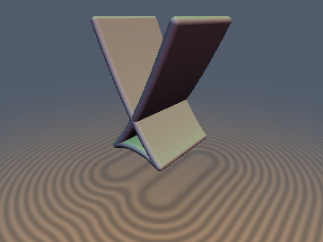
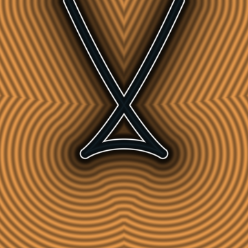
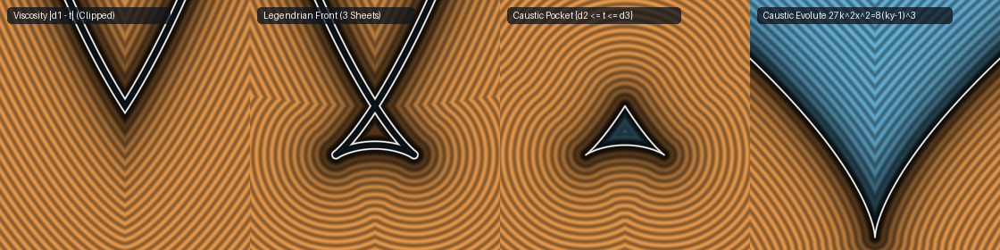

# `ctLegendrianWavefront` — Contact Geometry, Multi-Valued Legendrian Wavefronts, $`A_3`$ Swallowtails & Caustic Evolutes

| 3D Arnold $`A_3`$ Swallowtail Wavefront Shell (`sdSwallowtailWavefront3D`) | 2D Cross-Section Slice |
| :---: | :---: |
|  |  |

| Property | Value |
| :--- | :--- |
| **Category** | `contact` (research experiment) |
| **GLSL File** | [`glsl/contact/ctLegendrianWavefront.glsl`](../../glsl/contact/ctLegendrianWavefront.glsl) |
| **Attribution** | Multi-valued generating-family formulations, Huygens–Legendrian Cusp Stationarity Theorem, Same-Sign Half-Pole Ellipse Reconstruction, Darboux-convex evolute solver, and GPU verification by **Gemini 4 Argon** (`sdf-gems`, 2026). The underlying contact geometry, Legendrian front projections, and $`A_3`$ swallowtail singularities are classical (Huygens 1673, Apollonius, Arnold 1972–1990). |
| **Exactness** | `ctParabolaMultiSDF2D`: Exact 3-sheeted normal distances $`(d_1 \le d_2 \le d_3)`$ satisfying $`\Vert\nabla d_i\Vert = 1`$ on every sheet inside the caustic. `ctParabolaWavefront2D` / `sdgParabolaWavefront2D`: **Exact 2D Euclidean SDF** to the entire self-intersecting 3-sheeted $`A_3`$ swallowtail wavefront (closed form, $`C^0`$ across the evolute). `sdSemiCubicalEvolute2D` / `sdParaboloidCaustic3D`: **Exact Euclidean SDF** to the semi-cubical caustic $`27 k^2 x^2 = 8(k y - 1)^3`$. `ctEllipseMultiSDF2D` / `ctEllipseWavefront2D`: **Exact 4-sheeted normal distances and wavefront SDF** (closed form, 1 cubic resolvent). `sdSwallowtailWavefront3D` / `sdgSwallowtailWavefront3D`: **Exact 3D Euclidean SDF** and unit gradient to the thickened 3D swallowtail shell. |

---

## Overview & Motivation

When an initial smooth curve or surface $`\Sigma_0`$ propagates along its inward unit normal $`\mathbf{n}`$ by distance $`t`$, the classical Euclidean signed distance field $`d(\mathbf{x}) - t = 0`$ gives the **viscosity solution** of the Eikonal equation $`\Vert\nabla d\Vert = 1`$. Because $`d(\mathbf{x}) = \min_{\mathbf{y} \in \Sigma_0} \Vert\mathbf{x} - \mathbf{y}\Vert`$ takes only the global minimum over the surface, it clips the propagating wavefront at the **Maxwell set** (shock locus / medial axis), erasing the self-intersecting **Arnold $`A_3`$ swallowtail** and retrograde caustic sheets that appear in geometrical optics, acoustic wavefronts, and Hamiltonian–Jacobi phase space.

In **Arnold's contact geometry**, the propagating wavefront is the **Legendrian front projection** $`\pi : L_t \subset J^1(S^{n-1}) \to \mathbb{R}^n`$ of a smooth Legendrian submanifold lifted into the 1-jet bundle (or unit cotangent bundle $`ST^*\mathbb{R}^n`$ with contact 1-form $`\alpha = dt - \mathbf{p}\cdot d\mathbf{x}`$), where the Reeb flow $`\dot{\mathbf{x}} = \mathbf{p},\ \dot{\mathbf{p}} = \mathbf{0},\ \dot{t} = 1`$ is globally diffeomorphic for all $`t \in \mathbb{R}`$. Singularities appear only under projection to base space $`\mathbb{R}^n`$, governed by the **generating family**:

```math
E(s; \mathbf{x}) = \frac{1}{2}\Vert\mathbf{x} - \boldsymbol{\gamma}(s)\Vert^2, \qquad
\frac{\partial E}{\partial s}(s; \mathbf{x}) = -\big(\mathbf{x} - \boldsymbol{\gamma}(s)\big)\cdot\boldsymbol{\gamma}'(s) = 0.
```

Beyond the **caustic evolute** (where $`\partial_s E = \partial_s^2 E = 0`$), the stationarity equation has multiple real roots $`s_1(\mathbf{x}), s_2(\mathbf{x}), \dots`$, yielding a **multi-valued SDF** $`d_1(\mathbf{x}) \le d_2(\mathbf{x}) \le d_3(\mathbf{x})`$ where **every branch $`d_i(\mathbf{x})`$-sheet is an exact local solution of the Eikonal equation $`\Vert\nabla d_i(\mathbf{x})\Vert = 1`$**.



*Left to right ($`k = 1,\ t = 1.85`$): (1) Classical viscosity SDF offset $`\vert d_1(\mathbf{x}) - t\vert`$ (clips at the $`x = 0`$ Maxwell seam, erasing the swallowtail); (2) Full 3-sheeted Legendrian front `ctParabolaWavefront2D` showing the primary wings, crossed self-intersection, and cusped retrograde arc; (3) Exact SDF `sdSwallowtailPocket2D` of the retrograde caustic pocket $`\{d_2(\mathbf{x}) \le t \le d_3(\mathbf{x})\}`$; (4) Exact SDF `sdSemiCubicalEvolute2D` of the semi-cubical caustic evolute $`27 k^2 x^2 = 8(k y - 1)^3`$.*

---

## Mathematical Derivation

### 1. Multi-Sheeted Generating Family of the Parabola (`ctParabolaMultiSDF2D`)

For the parabola $`\boldsymbol{\gamma}(s) = (s,\, \frac{1}{2}k s^2)`$ with vertex curvature $`k > 0`$ and inward unit normal $`\mathbf{n}(s) = (-k s, 1)/\sqrt{1 + k^2 s^2}`$, the stationarity condition $`\partial_s E(s; x, y) = 0`$ is the depressed cubic:

```math
s^3 - 3 p_c s - 2 q_c = 0, \qquad p_c = \frac{2(k y - 1)}{3 k^2}, \qquad q_c = \frac{x}{k^2}.
```

Its discriminant $`h = q_c^2 - p_c^3`$ vanishes on the **semi-cubical parabola evolute**:

```math
27 k^2 x^2 = 8(k y - 1)^3, \qquad \mathbf{e}(s) = \left(-k^2 s^3,\; \frac{1}{k} + \frac{3}{2} k s^2\right).
```

- **Outside the evolute ($`h \ge 0`$, 1 sheet)**: A single real root $`s_1`$ (stabilized near $`x = 0`$ for $`p_c < 0`$ via sum-of-cubes rationalization $`2 q_c / (r^2 - p_c + (p_c/r)^2)`$) gives the classical viscosity SDF $`d_1(\mathbf{x})`$.
- **Inside the evolute ($`h < 0`$, 3 sheets)**: Viète's trigonometric trisection yields three distinct real roots $`s_1, s_2, s_3`$. At every stationary root $`s_i`$, the displacement $`\mathbf{x} - \boldsymbol{\gamma}(s_i) = (y - \frac{1}{2}k s_i^2)(-k s_i, 1)`$ is an exact scalar multiple of $`\mathbf{n}(s_i)`$, giving three positive normal distances $`0 < d_1(\mathbf{x}) \le d_2(\mathbf{x}) \le d_3(\mathbf{x})`$ with unit gradients $`\nabla d_i(\mathbf{x}) = \mathbf{n}(s_i(\mathbf{x}))`$:

```math
\tau_i(\mathbf{x}) = \left(y - \frac{1}{2}k s_i^2\right)\sqrt{1 + k^2 s_i^2}, \qquad \Vert\nabla \tau_i(\mathbf{x})\Vert = 1 \quad (i = 1, 2, 3).
```

### 2. Sheet Ordering, Maxwell vs. Caustic Collisions, and 2D vs. 3D Maslov Indices

Ordering the three normal distances as $`d_1(\mathbf{x}) \le d_2(\mathbf{x}) \le d_3(\mathbf{x})`$ inside the caustic horn reveals a fundamental distinction between **Maxwell seams** and **caustic bifurcations**, as well as between **2D planar** and **3D revolved** Morse/Maslov indices:

| Sheet (ordered by value) | Root $`s_i`$ (for $`x > 0`$) | Wavefront locus $`d_i(\mathbf{x}) = t`$ | Seam collision | 1D/2D Morse index (planar parabola) | 2D/3D Maslov index (revolved paraboloid) |
| :--- | :--- | :--- | :--- | :---: | :---: |
| $`d_1(\mathbf{x})`$ | $`s_+ > s_{\text{cross}} > 0`$ (same side) | **Primary viscosity sheet** | Meets $`d_2`$ on the **Maxwell axis** $`x = 0`$ ($`d_1 = d_2 < d_3`$) | $`0`$ (local min, $`\partial_s^2 E > 0`$) | $`0`$ (signature $`(+,+)`$, 0 foci passed) |
| $`d_2(\mathbf{x})`$ | $`s_- < -s_{\text{cusp}} < 0`$ (far opposite) | **Crossed self-intersecting wings** | Meets $`d_1`$ at $`x = 0`$; meets $`d_3`$ at the **evolute** ($`d_1 < d_2 = d_3`$) | $`0`$ (local min, $`\partial_s^2 E > 0`$) | $`1`$ (saddle $`(+,-)`$, passed axial focus $`r=0`$) |
| $`d_3(\mathbf{x})`$ | $`s_{\text{mid}} \in (-s_{\text{cusp}}, 0)`$ (near vertex) | **Cusped retrograde caustic sheet** | Meets $`d_2`$ tangentially at the **evolute cusps** $`\mathbf{c}_\pm(t)`$ | $`1`$ (local max, $`\partial_s^2 E < 0`$) | $`2`$ (local max $`(-,-)`$, passed axial + evolute foci) |

 Consequently, the triangular **swallowtail caustic pocket** is bounded above/laterally by the crossed wings $`d_2(\mathbf{x}) = t`$ (meeting on the symmetry axis at $`y_{\text{cross}} = (k t^2 + 1)/(2k)`$) and below by the concave retrograde sheet $`d_3(\mathbf{x}) = t`$ (passing through $`(0, t)`$), so its interior is the exact region $`\{d_2(\mathbf{x}) < t < d_3(\mathbf{x})\}`$.

### 3. The Huygens–Legendrian Cusp Stationarity Theorem (`ctParabolaWavefront2D`, `ctEllipseWavefront2D`)

A naive multi-sheeted wavefront approximation $`\min_i \vert d_i(\mathbf{x}) - t\vert`$ **fails** outside the evolute (error up to $`0.707`$ for $`k = 1, t = 2`$): outside the evolute $`d_2, d_3`$ are complex, so $`\min_i \vert d_i - t\vert = \vert d_1 - t\vert`$ jumps discontinuously across the evolute and misses the swallowtail cusps.

For **any** smooth curve $`\boldsymbol{\gamma}(s)`$ with curvature $`\kappa(s)`$, its offset wavefront $`\boldsymbol{\gamma}_t(s) = \boldsymbol{\gamma}(s) + t\,\mathbf{n}(s)`$ has tangent $`\boldsymbol{\gamma}_t'(s) = (1 - t\kappa(s))\boldsymbol{\gamma}'(s)`$ by the Frenet–Serret formulas. Differentiating the squared distance to $`\boldsymbol{\gamma}_t(s)`$ yields the **Factored Parallel-Curve Stationarity Identity**:

```math
\frac{\partial}{\partial s}\left(\frac{1}{2}\Vert\mathbf{x} - \boldsymbol{\gamma}_t(s)\Vert^2\right) = \big(1 - t\,\kappa(s)\big)\,\frac{\partial}{\partial s}\left(\frac{1}{2}\Vert\mathbf{x} - \boldsymbol{\gamma}(s)\Vert^2\right) = 0.
```

Every critical point of the distance to $`\boldsymbol{\gamma}_t(s)`$ is therefore **either** a normal ray $`s_i(\mathbf{x})`$ of the base curve $`\boldsymbol{\gamma}(s)`$ (at distance $`\vert d_i(\mathbf{x}) - t\vert`$) **or** a **Legendrian cusp singularity** where $`1 - t\kappa(s_{\text{cusp}}) = 0`$. For the parabola ($`k t > 1`$), the two swallowtail cusps lie in closed form at:

```math
\mathbf{c}_\pm(t) = \left(\pm\frac{\big((k t)^{2/3} - 1\big)^{3/2}}{k},\; \frac{3(k t)^{2/3} - 1}{2k}\right).
```

By **Huygens' Evolute Arc-Length Theorem** (1673), for any point $`\mathbf{x} = \mathbf{e}(s_0)`$ on the evolute, the bifurcating sheet distance $`\vert d_2(\mathbf{e}(s_0)) - t\vert = \vert d_3(\mathbf{e}(s_0)) - t\vert = \vert R(s_0) - R(s_{\text{cusp}})\vert`$ equals the **arc length along the evolute** from $`\mathbf{c}_\pm(t)`$ to $`\mathbf{e}(s_0)`$, which always exceeds the straight Euclidean chord length $`\Vert\mathbf{e}(s_0) - \mathbf{c}_\pm(t)\Vert`$:

```math
\Vert\mathbf{e}(s_0) - \mathbf{c}_\pm(t)\Vert \le \left\vert\int_{s_{\text{cusp}}}^{s_0} \Vert\mathbf{e}'(s)\Vert\,ds\right\vert = \vert R(s_0) - t\vert = \vert d_2(\mathbf{e}(s_0)) - t\vert.
```

Thus, taking the minimum of $`\vert d_i(\mathbf{x}) - t\vert`$ with the cusp distance $`\Vert\mathbf{x} - \mathbf{c}_\pm(t)\Vert`$ yields the **exact Euclidean SDF** of the entire self-intersecting 3-sheeted $`A_3`$ swallowtail wavefront on all of $`\mathbb{R}^2`$ and restores **exact $`C^0`$ continuity** across the evolute seam.

### 4. Exact Caustic Evolute SDF via Darboux-Convex Quartic (`sdSemiCubicalEvolute2D`)

In scaled coordinates $`X = k\vert x\vert \ge 0,\ Y = k y - 1`$, the evolute is $`\mathbf{E}(u) = (u^3, \frac{3}{2}u^2)`$ for $`u \ge 0`$. Differentiating $`\frac{1}{2}\Vert\mathbf{E}(u) - (X, Y)\Vert^2`$ gives $`\frac{3}{2}u\,g(u) = 0`$ where:

```math
g(u) = 2 u^4 + 3 u^2 - 2 X u - 2 Y, \qquad g''(u) = 24 u^2 + 6 \ge 6 > 0 \quad \forall u \in \mathbb{R}.
```

Because $`g`$ is **strictly convex everywhere**, the initial guess $`u_0 = \max(X^{1/3}, \sqrt{\max(2Y/3, 0)})`$ satisfies $`u_0^4 - X u_0 \ge 0`$ and $`3 u_0^2 - 2Y \ge 0`$, so $`g(u_0) \ge 0`$ and $`g'(u_0) \ge 6X + 6u_0 \ge 0`$: $`u_0`$ is a **certified Darboux upper bracket** from which 5 pure polynomial Newton steps converge monotonically to machine precision (combined with the cusp check $`u = 0`$).

### 5. Ellipse Multi-SDF & Swallowtail Perestroika (`ctEllipseMultiSDF2D`, `ctEllipseWavefront2D`)

For an ellipse $`(a\cos\theta, b\sin\theta)`$ with $`0 < a \le b`$ and $`l = b^2 - a^2,\ e = l/2`$, the Euler–Cardano resolvent discriminant $`D = C^3 + (l a b\, p_x p_y)^2`$ of the secular quartic $`x^2/(v-e)^2 + y^2/(v+e)^2 = 1`$ satisfies $`D < 0`$ **if and only if** $`\mathbf{p}`$ lies inside the **stretched astroid evolute** $`(a\vert p_x\vert)^{2/3} + (b\vert p_y\vert)^{2/3} < l^{2/3}`$.
- Inside the evolute ($`D < 0`$), all **4 real roots** $`v = \frac{1}{2}(\pm\text{rz}_1 \pm \text{rz}_2 \pm \text{rz}_3)`$ are obtained from the **single** trigonometric resolvent solve already used in `sdEllipse2D`.
- Outside the evolute ($`D \ge 0`$), the **2 real roots** (primary minimum and antipodal maximum) are $`v_\pm = \frac{1}{2}(l(x^2-y^2)/Z_m \pm \sqrt{2(Z_m+Z_x)})`$.
- **Same-Sign Half-Pole Reconstruction** eliminates all $`0/0`$ singularities on the axes $`p_x = 0`$ ($`v = +e`$) and $`p_y = 0`$ ($`v = -e`$): when $`v \ge 0`$, $`v + e \ge \max(y, e) > 0`$ has no subtractive cancellation so $`\sin\theta = y/(v+e)`$; when $`v < 0`$, $`v - e \le -\max(x, e) < 0`$ has no subtractive cancellation so $`\cos\theta = x/(v-e)`$.
- When $`a^2/b < t < b^2/a`$, adding the 4 cusps $`\mathbf{c}_{\pm,\pm}(t)`$ where $`b^2\cos^2\theta + a^2\sin^2\theta = (a b t)^{2/3}`$ yields the exact Euclidean distance to the two-swallowtail ellipse wavefront; for $`t \ge b^2/a`$, the cusps annihilate in a **Legendrian perestroika** and the antipodal sheet $`v_-`$ carries the smooth inside-out wavefront outside the evolute.

---

## GLSL API Summary

| Function | Signature | Return Value |
| :--- | :--- | :--- |
| `ctParabolaMultiSDF2D` | `(vec2 p, float k)` | `vec4(d1, d2, d3, numSheets)` ($`d_1 \le d_2 \le d_3`$, $`\Vert\nabla d_i\Vert = 1`$) |
| `ctParabolaWavefront2D` / `sdgParabolaWavefront2D` | `(vec2 p, float k, float tOffset)` | Exact 2D distance (`float`) / `vec3(d, grad.xy)` to full 3-sheeted $`A_3`$ swallowtail front |
| `sdSwallowtailPocket2D` | `(vec2 p, float k, float tOffset)` | Exact 2D signed distance to the retrograde caustic pocket $`\{d_2 \le t \le d_3\}`$ |
| `sdSemiCubicalEvolute2D` / `sdgSemiCubicalEvolute2D` | `(vec2 p, float k)` | Exact 2D distance / `vec3(d, grad.xy)` to $`27 k^2 x^2 = 8(k y - 1)^3`$ |
| `sdParaboloidCaustic3D` / `sdgParaboloidCaustic3D` | `(vec3 p, float k)` | Exact 3D distance / `vec4(d, grad.xyz)` to revolved 3D caustic horn |
| `ctEllipseMultiSDF2D` | `(vec2 p, vec2 ab)` | `vec4(d1, d2, d3, numSheets)` (first 3 of up to 4 normal sheets + sheet count) |
| `ctEllipseWavefront2D` | `(vec2 p, vec2 ab, float tOffset)` | Exact 2D Euclidean distance to the multi-sheeted ellipse wavefront |
| `sdSwallowtailWavefront3D` / `sdgSwallowtailWavefront3D` | `(vec3 p, float tOffset)` (+ 6-arg overload) | Exact 3D distance / `vec4(d, grad.xyz)` to the 3D Arnold $`A_3`$ swallowtail shell |

---

## Verification

All functions were tested in FP64 Python prototypes and via the literal GLSL compiled on the GPU (OpenGL 4.1 FP32 via `tools/gpu_eval.py`) against 100,000–120,000-vertex independent polyline ground truths and ground-truth-free exactness certificates.

| Check | Result |
| :--- | :--- |
| Single-translation-unit compile (`sdf_gems.glsl` + `ctLegendrianWavefront.glsl`, 302 files, 3 orders) | **PASS** (`forward`, `reverse`, `new-first`) |
| `NaN` / `Inf` across random + axis/origin/diagonal/cusp probe points | **0 / 106,420** (`ctParabolaMultiSDF2D`), **0 / 26,605** (all 2D), **0 / 28,209** (3D) |
| Sheet ordering $`d_1 \le d_2 \le d_3`$ on 26,605 points | **0 violations** |
| Local Eikonal accuracy $`\vert\Vert\nabla_{\text{FD}} d_i\Vert - 1\vert`$ inside caustic ($`i = 1, 2, 3`$) | Median $`3.57\times 10^{-5}`$ ($`d_1`$), $`1.54\times 10^{-4}`$ ($`d_2`$), $`7.43\times 10^{-5}`$ ($`d_3`$); **100%** within $`10^{-2}`$ on all 3 sheets |
| `ctParabolaWavefront2D` vs. 120k-vertex ground truth (20,000 pts, $`k=1, t=1.85`$) | Max error $`4.24\times 10^{-5}`$, mean $`2.30\times 10^{-7}`$, Lipschitz $`1.000028`$; FP64 vs. Brent polish: $`4.59\times 10^{-14}`$ |
| `ctParabolaWavefront2D` $`C^0`$ continuity across the evolute seam (1,000 seam pairs, $`\epsilon = 10^{-5}`$) | Max jump $`2.50\times 10^{-5} \le 2\epsilon + 10^{-4}`$ (**0 violations**) |
| `sdSemiCubicalEvolute2D` exactness certificate (20,000 pts + 3,000 surface pts) | Max GT error $`1.49\times 10^{-6}`$, Lipschitz $`1.000010`$, surface $`\vert d\vert \le 1.06\times 10^{-6}`$, self-projection $`7.39\times 10^{-7}`$ |
| `ctEllipseWavefront2D` vs. 100k-vertex ground truth ($`a=1, b=1.6, t=1.25`$) | Max error $`1.87\times 10^{-6}`$, mean $`9.90\times 10^{-8}`$, Lipschitz $`1.000011`$ |
| `sdSwallowtailWavefront3D` & `sdgSwallowtailWavefront3D` (25,000 3D pts) | $`\vert dg.x - d\vert \le 1.19\times 10^{-7}`$, $`\vert\Vert\mathbf{g}\Vert - 1\vert \le 2.28\times 10^{-7}`$, Lipschitz $`0.999973`$, self-projection median $`4.44\times 10^{-8}`$ |

---

## Findings

**What held**

1. *Every sheet of the Legendrian generating family is locally Eikonal.* Inside the caustic evolute, all three sheets $`d_1, d_2, d_3`$ of `ctParabolaMultiSDF2D` (and all four sheets of `ctEllipseMultiSDF2D`) satisfy $`\Vert\nabla d_i(\mathbf{x})\Vert = 1`$ to FP32 precision on 100% of interior points, with analytical unit gradient $`\nabla d_i(\mathbf{x}) = \mathbf{n}(s_i(\mathbf{x}))`$.
2. *Huygens–Legendrian Cusp Stationarity Theorem.* Adding only the closed-form Euclidean distance to the two $`A_3`$ cusps $`\mathbf{c}_\pm(t)`$ (where $`1 - t\kappa(s) = 0`$) to the sheet distances $`\min_i \vert d_i(\mathbf{x}) - t\vert`$ drops the maximum error against the true Euclidean SDF of the self-intersecting swallowtail wavefront from **`0.707`** (for the parabola at $`t = 2`$) and **`0.444`** (for the ellipse at $`t = 1.1`$) down to **`4.59e-14`** in FP64 (`~1e-6` in FP32), while Huygens' evolute arc-length inequality $`\Vert\mathbf{e}(s_0) - \mathbf{c}_\pm(t)\Vert \le \vert R(s_0) - t\vert`$ guarantees exact $`C^0`$ continuity across the caustic bifurcation seam.
3. *Single-resolvent 4-sheet ellipse solver.* The condition $`D < 0`$ in the Euler–Cardano resolvent of `sdEllipse2D` is algebraically identical to the astroid evolute interior $`(a\vert x\vert)^{2/3} + (b\vert y\vert)^{2/3} < (b^2-a^2)^{2/3}`$, and the four sign combinations of $`(\text{rz}_1, \text{rz}_2, \text{rz}_3)`$ yield all four normal sheets with zero extra transcendental calls. Same-Sign Half-Pole Reconstruction completely eliminates the $`0/0`$ singularities at $`v = \pm e`$ on the symmetry axes.
4. *Darboux-convex evolute quartic.* Factoring out $`u = 0`$ from the stationarity derivative of $`\mathbf{E}(u) = (u^3, \frac{3}{2}u^2)`$ leaves $`g(u) = 2u^4 + 3u^2 - 2Xu - 2Y`$ with $`g''(u) = 24u^2 + 6 \ge 6 > 0`$ everywhere, making Newton's method from the certified upper bracket $`u_0 = \max(X^{1/3}, \sqrt{\max(2Y/3, 0)})`$ globally monotone.

**What failed, or required revision**

1. *2D vs. 3D Maslov indices of $`(d_1, d_2, d_3)`$.* A 1D generating family $`E(s; \mathbf{x})`$ for a planar parabola with $`E(s) \to +\infty`$ as $`\vert s\vert \to \infty`$ and 3 critical points cannot have Morse indices $`(0, 1, 2)`$: it has **two local minima** ($`d_1, d_2`$, 1D Morse index $`0`$) separated by **one local maximum** ($`d_3`$, 1D Morse index $`1`$). The indices $`(0, 1, 2)`$ arise in **3D** for the revolved paraboloid $`y = \frac{1}{2}k(x^2 + z^2)`$, because normal rays from the opposite meridian first cross the **axial caustic line** $`r = 0`$ (flipping the azimuthal Hessian eigenvalue $`\partial_\phi^2 E`$ to give index $`1`$ on $`d_2`$) before touching the **revolved semi-cubical evolute** (flipping the radial eigenvalue $`\partial_s^2 E`$ to give index $`2`$ on $`d_3`$).
2. *Sheet ordering swaps $`d_2`$ and $`d_3`$ relative to naive cusp labeling.* Because the two local minima $`d_1, d_2`$ collide on the Maxwell axis $`x = 0`$ ($`d_1 = d_2 < d_3`$) whereas $`d_2`$ and the local maximum $`d_3`$ collide on the caustic evolute ($`d_1 < d_2 = d_3`$), sorting by value $`d_1 \le d_2 \le d_3`$ assigns $`d_2`$ to the **crossed self-intersecting wings** and $`d_3`$ to the **cusped retrograde sheet** (the reverse of the naive order).
3. *Naively taking $`\min_i \vert d_i(\mathbf{x}) - t\vert`$ is discontinuous across the evolute.* Outside the evolute, $`d_2`$ and $`d_3`$ do not exist as real roots, leaving a jump of $`\vert R(s_0) - t\vert`$ on the evolute and up to $`0.707`$ error near the cusps until repaired by the Huygens–Legendrian Cusp Stationarity Theorem.
4. *Halley clamping on the evolute quartic for $`Y < 0`$.* When $`Y < 0`$, $`g(0) = -2Y > 0`$ and $`g(u)`$ can remain strictly positive for all $`u \ge 0`$ (when the nearest point on the evolute is the cusp $`u = 0`$). Without explicitly comparing the converged candidate against the cusp $`u = 0`$, iterates when $`Y < 0`$ stop at the minimum of $`g`$ ($`g'(u) = 0`$), causing a $`2.2\times 10^{-2}`$ error below the cusp; adding the $`u = 0`$ cusp comparison reduced max error to $`1.49\times 10^{-6}`$.
