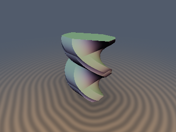
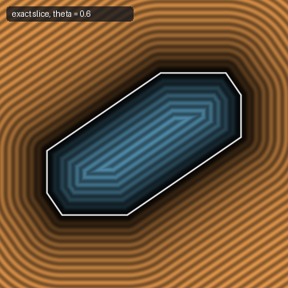
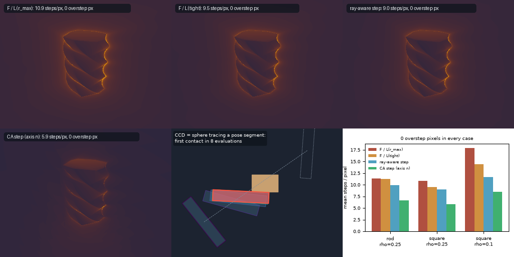

# `sdCSpaceRectRect`, `sdCSpaceRectRectSlice`, `sdgCSpaceRectRectPose`, `sdgCSpaceRectRect`, `stepCSpaceRectRect` — Configuration-Space Obstacle of a Rotating Rectangle (Piano Mover's C-Obstacle)

| 3D Surface ($`F(x, y, \theta) = 0`$, $`\theta`$ vertical) | Exact Slice at Fixed $`\theta`$ |
| :---: | :---: |
|  |  |

| Property | Value |
| :--- | :--- |
| **Author / Discoverer** | **Claude Fable 5.2** (`sdf-gems`, 2026). Research experiment: see [Findings](#findings). |
| **Category** | `cspace` |
| **GLSL File** | [`glsl/cspace/sdCSpaceRect.glsl`](../../glsl/cspace/sdCSpaceRect.glsl) |
| **Exact Euclidean SDF?** | `sdCSpaceRectRectSlice` / `sdgCSpaceRectRectPose`: **Exact** 2D SDF in $`(x, y)`$ for fixed $`\theta`$ (max error `2.1e-07` on the GPU against two independent ground truths). `sdCSpaceRectRect` / `sdgCSpaceRectRect`: **Conservative bound** in $`\mathbf{q} = (x, y, \rho\theta)`$ with the tight Lipschitz constant (not the Euclidean SDF of the 3D solid; mean tightness `0.51` to `0.82`). `stepCSpaceRectRect*`: conservative ray steps. |

---

## Overview & Motivation

A rigid rectangular robot $`A`$ (half-extents $`\mathbf{a}`$, centre $`(x, y)`$, rotation $`\theta`$) moves among obstacles. For one
rectangular obstacle $`B`$ (half-extents $`\mathbf{b}`$, at the origin), define the **signed separation**

```math
F(x, y, \theta) = \begin{cases} \mathrm{dist}(A, B) & A \cap B = \emptyset \\ -\,\mathrm{depth}(A, B) & \text{otherwise (minimum translation that separates them)} \end{cases}
```

The set $`\{F < 0\}`$ in pose space is the classical configuration-space obstacle. It is a twisted column with period $`\pi`$ in $`\theta`$.
This file makes it a solid that can be sphere traced, and sphere tracing a straight line in pose space is continuous collision
detection (conservative advancement) for a motion that interpolates $`(x, y, \theta)`$ linearly.

## Mathematical Derivation

### 1. Fixed $`\theta`$: exact SDF of a convex octagon

$`A`$ at pose $`(\mathbf{p}, \theta)`$ meets $`B`$ exactly when $`\mathbf{p} \in M_\theta = B \oplus (-A_\theta)`$, and for convex bodies the signed separation equals
the signed distance from $`\mathbf{p}`$ to $`M_\theta`$. A rectangle is centrally symmetric, so $`M_\theta = B \oplus A_\theta`$: a centrally
symmetric convex octagon with support function

```math
h(\mathbf{n}) = \mathbf{b} \cdot \vert\mathbf{n}\vert + \mathbf{a} \cdot \vert R_\theta^{T}\mathbf{n}\vert .
```

After reducing $`\theta`$ to $`[0, \pi/2)`$ (a quarter turn swaps $`a_x`$ and $`a_y`$), with robot axes $`\mathbf{u} = (\cos\theta, \sin\theta)`$,
$`\mathbf{v} = (-\sin\theta, \cos\theta)`$, robot vertices $`A_0 = a_x\mathbf{u} - a_y\mathbf{v}`$, $`A_1 = a_x\mathbf{u} + a_y\mathbf{v}`$ and obstacle corners
$`B_0 = (b_x, b_y)`$, $`B_1 = (-b_x, b_y)`$, half of the boundary is the chain

```math
B_0 + A_0 \xrightarrow{\;\mathbf{v},\ 2a_y\;} B_0 + A_1 \xrightarrow{\;-\mathbf{e}_x,\ 2b_x\;} B_1 + A_1 \xrightarrow{\;-\mathbf{u},\ 2a_x\;} B_1 - A_0 \xrightarrow{\;-\mathbf{e}_y,\ 2b_y\;} -(B_0 + A_0)
```

(direction and length above each arrow). Edge directions are unit vectors and edge lengths are known, so each segment projection
is `clamp(dot(w - S, dir), 0, len)` with **no division**. The other half is covered by evaluating the same four segments at $`-\mathbf{p}`$.
The interior test and interior distance come from the four pairs of supporting lines, $`g = \max_i (\vert\mathbf{n}_i \cdot \mathbf{p}\vert - h(\mathbf{n}_i))`$,
and $`F = g`$ if $`g < 0`$, else the minimum segment distance. Cost: 8 segment projections, 1 `sqrt`.

### 2. Gradient: contact normal and torque arm

Each nearest octagon point is $`\mathbf{m} = \mathbf{b}^{*} + \mathbf{a}'`$ with $`\mathbf{b}^{*} \in B`$ and $`\mathbf{a}' \in A_\theta`$ (relative to the robot centre). The
robot's witness point relative to its centre is $`\mathbf{r} = -\mathbf{a}'`$, and

```math
\nabla_{xy} F = \mathbf{n}, \qquad \frac{\partial F}{\partial \theta} = \mathbf{r} \times \mathbf{n} = r_x n_y - r_y n_x ,
```

the unit contact normal and the torque arm of a unit contact force. On robot-edge segments $`\mathbf{a}' = \mathbf{m} - B_i`$; on obstacle-edge
segments $`\mathbf{a}'`$ is the fixed robot vertex; at octagon vertices both agree. `sdgCSpaceRectRectPose` returns $`(F, n_x, n_y, \partial_\theta F)`$.

### 3. Lipschitz constant in pose space: $`\max(a_x, a_y)`$, not the circumradius

The textbook argument ("every robot point moves at most $`r_{\max}\vert d\theta\vert`$", $`r_{\max} = \Vert\mathbf{a}\Vert`$) gives
$`L_{r_{\max}} = \sqrt{1 + (r_{\max}/\rho)^2}`$ in $`\mathbf{q} = (x, y, \rho\theta)`$. It is valid but not tight. The witness point is a
*support point* of the robot in direction $`-\mathbf{n}`$, so $`\mathbf{r} \times \mathbf{n}`$ is the derivative of the robot's support function
$`h_A(\varphi) = a_x\vert\cos\varphi\vert + a_y\vert\sin\varphi\vert`$ with respect to the direction angle:

```math
\left\vert \frac{\partial F}{\partial\theta} \right\vert \le \max_\varphi \vert h_A'(\varphi)\vert = \max(a_x, a_y), \qquad
L = \sqrt{1 + \left(\frac{\max(a_x, a_y)}{\rho}\right)^{2}} .
```

The bound is attained (obstacle corner against the end of the robot's long edge), so $`L`$ is the exact Lipschitz constant of $`F`$,
and `sdCSpaceRectRect = F / L` is the largest constant rescaling of $`F`$ that is 1-Lipschitz. The gain over $`r_{\max}`$ is between
$`1\times`$ (a thin rod) and $`\sqrt 2\times`$ (a square, as $`\rho \to 0`$). For a disk robot the same argument gives $`0`$, as it must.

For a pivot at local offset $`-\mathbf{c}`$ from the centre, the same reasoning gives `cspaceRectTorqueBound(a, c)`:
$`\max(a_x + \vert c_x\vert,\ a_y + \vert c_y\vert)`$, plus a full vertex radius when the pivot lies outside the slab of an edge pair.

### 4. Ray-aware steps (conservative advancement)

$`F`$ is 1-Lipschitz in the anisotropic norm $`\Vert d\mathbf{x}\Vert + \max(a_x, a_y)\vert d\theta\vert`$. Along a unit ray direction $`\mathbf{d}`$ in $`\mathbf{q}`$-space the
surface cannot be reached before

```math
t_{\text{ray}} = \frac{F}{\Vert\mathbf{d}_{xy}\Vert + \max(a_x, a_y)\,\vert d_z\vert/\rho} \;\ge\; \frac{F}{L}
```

(`stepCSpaceRectRect`). Outside the obstacle, the gap measured along the *current* separating axis $`\mathbf{n}`$ is a lower bound of
the separation and closes at a rate of at most $`-\mathbf{n}\cdot\mathbf{d}_{xy} + \max(a_x, a_y)\vert d_z\vert/\rho`$, which gives the longer step
`stepCSpaceRectRectCA` (Mirtich's conservative advancement with the tight rotational term). Both are independent of the
choice of $`\rho`$ when used on a pose-space segment, so there is no "best $`\rho`$": it only sets the aspect of the picture.

## GLSL

See [`glsl/cspace/sdCSpaceRect.glsl`](../../glsl/cspace/sdCSpaceRect.glsl).

```glsl
vec4  sdgCSpaceRectRectPose( vec2 p, float theta, vec2 a, vec2 b );   // (F, dF/dx, dF/dy, dF/dtheta), exact
float sdCSpaceRectRectSlice( vec2 xy, float theta, vec2 a, vec2 b );  // exact 2D SDF at fixed theta
float sdCSpaceRectRect( vec3 q, vec2 a, vec2 b, float rho );          // conservative bound F / L, q = (x, y, rho theta)
vec4  sdgCSpaceRectRect( vec3 q, vec2 a, vec2 b, float rho );         // bound + exact unit normal of the level set
float stepCSpaceRectRect( vec3 q, vec3 rd, vec2 a, vec2 b, float rho );              // ray-aware step
float stepCSpaceRectRectCA( vec3 q, vec3 rd, vec2 a, vec2 b, float rho, float tMax ); // CA step along n (exterior)
vec4  sdgCSpaceRectRectPivot( vec2 xy, float theta, vec2 a, vec2 c, vec2 b );        // offset pivot
```

A rounded obstacle or rounded robot is `F - radius` (Minkowski sum with a disk); this follows from the definition and was
not separately measured.

## Verification (measured)

GPU = the literal GLSL in FP32 through `tools/gpu_eval.py`; FP64 = a line-by-line Python port.

| Check | Result |
| :--- | :--- |
| Single-translation-unit compile (forward, reverse, new-first) | pass (284 files) |
| Slice vs ground truth 1 (convex hull of the 16 vertex differences, then `ground_truth.polygon_sdf`), 120,270 poses over 5 shape pairs incl. $`\theta = 0, \pm\pi/2, \pi`$, on-boundary, deep-penetration and zero-thickness robot/obstacle | max error FP64 `3.3e-16`, GPU `2.1e-07` |
| Slice vs ground truth 2 (body-space: SAT minimum translation if overlapping, vertex-edge distance otherwise), 72,162 poses | max error FP64 `3.3e-16`, GPU `2.1e-07` |
| Slice vs `shapely` polygon distance (separated poses of 30,000) | max error FP64 `2.8e-16`, GPU `1.2e-07` |
| Point robot ($`\mathbf{a} = 0`$) vs exact box SDF, 20,000 poses | GPU `1.5e-07` |
| NaN / Inf at probe points, scales 1, 10, 1000, incl. $`\mathbf{a} = 0`$, $`\mathbf{b} = 0`$, both zero | 0 |
| Zero set vs `shapely` overlap predicate, 30,000 poses (21% overlapping) | 0 sign mismatches (GPU and FP64) |
| 3,000 contact poses found by bisection on the `shapely` predicate only | max $`\vert F\vert`$ FP64 `1.8e-15`, GPU `1.3e-07` |
| $`\mathbf{n}`$ and $`\partial_\theta F`$ vs central differences (FP64, 3 x 40,000 poses) | $`\mathbf{n}`$: `1.4e-06`, torque arm: `3.9e-08`, $`\Vert\mathbf{n}\Vert - 1`$: `2.2e-16` |
| GPU gradient vs FP64 port | $`F`$ `1.5e-07`; $`\mathbf{n}`$ up to `2.9e-03`, torque up to `2.9e-04` (FP32 normalisation of tiny offsets near corners) |
| $`\sup\vert\partial_\theta F\vert`$ over 2,000,000 poses, 4 shapes | equals $`\max(a_x, a_y)`$ to 5 digits in every case, never above it (e.g. `0.220000` for a square with $`r_{\max} = 0.3111`$) |
| Pair Lipschitz ratio in $`\mathbf{q}`$, 400,000 pairs x 4 scales, $`\rho \in \{0.1, 0.25, 1\}`$ | always below $`L`$, reaching `0.994` to `0.9998` of it; $`L_{r_{\max}}`$ is loose by up to `1.35x` |
| Offset pivot: $`\sup\vert\partial_\theta F\vert`$ vs `cspaceRectTorqueBound`, 6 pivots (inside, on a corner, outside), 3,000,000 poses each | equal to 5 digits in all 6 (farthest-vertex radius is loose by `1.01x` to `1.24x`) |
| 3D bound vs independent surface cloud (1.7M contact poses), 30,000 points, 3 scenes | never exceeds the cloud distance (max excess `-1.7e-05`); mean tightness `0.72`, `0.82`, `0.51` (with $`r_{\max}`$: `0.71`, `0.68`, `0.38`) |
| `sdgCSpaceRectRect` unit normal vs FP64 analytic, 30,000 points x 3 scenes | min cosine `1.0000`, $`\Vert\mathbf{g}\Vert - 1 \le`$ `1.2e-07` |

### Sphere tracing cost (`360x270`, default camera, slab-clipped column)



Heatmaps: square robot, $`\rho = 0.25`$. Field bounds were measured with `tools.render_sdf.raymarch_stats`; ray-aware steps with a
replica of it that reproduces its numbers exactly for the field bounds.

| Scene | raw $`F`$ (no scaling) | $`F / L_{r_{\max}}`$ | $`F / L`$ (tight) | ray-aware step | CA step along $`\mathbf{n}`$ |
| :--- | :---: | :---: | :---: | :---: | :---: |
| rod $`\mathbf{a} = (0.36, 0.07)`$, $`\rho = 0.25`$ | 7.0 steps, **4,461 overstep px** | 11.40, 0 | 11.29, 0 | 9.89, 0 | 6.67, 0 |
| square $`\mathbf{a} = (0.22, 0.22)`$, $`\rho = 0.25`$ | 7.5 steps, **1,356 overstep px** | 10.86, 0 | 9.47, 0 | 8.98, 0 | 5.86, 0 |
| square, $`\rho = 0.1`$ | 7.3 steps, **5,811 overstep px** | 17.88, 0 | 14.45, 0 | 11.69, 0 | 8.45, 0 |

(mean steps per pixel, overstep pixels). The CA step reports about 0.3% fewer hit pixels than the field bounds because its
value is not small for rays that graze the surface within the hit tolerance.

### Continuous collision detection by sphere tracing

5,312 random pose-space segments with a free start ($`x, y \in [-1, 1]`$, $`\theta \in [-\pi, \pi]`$, rod robot), $`F`$ from the literal GLSL,
stop at $`F < 10^{-4}`$. Reference: 8,001-sample sweep per segment in FP64 plus bisection (2,630 colliding, 2,682 free).

| Step rule | Tunnelled | Stops after true contact | Mean evaluations (colliding / free) | Max |
| :--- | :---: | :---: | :---: | :---: |
| $`F / (\Vert\Delta\mathbf{x}\Vert + r_{\max}\vert\Delta\theta\vert)`$ | 0 | 0 | 10.46 (13.17 / 7.81) | 307 |
| $`F / (\Vert\Delta\mathbf{x}\Vert + \max(a_x, a_y)\vert\Delta\theta\vert)`$ | 0 | 0 | 10.37 (13.04 / 7.75) | 307 |
| CA along $`\mathbf{n}`$ with $`\max(a_x, a_y)`$ | 0 | 0 | 6.77 (9.55 / 4.04) | 112 |

## Findings

**What held**

- Claim 1 (exact closed form for fixed $`\theta`$): held, against three independently built references, including degenerate octagons.
- Claim 2 (zero set = contact poses): held, 0 mismatches against an independent overlap predicate.
- Claim 3 (Lipschitz bound): the $`r_{\max}`$ bound is valid, and a tighter closed form exists: the exact constant uses
  $`\max(a_x, a_y)`$. Measured, and explained by the support-function argument above (an argument, not a formal proof).
- Claim 4 (gradient = contact normal and torque arm): held.
- Claim 5 (CCD by sphere tracing): held, zero tunnelling and zero late stops in 5,312 segments.
- Stretch: offset pivot value, gradient and tight torque bound verified. The 2-link arm was not attempted.

**What failed or disappointed**

- The tight constant is a small win for the elongated robots where C-space pictures look best: `1.3%` for the preview rod
  (11.40 to 11.29 steps). It only matters for squarish robots (up to `1.35x` on the constant, 17.9 to 14.5 steps).
- No isotropic field can do better than $`F / L`$ by rescaling. The real gains need the ray direction (ray-aware `1.1x` to `1.5x`,
  CA along $`\mathbf{n}`$ `1.7x` to `2.1x` fewer steps than $`F / L_{r_{\max}}`$), which is a step function, not an SDF.
- `sdCSpaceRectRect` is not the Euclidean SDF of the 3D solid: it reaches on average only `51%` to `82%` of the true distance,
  and its gradient norm is below 1 almost everywhere, so offsets and soft shadows from it are distorted.
- There is no meaningful "best $`\rho`$": it is a unit choice and cancels in the ray-aware steps.
- The FP32 contact normal loses accuracy (up to `3e-3`) within about `1e-4` of an octagon corner.
- The CA step is exterior-only and is unbounded when the motion opens the gap (hence the `tMax` argument).

**Open questions**

- An exact Euclidean SDF of the twisted column in $`(x, y, \rho\theta)`$ (its faces are ruled and helicoid-like patches).
- A sharper ray-aware rate using the joint range of $`(\mathbf{n}, \mathbf{r}\times\mathbf{n})`$ instead of bounding the two terms separately.
- General convex polygons (the constant should be $`\max\vert h_A'\vert`$, untested here), several obstacles (a `min` of fields), and
  non-convex bodies, where penetration depth is no longer a Minkowski-sum distance.

## Novelty & Prior Art

- Configuration-space obstacles and their fixed-orientation slices as Minkowski sums: Lozano-Pérez, *Spatial Planning: A
  Configuration Space Approach* (1983). Not new.
- Signed separation / penetration depth as the distance from the origin to the Minkowski difference: Cameron and Culley (1986);
  it underlies GJK and EPA. Not new.
- Conservative advancement with a motion bound projected on the closest direction: Mirtich (1996) and Zhang, Lee and Kim (C2A
  and related work, 2006 onwards). `stepCSpaceRectRectCA` is that algorithm. The directional motion bounds in that literature
  are tighter than $`\omega r_{\max}`$ already; the specific statement that the rectangle's rotational term is $`\max(a_x, a_y)`$, the
  derivative of its support function, was not found stated in this form, but it is elementary and is likely known.
- Several web searches (Shadertoy, C-space visualisation, SDF raymarching of a C-obstacle) turned up only generic descriptions
  and no published closed-form shader for this solid. That is an absence of search hits, not proof of absence.
- What appears to be new here: packaging the rectangle-rectangle C-obstacle as a division-free exact slice SDF with exact pose
  gradient in GLSL, the measured tight Lipschitz constant for sphere tracing it (with the offset-pivot variant), and the
  measured comparison of field bounds against ray-aware steps.
