# 3. 3D Curves, Knots & Fibrations

[**← Back to Main `sdf-gems` README**](../../README.md) · **GLSL Headers**: [`glsl/curves3d/`](../../glsl/curves3d/) (21 headers)

Exact $`O(1)`$ and algebraic 3D space curves, knots, links, braids, coils, spherical curves on $`S^2`$, ropelength-constrained tubes, and Hopf/twistor circle fibrations.

## Contents

- **Knots, Links, Braids & Hopf Fibrations** (10)
- **Splines, Helices, Coils & Cylindrical Waveguides** (5)
- **Spherical Curves on $`S^2`$** (6)

## Knots, Links, Braids & Hopf Fibrations

| Preview | Function | Summary |
| :---: | :--- | :--- |
| 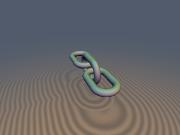&nbsp;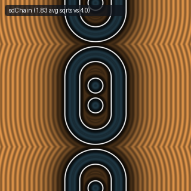 | [**`sdLink`**](sdLink.md) [`glsl`](../../glsl/curves3d/sdLink.glsl) · **Exact** | **Also**: `sdChain`. 1/2-`sqrt` chain link (`1` `sqrt` in middle slab) & 1.83-`sqrt` screw-folded + squared-dominance infinite chain (`sdChain`, $`2.19\times`$ fewer `sqrt`s) |
| 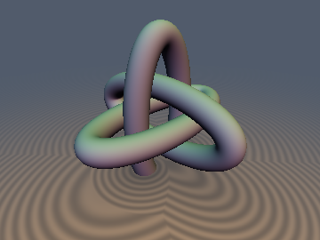 | [**`sdBorromeanRings`**](sdBorromeanRings.md) [`glsl`](../../glsl/curves3d/sdBorromeanRings.glsl) · **Exact** | **Also**: `sdEllipticTorus`, `sdgEllipticTorus`, `sdgBorromeanRings`, `sdTorusKnot`. Exact 3D Euclidean elliptic torus, canonical orthogonal Borromean rings, and 0-loop branch-cut-free $`(p,q)`$ torus knot |
| 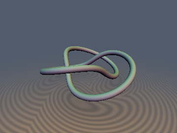 | [**`sdTrefoilKnot`**](sdTrefoilKnot.md) [`glsl`](../../glsl/curves3d/sdTrefoilKnot.glsl) · **Exact** | **Also**: `sdgTrefoilKnot`, `sdTorusKnotExact`, `sdgTorusKnotExact`. Exact 3D Euclidean trefoil knot and general $`(p,q)`$ torus knots via azimuthal strand seeding and harmonic cross-term cancellation |
| 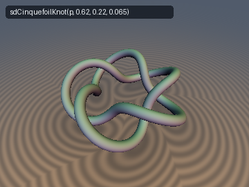 | [**`sdCinquefoilKnot`**](sdCinquefoilKnot.md) [`glsl`](../../glsl/curves3d/sdCinquefoilKnot.glsl) · **Exact** | **Also**: `sdSolomonLink`. Exact $`O(1)`$ 3D Euclidean $`(2,5)`$ cinquefoil torus knot ($`5_1`$ Solomon's seal knot) and King Solomon's $`(2,4)`$ doubly-linked rings ($`4^2_1`$) via antipodal torus $`D_k`$ fundamental-cell folding |
| 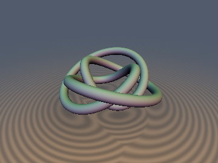 | [**`sdFigureEightKnot`**](sdFigureEightKnot.md) [`glsl`](../../glsl/curves3d/sdFigureEightKnot.glsl) · **Exact** | **Also**: `sdgFigureEightKnot`, `sdTurkHeadKnot`, `sdgTurkHeadKnot`. Exact $`O(1)`$ 3D Thurston hyperbolic figure-eight knot ($`4_1`$) and Turk's head rosette knots via antisymmetric crossing parity and strand seeding |
| 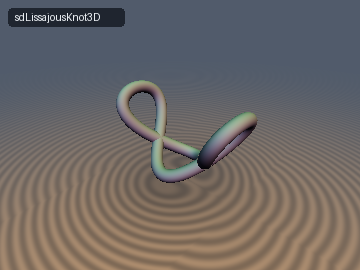 | [**`sdLissajousKnot3D`**](sdLissajousKnot.md) [`glsl`](../../glsl/curves3d/sdLissajousKnot.glsl) · **Exact** | **Also**: `sdgLissajousKnot3D`, `sdHoropterCurve`, `sdgHoropterCurve`. Exact $`O(1)`$ 3D Euclidean $`(1,2,3)`$ Chebyshev-Lissajous saddle curve and Hermann von Helmholtz's (1867) rational twisted-cubic horopter curve of binocular stereopsis |
| 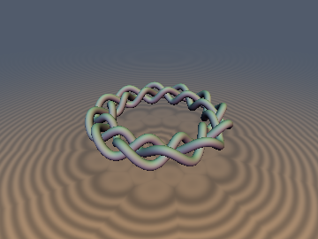 | [**`sdCircularBraid`**](sdCircularBraid.md) [`glsl`](../../glsl/curves3d/sdCircularBraid.glsl) · **Exact** | **Also**: `sdgCircularBraid`, `sdLinearBraid3D`, `sdgLinearBraid3D`. Exact $`O(1)`$ 3D Euclidean $`N`$-wave circular 3-strand Celtic braid ring and linear 3-strand plait via Lemniscate-of-Gerono over-under crossings and $`D_{3N}`$ dihedral-strand folding |
| 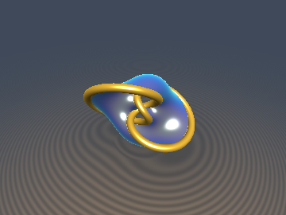 | [**`sdMilnorSeifertKnot`**](sdMilnorSeifertKnot.md) [`glsl`](../../glsl/curves3d/sdMilnorSeifertKnot.glsl) · **Exact** | **Also**: `sdMilnorTorusKnot`, `sdgMilnorTorusKnot`, `sdSeifertSurface`, `sdgSeifertSurface`. Algebraic $`(p,q)`$-torus knot via Milnor fibration $`u^p - v^q`$ on $`S^3 \subset \mathbb{C}^2`$ with 1-dot stereographic pullback & branch-cut-free Seifert minimal soap-film SDF |
| 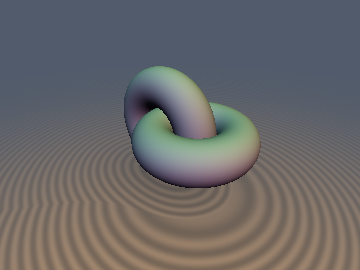 | [**`keRopelength`**](keRopelength.md) [`glsl`](../../glsl/curves3d/keRopelength.glsl) · **Exact** ($`r\le r_{\max}`$) / 1-Lipschitz | **Also**: `kePointTangentRadius`, `keSurfaceTangentRadius`, `keMobiusPairEnergy`, `keHopfLinkInjectivityRadius`, `sdTightHopfLink3D`, `sdgTightHopfLink3D`, `keApolloniusContactTube`, `sdSwollenHopfLink3D`. Gonzalez-Maddocks point-tangent global radius of curvature, Möbius-invariant cross-ratio energy, tight Gehring Hopf link ropelength, and 1-Lipschitz Apollonius contact-partitioned tubes |
| 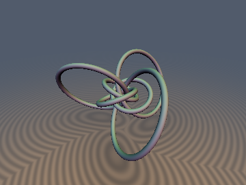 | [**`twHopfSubmersion`**](twHopfSubmersion.md) [`glsl`](../../glsl/curves3d/twHopfSubmersion.glsl) · **Exact** | **Also**: `twFiberCircleCenter`, `twFiberCircleNormal`, `sdTwistorFiberCircle`, `sdgTwistorFiberCircle`, `sdTwistorPullbackBound`, `sdTwistorPolyhedralLinks3D`. Closed-form 3D Euclidean circle formula for any stereographic-Hopf fiber $`\eta^{-1}(\mathbf{q})`$, south-pole-stabilized conjugate evaluation, and 6-ring Villarceau bouquets |

## Splines, Helices, Coils & Cylindrical Waveguides

| Preview | Function | Summary |
| :---: | :--- | :--- |
| 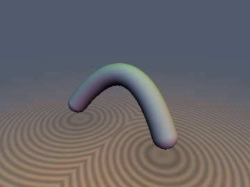 | [**`sdBezier3D`**](sdBezier3D.md) [`glsl`](../../glsl/curves3d/sdBezier3D.glsl) · **Exact** | **Also**: `udBezier3D`, `sdBezierCapsule3D`, `sdgBezier3D`. Collinear-safe, 1-`cbrt` conjugate-rationalized 3D quadratic Bézier curve, capsule, and analytical gradient via 3D-to-2D Gram reduction |
| 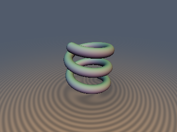&nbsp;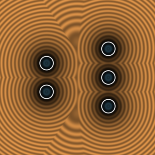 | [**`sdHelix`**](sdHelix.md) [`glsl`](../../glsl/curves3d/sdHelix.glsl) · **Exact** | **Also**: `sdCoilSpring`, `sdgHelix`. Exact 3D infinite helix & finite $`N`$-turn coil spring (`sdCoilSpring`, `sdgCoilSpring`); eliminates central-axis singularity & $`+0.68`$ to $`+2.13`$ overstep |
| 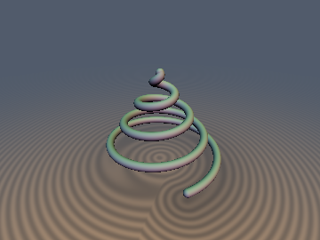 | [**`sdConicalSpiral`**](sdConicalSpiral.md) [`glsl`](../../glsl/curves3d/sdConicalSpiral.glsl) · **Exact** | **Also**: `sdConicalHelix`, `sdgConicalHelix`, `sdGastropodShell`, `sdgGastropodShell`. Exact 3D Euclidean Pappus conical helix and Raup helicocone gastropod shell via orthogonal cone-generator turn projection |
| 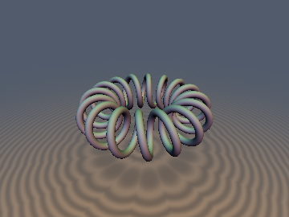 | [**`sdToroidalCoil`**](sdToroidalCoil.md) [`glsl`](../../glsl/curves3d/sdToroidalCoil.glsl) · **Exact** | **Also**: `sdgToroidalCoil`. Exact $`O(1)`$ turn-independent 3D toroidal solenoid coil via poloidal-toroidal phase unwrapping & harmonic cross-term cancellation |
| 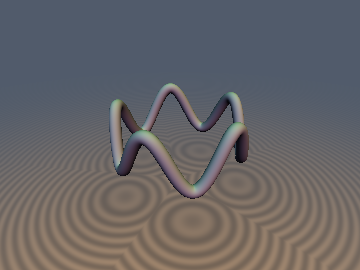 | [**`sdCrownCurve`**](sdCrownCurve.md) [`glsl`](../../glsl/curves3d/sdCrownCurve.glsl) · **Exact** | **Also**: `sdgCrownCurve`, `sdCylindricalSoliton`, `sdgCylindricalSoliton`. Exact $`O(1)`$ 3D Euclidean cylindrical sinusoidal crown waveguide and cylindrical Sine-Gordon soliton loop on $`S^1(R) \times \mathbb{R}`$ via cylinder dot-product linearization and $`D_n`$ dihedral half-wave folding |

## Spherical Curves on $`S^2`$

| Preview | Function | Summary |
| :---: | :--- | :--- |
| 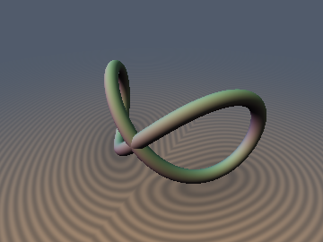 | [**`sdVivianiCurve`**](sdVivianiCurve.md) [`glsl`](../../glsl/curves3d/sdVivianiCurve.glsl) · **Exact** | **Also**: `sdgVivianiCurve`, `sdTennisBallSeam`, `sdgTennisBallSeam`. Exact 3D Euclidean Viviani curve and $`D_{2d}`$ tennis-ball seam curve via $`S^2`$ dot-product linearization (0 SFU `sqrt`s inside solver) |
| 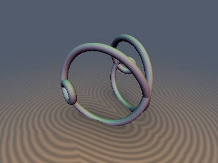 | [**`sdCleliaCurve`**](sdCleliaCurve.md) [`glsl`](../../glsl/curves3d/sdCleliaCurve.glsl) · **Exact** | **Also**: `sdgCleliaCurve`, `sdSphericalLoxodrome`, `sdgSphericalLoxodrome`. Exact 3D spherical loxodrome (rhumb line) and Grandi's Clelia / Rhodonea curve via $`S^2`$ dot-product linearization |
| 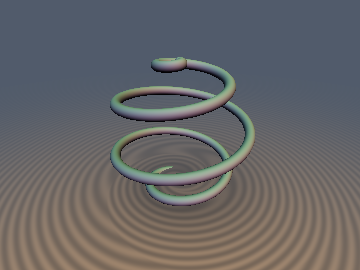 | [**`sdSphericalSpiral`**](sdSphericalSpiral.md) [`glsl`](../../glsl/curves3d/sdSphericalSpiral.glsl) · **Exact** | **Also**: `sdgSphericalSpiral`. Exact $`O(1)`$ 3D Euclidean spherical spiral of Sinus (`sdSphericalSpiral`) and Seiffert's (1896) spherical spiral (`sdSeiffertSpiral`) on $`S^2(R)`$ via $`S^2`$ dot-product linearization and 0-`sqrt` Newton projection |
| 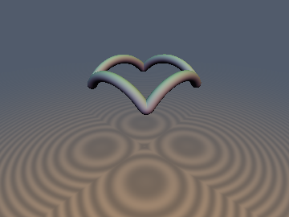 | [**`sdSphericalEpicycloid`**](sdSphericalEpicycloid.md) [`glsl`](../../glsl/curves3d/sdSphericalEpicycloid.glsl) · **Exact** | **Also**: `sdHippopede`, `sdgHippopede`, `sdgSphericalEpicycloid`. Exact $`O(1)`$ 3D Eudoxus hippopede (horse-fetter) & Camus spherical epicycloid bevel-gear curves via $`S^2`$ dot-product linearization |
| 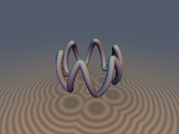 | [**`sdSphericalSineWave`**](sdSphericalLissajous.md) [`glsl`](../../glsl/curves3d/sdSphericalLissajous.glsl) · **Exact** | **Also**: `sdgSphericalSineWave`, `sdSphericalLissajous`, `sdgSphericalLissajous`. Exact $`O(1)`$ 3D Euclidean $`N`$-wave spherical sinusoidal waveguide and spherical Bowditch $`(1,2)`$ figure-eight Lissajous curve on $`S^2(R)`$ via $`S^2`$ dot-product linearization and $`D_n`$ dihedral half-wave folding |
| 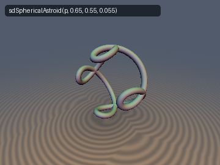 | [**`sdSphericalAstroid`**](sdSphericalAstroid.md) [`glsl`](../../glsl/curves3d/sdSphericalAstroid.glsl) · **Exact** | **Also**: `sdSphericalCardioid`. Exact $`O(1)`$ 3D Euclidean 4-cusped spherical astroid and spherical cardioid on $`S^2(R)`$ via the 0-`sqrt` orthonormal equatorial rolling identity and $`S^2`$ dot-product linearization |
