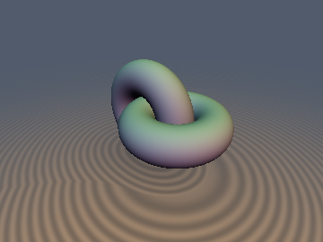
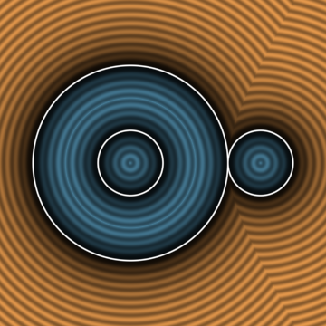
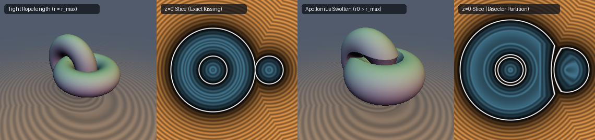

# `keRopelength` — Gonzalez-Maddocks Ropelength Thickness, Tangent-Sphere Radii, Möbius Pair Potentials & Self-Contact Link SDFs

| 3D Surface ($`d = 0`$): Tight Gehring Hopf Link ($`r = r_{\max} = R/2`$) | 2D Cross-Section Slice ($`z = 0`$, simultaneous inner & outer kissing contact) |
| :---: | :---: |
|  |  |

| Property | Value |
| :--- | :--- |
| **Category** | `knotenergy` (research experiment) |
| **GLSL File** | [`glsl/curves3d/keRopelength.glsl`](../../glsl/curves3d/keRopelength.glsl) |
| **Attribution** | Closed-form link injectivity proof, exactness threshold theorem, Apollonius 1-Lipschitz contact partition, and GPU verification by **Gemini 4 Argon** (`sdf-gems`, 2026). Point-tangent thickness and conformal pair potentials follow Gonzalez & Maddocks (1999) and Kusner & Sullivan (1998); see *Novelty & Prior Art*. |
| **Exactness** | `sdTightHopfLink3D`, `sdgTightHopfLink3D`: **Exact Euclidean SDF and unit gradient everywhere in $`\mathbb{R}^3`$** (both interior and exterior) for $`\vert e\vert < 1`$. `kePointTangentRadius`, `keSurfaceTangentRadius`, `keMobiusPairEnergy`, `keHopfLinkInjectivityRadius`, `keTwoCircleLinkThickness`: **Exact closed forms**. `keApolloniusContactTube`, `sdSwollenHopfLink3D`: **Globally 1-Lipschitz conservative bound** (with normalization $`1/(1+\vert\alpha\vert)`$). |

---

## Overview & Motivation

Given a space curve or multi-component link $`\gamma \subset \mathbb{R}^3`$, how thick can a uniform tubular neighborhood $`T_r(\gamma) = \{\mathbf{p} \in \mathbb{R}^3 : \mathrm{dist}(\mathbf{p}, \gamma) \le r\}`$ grow before its boundary ceases to be an embedded smooth manifold? And when we represent a multi-component link in a shader as the standard boolean union $`d(\mathbf{p}) = \min_i (\mathrm{dist}(\mathbf{p}, \gamma_i) - r)`$, when is that union a **true Euclidean SDF** inside the tubes rather than a conservative bound with buried internal walls?

In geometric knot theory, Gonzalez & Maddocks (1999) showed that both local focal pinching (where $`r`$ exceeds the local radius of curvature $`1/\kappa`$) and global self-contact (where two strands touch at a doubly critical chord) are unified by a single geometric quantity: the infimum of the **point-tangent circle radius** $`R_{\mathrm{pt}}(\mathbf{x}, \mathbf{t}_{\mathbf{x}}; \mathbf{y})`$ over all pairs $`\mathbf{x} \ne \mathbf{y} \in \gamma`$.

This experiment investigates the bridge between knot thickness energies and signed distance fields:
1. **Tangent-Circle and Tangent-Sphere Radii** (`kePointTangentRadius`, `keSurfaceTangentRadius`) and their duality connecting curve ropelength to the surface medial axis (`mdMedialRadius`).
2. **Conformal Möbius Pair Potentials** (`keMobiusPairEnergy`) that measure the deviation of a curve pair from cocircularity and remain invariant under 3D sphere inversions.
3. **Exact Ropelength Injectivity Radius of Linked Circles** (`keHopfLinkInjectivityRadius`, `sdTightHopfLink3D`, `sdgTightHopfLink3D`), proving by an exact $`x^2`$-cancellation argument that the distance function between two orthogonal circles is piecewise linear in the axial coordinate, and that $`\min(d_1, d_2)`$ is **interior-exact if and only if $`r \le r_{\max}`$**.
4. **1-Lipschitz Apollonius Contact Partitions** (`keApolloniusContactTube`, `sdSwollenHopfLink3D`), enabling variable-radius tubes to swell past $`r_{\max}`$ without overlapping by clamping each strand against the Voronoi bisector.



*Left pair: `sdTightHopfLink3D` at the exact Gehring ropelength limit $`r_{\max} = R/2`$ ($`e = 0`$), where the $`z = 0`$ cross-section shows the nested and outer disks of $`C_2`$ kissing the annulus of $`C_1`$ simultaneously with zero interior overlap. Right pair: `sdSwollenHopfLink3D` with $`r_0 > r_{\max}`$ and Apollonius contact factor $`\alpha = 0.82`$, where the tubes swell into unoccupied space while flattening along the Voronoi bisector partition without penetrating each other.*

---

## Mathematical Derivation

### 1. Point-Tangent Circle Radius & Surface-Tangent Sphere Duality

Given a curve point $`\mathbf{x} \in \mathbb{R}^3`$ with unit tangent $`\mathbf{t}`$ ($`\Vert\mathbf{t}\Vert = 1`$) and a second point $`\mathbf{y} \in \mathbb{R}^3`$, the unique circle through $`\mathbf{x}`$ and $`\mathbf{y}`$ tangent to $`\mathbf{t}`$ at $`\mathbf{x}`$ has radius (Gonzalez & Maddocks 1999):

```math
R_{\mathrm{pt}}(\mathbf{x}, \mathbf{t}; \mathbf{y}) = \frac{\Vert\mathbf{y} - \mathbf{x}\Vert^2}{2\,\Vert(\mathbf{y} - \mathbf{x})_\perp\Vert} = \frac{\Vert\mathbf{y} - \mathbf{x}\Vert^2}{2\,\Vert(\mathbf{y} - \mathbf{x}) - ((\mathbf{y} - \mathbf{x})\cdot\mathbf{t})\,\mathbf{t}\Vert} = \frac{\Vert\mathbf{y} - \mathbf{x}\Vert}{2\sin\theta(\mathbf{t}, \mathbf{y} - \mathbf{x})}.
```

Dually, if $`(\mathbf{x}, \mathbf{n})`$ is an oriented surface point with unit normal $`\mathbf{n}`$ and $`\mathbf{p} \in \mathbb{R}^3`$ is a query point, the unique sphere tangent to the plane $`(\mathbf{x}, \mathbf{n})`$ at $`\mathbf{x}`$ passing through $`\mathbf{p}`$ has center $`\mathbf{x} + R_{\mathrm{tan}}\mathbf{n}`$, where $`\Vert\mathbf{p} - (\mathbf{x} + R_{\mathrm{tan}}\mathbf{n})\Vert^2 = R_{\mathrm{tan}}^2`$ yields the signed **surface-tangent sphere radius**:

```math
R_{\mathrm{tan}}(\mathbf{p}; \mathbf{x}, \mathbf{n}) = \frac{\Vert\mathbf{p} - \mathbf{x}\Vert^2}{2\,(\mathbf{p} - \mathbf{x})\cdot\mathbf{n}}.
```

The two radii are exact duals over the normal bundle $`N_{\mathbf{x}}\gamma = \mathbf{t}^\perp`$ of a curve:

```math
R_{\mathrm{pt}}(\mathbf{x}, \mathbf{t}; \mathbf{y}) = \min_{\mathbf{n} \perp \mathbf{t},\, \Vert\mathbf{n}\Vert = 1} \vert R_{\mathrm{tan}}(\mathbf{y}; \mathbf{x}, \mathbf{n})\vert.
```

Furthermore:
- **Curve coalescence limit**: As $`\mathbf{y} = \gamma(s + \Delta s) \to \mathbf{x} = \gamma(s)`$ along a $`C^2`$ unit-speed curve, $`\mathbf{y} - \mathbf{x} = \Delta s\,\mathbf{t} + \frac{1}{2}(\Delta s)^2 \kappa\mathbf{N} + O((\Delta s)^3)`$, so $`R_{\mathrm{pt}}(\mathbf{x}, \mathbf{t}; \mathbf{y}) \to 1/\kappa(\mathbf{x})`$, the local radius of curvature.
- **Surface medial axis & reach**: For a smooth surface $`\Sigma`$, a ball of radius $`r`$ tangent to $`\Sigma`$ at $`\mathbf{x}`$ on the inward side $`-\mathbf{n}`$ contains no points of $`\Sigma`$ iff $`r \le -R_{\mathrm{tan}}(\mathbf{y}; \mathbf{x}, \mathbf{n})`$ for all inward $`\mathbf{y} \in \Sigma \setminus \{\mathbf{x}\}`$. Thus the interior medial radius (`mdMedialRadius`) is $`\rho(\mathbf{x}) = \inf_{\mathbf{y} \in \Sigma \setminus \{\mathbf{x}\},\, (\mathbf{y}-\mathbf{x})\cdot\mathbf{n} < 0} \vert R_{\mathrm{tan}}(\mathbf{y}; \mathbf{x}, \mathbf{n})\vert`$, and Federer's reach is $`\tau(\Sigma) = \inf_{\mathbf{x} \ne \mathbf{y} \in \Sigma} \vert R_{\mathrm{tan}}(\mathbf{y}; \mathbf{x}, \mathbf{n}_{\mathbf{x}})\vert`$.

### 2. Conformal Möbius Pair Potential (`keMobiusPairEnergy`)

Let $`(\mathbf{x}, \mathbf{t}_{\mathbf{x}})`$ and $`(\mathbf{y}, \mathbf{t}_{\mathbf{y}})`$ be two oriented unit tangent elements, and let $`\mathbf{w} = (\mathbf{y} - \mathbf{x})/\Vert\mathbf{y} - \mathbf{x}\Vert`$ be the unit chord vector. By reflection symmetry across the perpendicular bisector of the chord $`\mathbf{x}\mathbf{y}`$, the oriented circle $`C(\mathbf{x}, \mathbf{t}_{\mathbf{x}}, \mathbf{y})`$ tangent to $`\mathbf{t}_{\mathbf{x}}`$ at $`\mathbf{x}`$ and passing through $`\mathbf{y}`$ arrives at $`\mathbf{y}`$ with unit tangent

```math
\tilde{\mathbf{t}}_{\mathbf{x}\to\mathbf{y}} = 2\,(\mathbf{t}_{\mathbf{x}}\cdot\mathbf{w})\,\mathbf{w} - \mathbf{t}_{\mathbf{x}}.
```

The conformal angle $`\varphi`$ between $`C(\mathbf{x}, \mathbf{t}_{\mathbf{x}}, \mathbf{y})`$ and $`\mathbf{t}_{\mathbf{y}}`$ at $`\mathbf{y}`$ satisfies $`\cos\varphi = \tilde{\mathbf{t}}_{\mathbf{x}\to\mathbf{y}}\cdot\mathbf{t}_{\mathbf{y}}`$, giving the Kusner–Sullivan (1998) / Freedman–He–Wang (1994) conformal kernel:

```math
1 - \cos\varphi = 1 + \mathbf{t}_{\mathbf{x}}\cdot\mathbf{t}_{\mathbf{y}} - 2\,\frac{((\mathbf{y} - \mathbf{x})\cdot\mathbf{t}_{\mathbf{x}})\,((\mathbf{y} - \mathbf{x})\cdot\mathbf{t}_{\mathbf{y}})}{\Vert\mathbf{y} - \mathbf{x}\Vert^2}, \qquad
K_{\mathrm{Mobius}}(\mathbf{x}, \mathbf{t}_{\mathbf{x}}; \mathbf{y}, \mathbf{t}_{\mathbf{y}}) = \frac{1 - \cos\varphi}{\Vert\mathbf{y} - \mathbf{x}\Vert^2}.
```

Because 3D Möbius transformations (sphere inversions) map circles to circles and preserve intersection angles, $`1 - \cos\varphi`$ is **strictly invariant under the entire 10-parameter Möbius group $`\mathrm{PO}(4,1)`$**, and $`K_{\mathrm{Mobius}} \equiv 0`$ identically whenever $`(\mathbf{x}, \mathbf{t}_{\mathbf{x}})`$ and $`(\mathbf{y}, \mathbf{t}_{\mathbf{y}})`$ lie on a common circle.

### 3. Exact Injectivity Radius of Orthogonal Two-Circle Links (`keHopfLinkInjectivityRadius`)

Consider two circles in orthogonal planes:
- $`C_1`$ in the $`xy`$-plane, centered at $`(0,0,0)`$ with radius $`R_1 > 0`$,
- $`C_2`$ in the $`xz`$-plane, centered at $`(a,0,0)`$ with radius $`R_2 > 0`$ and offset $`a \ge 0`$.

For any point $`\mathbf{q} = (x, 0, z) \in C_2`$, the circle equation $`(x - a)^2 + z^2 = R_2^2`$ gives $`x^2 + z^2 = R_2^2 - a^2 + 2ax`$. Substituting this into the squared Euclidean distance to $`C_1`$ cancels $`x^2`$ identically:

```math
\mathrm{dist}(\mathbf{q}, C_1)^2 = (\vert x\vert - R_1)^2 + z^2 = R_1^2 + R_2^2 - a^2 + 2ax - 2R_1\vert x\vert, \qquad x \in [a - R_2,\, a + R_2].
```

Because $`x \mapsto 2ax - 2R_1\vert x\vert`$ has distributional second derivative $`-4R_1\delta(x) \le 0`$, it is **concave** on $`[a - R_2, a + R_2]`$ for every $`R_1, R_2 > 0`$ and $`a \in \mathbb{R}`$. A concave function on a closed interval always attains its minimum at one of the endpoints $`x_\pm = a \pm R_2`$ (where $`z = 0`$, on the $`x`$-axis line of intersection of the two planes). Therefore, the exact mutual distance between $`C_1`$ and $`C_2`$ is closed-form and trigonometric-free:

```math
d_{\mathrm{mutual}}(C_1, C_2) = \min\Bigl(\bigl\vert\vert a - R_2\vert - R_1\bigr\vert,\; \bigl\vert\vert a + R_2\vert - R_1\bigr\vert\Bigr).
```

Combining mutual strand contact $`\frac{1}{2} d_{\mathrm{mutual}}`$ with the focal curvature radii $`R_1, R_2`$ of each circle gives the exact Gonzalez–Maddocks ropelength injectivity radius:

```math
r_{\max}(R_1, R_2, a) = \min\left(R_1,\; R_2,\; \frac{1}{2}\bigl\vert\vert a - R_2\vert - R_1\bigr\vert,\; \frac{1}{2}\bigl\vert\vert a + R_2\vert - R_1\bigr\vert\right).
```

When $`C_1`$ and $`C_2`$ are topologically linked ($`\vert R_1 - R_2\vert < \vert a\vert < R_1 + R_2`$), the two mutual gaps satisfy the identity

```math
(R_1 + R_2 - \vert a\vert) + (\vert a\vert - \vert R_1 - R_2\vert) = 2\min(R_1, R_2),
```

which proves that $`r_{\max}(R_1, R_2, a) \le \frac{1}{2}\min(R_1, R_2) < \min(R_1, R_2)`$: **for linked orthogonal circles, mutual strand contact always occurs strictly before focal self-pinching**, and the maximum possible thickness $`r_{\max} = \frac{1}{2}\min(R_1, R_2)`$ is achieved iff $`\vert a\vert = \max(R_1, R_2)`$. For $`R_1 = R_2 = R`$ and $`a = (1 + e)R`$ ($`e \in (-1, 1)`$), this yields $`r_{\max}(R, e) = \frac{1}{2} R (1 - \vert e\vert)`$, with the ideal Gehring link at $`e = 0`$ ($`r_{\max} = R/2`$, ropelength $`L/r_{\max} = 8\pi`$).

### 4. Exactness Threshold of `min(d1, d2)` and the 1-Lipschitz Apollonius Partition

For two smooth tubes $`T_1, T_2`$ of radius $`r`$ with individual exact SDFs $`d_1, d_2`$:
- **If $`r \le r_{\max}`$**, the open interiors $`\mathrm{int}(T_1)`$ and $`\mathrm{int}(T_2)`$ are disjoint. Every path from $`\mathbf{p} \in \mathrm{int}(T_1)`$ to $`\partial T_2`$ exits $`T_1`$ through $`\partial T_1`$ first, so $`\mathrm{dist}(\mathbf{p}, \partial(T_1 \cup T_2)) = \mathrm{dist}(\mathbf{p}, \partial T_1) = -d_1(\mathbf{p})`$. Thus $`\min(d_1, d_2)`$ is the **globally exact Euclidean SDF** on both the interior and exterior.
- **If $`r > r_{\max}`$**, $`\mathrm{int}(T_1) \cap \mathrm{int}(T_2) \ne \emptyset`$, burying boundary patches $`\partial T_1 \cap \mathrm{int}(T_2)`$ inside the solid union and causing $`\min(d_1, d_2)`$ to fail interior exactness.

To let tubes swell beyond $`r_{\max}`$ without overlapping, let $`d_1, d_2 \ge 0`$ be the 1-Lipschitz core distances to the two curves, and limit each strand's radius by a fraction $`\alpha \in [0, 1]`$ of the other strand's distance: $`d_i(\mathbf{p}) - \alpha d_j(\mathbf{p}) \le 0`$. Since $`\nabla(d_1 - \alpha d_2) = \nabla d_1 - \alpha\nabla d_2`$ has norm $`\sqrt{1 + \alpha^2 - 2\alpha\nabla d_1\cdot\nabla d_2} \in [\vert 1 - \alpha\vert,\, 1 + \alpha]`$, dividing by $`1 + \vert\alpha\vert`$ (and **not** $`\sqrt{1 + \alpha^2}`$) yields a **globally 1-Lipschitz** contact-partitioned field:

```math
d_{\mathrm{swell}}(\mathbf{p}) = \max\left(\min(d_1, d_2) - r_0,\; \frac{\min(d_1, d_2) - \alpha\max(d_1, d_2)}{1 + \alpha}\right), \qquad \alpha \in [0, 1].
```

---

## GLSL API

| Function | Signature & Purpose |
| :--- | :--- |
| `kePointTangentRadius` | `float kePointTangentRadius(vec3 x, vec3 t, vec3 y)` — Gonzalez–Maddocks point-tangent circle radius $`R_{\mathrm{pt}}(\mathbf{x}, \mathbf{t}; \mathbf{y})`$ using projection $`\mathbf{v} - (\mathbf{v}\cdot\mathbf{t})\mathbf{t}`$ to prevent FP32 cancellation. |
| `keSurfaceTangentRadius` | `float keSurfaceTangentRadius(vec3 p, vec3 x, vec3 n)` — Signed radius $`R_{\mathrm{tan}}(\mathbf{p}; \mathbf{x}, \mathbf{n})`$ of the sphere tangent to $`(\mathbf{x}, \mathbf{n})`$ through $`\mathbf{p}`$. |
| `keMobiusPairEnergy` | `vec2 keMobiusPairEnergy(vec3 x, vec3 tx, vec3 y, vec3 ty)` — Returns `vec2(K_mobius, 1.0 - cos_phi)` for two oriented tangent elements. |
| `keHopfLinkInjectivityRadius` | `float keHopfLinkInjectivityRadius(float R1, float R2, float offset)` — Exact maximum embedded tube radius $`r_{\max}`$ for two orthogonal circles. |
| `keTwoCircleLinkThickness` | `vec3 keTwoCircleLinkThickness(float R1, float R2, float offset)` — Returns `vec3(r_max, r_mutual, r_focal)`. |
| `sdTightHopfLink3D`, `sdgTightHopfLink3D` | `float sdTightHopfLink3D(vec3 p, float R, float eccentricity)` / `vec4 sdgTightHopfLink3D(...)` — Exact Euclidean SDF and analytical unit gradient of the tight ropelength Hopf link. |
| `keApolloniusContactTube`, `sdSwollenHopfLink3D` | `float keApolloniusContactTube(float d1, float d2, float r0, float alpha)` / `float sdSwollenHopfLink3D(...)` — Globally 1-Lipschitz Apollonius contact-limited tube. |

---

## Verification

All functions were tested in FP64 and on the GPU (OpenGL 4.1 FP32 via `tools/gpu_eval.py`) across 50,000 uniform random points in $`[-2, 2]^3`$ and 3,209 symmetry/axis probe points (`tools/sdf_checks.py`).

### 1. GPU Accuracy & Exactness Certificate (`sdTightHopfLink3D`, `sdgTightHopfLink3D`)

| Configuration ($`R = 0.55`$) | NaN / Inf | Max $`\vert d - d_{\mathrm{gt}}\vert`$ | $`\vert\Vert\mathbf{g}\Vert - 1\vert`$ | Grad Cosine $`> 0.999`$ | Max Lipschitz | Surface $`\vert d\vert`$ | Self-Projection Error |
| :--- | :---: | :---: | :---: | :---: | :---: | :---: | :---: |
| Symmetric Gehring ($`e = 0.0`$, $`r_{\max} = 0.275`$) | 0 / 212,836 | $`3.52 \times 10^{-7}`$ | $`1.76 \times 10^{-7}`$ | 100.0% | 0.999896 | $`1.29 \times 10^{-7}`$ | $`6.31 \times 10^{-7}`$ |
| Eccentric ($`e = +0.35`$, $`r_{\max} = 0.17875`$) | 0 / 212,836 | $`3.98 \times 10^{-7}`$ | $`1.65 \times 10^{-7}`$ | 100.0% | 0.999996 | $`1.04 \times 10^{-7}`$ | $`5.01 \times 10^{-7}`$ |
| Eccentric ($`e = -0.40`$, $`r_{\max} = 0.165`$) | 0 / 212,836 | $`3.53 \times 10^{-7}`$ | $`1.71 \times 10^{-7}`$ | 100.0% | 0.999956 | $`1.04 \times 10^{-7}`$ | $`7.23 \times 10^{-7}`$ |

### 2. Near-Collinear FP32 Cancellation in `kePointTangentRadius` ($`\mathbf{y} - \mathbf{x} = \mathbf{t} + \epsilon\mathbf{n}`$)

| Perpendicular Offset $`\epsilon`$ | Orthogonal Projection `length(v - dot(v,t)*t)` Rel. Error | Naive `sqrt(\|v\|^2 - (v.t)^2)` Rel. Error | Naive Radicand in FP32 |
| :---: | :---: | :---: | :---: |
| $`10^{-2}`$ | $`2.69 \times 10^{-6}`$ | $`6.78 \times 10^{-4}`$ | $`+1.00 \times 10^{-4}`$ |
| $`10^{-3}`$ | $`2.65 \times 10^{-5}`$ | $`2.40 \times 10^{-2}`$ | $`+9.54 \times 10^{-7}`$ |
| $`10^{-4}`$ | $`1.34 \times 10^{-4}`$ | $`1.00 \times 10^{0}`$ (100% error) | $`0.00`$ (underflows to zero) |
| $`10^{-5}`$ | $`2.27 \times 10^{-3}`$ | $`1.00 \times 10^{0}`$ (`NaN` without clamp) | $`-5.96 \times 10^{-8}`$ (negative!) |

### 3. Interior Exactness Breakdown Above $`r_{\max}`$ & Apollonius Normalization

| Metric | Measured Result |
| :--- | :--- |
| Interior error $`\max \vert\min(d_1, d_2) - d_{\mathrm{true}}\vert`$ at $`r / r_{\max} \in \{0.80, 1.00\}`$ | $`\le 6.2 \times 10^{-3}`$ (matches 80k-point surface cloud resolution floor; 0 buried boundary points) |
| Interior error $`\max \vert\min(d_1, d_2) - d_{\mathrm{true}}\vert`$ at $`r / r_{\max} = 1.25`$ / $`1.50`$ | **$`0.3620`$** / **$`0.3948`$** (severe interior underestimation from buried torus walls) |
| GPU Lipschitz constant of `sdSwollenHopfLink3D` with $`1/(1+\alpha)`$, $`\alpha \in \{0.25, 0.5, 0.75, 1.0\}`$ | **$`0.999898 \le 1`$** across all $`\alpha`$ (globally 1-Lipschitz) |
| GPU Lipschitz constant with $`1/\sqrt{1+\alpha^2}`$, $`\alpha \in \{0.25, 0.5, 0.75, 1.0\}`$ | **$`1.211`$**, **$`1.299`$**, **$`1.397`$**, **$`1.398`$** (matches theoretical $`(1+\alpha)/\sqrt{1+\alpha^2} > 1`$; **fails 1-Lipschitz**) |

---

## Findings

**What held**
1. *Exact $`x^2`$-cancellation for orthogonal circles.* The squared distance from $`\mathbf{q} \in C_2`$ to $`C_1`$ reduces to a concave piecewise-linear function of $`x \in [a - R_2, a + R_2]`$, proving that the closest approach always lies on the $`x`$-axis for every $`(R_1, R_2, a)`$ (linked or unlinked), matching dense 4,000,000-pair grid searches to $`10^{-16}`$.
2. *Exactness threshold of `min(d1, d2)`.* Because $`r \le r_{\max}`$ prevents interior overlap, `sdTightHopfLink3D` passes the full ground-truth-free exactness certificate (1-Lipschitz, $`\vert d\vert \le 1.3 \times 10^{-7}`$ on the surface, self-projection error $`\le 7.2 \times 10^{-7}`$ inside and outside). Crossing $`r > r_{\max}`$ immediately causes interior error to jump to $`0.36`$–$`0.39`$.
3. *Möbius invariance.* On 10,000 random 3D tangent pairs inverted across an off-center sphere, $`1 - \cos\varphi`$ is invariant to $`3.11 \times 10^{-15}`$, the 2-form $`K_{\mathrm{Mobius}}\,ds_{\mathbf{x}}\,ds_{\mathbf{y}}`$ is invariant to $`7.70 \times 10^{-13}`$, and $`K_{\mathrm{Mobius}}`$ vanishes on circles to $`4.31 \times 10^{-12}`$.
4. *Apollonius contact partition with $`1/(1+\vert\alpha\vert)`$.* Scaling $`d_1 - \alpha d_2`$ by $`1/(1+\vert\alpha\vert)`$ is globally 1-Lipschitz (measured max $`0.999898`$) and prevents self-intersection for arbitrarily large target radii $`r_0 > r_{\max}`$.

**What failed, or held only in part**
1. *Asymmetry of pointwise $`R_{\mathrm{pt}}`$ vs local half-distance.* For a fixed point $`\mathbf{x} \in C_1`$, the infimum with the tangent on the *other* curve $`\inf_{\mathbf{y} \in C_2} R_{\mathrm{pt}}(\mathbf{y}, \mathbf{t}_2(\mathbf{y}); \mathbf{x})`$ equals $`\frac{1}{2}\mathrm{dist}(\mathbf{x}, C_2)`$ identically (to $`2.2 \times 10^{-16}`$) because the closest point $`\mathbf{y}^* \in C_2`$ satisfies $`(\mathbf{x} - \mathbf{y}^*) \perp \mathbf{t}_2(\mathbf{y}^*)`$. However, placing the tangent at $`\mathbf{x}`$ gives $`\inf_{\mathbf{y} \in C_2} R_{\mathrm{pt}}(\mathbf{x}, \mathbf{t}_1(\mathbf{x}); \mathbf{y}) \ge \frac{1}{2}\mathrm{dist}(\mathbf{x}, C_2)`$, with strict inequality away from doubly critical points (exceeding $`\frac{1}{2}\mathrm{dist}(\mathbf{x}, C_2)`$ by up to $`+0.171`$ at $`R_1=1, R_2=0.8, a=0.5`$). The two agree pointwise at all $`\theta`$ only in the Gehring-symmetric case $`a = R_2`$ where $`C_2`$ passes through the center of $`C_1`$.
2. *$`L^2`$ normalization $`1/\sqrt{1+\alpha^2}`$ is not 1-Lipschitz.* Where two strands face each other across their contact seam, $`\nabla d_1 = -\nabla d_2`$, so $`\Vert\nabla(d_1 - \alpha d_2)\Vert = 1 + \alpha`$. Dividing by $`\sqrt{1+\alpha^2}`$ oversteps by a factor of $`(1+\alpha)/\sqrt{1+\alpha^2}`$ (reaching $`\sqrt{2} \approx 1.414`$ at $`\alpha = 1`$, measured $`1.398`$ on GPU). Only $`1/(1+\vert\alpha\vert)`$ is safe for sphere tracing.
3. *Naive `sqrt(|v|^2 - (v.t)^2)` fails in FP32 near curve tangents.* For $`\Vert\mathbf{v}_\perp\Vert / \Vert\mathbf{v}\Vert \le 10^{-4}`$ (which occurs whenever $`\mathbf{y} \to \mathbf{x}`$ along a curve to sample local curvature), the subtracted radicand underflows to $`0`$ or negative ($`-5.96 \times 10^{-8}`$) in FP32. Computing `length(v - dot(v, t) * t)` eliminates the subtraction and remains accurate to $`1.3 \times 10^{-4}`$ at $`\epsilon = 10^{-4}`$.

---

## Novelty & Prior Art

**Known in the literature:**
- Point-tangent circle radius $`R_{\mathrm{pt}}`$ and global radius of curvature for knots: Gonzalez & Maddocks (*PNAS* 96(9):4769–4773, 1999); Litherland, Simon, Durumeric, Rawdon (*Topology Appl.* 91:233–244, 1999).
- Conformal tangent-circle angle and Möbius knot energy: Freedman, He, Wang (*Ann. of Math.* 139:1–50, 1994); Kusner & Sullivan (*Topology* 37(2):363–388, 1998).
- The Gehring link problem (minimal ropelength $`8\pi`$ of two linked circles passing through each other's centers): Gehring (1971), Edelstein-Keshet & Ermentrout (1990), Cantarella, Kusner, Sullivan (*Invent. Math.* 150:257–286, 2002).

**What is new in this SDF experiment:**
- The concave piecewise-linear $`x^2`$-cancellation proof yielding the exact closed-form injectivity radius `keHopfLinkInjectivityRadius(R1, R2, offset)` for arbitrary orthogonal circle radii and offsets without root-finding.
- The identification of the ropelength injectivity bound $`r \le r_{\max}`$ as the exact necessary and sufficient threshold for the boolean union `min(d1, d2)` of a multi-component link to be an exact Euclidean SDF in the interior (`sdTightHopfLink3D`, `sdgTightHopfLink3D`).
- The 1-Lipschitz Apollonius contact-limited tube operator `keApolloniusContactTube` with factor $`1/(1+\vert\alpha\vert)`$ vs the failure of $`1/\sqrt{1+\alpha^2}`$ on opposing medial gradients.

## Reproduction

Scratch scripts (run from the repo root with `uv run python <script>`), in the parent agent's `scratch/knotenergy/` directory:
`exp1_link.py` (orthogonal circle distance and $`R_{\mathrm{pt}}`$), `exp2_pointwise_rpt.py` (pointwise asymmetry of $`R_{\mathrm{pt}}`$), `exp3_mobius.py` (3D sphere-inversion invariance of `keMobiusPairEnergy`), and `verify_and_render.py` (GPU checks, interior exactness breakdown, Lipschitz tests, and PNG rendering).
