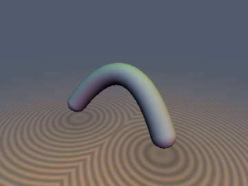
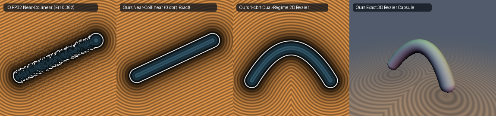

# `sdBezier3D`, `udBezier3D` & `sdgBezier3D` — Exact Collinear-Safe, 1-`cbrt` 3D Quadratic Bézier Capsule



## Overview

Any three control points $`A, B, C \in \mathbb{R}^3`$ define a 3D Quadratic Bézier curve:
```math
P(t) = (1 - t)^2 A + 2(1 - t)t B + t^2 C = A + 2at + bt^2, \qquad t \in [0, 1],
```
where $`a = B - A \in \mathbb{R}^3`$ and $`b = A - 2B + C \in \mathbb{R}^3`$. Because the squared 3D Euclidean distance $`D(t) = \|P(t) - \text{pos}\|_2^2 = \|d + 2at + bt^2\|_2^2`$ ($`d = A - \text{pos}`$) decomposes orthogonally into the affine plane spanned by $`a`$ and $`b`$ plus the constant perpendicular distance squared $`\|\text{pos}_\perp\|_2^2`$, its stationarity condition in $`\mathbb{R}^3`$:
```math
\frac{1}{4} D'(t) = (a + bt) \cdot (d + 2at + bt^2) = 0
```
has the **exact same depressed cubic structure** as in 2D, using 3D dot products $`\langle b, b \rangle, \langle a, b \rangle, \langle a, a \rangle, \langle d, b \rangle, \langle d, a \rangle`$ without ever constructing an explicit 3D orthonormal frame!

Furthermore, in the 3-real-root regime ($`h = q^2 + 4p^3 < 0`$), the middle root $`t_z = (n - m)z - k_x`$ remains a local maximum of $`D(t)`$ in $`\mathbb{R}^3`$ and can never be the closest point, so only the two outer roots $`t_x, t_y`$ need to be tested.

---

## Key Properties



1. **Exact 3D Euclidean Distance & Analytical Unit Gradient (`sdgBezier3D`)**:
   Once the optimal parameter $`t^* \in [0, 1]`$ is found, the closest point on the 3D spine is $`P(t^*) = A + (2a + bt^*)t^*`$, the offset vector is $`\mathbf{q} = \text{pos} - P(t^*) = -(d + (2a + bt^*)t^*)`$, and the exact 3D capsule SDF and unit normal are:
   $`\displaystyle d_{\text{3D}}(\text{pos}) = \|\mathbf{q}\|_2 - r, \qquad \nabla d_{\text{3D}}(\text{pos}) = \frac{\mathbf{q}}{\|\mathbf{q}\|_2},`$
   requiring **zero extra cube roots or `sqrt`s** beyond `length(q)`.
2. **Collinear-Safe & Dual-Regime Cancellation-Free 1-`cbrt` Solver**:
   Inherits both the unscaled cubic Newton solver for collinear/near-collinear 3D segments ($`\|b\|_2^2 \le 10^{-3}\|a\|_2^2`$, smoothly reducing to an exact 3D capsule `sdCapsule(pos, A, C, r)` when $`B = \frac{1}{2}(A + C)`$) and the dual-regime cancellation-free 1-`cbrt` Cardano formula for $`h \ge 0`$.

---

## GLSL Implementation

See [`glsl/curves3d/sdBezier3D.glsl`](../../glsl/curves3d/sdBezier3D.glsl).
