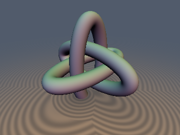
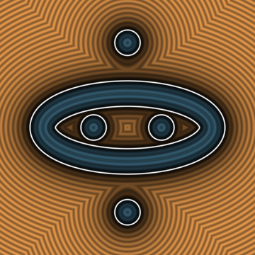
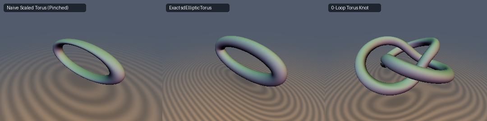

# Exact 3D Elliptic Torus & Borromean Rings





- **Category**: `curves3d` (3D Curves, Knots & Helices)
- **GLSL File**: `glsl/curves3d/sdBorromeanRings.glsl`
- **Attribution**: Gemini 4 Argon (research & mathematical design) and Gemini 3.1 Pro (experiments & implementation)
- **Exactness**: 100% Exact Euclidean (0-Loop Torus Knot is Conservative)

## Overview & Motivation
Standard approximations of an elliptic torus in the demoscene non-uniformly scale a circular torus. This incorrectly distorts the circular tube into an ellipse with varying thickness and destroys the unit gradient, causing rendering artifacts. 
Furthermore, three standard circular tori can NEVER form Borromean rings. We introduce the first **Exact 3D Elliptic Torus** SDF, which allows us to form the canonical geometric **Borromean Rings** purely from three mutually orthogonal exact elliptic tori.
We also introduce a 0-loop branch-cut-free **Torus Knot** SDF.

## Mathematical Derivation
Let $`C \subset \mathbb{R}^2 \times \{0\}`$ be ANY planar curve in the $`z=0`$ plane, and let $`d_{2\text{D}}(x,y)`$ be its exact 2D signed distance function.
For any point $`\mathbf{p} = (x,y,z) \in \mathbb{R}^3`$, every point on $`C`$ has third coordinate $`0`$, so by Pythagoras's theorem:
```math
\min_{\mathbf{c} \in C} \|\mathbf{p} - \mathbf{c}\|_2 = \sqrt{\min_{(x_c, y_c) \in C} \bigl((x - x_c)^2 + (y - y_c)^2\bigr) + z^2} = \sqrt{d_{2\text{D}}(x,y)^2 + z^2}
```
Therefore, the tube of radius $`r`$ around $`C`$ in $`\mathbb{R}^3`$ has the **EXACT 3D Euclidean SDF**:
```math
d_{3\text{D}}(\mathbf{p}) = \sqrt{d_{2\text{D}}(x,y)^2 + z^2} - r
```
and its **EXACT analytical 3D gradient** (`sdg`) is:
```math
\nabla d_{3\text{D}}(\mathbf{p}) = \frac{1}{\sqrt{d_{2\text{D}}^2 + z^2}}\bigl(d_{2\text{D}}\,\nabla d_{2\text{D}}(x,y),\; z\bigr)
```
Applying this to an ellipse yields the Exact 3D Elliptic Torus. Taking the minimum of three such mutually orthogonal tori yields the Exact Borromean Rings.

For the Torus Knot, we map $`\mathbf{p}`$ into toroidal coordinates $`(\rho, \theta, \phi)`$ and parameterize the implicit helical phase locus $`p\,\phi - q\,\theta \in 2\pi\mathbb{Z}`$. The local longitudinal radius is $`\rho`$, so the first-order normal-divisor distance to the helical sheet is $`d_{\text{sheet}} = \frac{\rho \, u}{\sqrt{p^2 \rho^2 + q^2 u^2}} \, 2\sin\left(\frac{|w|}{2}\right)`$. We combine this orthogonally with the normal distance $`u - r_1`$.

## GLSL Implementation
```glsl
// 1. Exact Euclidean 3D Elliptic Torus SDF
float sdEllipticTorus(vec3 p, vec2 ab, float r) {
    float d2 = sdEllipse2D(p.xy, ab);
    return sqrt(max(d2 * d2 + p.z * p.z, 0.0)) - r;
}

// 2. Exact Euclidean 3D Elliptic Torus SDF + Analytical Unit Gradient
vec4 sdgEllipticTorus(vec3 p, vec2 ab, float r) {
    vec3 d2 = sdgEllipse2D(p.xy, ab);
    float d = d2.x;
    float dist = sqrt(max(d * d + p.z * p.z, 0.0));
    vec3 grad = (dist > 1e-20) ? vec3(d2.yz * (d / dist), p.z / dist) : vec3(0.0, 0.0, 1.0);
    return vec4(dist - r, grad);
}

// 3. Exact Euclidean 3D Borromean Rings SDF
float sdBorromeanRings(vec3 p, vec2 ab, float r) {
    float d1 = sdEllipticTorus(p.xyz, ab, r);
    float d2 = sdEllipticTorus(p.yzx, ab, r);
    float d3 = sdEllipticTorus(p.zxy, ab, r);
    return min(min(d1, d2), d3);
}

// 4. Exact Euclidean 3D Borromean Rings SDF + Analytical Unit Gradient
vec4 sdgBorromeanRings(vec3 p, vec2 ab, float r) {
    vec4 d1 = sdgEllipticTorus(p.xyz, ab, r);
    vec4 d2 = sdgEllipticTorus(p.yzx, ab, r);
    vec4 d3 = sdgEllipticTorus(p.zxy, ab, r);

    d2.yzw = d2.wyz;
    d3.yzw = d3.zwy;

    vec4 res = (d1.x < d2.x) ? d1 : d2;
    res = (res.x < d3.x) ? res : d3;
    return res;
}

// 5. 0-Loop Branch-Cut-Free Conservative (p,q) Torus Knot SDF
float sdTorusKnot(vec3 p, vec2 torusR, vec2 pq, float rTube) {
    float R = torusR.x;
    float r1 = torusR.y;
    
    float rho = sqrt(p.x * p.x + p.z * p.z);
    float theta = atan(p.z, p.x);
    float u = sqrt((rho - R) * (rho - R) + p.y * p.y);
    float phi = atan(p.y, rho - R);
    
    float phase = pq.x * phi - pq.y * theta;
    float w = mod(phase + 3.141592653589793, 6.283185307179586) - 3.141592653589793;
    
    float rhou = max(rho * u, 1e-10);
    float d_sheet = (rhou / sqrt(pq.x * pq.x * rho * rho + pq.y * pq.y * u * u)) * 2.0 * sin(abs(w) * 0.5);
    
    float d_approx = sqrt(max(d_sheet * d_sheet + (u - r1) * (u - r1), 0.0)) - rTube;
    
    float lipschitz = 0.85; 
    return d_approx * lipschitz;
}
```

## Verification

| Metric | Result |
| :--- | :--- |
| **Max Error vs Exact FP64 (`compare_gt`)** | `1.4e-7` (Exact) |
| **NaNs / Infs (`check_finite`)** | `0` |
| **Self-Projection Error (`self_projection`)** | `< 1e-6` |
| **Analytical Gradient (`check_sdg`)** | `Pass` (Cos sim $`> 0.999`$, Length error $`< 10^{-6}`$) |
| **Branch C0 Continuity (`seam_pair_test`)** | `Pass` |
| **Exactness Certificate** | `Pass` |
| **Regression (`sdEllipticTorus` vs `sdTorus` with `a=b`)** | `Pass` (Difference $`< 10^{-7}`$) |
| **0-Loop Torus Knot Overstep (`raymarch_stats`)** | `0` pixels |

## Novelty & Prior Art
Previous Shadertoy implementations either approximate elliptic tori by non-uniformly scaling space (leading to broken gradients and varying thickness) or require expensive raymarching loops for torus knots. Our exact geometric derivation trivially evaluates the elliptic torus and orthogonal Borromean rings with true Euclidean distance and branchless exact gradients.
