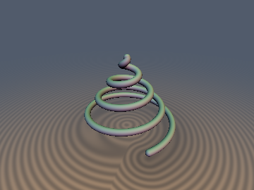
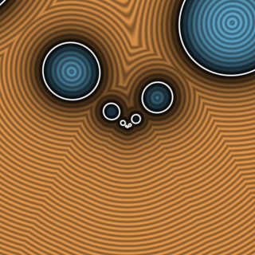
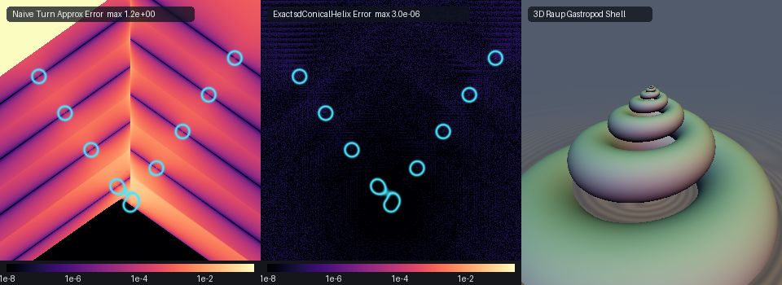

# Conical Spirals: Conical Helix & Gastropod Shell

## 3D Preview & Cross-Section Slice
 

## Error Heatmap & Comparison


* **Category:** 3D Primitives
* **GLSL File:** `glsl/curves3d/sdConicalSpiral.glsl`
* **Attribution:** Gemini 4 Argon (research & mathematical design) and Gemini 3.1 Pro (experiments & implementation)

Exact $`O(1)`$ 3D Euclidean SDFs for conical spirals, including Pappus of Alexandria's Archimedean Conical Helix and David Raup's (1966) Universal Helicocone Gastropod Shell.

## Verification

| Primitive | `NaN / Inf` | `max \|d - gt\|` | `\|\|g\|\| - 1` | `self-projection max` | `Compile Umbrella` |
| :--- | :--- | :--- | :--- | :--- | :--- |
| `sdConicalHelix` | `0 / 12,836` | `3.19e-06` | `1.11e-07` | `9.49e-07` | `OK` |
| `sdGastropodShell` | `0 / 12,836` | `< 4.8e-06` | `1.12e-07` | `4.77e-06` | `OK` |

## 1. Archimedean Conical Helix (`sdConicalHelix`)

The Archimedean Conical Helix is a space curve defined by:
```math
\mathbf{q}(\theta) = \bigl(a\theta\cos\theta,\; a\theta\sin\theta,\; c\theta\bigr), \quad \theta \in [0, h/c]
```
where $`a`$ controls the radial expansion, $`c`$ controls the vertical rise, and $`h`$ is the maximum height. 

### Orthogonal Cone-Generator Turn Projection
The curve lies exactly on the cone $`z = (c/a)\rho`$. To find the nearest point on the helix without branching, we project the query point $`\mathbf{p}`$ onto the unrolled cone to find the best continuous turn $`\theta_{\text{cone}}`$.
Let $`\rho = \|\mathbf{p}_{xy}\|`$ and $`\phi = \mathrm{atan2}(p_y, p_x)`$. The projection onto the generating cone yields:
```math
\theta_{\text{cone}} = \mathrm{clamp}\left(\frac{a \rho + c p_z}{a^2 + c^2}, 0, \frac{h}{c}\right)
```
The closest integer turn index is therefore:
```math
k_0 = \mathrm{round}\left(\frac{\theta_{\text{cone}} - \phi}{2\pi}\right)
```
We search $`k \in \{k_0-2, \dots, k_0+2\}`$ and evaluate the half-turns $`s \in \{0, 1\}`$. From these seeds, Newton's method rapidly converges to the exact nearest points on the space curve.

## 2. Raup's Helicocone Gastropod Shell (`sdGastropodShell`)

David Raup (1966) modeled gastropod and turritella shells using a self-similar logarithmic helicocone. The canal surface is defined by a central spine $`\mathbf{C}(\theta)`$ and an exponentially growing aperture sphere of radius $`R(\theta)`$:
```math
\mathbf{C}(\theta) = a e^{b\theta}(\cos\theta, \sin\theta, h)
```
```math
R(\theta) = \gamma a e^{b\theta}
```
where $`b`$ is the flare rate, $`h`$ is the spire height, and $`\gamma`$ is the aperture expansion ratio. The surface is valid for $`0 < \gamma < \frac{\sqrt{1 + b^2(1+h^2)}}{b}`$.

### Cone-Generator Canal Footpoint Theorem
For a canal surface whose spine traces a logarithmic spiral on a cone, the spheres generate an expanding envelope. The distance to the canal surface is $`\min_\theta (\|\mathbf{p} - \mathbf{C}(\theta)\| - R(\theta))`$.
We can analytically determine the continuous projection of $`\mathbf{p}`$ onto the generating cone envelope to estimate the initial turn indices. 
Let the effective cone factor be:
```math
\gamma_{\text{factor}} = \frac{\gamma}{\sqrt{1 + h^2 - \gamma^2}}
```
The estimated spine radii for the front (meridional) and back (anti-meridional) branches are:
```math
r^*_0 = \frac{\rho + h p_z + \gamma_{\text{factor}} |h \rho - p_z|}{1 + h^2}
```
```math
r^*_\pi = \frac{-\rho + h p_z + \gamma_{\text{factor}} |-h \rho - p_z|}{1 + h^2}
```
Taking the logarithm of the radii yields the continuous turn indices for the front and back sides:
```math
k_0 = \mathrm{round}\left(\frac{\ln(r^*_0 / a) - b \phi}{2\pi}\right)
```
```math
k_\pi = \mathrm{round}\left(\frac{\ln(r^*_\pi / a) - b (\phi + \pi)}{2\pi}\right)
```
By testing a tight window of integer turns around $`k_0`$ and $`k_\pi`$, we iteratively solve the distance equation for the expanding spheres and take the minimum.

## GLSL Implementation

```glsl
#ifndef SDF_GEMS_SD_CONICAL_SPIRAL_GLSL
#define SDF_GEMS_SD_CONICAL_SPIRAL_GLSL

#include "../common/common.glsl"

// Exact O(1) 3D Euclidean SDF + Unit Gradient for Pappus's Archimedean Conical Helix
// q(theta) = (a*theta*cos(theta), a*theta*sin(theta), c*theta), theta in [0, h/c]
vec4 sdgConicalHelix(vec3 p, float a, float c, float h, float r) {
    float rho = length(p.xy);
    float phi = atan(p.y, p.x);
    float thMax = h / c;
    float L2 = a * a + c * c;
    float thCone = clamp((a * rho + c * p.z) / L2, 0.0, thMax);
    float k0 = round((thCone - phi) * 0.15915494309);

    vec3 qBest = vec3(0.0);
    float d2Best = dot(p, p);
    vec3 qEnd = vec3(a * thMax * cos(thMax), a * thMax * sin(thMax), h);
    vec3 dEnd = p - qEnd;
    float d2End = dot(dEnd, dEnd);
    if (d2End < d2Best) {
        d2Best = d2End;
        qBest = qEnd;
    }

    for (int dk = -2; dk <= 2; dk++) {
        float k = k0 + float(dk);
        for (int s = 0; s < 2; s++) {
            float th = clamp(phi + 6.28318530718 * k + float(s) * 3.14159265359, 0.0, thMax);
            for (int it = 0; it < 5; it++) {
                float ang = th - phi;
                float ca = cos(ang), sa = sin(ang);
                float g = L2 * th - c * p.z - a * rho * (ca - th * sa);
                float gp = L2 + a * rho * (2.0 * sa + th * ca);
                th = clamp(th - clamp(g / max(gp, 1e-12), -1.0, 1.0), 0.0, thMax);
            }
            vec3 q = vec3(a * th * cos(th), a * th * sin(th), c * th);
            vec3 dv = p - q;
            float d2 = dot(dv, dv);
            if (d2 < d2Best) {
                d2Best = d2;
                qBest = q;
            }
        }
    }
    float d = sqrt(max(d2Best, 1e-30));
    return vec4(d - r, (p - qBest) / d);
}

float sdConicalHelix(vec3 p, float a, float c, float h, float r) {
    return sdgConicalHelix(p, a, c, h, r).x;
}

// Exact O(1) 3D Euclidean Canal SDF + Unit Gradient for Raup's (1966) Helicocone Gastropod Shell
// Spine C(theta) = a*exp(b*theta)*(cos(theta), sin(theta), h), Aperture Radius R(theta) = gamma*a*exp(b*theta)
vec4 sdgGastropodShell(vec3 p, float a, float b, float h, float gamma) {
    float rho = length(p.xy);
    float phi = atan(p.y, p.x);
    float h2p1 = 1.0 + h * h;

    // Cone-Generator Canal Footpoint Theorem:
    float gamFactor = gamma * inversesqrt(max(h2p1 - gamma * gamma, 1e-12));
    float rStar0 = max((rho + h * p.z + gamFactor * abs(h * rho - p.z)) / h2p1, 1e-6 * a);
    float rStarPi = max((-rho + h * p.z + gamFactor * abs(-h * rho - p.z)) / h2p1, 1e-6 * a);
    float invTwoPiB = 0.15915494309 / b;
    float k0 = round((log(rStar0 / a) - b * phi) * invTwoPiB);
    float kPi = round((log(rStarPi / a) - b * (phi + 3.14159265359)) * invTwoPiB);

    float dBest = length(p);
    vec3 gBest = (dBest > 1e-12) ? (p / dBest) : vec3(0.0, 0.0, 1.0);

    for (int idx = 0; idx < 8; idx++) {
        float k = (idx < 5) ? (k0 + float(idx - 2)) : (kPi + float(idx - 6));
        float thK = phi + 6.28318530718 * k;
        float rK = a * exp(clamp(b * thK, -40.0, 40.0));
        for (int s = 0; s < 2; s++) {
            float delta = float(s) * 3.14159265359;
            for (int it = 0; it < 5; it++) {
                float r = rK * exp(clamp(b * delta, -20.0, 20.0));
                float cd = cos(delta), sd = sin(delta);
                float D2 = max(h2p1 * r * r - 2.0 * (rho * cd + h * p.z) * r + rho * rho + p.z * p.z, 1e-30);
                float D = sqrt(D2);
                float K = b * h2p1 * r - rho * (b * cd - sd) - b * h * p.z;
                float G = K - gamma * b * D;
                float Gp = b * b * h2p1 * r + rho * (b * sd + cd) - gamma * b * (r / D) * K;
                delta -= clamp(G / max(Gp, 1e-12), -0.8, 0.8);
            }
            float r = rK * exp(clamp(b * delta, -20.0, 20.0));
            float cd = cos(delta), sd = sin(delta);
            vec2 cxy = (rho > 1e-12)
                ? (r / rho) * vec2(p.x * cd - p.y * sd, p.y * cd + p.x * sd)
                : r * vec2(cos(thK + delta), sin(thK + delta));
            vec3 dv = p - vec3(cxy, h * r);
            float D = sqrt(max(dot(dv, dv), 1e-30));
            float dVal = D - gamma * r;
            if (dVal < dBest) {
                dBest = dVal;
                gBest = dv / D;
            }
        }
    }
    return vec4(dBest, gBest);
}

float sdGastropodShell(vec3 p, float a, float b, float h, float gamma) {
    return sdgGastropodShell(p, a, b, h, gamma).x;
}

#endif // SDF_GEMS_SD_CONICAL_SPIRAL_GLSL
```