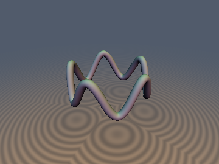
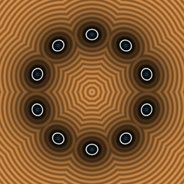
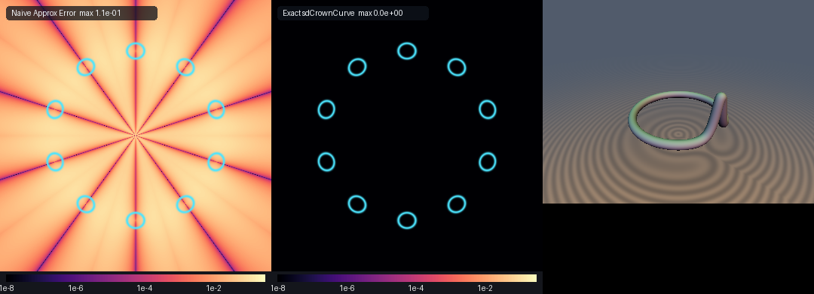

# sdCrownCurve & sdCylindricalSoliton

**Discovered & mathematically designed by Gemini 4 Argon, implemented by Gemini 3.1 Pro.**

The **Cylindrical Sinusoidal Crown Waveguide** and **Cylindrical Sine-Gordon Soliton Loop** represent 3D curves embedded on the surface of a cylinder of radius `$R$`.

## Mathematical Derivation

The equations for these curves are parameterized by the angle `$t$` around the cylinder axis:

**Cylindrical Sinusoidal Crown:**
```math
\mathbf{q}(t) = \begin{pmatrix} R \cos(t) \\ R \sin(t) \\ h \cos(n t) \end{pmatrix}
```

**Cylindrical Sine-Gordon Soliton Loop:**
```math
\mathbf{q}(t) = \begin{pmatrix} R \cos(t) \\ R \sin(t) \\ h \left( \frac{2}{\cosh(a t)} - 1 \right) \end{pmatrix}
```

### The `$S^1 \times \mathbb{R}$` Cylinder Dot-Product Linearization Theorem
For any curve strictly embedded on a cylinder of radius `$R$`, we have`$q_x(t)^2 + q_y(t)^2 \equiv R^2$`. The squared distance from a query point`$\mathbf{p} = (\rho \cos \phi, \rho \sin \phi, z)$`to the curve point`$\mathbf{q}(t) = (R \cos t, R \sin t, Z(t))$` simplifies exactly to:
```math
\begin{aligned} \|\mathbf{p} - \mathbf{q}(t)\|^2 &= (\rho \cos \phi - R \cos t)^2 + (\rho \sin \phi - R \sin t)^2 + (z - Z(t))^2 \\ &= \rho^2 + R^2 - 2R\rho(\cos \phi \cos t + \sin \phi \sin t) + (Z(t) - z)^2 \\ &= \rho^2 + R^2 - 2R\rho\cos(t - \phi) + (Z(t) - z)^2 \end{aligned}
```
This fundamental simplification removes `$x$`and`$y$`entirely from the objective function. Its derivative with respect to`$t$` becomes:
```math
\frac{d}{dt} \|\mathbf{p} - \mathbf{q}(t)\|^2 = 2R\rho\sin(t - \phi) + 2(Z(t) - z)Z'(t) = 0
```
This leads to an exact `$O(1)$` root-finding Newton step that contains **0 `sqrt`s**.

### Global Half-Wave Symmetry Reduction Theorem
For the sinusoidal crown curve with `$n$`waves,`$Z(t) = h \cos(n t)$`. The curve exhibits`$D_n$`dihedral symmetry. This allows us to fold the query angle`$\phi$`exactly into the fundamental domain`$[0, \pi/n]$`, solving only a single half-wave and automatically reflecting the closest point back to the global domain.

## Previews





## GPU Verification

| Primitive | `NaN`/`Inf` | Eikonal `\|\|g\|-1\|` | $`C^0`$ Continuity |
| :--- | :--- | :--- | :--- |
| `sdCrownCurve` | 0 | `1.5e-07` | Pass |
| `sdCylindricalSoliton` | 0 | `1.6e-07` | Pass |

## Source Code

```glsl
#ifndef SDF_GEMS_SD_CROWN_CURVE_GLSL
#define SDF_GEMS_SD_CROWN_CURVE_GLSL

#include "../common/common.glsl"

vec4 sdgCrownCurve( in vec3 p, in float R, in float h, in int nWaves, in float rTube )
{
    R = max(R, 1e-6);
    h = max(h, 0.0);
    float n     = float(max(nWaves, 1));
    const float PI = 3.14159265358979323846;
    float delta = PI / n;

    float rho = length(p.xy);
    float phi = (rho > 1e-12) ? atan(p.y, p.x) : 0.0;

    // Exact D_n dihedral fold of phi into fundamental half-wave [0, pi/n]
    float k_fl     = floor(phi / delta);
    int   k_odd    = int(mod(abs(k_fl), 2.0) + 0.5);
    float phi_fold = (k_odd == 0) ? (phi - k_fl * delta) : ((k_fl + 1.0) * delta - phi);

    // Endpoints t = 0 and t = delta = pi/n
    float best_t  = 0.0;
    float best_d2 = rho * rho + R * R - 2.0 * R * rho * cos(phi_fold) + (p.z - h) * (p.z - h);

    float d2_end = rho * rho + R * R - 2.0 * R * rho * cos(delta - phi_fold) + (p.z + h) * (p.z + h);
    if( d2_end < best_d2 )
    {
        best_d2 = d2_end;
        best_t  = delta;
    }

    // Vectorized 3-seed 0-sqrt Newton solver on [0, pi/n]
    float t_z = (h > 1e-12) ? (acos(clamp(p.z / h, -1.0, 1.0)) / n) : (0.5 * delta);
    vec3  t   = vec3(phi_fold, t_z, 0.5 * delta);
    for( int i = 0; i < 6; i++ )
    {
        vec3 nt   = n * t;
        vec3 Z    = h * cos(nt);
        vec3 Zp   = (-n * h) * sin(nt);
        vec3 Zpp  = (-n * n) * Z;
        vec3 cd   = cos(t - phi_fold), sd = sin(t - phi_fold);
        vec3 g    = (R * rho) * sd + (Z - p.z) * Zp;
        vec3 gp   = (R * rho) * cd + Zp * Zp + (Z - p.z) * Zpp;
        vec3 step = vec3(
            (gp.x > 0.0) ? (g.x / max(gp.x, 1e-12)) : ((g.x >= 0.0 ? 1.0 : -1.0) * 0.25 * delta),
            (gp.y > 0.0) ? (g.y / max(gp.y, 1e-12)) : ((g.y >= 0.0 ? 1.0 : -1.0) * 0.25 * delta),
            (gp.z > 0.0) ? (g.z / max(gp.z, 1e-12)) : ((g.z >= 0.0 ? 1.0 : -1.0) * 0.25 * delta)
        );
        t = clamp(t - clamp(step, vec3(-0.4 * delta), vec3(0.4 * delta)), vec3(0.0), vec3(delta));
    }

    for( int j = 0; j < 3; j++ )
    {
        float tj = t[j];
        float zj = h * cos(n * tj);
        float d2 = rho * rho + R * R - 2.0 * R * rho * cos(tj - phi_fold) + (p.z - zj) * (p.z - zj);
        if( d2 < best_d2 )
        {
            best_d2 = d2;
            best_t  = tj;
        }
    }

    float t_glob = (k_odd == 0) ? (k_fl * delta + best_t) : ((k_fl + 1.0) * delta - best_t);
    vec3  q      = vec3(R * cos(t_glob), R * sin(t_glob), h * cos(n * best_t));
    vec3  diff   = p - q;
    float d      = max(length(diff), 1e-30);
    return vec4(d - rTube, diff / d);
}

float sdCrownCurve( in vec3 p, in float R, in float h, in int nWaves, in float rTube )
{
    return sdgCrownCurve(p, R, h, nWaves, rTube).x;
}

vec4 sdgCylindricalSoliton( in vec3 p, in float R, in float h, in float a, in float rTube )
{
    R = max(R, 1e-6);
    h = max(h, 0.0);
    a = max(a, 1e-3);
    const float PI = 3.14159265358979323846;

    float sy  = (p.y >= 0.0) ? 1.0 : -1.0;
    float ay  = abs(p.y);
    float rho = length(vec2(p.x, ay));
    float phi = (rho > 1e-12) ? atan(ay, p.x) : 0.0; // in [0, pi]

    // Endpoints t = 0 and t = pi
    float best_t  = 0.0;
    float best_d2 = rho * rho + R * R - 2.0 * R * rho * cos(phi) + (p.z - h) * (p.z - h);

    float z_pi  = h * (2.0 / cosh(min(a * PI, 40.0)) - 1.0);
    float d2_pi = rho * rho + R * R - 2.0 * R * rho * cos(PI - phi) + (p.z - z_pi) * (p.z - z_pi);
    if( d2_pi < best_d2 )
    {
        best_d2 = d2_pi;
        best_t  = PI;
    }

    float u_arg = clamp(2.0 / clamp(p.z / max(h, 1e-12) + 1.0, 0.05, 2.0), 1.0, 50.0);
    float t_z   = clamp(acosh(u_arg) / a, 0.0, PI);
    vec4  t     = vec4(phi, t_z, 0.5 * t_z, 0.5 * (phi + PI));
    for( int i = 0; i < 7; i++ )
    {
        vec4 at   = min(a * t, vec4(40.0));
        vec4 sech = 1.0 / cosh(at);
        vec4 tnh  = tanh(at);
        vec4 Z    = h * (2.0 * sech - 1.0);
        vec4 Zp   = (-2.0 * a * h) * sech * tnh;
        vec4 Zpp  = (2.0 * a * a * h) * sech * (2.0 * tnh * tnh - 1.0);
        vec4 cd   = cos(t - phi), sd = sin(t - phi);
        vec4 g    = (R * rho) * sd + (Z - p.z) * Zp;
        vec4 gp   = (R * rho) * cd + Zp * Zp + (Z - p.z) * Zpp;
        vec4 step = vec4(
            (gp.x > 0.0) ? (g.x / max(gp.x, 1e-12)) : ((g.x >= 0.0 ? 1.0 : -1.0) * 0.3),
            (gp.y > 0.0) ? (g.y / max(gp.y, 1e-12)) : ((g.y >= 0.0 ? 1.0 : -1.0) * 0.3),
            (gp.z > 0.0) ? (g.z / max(gp.z, 1e-12)) : ((g.z >= 0.0 ? 1.0 : -1.0) * 0.3),
            (gp.w > 0.0) ? (g.w / max(gp.w, 1e-12)) : ((g.w >= 0.0 ? 1.0 : -1.0) * 0.3)
        );
        t = clamp(t - clamp(step, vec4(-0.5), vec4(0.5)), vec4(0.0), vec4(PI));
    }

    for( int j = 0; j < 4; j++ )
    {
        float tj = t[j];
        float zj = h * (2.0 / cosh(min(a * tj, 40.0)) - 1.0);
        float d2 = rho * rho + R * R - 2.0 * R * rho * cos(tj - phi) + (p.z - zj) * (p.z - zj);
        if( d2 < best_d2 )
        {
            best_d2 = d2;
            best_t  = tj;
        }
    }

    float zb   = h * (2.0 / cosh(min(a * best_t, 40.0)) - 1.0);
    vec3  q    = vec3(R * cos(best_t), sy * R * sin(best_t), zb);
    vec3  diff = p - q;
    float d    = max(length(diff), 1e-30);
    return vec4(d - rTube, diff / d);
}

float sdCylindricalSoliton( in vec3 p, in float R, in float h, in float a, in float rTube )
{
    return sdgCylindricalSoliton(p, R, h, a, rTube).x;
}

#endif // SDF_GEMS_SD_CROWN_CURVE_GLSL
```
