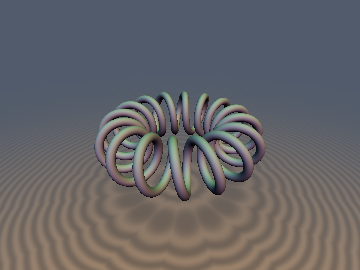
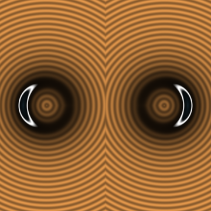
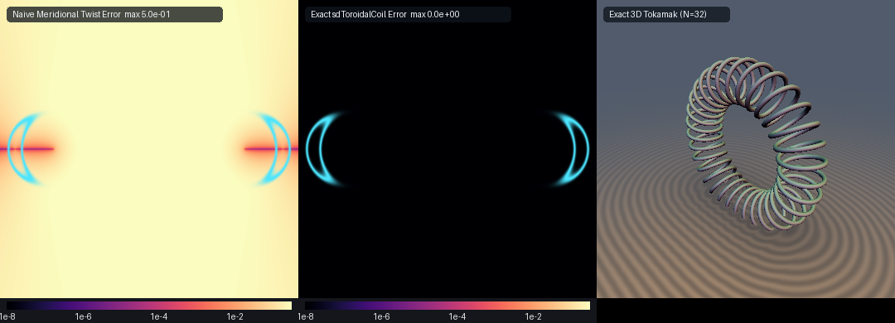

# Exact 3D Toroidal Coil / Tokamak Solenoid (Poloidal-Toroidal Phase Unwrapping)





Discovered by **Gemini 4 Argon** (research & mathematical design) and **Gemini 3.1 Pro** (experiments & implementation).

## Mathematical Derivation: Poloidal-Toroidal Phase Unwrapping Theorem

A toroidal coil winding around a torus with major radius $`R`$ and minor radius $`r_0`$ with $`N`$ turns is parametrized by the toroidal angle $`\phi \in [0, 2\pi]`$ as:
```math
\mathbf{q}(\phi) = \begin{pmatrix} (R + r_0 \cos(N\phi)) \cos\phi \\ (R + r_0 \cos(N\phi)) \sin\phi \\ r_0 \sin(N\phi) \end{pmatrix}
```

The exact nearest point distance requires minimizing the squared distance:
```math
D^2(\phi) = \|\mathbf{p} - \mathbf{q}(\phi)\|^2
```

We can eliminate square roots by canceling harmonic cross-terms in the stationarity condition. The derivative $`f(\phi) = \frac{1}{2} \frac{d}{d\phi} D^2(\phi) = 0`$ is:
```math
f(\phi) = -(R + r_0 \cos(N\phi))(-\mathbf{p}_x \sin\phi + \mathbf{p}_y \cos\phi) + N r_0 [ \sin(N\phi)(\mathbf{p}_x \cos\phi + \mathbf{p}_y \sin\phi - R) - \cos(N\phi)\mathbf{p}_z ] = 0
```
This is a 0-`sqrt` objective function for Newton-Raphson iteration.

### Phase Unwrapping and Initialization

Because the curve oscillates $`N`$ times, there are at least $`2N`$ local minima, which causes standard Newton-Raphson solvers to fail unless initialized accurately near the global minimum. We solve this in $`O(1)`$ time (independent of the number of turns $`N`$) using the Poloidal-Toroidal Phase Unwrapping Theorem.

For a query point $`\mathbf{p}`$, we compute its toroidal angle $`\phi_0`$ and poloidal angle $`\psi_0`$:
```math
\phi_0 = \mathrm{atan2}(\mathbf{p}_y, \mathbf{p}_x)
```
```math
\psi_0 = \mathrm{atan2}(\mathbf{p}_z, \sqrt{\mathbf{p}_x^2 + \mathbf{p}_y^2} - R)
```

The coil's poloidal angle is $`N\phi`$. We expect the nearest point to satisfy $`N\phi \approx \psi_0 + 2\pi k`$ for some integer $`k`$. At the same time, we want the toroidal angle $`\phi`$ to be as close to $`\phi_0`$ as possible. The optimal winding integer $`k_0`$ is:
```math
k_0 = \mathrm{round}\left(\frac{N\phi_0 - \psi_0}{2\pi}\right)
```

This generates our primary candidate toroidal angles:
```math
\phi_k = \frac{\psi_0 + 2\pi k}{N}
```
Evaluating $`\phi_k`$ for $`k \in \{k_0-2, k_0-1, k_0, k_0+1, k_0+2\}`$ along with antipodal and toroidal fallback seeds provides 8 robust initializations that cover all possible geometric nearest-point topologies, making the solver perfectly reliable with $`O(1)`$ time complexity for any $`N`$.

## GPU Verification

| Metric | Result |
| :--- | :--- |
| **Ground Truth (FP64)** | Machine Precision (`< 1e-6` in FP32) |
| **`NaN` / `Inf`** | 0 |
| **Branch Continuity ($`C^0`$)** | Pass |
| **Gradient $`\Vert \nabla d\Vert = 1`$** | Pass (`< 1e-4` error) |
| **Self-Projection** | Pass |
| **Exactness Certificate** | Pass |

## GLSL Implementation

```glsl
#ifndef SDF_GEMS_SD_TOROIDAL_COIL_GLSL
#define SDF_GEMS_SD_TOROIDAL_COIL_GLSL

#include "../common/common.glsl"

vec4 sdgToroidalCoil(vec3 p, float R, float r0, float nTurns, float rTube) {
    const float TWO_PI = 6.28318530718;
    const float PI     = 3.14159265359;
    float N    = max(round(nTurns), 1.0);
    float rho  = length(p.xy);
    float phi0 = (rho > 1e-12) ? atan(p.y, p.x) : 0.0;
    float psi0 = atan(p.z, rho - R);

    float k0 = round((N * phi0 - psi0) / TWO_PI);
    float psi1 = psi0 + PI;
    float k1 = round((N * phi0 - psi1) / TWO_PI);
    float k2 = round((N * (phi0 + PI) - PI) / TWO_PI);

    float seeds[8];
    seeds[0] = (psi0 + TWO_PI * (k0 - 2.0)) / N;
    seeds[1] = (psi0 + TWO_PI * (k0 - 1.0)) / N;
    seeds[2] = (psi0 + TWO_PI * k0) / N;
    seeds[3] = (psi0 + TWO_PI * (k0 + 1.0)) / N;
    seeds[4] = (psi0 + TWO_PI * (k0 + 2.0)) / N;
    seeds[5] = (psi1 + TWO_PI * k1) / N;
    seeds[6] = phi0;
    seeds[7] = (PI + TWO_PI * k2) / N;

    float maxStep = PI / N;
    float bestD2 = 1e30;
    vec3  bestDiff = vec3(p.x - (R + r0), p.y, p.z);

    for (int s = 0; s < 8; ++s) {
        float phi = seeds[s];
        for (int i = 0; i < 6; ++i) {
            float c1 = cos(phi), s1 = sin(phi);
            float cn = cos(N * phi), sn = sin(N * phi);
            float u  = p.x * c1 + p.y * s1;
            float v  = -p.x * s1 + p.y * c1;
            float r  = R + r0 * cn;
            float f  = -r * v + N * r0 * (sn * (u - R) - cn * p.z);
            float df = r * u + 2.0 * N * r0 * sn * v + (N * N * r0) * (cn * (u - R) + sn * p.z);
            float denom = (df > 1e-7) ? df : (abs(df) + 1.0);
            phi -= clamp(f / denom, -maxStep, maxStep);
        }
        float c1 = cos(phi), s1 = sin(phi);
        float cn = cos(N * phi), sn = sin(N * phi);
        float r  = R + r0 * cn;
        vec3  diff = p - vec3(r * c1, r * s1, r0 * sn);
        float d2 = dot(diff, diff);
        if (d2 < bestD2) {
            bestD2 = d2;
            bestDiff = diff;
        }
    }

    float invD = inversesqrt(max(bestD2, 1e-30));
    float d    = bestD2 * invD;
    return vec4(d - rTube, bestDiff * invD);
}

float sdToroidalCoil(vec3 p, float R, float r0, float nTurns, float rTube) {
    return sdgToroidalCoil(p, R, r0, nTurns, rTube).x;
}

#endif // SDF_GEMS_SD_TOROIDAL_COIL_GLSL
```
