# 7. Extrusions, Deformations & Metric Pullbacks

[**← Back to Main `sdf-gems` README**](../../README.md) · **GLSL Headers**: [`glsl/deform/`](../../glsl/deform/) (31 headers)

2D-to-3D extrusions, revolutions, and planar/arc sweeps; classical spatial warps with exact singular-value Lipschitz bounds; and non-Euclidean pullbacks (conformal, Poincaré hyperbolic, CGA sphere inversion, Laguerre boosts, Miura-ori isometric folding, symplectic flows, and Heisenberg sub-Riemannian geometry).

## Contents

- **2D-to-3D Extrusions, Revolutions, Shells & Sweeps** (14)
- **Spatial Deformations & Isometric Origami** (6)
- **Conformal, Hyperbolic, Laguerre, Symplectic & Sub-Riemannian Pullbacks** (11)

## 2D-to-3D Extrusions, Revolutions, Shells & Sweeps

| Preview | Function | Summary |
| :---: | :--- | :--- |
| 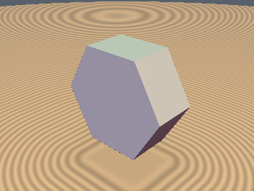&nbsp;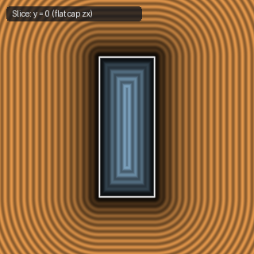 | [**`opExtrusion`**](opExtrusion.md) [`glsl`](../../glsl/deform/opExtrusion.glsl) · **Exact** | **Also**: `opExtrusionSq`. Orthogonal composition of any 2D SDF with $`[-h, h]`$, plus 1-`sqrt` `opExtrusionSq(d2, s, z, h)` |
| 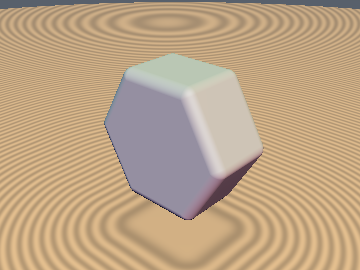&nbsp;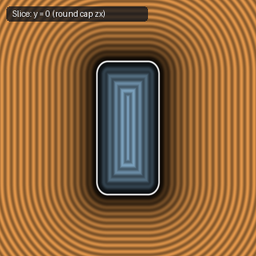 | [**`opExtrudeRound`**](opExtrudeRound.md) [`glsl`](../../glsl/deform/opExtrudeRound.glsl) · **Exact** | Orthogonal composition with a 2D rounded-box profile; bevels only the top/bottom rims |
| 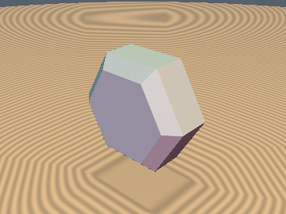&nbsp;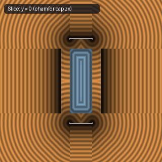 | [**`opExtrudeChamfer`**](opExtrudeChamfer.md) [`glsl`](../../glsl/deform/opExtrudeChamfer.glsl) · **Exact** | 5-line corner-local orthogonal composition with an exact $`45^\circ`$ chamfered cap profile ($`\Vert \nabla d\Vert = 1`$) |
| 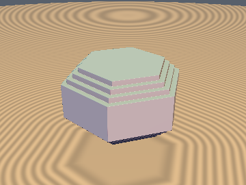&nbsp;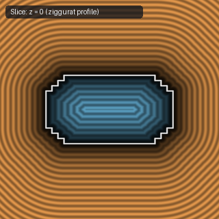 | [**`opExtrudeStairs`**](opExtrudeStairs.md) [`glsl`](../../glsl/deform/opExtrudeStairs.glsl) · **Exact** | 1-`sqrt` orthogonal composition sculpting an exact $`n`$-tier ziggurat / stepped rim around any 2D SDF |
| 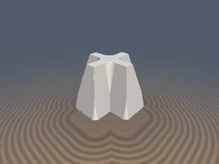&nbsp;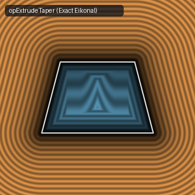 | [**`opExtrudeTaper`**](opExtrudeTaper.md) [`glsl`](../../glsl/deform/opExtrudeTaper.glsl) · **Exact** | **Also**: `opExtrudeBulge`. 0/1-`sqrt` exact draft-angle / slanted extrusion (`opExtrudeTaper`) and barrel/spool extrusion (`opExtrudeBulge`) |
| 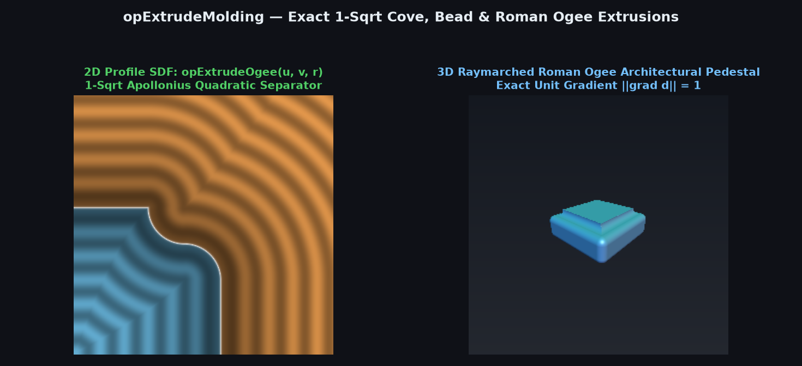 | [**`opExtrudeMolding`**](opExtrudeMolding.md) [`glsl`](../../glsl/deform/opExtrudeMolding.glsl) · **Exact** | **Also**: `opExtrudeCove`, `opExtrudeBead`, `opExtrudeOgee`, `sdgExtrude*`. 1-`sqrt` orthogonal Cove (cavetto), Bead (astragal), and $`G^1`$ S-curve Roman Ogee (cyma reversa) architectural molding extrusions + 3D gradients |
| 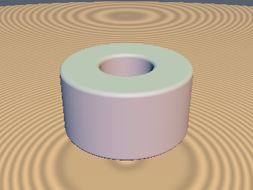&nbsp;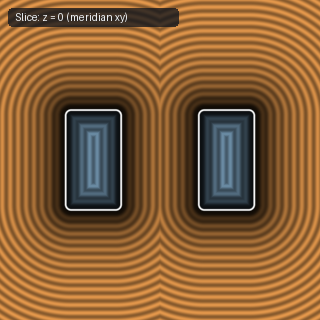 | [**`opRevolution`**](opRevolution.md) [`glsl`](../../glsl/deform/opRevolution.glsl) · **Exact** | Revolves a 2D SDF around the $`y`$-axis via $`(\Vert p_{xz}\Vert - o, p_y)`$ |
| 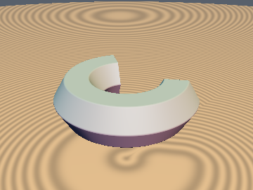&nbsp;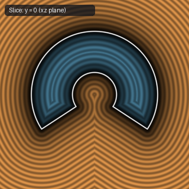 | [**`opRevolutionLim`**](opRevolutionLim.md) [`glsl`](../../glsl/deform/opRevolutionLim.glsl) · **Exact** | Exact 1-tap limited-angle partial revolution $`\phi \in [-\theta, \theta]`$ of any 2D SDF (flat or round end-caps) |
| 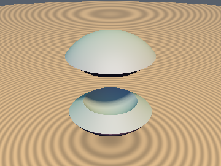&nbsp;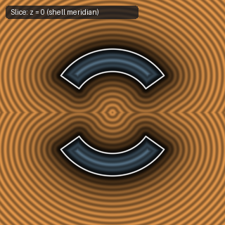 | [**`opSphericalExtrude`**](opSphericalExtrude.md) [`glsl`](../../glsl/deform/opSphericalExtrude.glsl) · **Exact** | Lifts any angular SDF on $`S^2`$ to an exact 3D spherical shell $`[R_1, R_2]`$ via polar-to-Cartesian conversion |
| 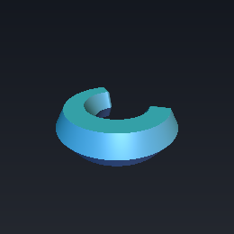&nbsp;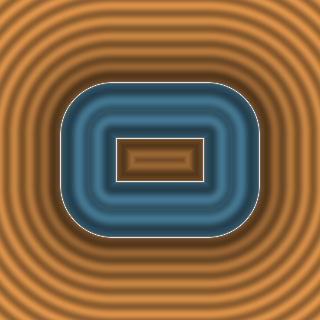 | [**`opSweep`**](opSweep.md) [`glsl`](../../glsl/deform/opSweep.glsl) · **Exact** | **Also**: `opSweepPlanar`, `sdgSweepPlanar`, `opSweepArcSpine`, `opSweepSegment*`, `opSweepArc*`, `sdgSweep*`. Exact Eikonal planar-spine, finite-segment, & circular-arc 2D-profile sweeps + 0-SFU 3D gradient composition |
| 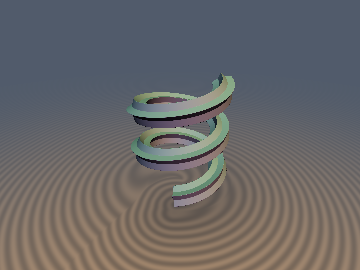 | [**`opSweepBishop`**](opSweepBishop.md) [`glsl`](../../glsl/deform/opSweepBishop.glsl) · **Exact / 1-Lipschitz** | **Also**: `opSweepHelixBishop`, `sdgSweepHelixBishopFinalize`, `opSweepHelixTwistedScale`, `sdBishopHelixSquare`, `sdgBishopHelixStar`, `sdTwistedHelixBar`. Exact Bishop parallel-transport 3D space-curve sweeps (`0` SFU 3D gradient, multi-turn Voronoi-clean, & finite $`N`$-turn coils) plus certified SVD bounds (`0.0%` overstep) for twisted bars |
| 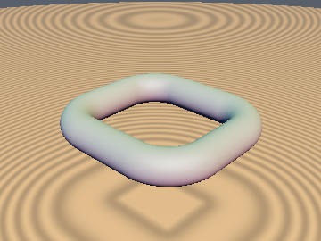&nbsp;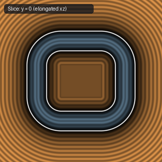 | [**`opElongate`**](opElongate.md) [`glsl`](../../glsl/deform/opElongate.glsl) · **Exact** | Splits a primitive and inserts straight extrusions along each axis; exact in 3D via `min(max(q), 0.0)` |
| 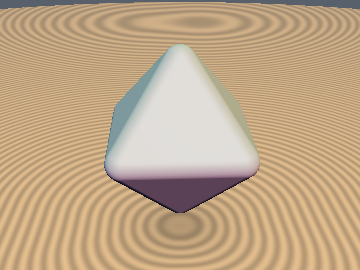&nbsp;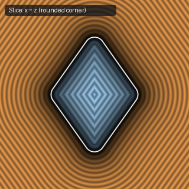 | [**`opRound`**](opRound.md) [`glsl`](../../glsl/deform/opRound.glsl) · **Exact** | Isotropic Minkowski offset $`d - r`$; requires an exact underlying SDF for spherical corners |
| 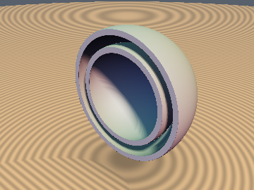&nbsp;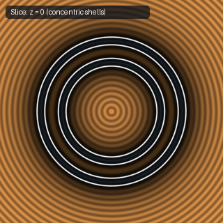 | [**`opOnion`**](opOnion.md) [`glsl`](../../glsl/deform/opOnion.glsl) · **Exact** | **Also**: `opOnionCap`, `opOnionRound`, `opOnionLayers`, `sdgOnionCap`. Concentric hollow shell $`\Vert d\Vert -t`$, 1-`sqrt` Euclidean cut-shell (`opOnionCap`), oblique/rounded rims, & 0-loop $`N`$-layer shells (`opOnionLayers`) |

## Spatial Deformations & Isometric Origami

| Preview | Function | Summary |
| :---: | :--- | :--- |
| 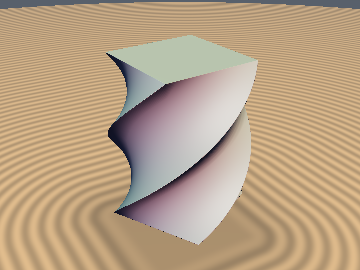&nbsp;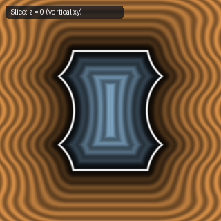 | [**`opTwist`**](opTwist.md) [`glsl`](../../glsl/deform/opTwist.glsl) · Bound | Torsional rotation around $`y`$; includes exact Jacobian singular-value Lipschitz factor |
| 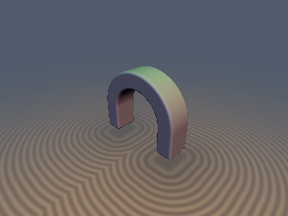&nbsp;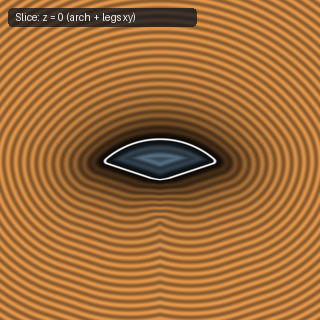 | [**`opBend`**](opBend.md) [`glsl`](../../glsl/deform/opBend.glsl) · **Exact** | Exact circular arc bend (`opArcBend`) and `atan`-free arch with straight tangent legs (`opBendArch`) |
| 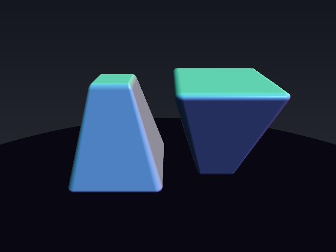&nbsp;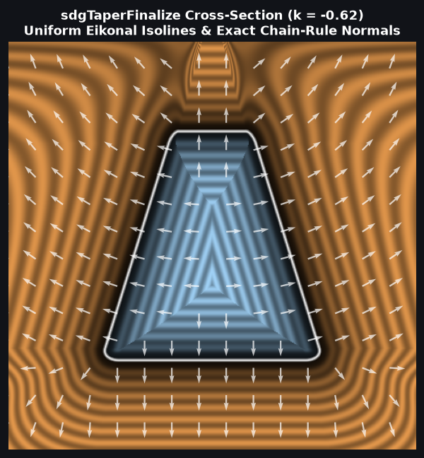 | [**`opTaper`**](opTaper.md) [`glsl`](../../glsl/deform/opTaper.glsl) · **Exact** / Bound | **Also**: `opTaperBox`, `sdgTaperBox`, `opTaperBound`, `sdgTaperFinalize`. 0/1-`sqrt` exact tapered 3D box/frustum (`opTaperBox`) and closed-form singular-value Lipschitz bound (`opTaperBound`) for general linear tapering |
| 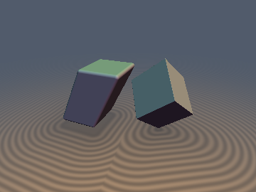&nbsp;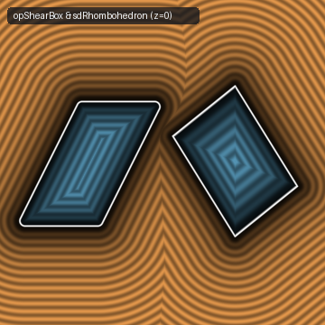 | [**`opShear`**](opShear.md) [`glsl`](../../glsl/deform/opShear.glsl) · **Exact** / **Conservative** | **Also**: `opShearBound`, `sdgShearFinalize`, `opShearBox`, `sdgShearBox`, `sdRhombohedron`, `sdgRhombohedron`. Exact singular-value Lipschitz shear bound (`0%` overstep vs $`+14.4\%`$ for `1/sqrt(1+k^2)`), 0/1-`sqrt` exact 3D sheared box (`0` `sqrt`s in interior + 6 face prisms), & $`D_{3d}`$ rhombohedron |
| 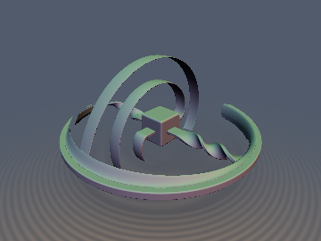 | [**`opDiracBelt`**](opDiracBelt.md) [`glsl`](../../glsl/deform/opDiracBelt.glsl) · **1-Lipschitz** | **Also**: `opDiracBeltScale`, `sdgDiracBelt`, `sdDiracBeltDemo`. Dirac's $`720^\circ`$ $`\mathrm{SU}(2)`$ spinor belt-trick homotopy and incompressible spherical-shell deformation ($`\det \mathbf{J} \equiv 1`$, exact Shear-SVD bound) |
| 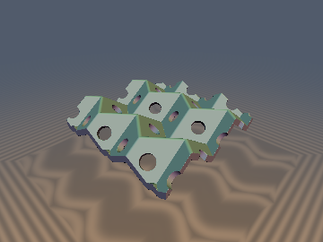 | [**`orMiuraOri`**](orMiuraOri.md) [`glsl`](../../glsl/deform/orMiuraOri.glsl) · **Exact** | **Also**: `orMiuraFrame`, `opMiuraOriCell`, `sdMiuraOriSheet`, `sdgMiuraOriSheet`, `opMiuraOriUnfold`, `sdYoshimuraCylinder`. Exact rigid isometric Kawasaki-Maekawa degree-4 Miura-ori sheet SDF via 2-chamber glide-reflection pairing (`1.6e-7` error), intrinsic paper unfolding coordinates, and Yoshimura/Kresling buckled cylinders |

## Conformal, Hyperbolic, Laguerre, Symplectic & Sub-Riemannian Pullbacks

| Preview | Function | Summary |
| :---: | :--- | :--- |
| 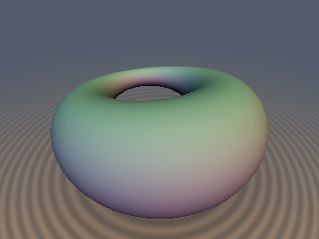&nbsp;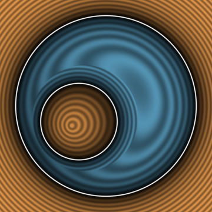 | [**`opSphereInvert`**](opSphereInvert.md) [`glsl`](../../glsl/deform/opSphereInvert.glsl) · **Exact** / **Conservative** | **Also**: `sdSphereInvertMetric`, `sdgSphereInvertFinalize`, `sdInvertPlane`, `sdInvertSphere`, `sdDupinCyclide`, `sdgDupinCyclide`. Globally 1-Lipschitz Apollonius–Kelvin spherical inversion (`0%` overstep vs $`100\%`$ for $`(r^2/R^2)d_q`$), 0-SFU Householder normal pullback, & Dupin cyclides |
| 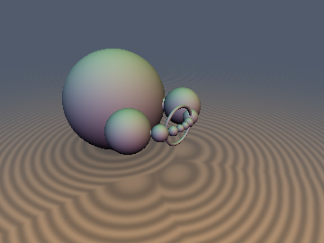 | [**`cgaRounds`**](cgaRounds.md) [`glsl`](../../glsl/deform/cgaRounds.glsl) · **Exact** | **Also**: `cgaInvert`, `sdCgaRound`, `sdgCgaRound`, `udCgaCircle`, `sdCgaTorus`, `sdCgaInvertedTorus`, `sdgCgaInvertedTorus`, `sdCgaSteinerChain`. Cancellation-free anchored CGA rounds, on-axis-exact circle inversion (`~6e-7` across $`\mathbb{R}^3`$, fixing the `0.41` axis bug), and exact inverted-torus Dupin cyclides (ring, horn, parabolic sheet, and inside-out regimes to `~1e-6` vs `1.59` point-pullback error) |
| 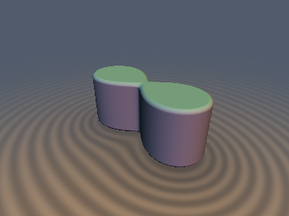 | [**`opConformal2D`**](opConformal2D.md) [`glsl`](../../glsl/deform/opConformal2D.glsl) · **1-Lipschitz** | **Also**: `opComplexSq2D`, `opPullbackSq`, `sdgPullbackSq`, `opComplexPow2D`, `opPullbackPow`, `sdCassiniOval2D`, `sdgCassiniOval2D`, `sdJoukowskiAirfoil2D`. Complex-analytic conformal pullbacks with global concave-secant bounds (`0.0%` overstep at critical points) and 1-`sqrt` Cassini ovals |
| 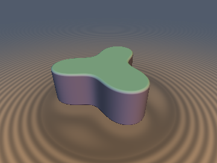 | [**`blSchwarzPick`**](blSchwarzPick.md) [`glsl`](../../glsl/deform/blSchwarzPick.glsl) · Certified Bound | **Also**: `blFactor`, `blEval3`, `sdBlaschkeSchwarzPick2D`, `sdBlaschkeDSP2D`, `sdBlaschkeHalley2D`, `sdDarbouxLemniscate3D`. Finite Blaschke product pullbacks and Darboux multipole lemniscates via 0-derivative Schwarz-Pick and 1-derivative Dieudonné-Schwarz-Pick hyperbolic bounds (`0.0%` overstep across all critical points $`B'(z)=0`$ where naive Koebe oversteps by `911.9`) |
| 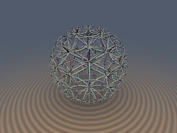 | [**`opPoincareBall`**](opPoincareBall.md) [`glsl`](../../glsl/deform/opPoincareBall.glsl) · **Exact / 1-Lipschitz** | **Also**: `sdPoincareMetric`, `sdgPoincareFinalize`, `opMobiusTranslate`, `sdPoincareGeodesicBall`, `sdPoincareHoneycomb435`. Globally 1-Lipschitz Poincaré ball secant pullback (`0.0%` overstep), 0-trig Möbius gyrovector translation, and $`\{4,3,5\}`$ hyperbolic honeycomb |
| 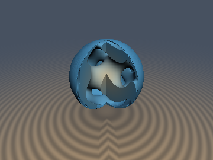 | [**`opHyperbolicBrenier`**](opHyperbolicBrenier.md) [`glsl`](../../glsl/deform/opHyperbolicBrenier.glsl) · **1-Lipschitz** | **Also**: `opSchwarzPickSafeStep`, `opBrenierTransportMap`, `opMobiusAdd`, `opPoincareLogMap`. Poincaré ball Schwarz-Pick safe step bounds & strictly convex Monge-Ampère $`W_2`$ optimal transport warps |
| 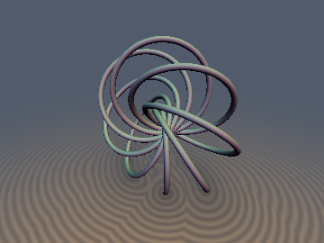 | [**`opHopfPullback`**](opHopfPullback.md) [`glsl`](../../glsl/deform/opHopfPullback.glsl) · **Exact / 1-Lipschitz** | **Also**: `opHopfMap`, `sdHopfFiber`, `sdgHopfFiber`, `sdHopfLink`, `sdHopfRingFibration`. Exact 3D Euclidean Villarceau circle fibers, Hopf links, and globally 1-Lipschitz stereographic-Hopf $`S^2`$ pullback |
| 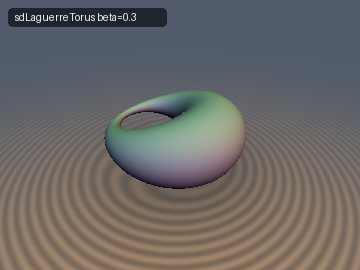 | [**`opLaguerreBoost`**](opLaguerreBoost.md) [`glsl`](../../glsl/deform/opLaguerreBoost.glsl) · Bound / **Exact** under a generator criterion | **Also**: `sdgLaguerreBoostFinalize`, `opLaguerreBoostProbe`, `sdLaguerreCapsule`, `sdLaguerreBox`, `sdLaguerreTorus`. Lorentz boost of the SDF graph (Laguerre transformation) solved in 3–8 taps with an aberrated analytic gradient; always 1-Lipschitz, exact only where boosted medial radii stay non-negative (capsule → round cone, torus → Dupin cyclide) |
| 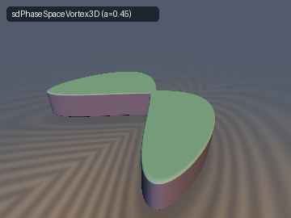 | [**`syHamiltonianFlow`**](syHamiltonianFlow.md) [`glsl`](../../glsl/deform/syHamiltonianFlow.glsl) · **Exact** (Duffing) / Certified Bound | **Also**: `sySingularValue2D`, `sySingularValueShear2D`, `opSymplecticHenon`, `opSymplecticChirikov`, `sdDuffingSeparatrix2D`, `sdPhaseSpaceVortex3D`. Cancellation-free $`\mathrm{SL}(2,\mathbb{R})`$ Frobenius singular values, self-bounding ball bounds for Hénon and Chirikov flows (`0%` overstep), and rational Weierstrass Duffing separatrices |
| 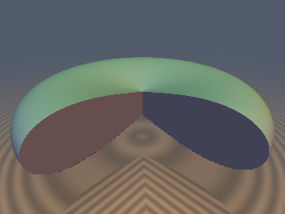 | [**`srHeisenberg`**](srHeisenberg.md) [`glsl`](../../glsl/deform/srHeisenberg.glsl) · **Exact** | **Also**: `srHeisenbergMul`, `srHorizontalGrad`, `srCarnotDistance`, `sdKoranyiBall`, `sdgKoranyiBall`, `sdCarnotBall`, `sdgCarnotBall`, `opHeisenbergTranslate`. Sub-Riemannian Heisenberg group $`\mathbb{H}^1`$, Korányi gauge vs exact Euclidean projection, and Pansu's apple-shaped Carnot-Carathéodory geodesic sphere |
| 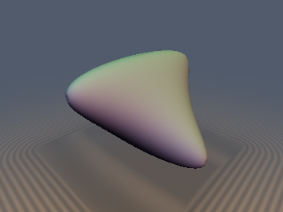 | [**`thSolGeometry`**](thSolGeometry.md) [`glsl`](../../glsl/deform/thSolGeometry.glsl) · **Exact** ($`d_{\mathrm{Sol}} \le \sqrt{2}\pi`$) / Certified Bound | **Also**: `solMul`, `solInv`, `opSolTranslate`, `solSheetDistanceXZ`, `solGeodesicDistance`, `sdSolBall`, `sdgSolBall`, `opRepSolCatMap`, `sdSolCatLattice`. Thurston's 8th geometry $`\mathrm{Sol}`$ (`ds^2 = e^{2z}dx^2 + e^{-2z}dy^2 + dz^2`): 7-step Landen AGM geodesic distance (`1.1e-6` $`p_{99}`$ err), 0-overstep 4-finned pleated spheres, and Arnold's Cat-Map compact 3-manifold crystal |
