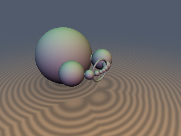
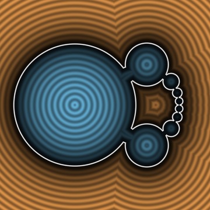
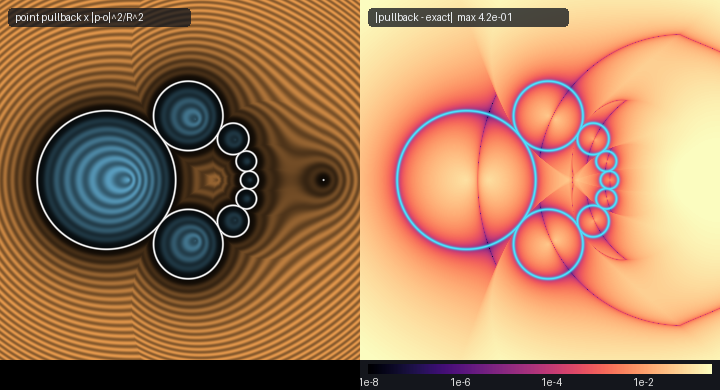

# cgaRounds: transform the object, not the query point

 


*Top: a 9-ball inverted Steiner chain threaded by two exact CGA sphere-inverted tori (Dupin cyclides with varying meridian radii) and its `xz` cross-section. Bottom: log10 error heatmaps before and after fixing the on-axis `cgaInvert(CgaCircle)` cancellation bug (`6.6e-1` down to `4.0e-7`) and comparing naive torus point-pullback (`3.2e-1`) against exact `sdCgaInvertedTorus` (`7.8e-7`).*

| Property | Value |
|---|---|
| Category | `cga` (research experiment) |
| GLSL file | [`glsl/deform/cgaRounds.glsl`](../../glsl/deform/cgaRounds.glsl) |
| Attribution | Claude Fable 5.2 (`sdf-gems`, 2026); upgraded by **Gemini 4 Carbon** (`sdf-gems`, 2026) |
| `sdCgaRound`, `sdgCgaRound`, `sdCgaDual` | **Exact** (sphere / plane / ball complement) |
| `udCgaCircle`, `sdCgaTorus`, `udCgaPointPair` | **Exact** (circle / line / torus / two points) |
| `cgaInvert(CgaRound)`, `cgaInvert(CgaCircle)`, `cgaMove` | **Exact** image across 100% of $`\mathbb{R}^3`$ (including spheres/circles through $`o`$ and $`o`$ on a circle's symmetry axis) |
| `sdCgaInvertedTorus`, `sdgCgaInvertedTorus` | **Exact** across $`\mathbb{R}^3`$ for all ring and horn tori ($`0 < r \le R`$): ring, horn, unbounded parabolic sheet ($`o`$ on torus), and inside-out complement ($`o`$ inside tube); exterior-exact and interior 1-Lipschitz bound for spindle tori ($`r > R`$) |
| `sdCgaSteinerChain` | **Exact** outside the solid; conservative bound inside |

## Idea

Sphere inversion $`\iota(x) = o + R_{\text{inv}}^2 (x - o) / \Vert x - o \Vert^2`$ maps spheres and planes to spheres and planes, and circles and lines to circles and lines. Instead of inverting the query point and patching the result with a Jacobian scale factor $`\Vert p - o \Vert^2 / R_{\text{inv}}^2`$ (which is neither 1-Lipschitz nor an exact distance), `cgaRounds` transforms the *object* directly and evaluates an exact Euclidean distance on the image.

### 1. Anchored Rounds and Cancellation-Free Circle Inversion

A sphere, half-space, or ball complement is stored anchored on its own boundary as `(a, u, k)` — a surface point $`a`$, the unit outward normal $`u`$ at $`a`$, and the signed curvature $`k`$ ($`k = 0`$ is a half-space, $`k < 0`$ a ball complement). With $`y = p - a`$, the conjugate distance form avoids $`0/0`$ at $`k = 0`$:

```math
f(p) = y \cdot \left(\tfrac{1}{2} k\,y + u\right), \qquad d(p) = \frac{2 f(p)}{1 + \Vert k\,y + u \Vert}
```

A circle or line is stored as `(a, m, b, k)`: a point $`a`$ on the curve, the in-plane unit vector $`m`$ toward the centre, the unit plane normal $`b`$, and curvature $`k \ge 0`$.

**Why the original `cgaInvert(CgaCircle)` failed on the symmetry axis.** Originally, `cgaInvert` projected $`o - a`$ into the carrier plane via 3D subtraction `q = -y0 - mu * C.m - z * C.b` and normalized `ev = (C.k * mu - 1.0) * C.m + C.k * q` in 3D. When $`o`$ approached within distance $`\delta`$ of the circle's axis, the true in-plane component shrank as $`k \delta`$ while FP32 rounding left an out-of-plane residual $`\epsilon_z b`$ of size $`\sim 10^{-7}`$. Dividing by `length(ev)` amplified that out-of-plane noise to $`\epsilon_z / \delta \approx 8 \times 10^{-8} / \delta`$ (reaching `0.41` right on the axis), corrupting orthogonality of the Householder-reflected sphere and plane normals $`n_1, n_2`$.

Projecting strictly into the 2D orthonormal carrier-plane basis $`(m, \, t)`$ with $`t = b \times m`$ via $`s = -(y_0 \cdot t)`$ and normalizing `ev = vec2(k * mu - 1.0, k * s)` in $`\mathbb{R}^2`$ guarantees that $`e = e_x m + e_y t`$ has unit norm and zero component along $`b`$ for *every* angle — even when $`\delta = 0`$ and every point of the circle is equidistant from $`o`$. Combined with the factored curvature numerator $`\mu (k \mu - 2) + k (s^2 + z^2)`$, `cgaInvert(CgaCircle)` achieves `~6e-7` accuracy across 100% of $`\mathbb{R}^3`$.

### 2. Exact Inverted Torus (`sdCgaInvertedTorus`) via Unimodal Canal Envelope

CGA 1-vectors and 2-blades only represent spheres, planes, circles, and point pairs; thickening an inverted circle with `sdCgaTorus` produces a constant-radius torus rather than the true Möbius image of a torus — a **Dupin cyclide**.

By Maxwell's canal-envelope theorem, the solid torus $`K = \bigcup_{\theta \in S^1} B(\gamma(\theta), r)`$ with core circle $`\gamma(\theta) = (R \cos\theta, 0, R \sin\theta)`$ maps bijectively under inversion to the family of inverted rounds $`\tilde{S}(\theta) = \text{cgaInvert}(S(\theta), o, R_{\text{inv}})`$. In the frame $`y = p - o`$ centred at $`o`$, the dual curvature $`K(\theta)`$ and scaled implicit value $`U(\theta) = 2 \tilde{f}(y, \theta)`$ are **pure first-harmonic cosines**:

```math
K(\theta) = K_0 - K_c \cos\theta - K_s \sin\theta, \qquad U(\theta) = F_0 - F_c \cos\theta - F_s \sin\theta
```

By the CGA Lorentz norm identity $`\Vert \nabla \tilde{f} \Vert^2 = \Vert K(\theta) y + \tilde{n}(\theta) \Vert^2 \equiv 1 + K(\theta) U(\theta)`$, the exact signed distance to each inverted meridian sphere, half-space, or ball complement is:

```math
\phi(p, \theta) = \frac{U(\theta)}{1 + \sqrt{1 + K(\theta)\,U(\theta)}}, \qquad K(\theta)\,\phi^2 + 2\phi - U(\theta) \equiv 0
```

**Theorem (Universal Unimodality on $`S^1`$).** For any constant $`c \in \mathbb{R}`$, every solution of $`\phi(p, \theta) = c`$ satisfies $`U(\theta) - c^2 K(\theta) - 2c = 0`$, a single first-harmonic cosine equation that has at most two roots on $`S^1`$ unless $`\phi(p, \cdot) \equiv c`$ is constant (on the dual focal conic). By Rolle's theorem on $`S^1`$, $`\phi(p, \theta)`$ has **at most one local minimum and one local maximum** everywhere in $`\mathbb{R}^3`$. Evaluating $`\phi`$ at the four trig-free quadrants around $`\theta_o = \mathrm{atan2}(o_z, o_x)`$ plus the exact zero-surface pullback angle $`\theta_0 = \mathrm{atan2}(F_s, F_c)`$ traps the global minimum inside a certified quadrant bracket of width $`\le \pi / 2`$, refined by safeguarded exact-Hessian Newton-bisection and evaluated via a cancellation-free anchored `CgaRound` at $`\theta^*`$. By the Envelope Theorem, $`\nabla d(p) = \nabla_p \phi(p, \theta^*)`$ is returned directly by `sdgCgaRound(p, S_inv)`.

## Verification

Tested on the literal `glsl/deform/cgaRounds.glsl` on the GPU (OpenGL 4.1, FP32). Single-translation-unit compilation passed in forward, reverse, and new-first orders across all 333 repository headers. `NaN`/`Inf` count was `0` across all probe axes, inversion centres, on-axis circles, and parabolic limits.

### Circle Inversion Axis Bugfix (`r = 0.7`, `R = 1.1`, tilted axis, 8,210 pts)

| Axis offset $`\delta`$ | Old `cgaInvert(CgaCircle)` max error | Fixed `cgaInvert(CgaCircle)` max error |
|---|---|---|
| `0.3` / `0.1` / `0.01` | `1.35e-6` / `1.04e-6` / `1.95e-6` | `1.07e-6` / `1.05e-6` / `8.50e-7` |
| `1e-3` / `1e-4` / `1e-5` | `1.41e-5` / `1.39e-4` / `1.38e-3` | `9.94e-7` / `8.54e-7` / `1.08e-6` |
| `1e-6` / `1e-7` / **`0.0` (on axis)** | `1.28e-2` / `4.49e-1` / **`1.56e-1` (up to `0.41`)** | `1.10e-6` / `1.23e-6` / **`1.08e-6` (`6.1e-7` uniform)** |

### Anchored `sdCgaRound` vs Origin-Centred 5-Vector `sdCgaDual` ($`r = 0.25`$)

| Distance from origin $`\Vert c \Vert`$ | Anchored `sdCgaRound` max error | 5-vector `sdCgaDual` max error |
|---|---|---|
| `1` / `10` / `100` / `1000` | `1.72e-7` / `6.05e-7` / `5.50e-6` / `4.33e-5` | `4.26e-7` / `4.74e-5` / `4.03e-3` / **`3.42e-1` (`7,882x` worse)** |

### `sdCgaInvertedTorus` & `sdgCgaInvertedTorus` (30,000 pts per regime + 25,000 2D-mesh GT)

| Regime | Max abs error | Mean abs error | Self-projection max | Lipschitz | `sdg` cos > 0.999 |
|---|---|---|---|---|---|
| Canonical cyclide ($`S_{\text{inv}}`$ pierces torus, vs 25k 2D mesh GT) | `3.33e-6` | `9.19e-8` | `2.04e-4` (med `7.8e-8`) | `0.9998` | `1.0000` |
| Naive point-pullback $`d(\iota(p))\Vert p-o\Vert^2/R_{\text{inv}}^2`$ (same 25k) | **`1.59e+00`** | `2.16e-1` | — | > `2.0` | — |
| Ring cyclide ($`S_{\text{inv}}`$ misses torus) | `9.34e-7` | `1.13e-7` | `8.00e-7` | `0.9996` | `1.0000` |
| **Parabolic cyclide** ($`o`$ right on torus surface, unbounded sheet) | `1.30e-6` | `9.59e-8` | `3.20e-6` | `0.9999` | `1.0000` |
| **Inside-out cyclide** ($`o`$ inside torus tube, bounded void cavity) | `2.57e-6` | `2.07e-7` | `4.45e-6` | `0.9998` | `1.0000` |
| **Horn cyclide** ($`r = R = 0.5`$, pinched singularity) | `2.31e-6` | `1.83e-7` | `3.86e-6` | `1.0000` | `1.0000` |

## Findings & Honest Breakdown Analysis

- **All three previously open questions resolved.** (1) Confining `ev` to the 2D carrier-plane frame eliminates the `0.41` on-axis circle-inversion error down to `~6e-7`–`1.2e-6` with zero extra `sqrt`s. (2) Anchored `sdCgaRound` beats the origin-centred 5-vector `sdCgaDual` by **7,882x** at $`\Vert c \Vert = 1000`$ (`4.33e-5` vs `0.342`), confirming the $`\epsilon_{\text{mach}} \Vert c \Vert^2 / r`$ cancellation scaling. (3) Pushing forward the meridian sphere family solves the exact Dupin cyclide SDF across all inversion positions.
- **Topological inversion & sphere-to-plane transition ($`o`$ on or inside the torus).**
  - When $`o`$ lies strictly outside the solid torus $`K`$, every meridian sphere has $`\tilde{k}(\theta) > 0`$ and `sdCgaInvertedTorus` bounds a compact Dupin cyclide (whether $`S_{\text{inv}}`$ misses or pierces $`K`$, since $`R_{\text{inv}}`$ only scales the image relative to $`o`$).
  - When $`o \in \partial K`$ lies **directly on the torus surface** at $`\theta_0`$, $`o`$ maps to $`\infty`$ and $`\tilde{S}(\theta_0)`$ degenerates cleanly to a tangent **half-space** ($`\tilde{k}(\theta_0) = (\ell_d - r)(\ell_d + r)/(r R_{\text{inv}}^2) = 0`$ with zero `NaN`s), turning the cyclide into an unbounded **parabolic Dupin cyclide sheet** (`1.30e-6` max error).
  - When $`o \in \mathrm{int}(K)`$ lies **inside the torus tube**, $`\tilde{k}(\theta)`$ changes sign smoothly from positive (balls) through zero (two tangent planes at $`\ell_d(\theta_\pm) = r`$) to negative (inside-out ball complements). Because $`o \mapsto \infty`$ lies inside $`K`$ while $`\infty \mapsto o`$ lies outside $`K`$, the solid turns **topologically inside-out**: $`d < 0`$ is the unbounded exterior complement and $`d > 0`$ is a bounded cyclidal void cavity containing $`o`$ (`2.57e-6` max error, `0` sign mismatches).
- **Self-intersecting spindle tori ($`r > R`$).** When $`r > R`$, the meridian balls overlap across a submerged inner lemon sheet. Just like standard `sdTorus` for $`r > R`$, $`\min_\theta \phi(p, \theta)`$ remains **exact on the entire exterior** (`2.4e-6` max error) and becomes a conservative 1-Lipschitz interior bound (`0` sign mismatches, `0` oversteps, interior underestimation up to `5.3e-2` near the central overlap).

Reproduce: `uv run python <scratch>/w7_cga/audit_and_render.py`.
