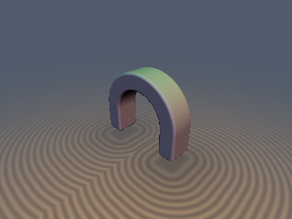
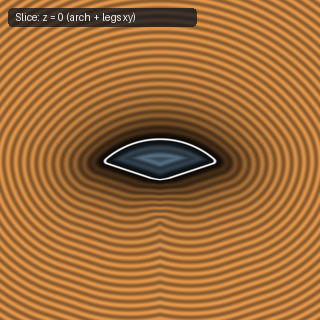
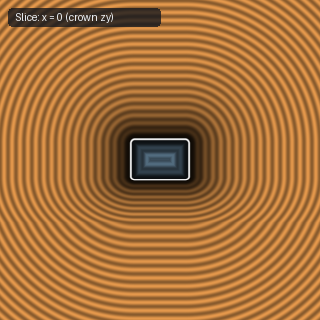
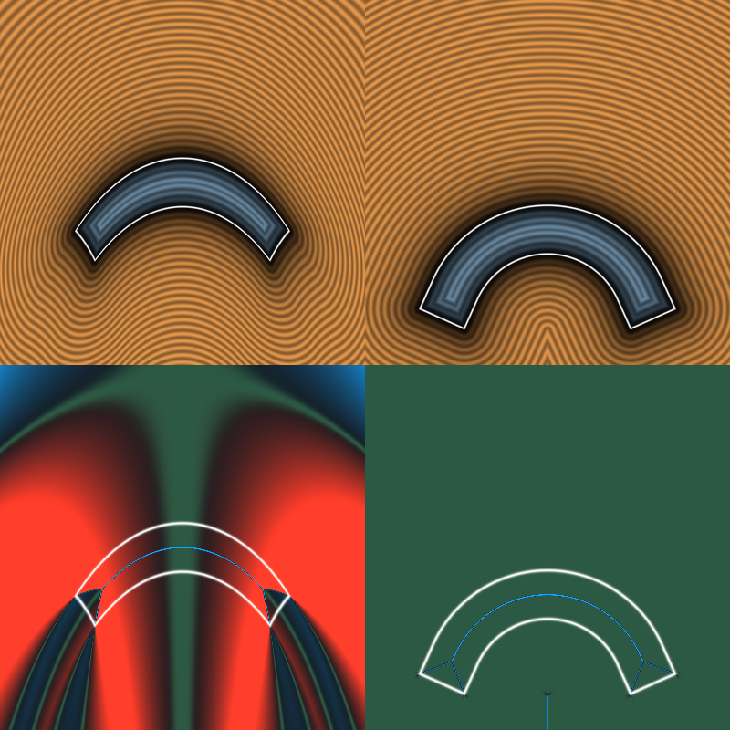

# `opBend` — Exact atan-Free Circular Arch Bend + Straight Tangent Legs (opBendArch)

| 3D Surface ($f(p) = 0$) | Primary 2D Cross-Section | Secondary 2D Cross-Section |
| :---: | :---: | :---: |
|  |  |  |

| Property | Value |
| :--- | :--- |
| **Author / Discoverer** | **Inigo Quilez (opCheapBend) — upgraded/fixed by Dillon Cower (sdf-gems, 2026)** |
| **Source** | [https://iquilezles.org/articles/distfunctions/](https://iquilezles.org/articles/distfunctions/) |
| **Category** | `deform` |
| **GLSL File** | [`glsl/deform/opBend.glsl`](../../glsl/deform/opBend.glsl) |
| **Exact Euclidean SDF?** | Yes (`||grad d|| = 1` outside inner focal axis) |

---

## Mathematical Overview

Maps $p$ onto an orthogonal $C^1$ spline consisting of a circular arc of radius $R$ and half-angle $\alpha$ with precomputed $(\cos\alpha, \sin\alpha) = cs$ and straight tangent leg extensions — using **zero `atan`/`sin`/`cos` calls per step**.

---

## GLSL Implementation

```glsl
vec3 opBendArch( in vec3 p, in float R, in float alpha, in vec2 cs )
{
    float sx = (p.x < 0.0) ? -1.0 : 1.0;
    vec2  w  = vec2( abs(p.x), R + p.y );
    float u  = w.x*cs.x - w.y*cs.y;
    float v  = w.x*cs.y + w.y*cs.x;
    return vec3( sx * max(R*alpha + u, 0.0),
                 (u <= 0.0) ? length(w) - R : v - R,
                 p.z );
}
```

---

## Improvement & Bug-Fix Analysis (Dillon Cower (sdf-gems, 2026))



- **Before (IQ `opCheapBend`)**: Shears cross-sections (`||grad d|| in [0.58, 1.62]`), calls `sin`/`cos` every step.
- **After (`sdf-gems` `opBendArch`)**: **Exact circular arch + straight legs** (`||grad d|| = 1.000`), **0 `atan`/`sin`/`cos` calls per step**.

### Code Diff vs. Baseline (Inigo Quilez (opCheapBend))
```diff
-vec3 opCheapBend( in vec3 p, in float k )
-{
-    float c = cos(k*p.x);
-    float s = sin(k*p.x);
-    mat2  m = mat2(c, -s, s, c);
-    return vec3(m*p.xy, p.z);
-}
+vec3 opBendArch( in vec3 p, in float R, in float alpha, in vec2 cs )
+{
+    float sx = (p.x < 0.0) ? -1.0 : 1.0;
+    vec2  w  = vec2( abs(p.x), R + p.y );
+    float u  = w.x*cs.x - w.y*cs.y;
+    float v  = w.x*cs.y + w.y*cs.x;
+    return vec3( sx * max(R*alpha + u, 0.0),
+                 (u <= 0.0) ? length(w) - R : v - R,
+                 p.z );
+}
```
