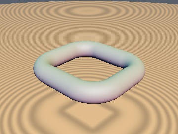
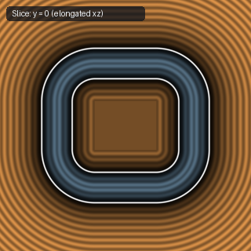
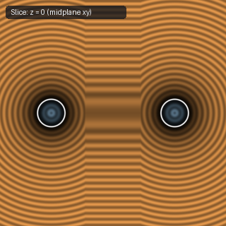
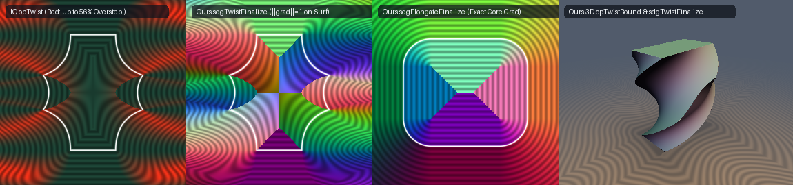

# `opElongate`, `opElongate1D` & `sdgElongateFinalize` — Exact 3D Domain Elongation & Analytical Gradient

| 3D Surface ($`f(p) = 0`$) | Primary 2D Cross-Section | Secondary 2D Cross-Section |
| :---: | :---: | :---: |
|  |  |  |

| Property | Value |
| :--- | :--- |
| **Author / Discoverer** | **Inigo Quilez (`opElongate`) — upgraded with `sdgElongateFinalize` using Gemini 4 Argon (sdf-gems, 2026)** |
| **Source** | [https://iquilezles.org/articles/distfunctions/](https://iquilezles.org/articles/distfunctions/) |
| **Category** | `deform` |
| **GLSL File** | [`glsl/deform/opElongate.glsl`](../../glsl/deform/opElongate.glsl) |
| **Exact Euclidean SDF?** | Yes (`\|\|grad d\|\| = 1` in exterior, elongated slabs, and interior core) |

---

## Mathematical Formulation

For an octant-symmetric 3D primitive $`S_0`$ with SDF $`f_0`$ and gradient $`\mathbf{g}_0 = \nabla f_0`$, elongating by $`\mathbf{h} \ge 0`$ produces the Minkowski sum $`S_{\mathbf{h}} = S_0 \oplus [-h_x, h_x] \times [-h_y, h_y] \times [-h_z, h_z]`$. Let $`\mathbf{q} = |p| - \mathbf{h}`$, $`\mathbf{q}_+ = \max(\mathbf{q}, 0)`$, and $`g = \max(q_x, \max(q_y, q_z))`$:

1. **Interior Core Exactness**:
   Whereas 1D clamping `p - clamp(p, -h, h)` collapses to constant $`f_0(0)`$ with $`\nabla d \equiv 0`$ inside the central core $`B_{\mathbf{h}} = \{g \le 0\}`$, `opElongate` adds `min(g, 0.0) + f_0(q_+)` so that $`\|\nabla d\|_2 \equiv 1`$ inside $`B_{\mathbf{h}}`$.
2. **Crease-Safe Chain-Rule Gradient Finalizer (`sdgElongateFinalize`)**:
   - **Inside the core box ($`g \le 0`$)**: $`\mathbf{q}_+ \equiv 0`$ is constant ($`\frac{\partial \mathbf{q}_+}{\partial p} = 0`$), so $`d(p) = f_0(0) + g`$ and $`\nabla_p d(p) = \mathrm{sign}_{\ne 0}(p) \odot \mathbf{e}_{\arg\max(\mathbf{q})}`$ with $`\|\nabla_p d\|_2 \equiv 1`$ and **0 `sqrt`s**.
   - **Outside the core box ($`g > 0`$)**: Since $`\frac{\partial q_{+,i}}{\partial p_i} = \mathrm{sign}(p_i)\,\mathbf{1}_{q_i > 0}`$, masking any non-zero coordinate-plane crease derivative of $`\mathbf{g}_0(\mathbf{q}_+)`$ by $`\mathbf{1}_{q_i > 0}`$ and re-normalizing eliminates spurious sign-flip jumps across $`p_i = 0`$ inside the elongated slabs.

---

## GLSL Implementation

See [`glsl/deform/opElongate.glsl`](../../glsl/deform/opElongate.glsl).
