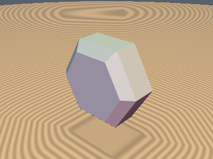
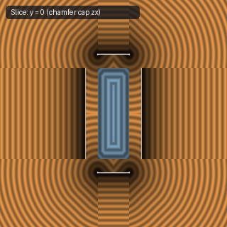
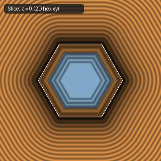
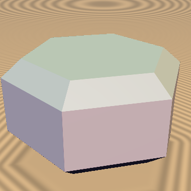

# `opExtrudeChamfer` — Orthogonal Eikonal 45-Degree Chamfer Extrusion

| 3D Surface ($f(p) = 0$) | Primary 2D Cross-Section | Secondary 2D Cross-Section |
| :---: | :---: | :---: |
|  |  |  |

| Property | Value |
| :--- | :--- |
| **Author / Discoverer** | **Dillon Cower (sdf-gems, 2026)** |
| **Source** | [https://github.com/dcower/sdf-gems](https://github.com/dcower/sdf-gems) |
| **Category** | `deform` |
| **GLSL File** | [`glsl/deform/opExtrudeChamfer.glsl`](../../glsl/deform/opExtrudeChamfer.glsl) |
| **Exact Euclidean SDF?** | Yes (`||grad d|| = 1`) |

---

## Mathematical Overview

Extrudes any exact 2D SDF $d_{\text{2D}}(p_{xy})$ with an exact Euclidean $45^\circ$ chamfered cap of width $c$ (`||grad d|| = 1`).



---

## GLSL Implementation

```glsl
float opExtrudeChamfer( in float d2d, in float z, in float h, in float c )
{
    float u = d2d, v = abs(z) - h;
    if (u <= -c && v <= 0.0) return max(u, v);
    if (u <= 0.0 && v <= -c) return max(u, v);
    if (u + v <= -c) return (u + v + c) * 0.70710678;
    float t = clamp(0.5 * (u - v + c), 0.0, c);
    return length(vec2(max(u, -c + t), max(v, -t)));
}
```
