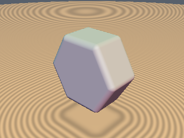
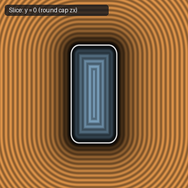
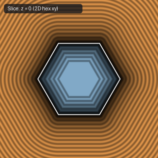

# `opExtrudeRound` — Orthogonal Eikonal Round-Bevel Extrusion

| 3D Surface ($f(p) = 0$) | Primary 2D Cross-Section | Secondary 2D Cross-Section |
| :---: | :---: | :---: |
|  |  |  |

| Property | Value |
| :--- | :--- |
| **Author / Discoverer** | **Dillon Cower (sdf-gems, 2026)** |
| **Source** | [https://github.com/dcower/sdf-gems](https://github.com/dcower/sdf-gems) |
| **Category** | `deform` |
| **GLSL File** | [`glsl/deform/opExtrudeRound.glsl`](../../glsl/deform/opExtrudeRound.glsl) |
| **Exact Euclidean SDF?** | Yes (`||grad d|| = 1`) |

---

## Mathematical Overview

By the Orthogonal Eikonal Composition Theorem, composing any exact 2D base SDF $d_{\text{2D}}(p_{xy})$ with a 2D round-capped profile preserves $\|\nabla d_{\text{3D}}\| = 1$ identically.

---

## GLSL Implementation

```glsl
float opExtrudeRound( in float d2d, in float z, in float h, in float r )
{
    vec2 q = vec2(d2d + r, abs(z) - h + r);
    return min(max(q.x, q.y), 0.0) + length(max(q, 0.0)) - r;
}
```
