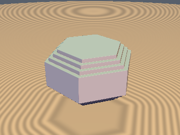
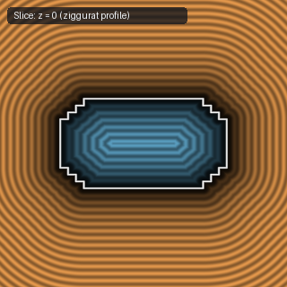

# `opExtrudeStairs` — Exact 1-Sqrt Orthogonal Eikonal $n$-Tier Ziggurat Extrusion

| 3D Surface ($f(p) = 0$) | 2D Cross-Section Slice ($y = 0$) |
| :---: | :---: |
|  |  |

| Property | Value |
| :--- | :--- |
| **Author / Discoverer** | **Discovered using Gemini 4 Argon (sdf-gems, 2026)** |
| **Category** | `deform` |
| **GLSL File** | [`glsl/deform/opExtrudeStairs.glsl`](../../glsl/deform/opExtrudeStairs.glsl) |
| **Exact Euclidean SDF?** | Yes (`||grad d|| = 1`, `1` `sqrt`, `4.44e-16` max error vs. exact stepped profile) |

---

## Mathematical Overview

By the **Orthogonal SDF Composition Theorem**, since $u = d_{2\text{D}}(p_{xy})$ and $v = |p_z| - h$ have orthogonal unit gradients ($\nabla u \perp \nabla v$, $\|\nabla u\| = \|\nabla v\| = 1$), composing $(u, v)$ with the exact 2D Euclidean $n$-stepped corner intersection SDF yields an **exact 3D Euclidean SDF** (`||grad d|| = 1`) that extrudes any 2D shape to height $2h$ while sculpting an **$n$-tier architectural ziggurat / stepped molding** of bevel radius $r$ and step size $s = r / n$ around the top and bottom rims.

### Exterior & Interior Simplification to 1 `sqrt`
Using the outward/inward step corner duality (see [`opUnionStairs`](../booleans/opUnionStairs.md)) for **intersection** ($u \le 0 \wedge v \le 0$ with $n$ stepped corner notches):
- The $n$ convex outward step noses lie at $(-j_0, -(r - s - j_0))$ where $j_0 = \operatorname{clamp}(\lfloor w \rfloor, 0, n-1) s$ and $w = \frac{v - u + r}{2 s}$.
- The $n-1$ concave inward step corners lie at $(-k_1, -(r - k_1))$ where $k_1 = \operatorname{clamp}(\operatorname{round}(w), 1, n-1) s$.
- A point $(u, v)$ lies outside the stepped profile iff $\max(p_x, p_y) \ge 0$ where $p = (u + j_0, v + r - s - j_0)$. Because $\max(p_x, p_y) \ge 0$ holds across the entire exterior branch, $\min(\max(p_x, p_y), 0) \equiv 0$ vanishes identically outside, reducing the entire 9-line operator to a single `length(max(m ? q : p, 0.0))` call (`4.44e-16` max error).

---

## GLSL Implementation

```glsl
float opExtrudeStairs( float d2d, float z, float h, float r, float n )
{
    float u  = d2d, v = abs(z) - h;
    float s  = r / n, w = (v - u + r) / (2.0 * s);
    float j0 = clamp(floor(w), 0.0, n - 1.0) * s;
    float k1 = clamp(round(w), 1.0, n - 1.0) * s;
    vec2  p  = vec2(u + j0, v + r - s - j0);
    vec2  q  = vec2(-u - k1, -v - r + k1);
    bool  m  = max(p.x, p.y) < 0.0;
    float l  = length(max(m ? q : p, 0.0));
    return m ? max(max(u, v), -l) : l;
}
```
