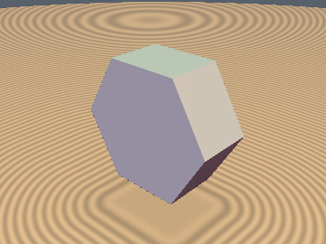
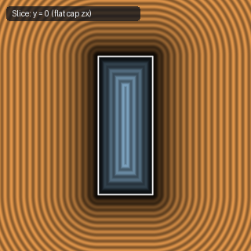
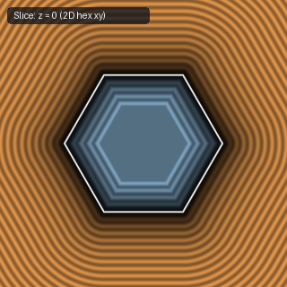

# `opExtrusion` & `opExtrusionSq` — Exact 2D-to-3D Linear Extrusion & Universal 1-`sqrt` Extrusion

| 3D Surface ($f(p) = 0$) | Primary 2D Cross-Section | Secondary 2D Cross-Section |
| :---: | :---: | :---: |
|  |  |  |

| Property | Value |
| :--- | :--- |
| **Author / Discoverer** | **Inigo Quilez — upgraded with 1-`sqrt` `opExtrusionSq` using Gemini 4 Argon (`sdf-gems`, 2026)** |
| **Source** | [https://iquilezles.org/articles/distfunctions/](https://iquilezles.org/articles/distfunctions/) |
| **Category** | `deform` |
| **GLSL File** | [`glsl/deform/opExtrusion.glsl`](../../glsl/deform/opExtrusion.glsl) |
| **Exact Euclidean SDF?** | Yes (`||grad d|| = 1`, `1` `sqrt` total in 3D via `opExtrusionSq`) |

---

## Mathematical Overview

1. **`opExtrusion(p, sdf2d, h)`**: Extrudes any signed 2D SDF `sdf2d` along the $z$-axis to half-height $h$ with flat caps.
2. **Universal 1-`sqrt` 3D Extrusion (`opExtrusionSq(d2, s, z, h)`)**:
   When a 2D primitive produces an unsigned squared distance $d_2 \ge 0$ and an outside sign $s$ ($s > 0$ outside, $s \le 0$ inside), naive `opExtrusion(p, sign(s)*sqrt(d2), h)` evaluates **two `sqrt`s**. Because $\max(d_{2\text{D}}, 0)^2 = d_2$ for $s > 0$ and $\min(\max(-\sqrt{d_2}, q_z), 0) + \max(q_z, 0) \equiv \max(-\sqrt{d_2}, q_z)$ for $s \le 0$, `opExtrusionSq` fuses the 2D and 3D square roots into **a single `sqrt` everywhere in $\mathbb{R}^3$** (`0.0` error).

---

## GLSL Implementation

```glsl
float opExtrusion( in vec3 p, in float sdf2d, in float h )
{
    vec2 w = vec2( sdf2d, abs(p.z) - h );
    return min(max(w.x, w.y), 0.0) + length(max(w, 0.0));
}

float opExtrusionSq( in float d2, in float s, in float z, in float h )
{
    float qz = abs(z) - h, m = max(qz, 0.0);
    float d  = sqrt((s > 0.0) ? d2 + m * m : d2);
    return (s > 0.0) ? d : max(-d, qz);
}
```
