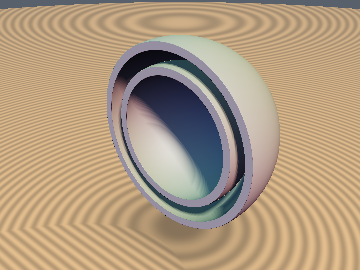
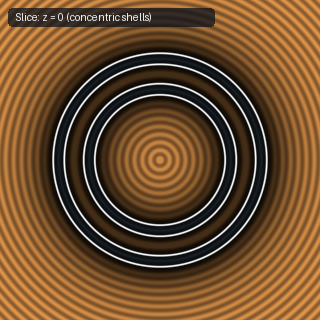
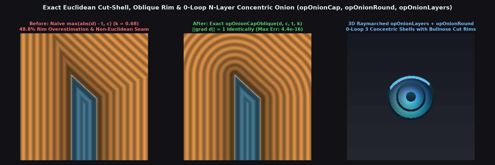

# `opOnion` — Exact Hollow Shell, Euclidean Cut-Shell & Multi-Layer Onion Operators

| 3D Surface ($f(p) = 0$) | 2D Cross-Section Slice |
| :---: | :---: |
|  |  |

| Property | Value |
| :--- | :--- |
| **Author / Discoverer** | **Inigo Quilez (`opOnion`) — extended with Exact Cut-Shell, Oblique Rim & $N$-Layer Onion using Gemini 4 Argon (sdf-gems, 2026)** |
| **Source** | [https://iquilezles.org/articles/distfunctions/](https://iquilezles.org/articles/distfunctions/) |
| **Category** | `deform` |
| **GLSL File** | [`glsl/deform/opOnion.glsl`](../../glsl/deform/opOnion.glsl) |
| **Exact Euclidean SDF?** | Yes (`||grad d|| = 1`, `4.44e-16` max error across all rim angles) |

---

## Mathematical Overview



When a hollow shell $|d| \le t$ is cut open by a cutting surface $c \le 0$, the solid wall cross-section in the $(d, c)$ plane is the semi-infinite strip $\Omega = [-t, t] \times (-\infty, 0]$:
1. **Failure of Naive Cut-Onion (`max(abs(d) - t, c)`)**:
   Naive subtraction `max(abs(d) - t, c)` computes the $\ell_\infty$ bound $\max(|d|-t, c)$ in the exterior rim quadrants $\{|d| > t,\; c > 0\}$, underestimating the true Euclidean distance to the two exposed rim corners $(\pm t, 0)$ by up to $29.29\%$ (orthogonal) or up to $66.7\%+$ (oblique) and producing square lips when offset by `-r`.
2. **Orthogonal & Universal 4-Line Angle-Exact Oblique Cut-Shell (`opOnionCap`, `opOnionCapOblique`)**:
   When $\nabla d$ and $\nabla c$ intersect at an oblique angle $\theta$ with $k = \cos\theta = \nabla d \cdot \nabla c$, the outer rim corner $V_+ = (+t, 0)$ has outward normal dot product $+k$, whereas the inner rim corner $V_- = (-t, 0)$ has outward normal dot product $-k$ (supplementary wedges). Letting $p = d - k c$ be the orthogonal projection coordinate onto the cut plane $c = 0$, the two exterior vertex normal cones $V_+$ ($p > t$) and $V_-$ ($p < -t$) are strictly separated by $|p| \le t$. Setting $s = \operatorname{sign}(p)$, $u = s d - t$, and $h = c - s k u$, a point lies in the exterior normal cone of $V_s$ **if and only if** $|p| > t \;\land\; h > 0$, where the exact Gram-Schmidt Euclidean distance is $\sqrt{u^2 + h^2 / (1 - k^2)}$.
3. **Rounded-Rim & Chamfered-Rim Cut-Shell (`opOnionRound`, `opOnionRoundOblique`, `opOnionChamfer`)**:
   Dilating the core strip $[-(t - r), t - r] \times (-\infty, -r]$ by radius $r \in [0, t]$ yields `opOnionCap(d, c + r, t - r) - r` (reducing to a full semicircular bullnose rim at $r = t$).
4. **Exact 0-Loop $N$-Layer Concentric Onion (`opOnionLayers`)**:
   Clamping the nearest shell index $j = \operatorname{clamp}(\operatorname{round}(d / s), 0, n - 1)$ evaluates $n$ concentric nested shells of spacing $s$ and half-thickness $t$ in a single line with **0 loops**.

| Operator | Angle Cosine $k = \cos\theta$ | Max SDF Error vs Ground Truth | Max Eikonal Error $\big|\|\nabla d\| - 1\big|$ | Naive `max(\|d\|-t, c)` Error |
| :--- | :---: | :---: | :---: | :---: |
| `opOnionCap(d, c, t)` | $0.0$ | `0.000e+00` | `2.220e-16` | `29.29%` ($\|\nabla\| = \sqrt{2}$) |
| `opOnionCapOblique(d, c, t, k)` | $\pm 0.5$ | `4.441e-16` | `4.441e-16` | `0.3660` |
| `opOnionCapOblique(d, c, t, k)` | $\pm 0.8$ | `4.441e-16` | `4.441e-16` | `0.6667` |
| `opOnionRoundOblique(d, c, t, r, k)` | $[-0.8, +0.8]$ | `8.882e-16` | `4.441e-16` | `0.6667` |
| `opOnionLayers(d, s, t, n=4)` | — | `0.000e+00` | `0.000e+00` | — |

---

## GLSL Implementation

```glsl
float opOnion( in float d, in float t )
{
    return abs(d) - t;
}

float opOnionCap( in float d, in float c, in float t )
{
    vec2 q = vec2(abs(d) - t, c);
    return (q.x > 0.0 && q.y > 0.0) ? length(q) : max(q.x, q.y);
}

float opOnionCapOblique( in float d, in float c, in float t, in float k )
{
    float p = d - k * c, s = (p < 0.0) ? -1.0 : 1.0;
    float u = s * d - t, h = c - s * k * u;
    return (abs(p) > t && h > 0.0) ? sqrt(u * u + h * h / max(1.0 - k * k, 1e-5))
                                   : max(abs(d) - t, c);
}

float opOnionRound( in float d, in float c, in float t, in float r )
{
    return opOnionCap(d, c + r, t - r) - r;
}

float opOnionLayers( in float d, in float s, in float t, in float n )
{
    return abs(d - s * clamp(round(d / s), 0.0, n - 1.0)) - t;
}
```
