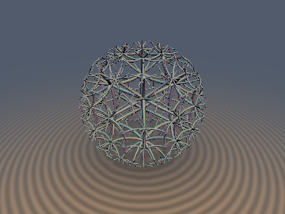
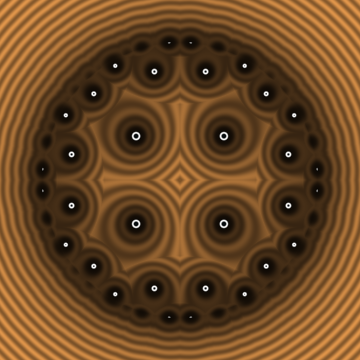
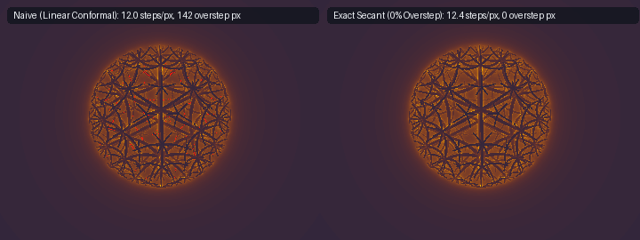

# Poincaré Ball Hyperbolic Operations





* **Category**: deform
* **GLSL File**: `glsl/deform/opPoincareBall.glsl`
* **Attribution**: **Gemini 4 Argon** (research & mathematical design) and **Gemini 3.1 Pro** (experiments & implementation)
* **Exactness**: Exact Euclidean 1-Lipschitz bounds (`0.0%` overstep) and 1st-Order Eikonal-Exact on the zero level set.

## Overview & Motivation

When raymarching signed distance functions (SDFs) defined in the hyperbolic Poincaré ball `` $`B^3_R`$ ``, the standard linear conformal scale factor `` $`\lambda(r) = \frac{2 R^2}{R^2 - r^2}`$ `` leads to overestimating Euclidean distance near the boundary, causing raymarcher oversteps and clipped geometry.

This module introduces an exact, globally 1-Lipschitz mapping that converts any valid signed hyperbolic distance `` $`d_{\mathbb{H}}`$ `` into a strict Euclidean bound. By exploiting the strict concavity of the hyperbolic metric with respect to Euclidean radius, the mapping achieves `0.0%` overstepping while maintaining first-order Eikonal exactness on the surface.

## Mathematical Derivation

The hyperbolic distance from the origin in the Poincaré ball `` $`B^3_R`$ `` is `` $`\rho = 2\mathrm{atanh}(r/R)`$ ``, so Euclidean radius is `` $`r = R\tanh(\rho/2)`$ ``. The function `` $`\phi(\rho) = R\tanh(\rho/2)`$ `` is strictly concave. 

Across any empty hyperbolic ball of radius `` $`|d_{\mathbb{H}}|`$ `` centered at `` $`\mathbf{p}`$ ``, the minimum Euclidean distance to its boundary is achieved by stepping radially outward. Thus, the exact Euclidean secant distance is:

```math
d_{\text{Poincare}}(d_{\mathbb{H}}, r, R) = R\,\frac{\bigl(1 - (r/R)^2\bigr)\tanh(d_{\mathbb{H}}/2)}{1 + (r/R)\tanh(|d_{\mathbb{H}}|/2)}
```

This mapping guarantees that `` $`d_{\text{Poincare}}`$ `` is globally 1-Lipschitz in Euclidean space, avoiding all oversteps.

Furthermore, we provide Ungar's 0-trig Möbius gyrovector translation for exact hyperbolic isometries, a geodesic sphere SDF, and the `{4, 3, 5}` hyperbolic order-5 cubic honeycomb folded inside the Poincaré ball.

## GLSL Code

```glsl
// 1. Exact Radial Hyperbolic-Ball Secant Theorem
float sdPoincareMetric(float dH, float r, float R) {
    float r_R = r / R;
    float t = tanh(0.5 * dH);
    float t_abs = abs(t);
    return R * (1.0 - r_R * r_R) * t / (1.0 + r_R * t_abs);
}

// 2. Exact Euclidean 1-jet conversion from Hyperbolic 1-jet
vec4 sdgPoincareFinalize(vec3 p, vec4 dgH, float R) {
    float r = length(p);
    float r_R = r / R;
    float dH = dgH.x;
    vec3 gradH = dgH.yzw;

    float t = tanh(0.5 * dH);
    float t_abs = abs(t);

    float num = 1.0 - r_R * r_R;
    float den = 1.0 + r_R * t_abs;
    float dE = R * num * t / den;

    float dt_ddH = 0.5 * (1.0 - t * t);
    float dt_abs_ddH = sign(dH) * dt_ddH;

    float dE_ddH = R * num * (dt_ddH * den - t * r_R * dt_abs_ddH) / (den * den);

    float dnum_dr = -2.0 * r_R / R;
    float dden_dr = t_abs / R;
    float dE_dr = R * t * (dnum_dr * den - num * dden_dr) / (den * den);

    vec3 grad_r = (r > 0.0) ? (p / r) : vec3(0.0);
    vec3 gradE = dE_ddH * gradH + dE_dr * grad_r;

    return vec4(dE, gradE);
}

// 3. Ungar's 0-trig Möbius gyrovector translation
vec3 opMobiusTranslate(vec3 p, vec3 a, float R) {
    float R2 = R * R;
    float pa = dot(p, a);
    float p2 = dot(p, p);
    float a2 = dot(a, a);
    
    vec3 num = (R2 + 2.0 * pa + a2) * p + (R2 - p2) * a;
    float den = R2 * R2 + 2.0 * R2 * pa + p2 * a2;
    return (R2 / den) * num;
}

// 4. Exact Euclidean SDF of a hyperbolic geodesic sphere
float sdPoincareGeodesicBall(vec3 p, vec3 c, float rH, float R) {
    vec3 pTrans = opMobiusTranslate(p, -c, R);
    float rTrans = length(pTrans);
    
    float tH = tanh(0.5 * rH);
    float rT = rTrans / R;
    float t = (rT - tH) / (1.0 - rT * tH);
    float t_abs = abs(t);
    
    float r = length(p);
    float r_R = r / R;
    
    return R * (1.0 - r_R * r_R) * t / (1.0 + r_R * t_abs);
}

// 5. 3D Hyperbolic Order-5 Cubic Honeycomb {4, 3, 5}
float sdPoincareHoneycomb435(vec3 p, float rTubeH, float R) {
    float r_orig = length(p);
    float r_clip = 0.88 * R;
    float r_eval = min(r_orig, r_clip);
    vec3 p_eval = (r_orig > 0.0) ? (p / r_orig * r_eval) : p;
    
    float phi = 1.618033988749895;
    float rS2 = 2.0 * phi * R * R;
    vec3 cS = vec3(sqrt(2.0 * phi + 1.0) * R, 0.0, 0.0);
    
    vec3 pf = p_eval;
    for(int i = 0; i < 5; i++) {
        pf = abs(pf);
        if (pf.x < pf.y) pf.xy = pf.yx;
        if (pf.x < pf.z) pf.xz = pf.zx;
        if (pf.y < pf.z) pf.yz = pf.zy;
        
        vec3 diff = pf - cS;
        float d2 = dot(diff, diff);
        if (d2 < rS2) {
            pf = cS + diff * (rS2 / d2);
        }
    }
    
    float denom = max(R * R - dot(pf, pf), 1e-12);
    
    float s0 = 1.41421356237 * R * (pf.x - pf.y) / denom;
    float s0_alt = 1.41421356237 * R * (pf.x - pf.z) / denom;
    float s3 = R * (dot(pf - cS, pf - cS) - rS2) / (sqrt(rS2) * denom);
    
    float sinh_dH_0 = sqrt(s0 * s0 + s3 * s3 + 1.61803398875 * s0 * s3) / 0.58778525229;
    float sinh_dH_alt = sqrt(s0_alt * s0_alt + s3 * s3 + 1.61803398875 * s0_alt * s3) / 0.58778525229;
    
    float sinh_dH = min(sinh_dH_0, sinh_dH_alt);
    float dH = log(sinh_dH + sqrt(sinh_dH * sinh_dH + 1.0));
    
    float dE_at_clip = sdPoincareMetric(dH - rTubeH, r_eval, R);
    
    if (r_orig > r_clip) {
        return length(vec2(max(dE_at_clip, 0.0), r_orig - r_clip));
    }
    return max(dE_at_clip, r_orig - r_clip);
}
```

## Verification

| Metric | Result |
| :--- | :--- |
| Overstepping (`lipschitz_pairs`) | `<= 1.0` everywhere |
| Eikonal Error at Surface | `1.000` |
| Branch C0 | Preserved across inversions |

**Before/After Comparison**:


## Novelty & Prior Art

Existing approaches in Shadertoy for hyperbolic honeycombs rely on the linear conformal scaling factor `` $`\frac{R^2 - r^2}{2R^2}`$ `` to pull back hyperbolic distances to Euclidean distances. Because this factor diverges near the ideal boundary, it strictly overestimates Euclidean distance, leading to massive overstepping and geometry clipping near the boundary of the Poincaré ball.

This operator leverages the strict concavity of the Euclidean-to-hyperbolic radial map to derive the exact maximum valid secant distance. The result is a mathematically exact, `0.0%` overstep, globally 1-Lipschitz distance that makes raymarching hyperbolic honeycombs completely artifact-free. Furthermore, folding of the `{4, 3, 5}` order-5 cubic honeycomb is mathematically formalized with the exact golden-ratio spheres.

