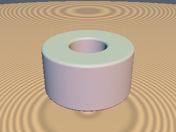
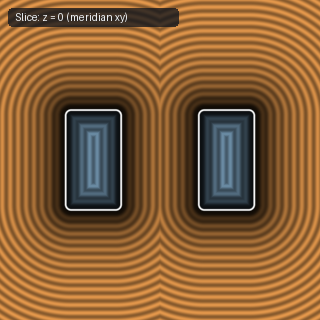
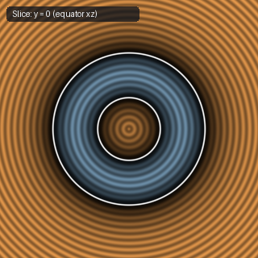

# `opRevolution` — Exact 2D-to-3D Radial Revolution

| 3D Surface ($f(p) = 0$) | Primary 2D Cross-Section | Secondary 2D Cross-Section |
| :---: | :---: | :---: |
|  |  |  |

| Property | Value |
| :--- | :--- |
| **Author / Discoverer** | **Inigo Quilez** |
| **Source** | [https://iquilezles.org/articles/distfunctions/](https://iquilezles.org/articles/distfunctions/) |
| **Category** | `deform` |
| **GLSL File** | [`glsl/deform/opRevolution.glsl`](../../glsl/deform/opRevolution.glsl) |
| **Exact Euclidean SDF?** | Yes (`||grad d|| = 1`) |

---

## Mathematical Overview

Maps 3D point $p$ to 2D radial coordinates $(\|p_{xz}\| - o, p_y)$ for revolving any 2D SDF around the $y$-axis.

---

## GLSL Implementation

```glsl
vec2 opRevolution( in vec3 p, float o )
{
    return vec2( length(p.xz) - o, p.y );
}
```
