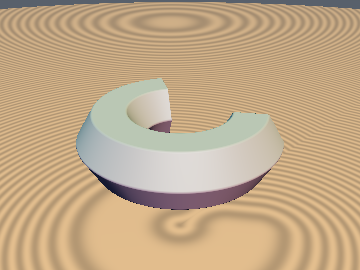
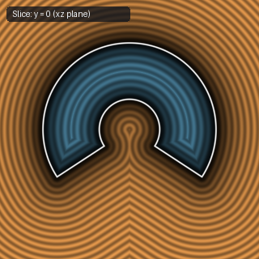

# `opRevolutionLim` — Exact 1-Tap Limited-Angle Partial Revolution of Any 2D SDF

| 3D Surface ($f(p) = 0$) | 2D Cross-Section Slice ($y = 0$) |
| :---: | :---: |
|  |  |

| Property | Value |
| :--- | :--- |
| **Author / Discoverer** | **Discovered using Gemini 4 Argon (sdf-gems, 2026)** |
| **Category** | `deform` |
| **GLSL File** | [`glsl/deform/opRevolutionLim.glsl`](../../glsl/deform/opRevolutionLim.glsl) |
| **Exact Euclidean SDF?** | Yes (`||grad d|| = 1` across $\mathbb{R}^3$ for all $\theta \in (0, \pi)$ using only `1` evaluation of `sdf2d`) |

---

## Mathematical Overview

Inigo Quilez's [`opRevolution`](opRevolution.md) revolves an arbitrary 2D SDF $d_{2\text{D}}(u, y)$ by a full $360^\circ$ around the $y$-axis, while [`sdCappedTorus`](../primitives3d/sdCappedTorus.md) revolves only a **circular** cross-section over a limited angular arc $\phi \in [-\theta, +\theta]$.

`opRevolutionLim` generalizes partial revolution to **any** 2D cross-section SDF $d_{2\text{D}}(u, y)$ centered at major radius $o > 0$ (assuming the cross-section lies in $u + o > 0$) using **only 1 evaluation (`1 tap`) of $d_{2\text{D}}$**:

### Single-Tap Exactness Theorem
Fold $q = (|p_x|, p_z)$, let $l = \|q\|_2$, and project $q$ into the orthonormal frame of the end-cap plane $\phi = \theta$ (`sc = vec2(sin(theta), cos(theta))`):
$$u = q_x \sin\theta + q_y \cos\theta, \qquad w = q_x \cos\theta - q_y \sin\theta.$$
For any candidate point in the revolved solid with radial coordinate $\rho' = o + u' > 0$ and azimuth $\phi' \in [-\theta, \theta]$, the squared 3D distance is:
$$\|p - q(\phi', u', y')\|_2^2 = l^2 + (\rho')^2 - 2 l \rho' \cos(\phi - \phi') + (p_y - y')^2.$$
Because $2 l \rho' \ge 0$ for all $(u', y') \in \Omega$ simultaneously, the optimal angle $\phi'^* = \min(\phi, \theta)$ is decoupled from $(u', y')$:
1. **Outside the angular sector ($w > 0$, i.e. $\phi > \theta$)**: $\phi'^* = \theta$ for every point in the cross-section, so the closest point lies on the flat end-cap plane $w = 0$. Since $(u, p_y, w)$ are global orthonormal coordinates relative to the end-cap plane, the exact 3D Euclidean distance is $\sqrt{\max(d_{2\text{D}}(u - o, p_y), 0)^2 + w^2}$.
2. **Inside the angular sector ($w \le 0$, i.e. $\phi \le \theta$)**:
   - In the exterior of the mantle ($d_{2\text{D}}(l - o, p_y) \ge 0$), the closest point lies in the meridian plane $\phi' = \phi$ at distance $d_{2\text{D}}(l - o, p_y)$.
   - In the interior of the solid ($d_{2\text{D}}(l - o, p_y) < 0$), when $u \ge 0$, the right triangle $l = \sqrt{u^2 + w^2}$ satisfies $l - u \le |w| = -w$. By the 1-Lipschitz property of $d_{2\text{D}}$:
     $$d_{2\text{D}}(u - o, p_y) \le d_{2\text{D}}(l - o, p_y) + (l - u) \le d_{2\text{D}}(l - o, p_y) - w.$$
     Hence whenever $-w < -d_{2\text{D}}(l - o, p_y)$ (the only interior region where the flat end-cap is closer than the revolved mantle), $d_{2\text{D}}(u - o, p_y) < 0$ is guaranteed automatically, so the distance to the end-cap disk is simply $-w$ without needing a second evaluation of $d_{2\text{D}}(u - o, p_y)$! When $u < 0$ (for reflex angles $\theta > \pi/2$), the mantle is always closer than the cap, which is enforced by setting $w_{\text{eff}} = -l$.

### Benchmark Verification (vs. $4{,}001$-Slice Brute Force)

| Aperture $\theta$ (rad) | Max Error vs. Brute Force | Max $\big|\|\nabla d\|_2 - 1\big|$ | `sdf2d` Evaluations | `sqrt` Count |
| :---: | :---: | :---: | :---: | :---: |
| `0.50` | `3.89e-16` | `3.33e-16` | **`1`** | `2` |
| `1.20` | `6.66e-16` | `3.33e-16` | **`1`** | `2` |
| `2.00` | `6.66e-16` | `3.33e-16` | **`1`** | `2` |
| `2.90` | `6.66e-16` | `3.33e-16` | **`1`** | `2` |

---

## GLSL Implementation

```glsl
// Step 1: Map 3D point p to 2D cross-section coordinates q.xy and cap coordinate q.z
// o  = major revolution radius (o > 0)
// sc = vec2(sin(theta), cos(theta)) for half-angle aperture theta in (0, pi)
vec3 opRevolutionLim( vec3 p, float o, vec2 sc )
{
    vec2  q = vec2(abs(p.x), p.z);
    float u = q.x * sc.x + q.y * sc.y;
    float w = q.x * sc.y - q.y * sc.x;
    float l = length(q);
    return vec3(((w > 0.0) ? u : l) - o, p.y, (w <= 0.0 && u < 0.0) ? -l : w);
}

// Step 2: Combine evaluated 2D SDF d2d = sdf2d(q.xy) with cap coordinate w = q.z (flat end-caps)
float opRevolutionLimFinalize( float d2d, float w )
{
    vec2 d = vec2(d2d, w);
    return min(max(d.x, d.y), 0.0) + length(max(d, 0.0));
}

// Optional Step 2b: Round-capped partial revolution (revolved cross-section end-caps)
float opRevolutionArcFinalize( float d2d, float w )
{
    return (w > 0.0) ? length(vec2(max(d2d, 0.0), w)) + min(d2d, 0.0) : d2d;
}
```
