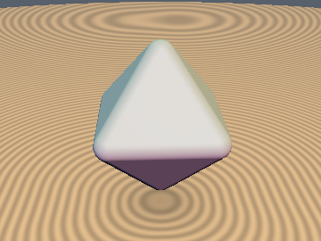
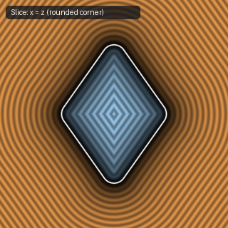
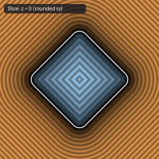

# `opRound` — Exact Iso-Surface Rounding

| 3D Surface ($`f(p) = 0`$) | Primary 2D Cross-Section | Secondary 2D Cross-Section |
| :---: | :---: | :---: |
|  |  |  |

| Property | Value |
| :--- | :--- |
| **Author / Discoverer** | **Inigo Quilez** |
| **Source** | [https://iquilezles.org/articles/distfunctions/](https://iquilezles.org/articles/distfunctions/) |
| **Category** | `deform` |
| **GLSL File** | [`glsl/deform/opRound.glsl`](../../glsl/deform/opRound.glsl) |
| **Exact Euclidean SDF?** | Yes (`\|\|grad d\|\| = 1`) |

---

## Mathematical Overview

Shifts the zero level-set outward by radius `rad` ($`d - r`$).

---

## GLSL Implementation

```glsl
float opRound( in float d, in float rad ) { return d - rad; }
```
