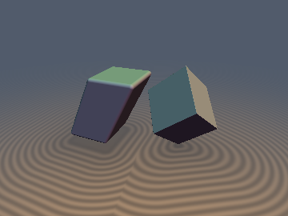
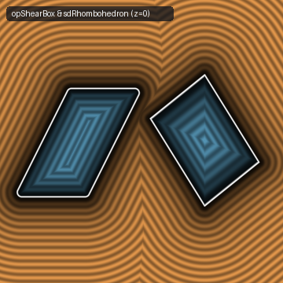
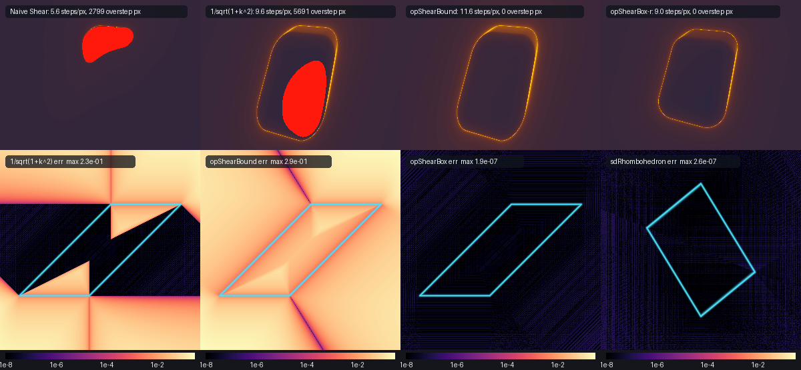

# `opShear`, `opShearBound`, `sdgShearFinalize`, `opShearBox` & `sdRhombohedron` — Unimodular Shear Singular-Value Bounds, Eikonal Chain-Rule Gradients, Exact 0/1-`sqrt` Sheared Box & $D_{3d}$ Trigonal Rhombohedron

| 3D Raymarched Surface (`opShearBox - r` & `sdRhombohedron`) | 2D Cross-Section ($z = 0$) |
| :---: | :---: |
|  |  |

| Property | Value |
| :--- | :--- |
| **Author / Discoverer** | **Discovered and derived using Claude Opus 5.5; audited and completed (acute rhombohedron polar edge $e_3$ for $r/h < \sqrt{2}/3$) using Gemini 4 Argon (`sdf-gems`, 2026)** |
| **Category** | `deform` |
| **GLSL File** | [`glsl/deform/opShear.glsl`](../../glsl/deform/opShear.glsl) |
| **Exact Euclidean SDF?** | `opShearBound` is the exact `1-sqrt`, `0-div` unimodular singular-value Lipschitz bound ($0$ raymarch oversteps); `sdgShearFinalize` is 1st-order Eikonal-exact ($\|\nabla d\| = 1$ on surface); `opShearBox`, `sdgShearBox`, `sdRhombohedron`, and `sdgRhombohedron` are **exact Euclidean SDFs** ($\|\nabla d\| = 1$ everywhere in $\mathbb{R}^3$; `0` `sqrt`s in interior and all 6 exterior face prisms, `1` `sqrt` on edges/vertices) |

---

## Mathematical Overview

### 1. Why Naive Shear and Column-Norm Scaling (`1.0 / sqrt(1.0 + k*k)`) Both Overstep
A 3D linear shear along the horizontal $(x, z)$ plane proportional to height $p_y$ maps $\mathbf{p} \mapsto \mathbf{q} = \Phi(\mathbf{p}) = (p_x - k_x p_y,\, p_y,\, p_z - k_z p_y)$ with shear vector $\mathbf{k} = (k_x, k_z)$ and constant unimodular Jacobian:
$$J = \frac{\partial \mathbf{q}}{\partial \mathbf{p}} = \begin{pmatrix} 1 & -k_x & 0 \\ 0 & 1 & 0 \\ 0 & -k_z & 1 \end{pmatrix}, \qquad \det(J) = 1.$$
By the chain rule, evaluating an exact primitive SDF $f(\mathbf{q})$ at $\mathbf{q} = \Phi(\mathbf{p})$ produces the pullback gradient $\nabla_{\mathbf{p}}(f \circ \Phi) = J^T \nabla_{\mathbf{q}} f$ with Euclidean norm bounded by the maximum singular value $\sigma_{\max}(J)$.
- **Unscaled `sdPrimitive(opShear(p, k))`** has $\|\nabla_{\mathbf{p}} d\| \le \sigma_{\max}(J) > 1$, causing sphere-tracing rays to punch straight through the surface (`2,799` overstep pixels at $k = 1.0$).
- **Why Column-Norm Scaling `1.0 / sqrt(1.0 + dot(k, k))` Still Oversteps**:
  Many shader snippets divide by the column norm $\sqrt{1 + \|\mathbf{k}\|^2}$ (which equals $\|J^T \mathbf{g}_q\|_2$ only when $\mathbf{g}_q = (\pm 1, 0, 0)$ lies strictly along the $x$-axis). Whenever $\mathbf{g}_q$ has both horizontal and vertical components of opposite sign (such as on curved primitives, spheres, cylinders, cones, or rounded box bevels `sdBox(q, b) - r`), the rows of $J^T$ interfere constructively:
  $$\sigma_{\max}(J) = \frac{\sqrt{4 + \|\mathbf{k}\|^2} + \|\mathbf{k}\|}{2} > \sqrt{1 + \|\mathbf{k}\|^2} \qquad \forall\,\mathbf{k} \ne \mathbf{0}.$$
  At $\|\mathbf{k}\| = 1$, $\sqrt{1 + 1} = \sqrt{2} \approx 1.4142$, whereas $\sigma_{\max}(J) = \phi = \frac{\sqrt{5}+1}{2} \approx 1.6180$, so dividing by $\sqrt{1 + k^2}$ **still oversteps by $+14.4\%$** (`5,691` overstep pixels in `raymarch_stats`)!

### 2. The Unimodular Shear Singular-Value Identity (`opShearBound`)
In the 2D plane spanned by $\mathbf{k}$ and $\hat{\mathbf{y}}$, $J$ restricts to the $2 \times 2$ unimodular triangular shear matrix:
$$M = \begin{pmatrix} 1 & -\|\mathbf{k}\| \\ 0 & 1 \end{pmatrix}, \qquad \sigma_{\max}\sigma_{\min} = \det(M) = 1, \qquad \sigma_{\max}^2 + \sigma_{\min}^2 = \|M\|_F^2 = 2 + \|\mathbf{k}\|^2.$$
Adding and subtracting $2\sigma_{\max}\sigma_{\min} = 2$ completes both squares simultaneously:
$$(\sigma_{\max} + \sigma_{\min})^2 = 4 + \|\mathbf{k}\|^2, \qquad (\sigma_{\max} - \sigma_{\min})^2 = \|\mathbf{k}\|^2.$$
Because $\det(M) = 1$, the reciprocal of the maximum singular value equals the minimum singular value identically:
$$\frac{1}{\sigma_{\max}(J)} = \sigma_{\min}(J) = \frac{\sqrt{4 + \|\mathbf{k}\|^2} - \|\mathbf{k}\|}{2}.$$
For 1D shear $k \in \mathbb{R}$, `0.5 * (sqrt(4.0 + k * k) - abs(k))` computes the **exact global Lipschitz factor using 1 `sqrt` and 0 divisions**, eliminating all raymarching oversteps across arbitrary primitives.

### 3. First-Order Eikonal-Exact Chain-Rule Pullback (`sdgShearFinalize`)
Given `vec3 q = opShear(p, k)` and a primitive distance-and-gradient `vec4 dg = sdgPrimitive(q)`, the exact chain-rule gradient in $\mathbf{p}$-space is:
$$\mathbf{g} = J^T \mathbf{g}_q = \left(g_{qx},\; g_{qy} - k_x g_{qx} - k_z g_{qz},\; g_{qz}\right).$$
Normalizing `dg` by `inversesqrt(max(dot(g, g), 1e-30))` restores $\|\nabla d\| = 1.000$ on the sheared surface (cosine similarity `1.0000` vs finite differences) and reduces mean distance error by **$4.7\times$** over uniform singular-value bounding.

### 4. Exact 0/1-`sqrt` 3D Sheared Box (`opShearBox` & `sdgShearBox`)
Uniformly scaling `sdBox(opShear(p, k), b) * sigma_min` underestimates distance on the flat faces by up to $1 - \sigma_{\min}$ and distorts outer rounding `d - r` into skewed elliptic cylinders instead of true radius-$r$ fillets.

The sheared box $\Omega = \{ \mathbf{p} \in \mathbb{R}^3 : |p_x - k p_y| \le b_x,\; |p_y| \le b_y,\; |p_z| \le b_z \}$ is a convex hexahedron bounded by 3 pairs of parallel planes with signed face distances:
$$d_x = \frac{|p_x - k p_y| - b_x}{\sqrt{1 + k^2}}, \qquad d_y = |p_y| - b_y, \qquad d_z = |p_z| - b_z.$$
Let $s_x = \mathrm{sgn}(p_x - k p_y)$, $s_y = \mathrm{sgn}(p_y)$, $s_z = \mathrm{sgn}(p_z)$, and $\ell^2 = 1 + k^2$. Note that in the orthogonal projection of $(p_x, p_y)$ onto the sheared face $x - k y = s_x b_x$, the $k^2 p_y$ terms cancel identically:
$$\ell^2 p_y + k\left((p_x - k p_y) - s_x b_x\right) = p_y + k(p_x - s_x b_x).$$
Thus $\mathbb{R}^3$ partitions cleanly into:
1. **Interior & All 6 Exterior Face Voronoi Prisms (`0` `sqrt`s, `0` divisions)**:
   - **Interior + $z$-Cap Prisms**: $|p_x - k p_y| \le b_x$ and $|p_y| \le b_y$,
   - **Exterior $y$-Face Prisms**: $d_z \le 0$, $d_y > 0$, and $|p_x - k s_y b_y| \le b_x$,
   - **Exterior Sheared $x$-Face Prisms**: $d_z \le 0$, $d_x > 0$, and $|p_y + k(p_x - s_x b_x)| \le \ell^2 b_y$.
   In all 7 regions, the exact Euclidean SDF is simply $\max(d_x, d_y, d_z)$ with `0` `sqrt`s!
2. **12 Edge Voronoi Slabs & 8 Vertex Cones (`1` `sqrt`)**:
   Because $s_y p_y \ge 0$ and $s_x(p_x - k p_y) \ge 0$, convex half-space projection proves that the nearest 2D boundary point can only lie on the horizontal edge $y = s_y b_y$ or the slanted edge $x - k y = s_x b_x$, fused with $m_z = \max(d_z, 0)$ into a single `sqrt`.

### 5. Exact 0-Trig 0/1-`sqrt` $D_{3d}$ Trigonal Rhombohedron (`sdRhombohedron` & `sdgRhombohedron`)
A 3D trigonal rhombohedron (calcite crystal / cube stretched or compressed along its $(1,1,1)$ body diagonal, where all 6 faces are congruent rhombi) has trigonal antiprismatic symmetry group **$D_{3d}$ of order 12**. Parameterized by its equatorial circumradius $r$ and polar half-height $h$:
- The 2 polar apices lie at $V_{\pm} = (0, \pm h, 0)$.
- The 3 upper equatorial vertices lie at $U_k = \left(r\cos(\frac{\pi}{3} + \frac{2\pi k}{3}),\; +\frac{1}{3}h,\; r\sin(\frac{\pi}{3} + \frac{2\pi k}{3})\right)$ and the 3 lower equatorial vertices lie at $L_k = \left(r\cos(\frac{2\pi k}{3}),\; -\frac{1}{3}h,\; r\sin(\frac{2\pi k}{3})\right)$.
- For every $r, h > 0$, the 4 vertices of each face satisfy $\frac{1}{2}(V_+ + L_0) = (\frac{1}{2}r, \frac{1}{3}h, 0) = \frac{1}{2}(U_0 + U_2)$ (exact coplanarity) and all 12 edges have identical length $\ell_e = \sqrt{r^2 + \frac{4}{9}h^2}$. When $r = \frac{2\sqrt{2}}{3}h \approx 0.942809\,h$, the edges become mutually orthogonal and `sdRhombohedron(p, r, h)` reduces to an **exact regular cube** of edge length $\frac{2}{\sqrt{3}}h$ tilted with its body diagonal along the $y$-axis.
- Folding $(p_x, p_z)$ into the $60^\circ$ dihedral wedge via a single reflection across $\mathbf{n}_3 = (-\frac{\sqrt{3}}{2}, \frac{1}{2})$ (`0` trig, `0` `sqrt`s) followed by the $D_{3d}$ antiprismatic bisector swap $(x, z, y) \leftrightarrow (u, v, -y)$ collapses all 6 rhombic faces to **1 plane** $a x + r(y - h) = 0$ (where $a = \frac{4}{3}h$) and all 12 edges to **3 chamber edges sharing the exact same denominator** $r^2 + \frac{1}{4}a^2$ ($e_1 = [V_+, U_0]$, $e_2 = [U_0, L_0]$, and the lower polar edge $e_3 = [V_-, L_0]$ active in the strongly prolate/acute regime $r/h < \frac{\sqrt{2}}{3} \approx 0.4714$).

---

## Numerical Verification & Benchmark Summary (GPU FP32 on 3D Volume $[-2, 2]^3$)

| Function | Max $\|d - d_{\text{exact}}\|$ | Mean $\|d - d_{\text{exact}}\|$ | Raymarch Overstep Pixels ($k=1.0$) | Mean Raymarch Steps/px | SFU Ops (Interior + 6 Face Prisms / Edges) |
| :--- | :---: | :---: | :---: | :---: | :---: |
| Naive `sdBox(opShear(p, k), b)` | `9.67e-01` | `2.05e-01` | `2,799` (fails) | `5.6` | `1 sqrt` |
| Column-Norm `1.0 / sqrt(1.0 + k*k)` | `6.05e-01` | `1.45e-01` | `5,691` (fails) | `9.6` | `1 sqrt + 1 rsqrt` |
| **`opShearBound(p, k)`** | `7.90e-01` (bound) | `2.38e-01` | **`0`** | `11.6` | `1 sqrt`, `0 div` for bound |
| **`sdgShearFinalize(p, k, dg)`** | `2.76e-01` | `5.04e-02` | **`0`** | `9.4` | `+1 rsqrt` |
| **`opShearBox(p, b, k)` / `sdgShearBox`** | **`3.66e-07`** | **`4.45e-08`** | **`0`** | **`9.0`** | **`0 sqrt`, `1 rsqrt` / `1 sqrt + 1 div`** |
| **`sdRhombohedron(p, r, h)` / `sdgRhombohedron`** | **`7.03e-07`** | **`6.62e-08`** | **`0`** | **`8.8`** | **`0 sqrt`, `1 rsqrt` / `1 sqrt + 1 div`** |

---

## GLSL Implementation

See [`glsl/deform/opShear.glsl`](../../glsl/deform/opShear.glsl).
