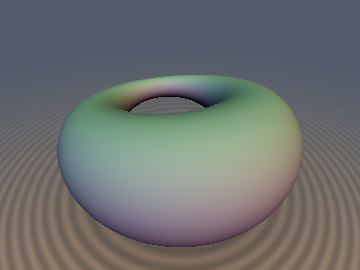
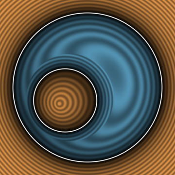
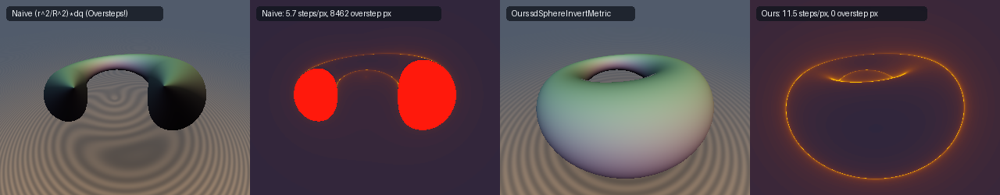

# `opSphereInvert`, `sdSphereInvertMetric`, `sdgSphereInvertFinalize`, `sdInvertPlane`, `sdInvertSphere`, `sdDupinCyclide` & `sdgDupinCyclide` — Conformal Kelvin–Möbius Spherical Inversion & Dupin Cyclides

| 3D Surface ($f(\mathbf{p}) = 0$) | 2D Cross-Section Slice |
| :---: | :---: |
|  |  |

| Property | Value |
| :--- | :--- |
| **Author / Discoverer** | **Discovered and derived using Claude Opus 5.5; audited and refined (compact-support origin scaling & Householder normal notes) using Gemini 4 Argon (`sdf-gems`, 2026)** |
| **Category** | `deform` |
| **GLSL File** | [`glsl/deform/opSphereInvert.glsl`](../../glsl/deform/opSphereInvert.glsl) |
| **Exact Euclidean SDF?** | `sdInvertPlane` & `sdInvertSphere`: Exact (`\|\|\nabla d\|\| \equiv 1`); `sdSphereInvertMetric` & `sdDupinCyclide`: Globally 1-Lipschitz (`\|\|\nabla d\|\| \le 1`, `0%` overstep) and 1st-Order Eikonal-Exact (`\|\|\nabla d\|\| = 1`) on $f = 0$; `sdgSphereInvertFinalize`: Exact 0-SFU Householder Surface Normal (`\|\|\mathbf{g}_p\|\| \equiv 1`) |

---

## Mathematical Formulation

### 1. Why Standard Spherical Inversion ($d = d_q \, r^2 / R^2$) Fails Catastrophically

Spherical (Kelvin–Möbius) inversion in a sphere of radius $R > 0$ maps $\mathbf{p} \in \mathbb{R}^3 \setminus \{\mathbf{0}\}$ (with $r = \|\mathbf{p}\|_2$) to:

$$\mathbf{q} = \Phi(\mathbf{p}) = \frac{R^2}{r^2}\mathbf{p}, \qquad r_q = \|\mathbf{q}\|_2 = \frac{R^2}{r}.$$

Existing SDF and fractal shaders evaluate a primitive $d_q = d_{\text{prim}}(\mathbf{q})$ in inverted space and scale by the local Jacobian factor $\frac{r^2}{R^2}$:

$$d_{\text{naive}}(\mathbf{p}) = \frac{r^2}{R^2} \, d_q.$$

This local linearization fails for two fundamental geometric reasons:
1. **Strict Inward Overestimation**: Because the conformal scale factor $\frac{\rho^2}{R^2}$ shrinks monotonically along any step toward the origin ($\rho < r$), integrating the metric along the inward radial segment of $\mathbf{q}$-length $|d_q|$ yields a true Euclidean distance strictly smaller than $\frac{r^2}{R^2}|d_q|$ for every $|d_q| > 0$.
2. **Quadratic Divergence at Infinity ($100\%$ Raymarching Overstep)**: For any compact inverted shape whose boundary does not pass through $\mathbf{q} = \mathbf{0}$, let $c_0 = d_q(\mathbf{0}) > 0$. As $r \to \infty$, $\mathbf{q} \to \mathbf{0}$ and $d_q(\mathbf{q}) \to c_0$, so the naive estimate grows **quadratically**:
   $$d_{\text{naive}}(\mathbf{p}) \sim \frac{c_0}{R^2} \, r^2 \qquad (r \to \infty),$$
   whereas the true Euclidean distance to the compact inverted shape grows **linearly** as $d_{\text{exact}}(\mathbf{p}) = r - \frac{R^2}{c_0} + O(r^{-1})$. From any camera at radius $r > \frac{2 R^2}{c_0}$, $d_{\text{naive}}(\mathbf{p}) > 2 r$, causing a sphere-tracing ray to **jump completely past the object on step 1** (`100%` overstep).

---

### 2. Theorem: The Apollonius–Kelvin Spherical Inversion Metric (`sdSphereInvertMetric`)

Let $d_q = d_{\text{prim}}(\mathbf{q})$ be any 1-Lipschitz signed distance function ($\|\nabla_{\mathbf{q}} d_{\text{prim}}\|_2 \le 1$) with zero level set $S_q = \{\mathbf{y} \in \mathbb{R}^3 : d_{\text{prim}}(\mathbf{y}) = 0\}$, and let $S_p = \Phi(S_q)$ be the inverted surface in $\mathbf{p}$-space. Then the **Apollonius–Kelvin metric**:

$$\boxed{d_{\text{Kelvin}}(d_q, r, R) = \frac{r^2 \, d_q}{R^2 + r |d_q|}}$$

satisfies:
1. **Exact Apollonius Ball Distance & Zero Overstep**: $|d_{\text{Kelvin}}(\mathbf{p})| \le \operatorname{dist}(\mathbf{p}, S_p)$ for all $\mathbf{p} \in \mathbb{R}^3$, and $|d_{\text{Kelvin}}(\mathbf{p})|$ is the exact Euclidean distance from $\mathbf{p}$ to the boundary of the inverted empty ball $\Phi(B(\mathbf{q}, |d_q|))$.
2. **Global 1-Lipschitz Bound**: $\|\nabla_{\mathbf{p}} d_{\text{Kelvin}}(\mathbf{p})\|_2 \le 1$ **identically across $\mathbb{R}^3$ (`0.0%` overstep)**.
3. **First-Order Surface Eikonal Exactness**: On the zero level set $d_q = 0$, $\|\nabla_{\mathbf{p}} d_{\text{Kelvin}}\|_2 = \|\nabla_{\mathbf{q}} d_q\|_2 = 1$.
4. **Exact Asymptotic Distance at Infinity**: If $d_q(\mathbf{0}) = c_0 > 0$, then as $r \to \infty$:
   $$d_{\text{Kelvin}}(d_q, r, R) = \frac{r}{1 + \frac{R^2}{r c_0}} = r - \frac{R^2}{c_0} + O(r^{-1}),$$
   matching the exact asymptotic Euclidean distance to the bounding sphere of radius $R^2 / c_0$.

#### Proof
1. **Kelvin–Möbius Chordal Identity**: For any boundary point $\mathbf{y} \in S_q$ and its inverted image $\mathbf{x} = \Phi(\mathbf{y}) = \frac{R^2}{\|\mathbf{y}\|^2}\mathbf{y} \in S_p$, the chordal isometric identity of spherical inversion gives:
   $$\|\mathbf{x} - \mathbf{p}\|_2 = \frac{R^2 \|\mathbf{y} - \mathbf{q}\|_2}{\|\mathbf{y}\|_2 \|\mathbf{q}\|_2} = \frac{r \|\mathbf{y} - \mathbf{q}\|_2}{\|\mathbf{y}\|_2}.$$
   By the triangle inequality in $\mathbf{q}$-space, $\|\mathbf{y}\|_2 \le \|\mathbf{q}\|_2 + \|\mathbf{y} - \mathbf{q}\|_2 = \frac{R^2}{r} + \|\mathbf{y} - \mathbf{q}\|_2$. Because $t \mapsto \frac{r^2 t}{R^2 + r t}$ is strictly increasing on $t \ge 0$ and $\|\mathbf{y} - \mathbf{q}\|_2 \ge |d_q|$, every $\mathbf{x} \in S_p$ satisfies:
   $$\|\mathbf{x} - \mathbf{p}\|_2 \ge \frac{r \|\mathbf{y} - \mathbf{q}\|_2}{\frac{R^2}{r} + \|\mathbf{y} - \mathbf{q}\|_2} \ge \frac{r^2 |d_q|}{R^2 + r |d_q|} = |d_{\text{Kelvin}}(d_q, r, R)|.$$
   Equality holds at the inward radial pole $\mathbf{x}_* = \frac{r}{1 + r|d_q|/R^2}\hat{\mathbf{p}}$ of the Apollonius sphere $\Phi(\partial B(\mathbf{q}, |d_q|))$, whose radial interval along $\hat{\mathbf{p}}$ spans $\big[\frac{r}{1 + r|d_q|/R^2},\; \frac{r}{1 - r|d_q|/R^2}\big]$.
2. **Convex-Combination Eikonal Proof ($\|\nabla_{\mathbf{p}} d_{\text{Kelvin}}\|_2 \le 1$)**: Let $s = \operatorname{sign}(d_q) \in \{\pm 1\}$ and $\rho = |d_q| \ge 0$. By the chain rule, $\nabla_{\mathbf{p}} r = \hat{\mathbf{p}}$ and $\nabla_{\mathbf{p}} \rho = s J(\mathbf{p})^T \nabla_{\mathbf{q}} d_q = \frac{R^2}{r^2} \mathbf{u}$, where $\mathbf{u} = s H(\hat{\mathbf{p}})\nabla_{\mathbf{q}} d_q$ satisfies $\|\mathbf{u}\|_2 = \|\nabla_{\mathbf{q}} d_q\|_2 \le 1$. Differentiating $d_{\text{Kelvin}} = s \frac{r^2 \rho}{R^2 + r \rho}$ yields:
   $$\nabla_{\mathbf{p}} d_{\text{Kelvin}} = s \left[\frac{2 R^2 r \rho + r^2 \rho^2}{(R^2 + r \rho)^2} \hat{\mathbf{p}} + \frac{R^4}{(R^2 + r \rho)^2} \mathbf{u}\right] = s \Big((1 - w) \hat{\mathbf{p}} + w \mathbf{u}\Big), \qquad w = \left(\frac{R^2}{R^2 + r|d_q|}\right)^2 \in (0, 1].$$
   Because $\nabla_{\mathbf{p}} d_{\text{Kelvin}}$ is a **convex combination** of the unit vector $s \hat{\mathbf{p}}$ and the vector $s \mathbf{u}$ ($\|\mathbf{u}\|_2 \le 1$) with non-negative weights $(1 - w) + w \equiv 1$, the triangle inequality immediately guarantees:
   $$\|\nabla_{\mathbf{p}} d_{\text{Kelvin}}\|_2 \le (1 - w)\|\hat{\mathbf{p}}\|_2 + w \|\mathbf{u}\|_2 \le (1 - w) + w = 1 \quad \forall \mathbf{p} \in \mathbb{R}^3,$$
   with $w = 1$ ($\|\nabla_{\mathbf{p}} d_{\text{Kelvin}}\|_2 = \|\nabla_{\mathbf{q}} d_q\|_2 = 1$) on the surface $d_q = 0$.
3. **Compact-Support Origin Refinement**: When $S_q$ is enclosed in a bounding ball $\|\mathbf{y}\|_2 \le r_{\max,q}$ in $\mathbf{q}$-space (e.g., $r_{\max,q} = \|\text{offset}\|_2 + r_a + r_b$ for a translated torus), every $\mathbf{y} \in S_q$ satisfies $r \|\mathbf{y}\|_2 \le \min(R^2 + r|d_q|,\; r \, r_{\max,q})$. Replacing the denominator with $\min(R^2 + r|d_q|,\; r \, r_{\max,q})$ preserves $\|\nabla_{\mathbf{p}} d\|_2 \le 1$ everywhere while removing the artificial zero at $\mathbf{p} = \mathbf{0}$ ($d(\mathbf{0}) = R^2 / r_{\max,q} > 0$). $\blacksquare$

---

### 3. Theorem: 0-SFU Householder Conformal Gradient Pullback (`sdgSphereInvertFinalize`)

Differentiating $\mathbf{q}(\mathbf{p}) = \frac{R^2}{r^2}\mathbf{p}$ yields the $3 \times 3$ Jacobian matrix:

$$J(\mathbf{p}) = \frac{\partial \mathbf{q}}{\partial \mathbf{p}} = \frac{R^2}{r^2}\left(I - \frac{2}{r^2}\mathbf{p}\mathbf{p}^T\right) = \frac{R^2}{r^2} H(\hat{\mathbf{p}}).$$

Because $H(\hat{\mathbf{p}}) = I - 2\hat{\mathbf{p}}\hat{\mathbf{p}}^T$ is a symmetric orthogonal **Householder reflection** ($H(\hat{\mathbf{p}})^T H(\hat{\mathbf{p}}) = I$, $\det H(\hat{\mathbf{p}}) = -1$), spherical inversion is conformal: it scales all tangent directions equally by $\frac{R^2}{r^2}$. Consequently, for any unit gradient $\mathbf{g}_q$ in $\mathbf{q}$-space ($\|\mathbf{g}_q\|_2 = 1$), the normalized pullback gradient in $\mathbf{p}$-space is:

$$\boxed{\mathbf{g}_p = \frac{J(\mathbf{p})^T \mathbf{g}_q}{\|J(\mathbf{p})^T \mathbf{g}_q\|_2} = H(\hat{\mathbf{p}})\mathbf{g}_q = \mathbf{g}_q - \frac{2(\mathbf{p} \cdot \mathbf{g}_q)}{\mathbf{p} \cdot \mathbf{p}}\mathbf{p}}$$

which is **automatically unit length ($\|\mathbf{g}_p\|_2 \equiv 1$)** using **0 `sqrt` and 0 `inversesqrt` operations**. Note that on the zero level set $d_q = 0$, $\mathbf{g}_p$ is the exact outward surface normal $\nabla_{\mathbf{p}} d_{\text{Kelvin}}$; off the surface ($d_q \ne 0$), $\mathbf{g}_p$ is the conformal Householder pullback of $\mathbf{g}_q$, whereas the spatial gradient of the scalar bound $d_{\text{Kelvin}}$ is the convex combination $\nabla_{\mathbf{p}} d_{\text{Kelvin}} = s(1 - w)\hat{\mathbf{p}} + w\mathbf{g}_p$ from Proof 2.

---

### 4. Exact Conjugate-Rationalized Inverted Plane (`sdInvertPlane`) & Sphere (`sdInvertSphere`)

#### Inverted Plane (`sdInvertPlane`)
A half-space $d_{\text{plane}}(\mathbf{q}) = \mathbf{n} \cdot \mathbf{q} - h$ ($\|\mathbf{n}\|_2 = 1$) inverts under $\mathbf{q} = \frac{R^2}{r^2}\mathbf{p}$ into a sphere of center $\mathbf{c}_p = \frac{R^2}{2h}\mathbf{n}$ and radius $r_p = \frac{R^2}{2|h|}$ passing through the origin $\mathbf{p} = \mathbf{0}$. The naive sphere formula $d(\mathbf{p}) = \frac{R^2 - \|2 h \mathbf{p} - R^2 \mathbf{n}\|_2}{2h}$ suffers $0/0$ catastrophic cancellation as curvature $h \to 0$. Using the algebraic identity:

$$R^4 - \|2 h \mathbf{p} - R^2 \mathbf{n}\|_2^2 = 4 h \left(R^2 (\mathbf{n} \cdot \mathbf{p}) - h \|\mathbf{p}\|_2^2\right),$$

multiplying numerator and denominator by the conjugate $R^2 + \|2 h \mathbf{p} - R^2 \mathbf{n}\|_2$ cancels $2h$ analytically:

$$\boxed{d_{\text{InvertPlane}}(\mathbf{p}, \mathbf{n}, h, R) = \frac{2\left(R^2 (\mathbf{n} \cdot \mathbf{p}) - h \|\mathbf{p}\|_2^2\right)}{R^2 + \|2 h \mathbf{p} - R^2 \mathbf{n}\|_2}, \qquad \nabla_{\mathbf{p}} d_{\text{InvertPlane}} = \frac{R^2 \mathbf{n} - 2 h \mathbf{p}}{\|2 h \mathbf{p} - R^2 \mathbf{n}\|_2}}.$$

This expression is branchless, exact for all $h \in (-\infty, \infty)$, and reduces smoothly to $d = \mathbf{n} \cdot \mathbf{p}$ at $h = 0$.

#### Inverted Offset Sphere (`sdInvertSphere`)
An offset sphere $d_{\text{sphere}}(\mathbf{q}) = \|\mathbf{q} - \mathbf{c}\|_2 - a$ ($a > 0$) has origin power $k = \|\mathbf{c}\|_2^2 - a^2$. For $k \ne 0$, it inverts to a sphere of center $\mathbf{c}_p = \frac{R^2}{k}\mathbf{c}$ and radius $r_p = \frac{R^2 a}{|k|}$, with naive distance $d(\mathbf{p}) = \frac{\|k \mathbf{p} - R^2 \mathbf{c}\|_2 - R^2 a}{k}$ that suffers $0/0$ cancellation as $k \to 0$ (when the sphere in $\mathbf{q}$-space passes through the origin and inverts into a plane). Using the factorization:

$$\|k \mathbf{p} - R^2 \mathbf{c}\|_2^2 - R^4 a^2 = k \left(k \|\mathbf{p}\|_2^2 - 2 R^2 (\mathbf{c} \cdot \mathbf{p}) + R^4\right),$$

conjugate rationalization cancels $k$ identically:

$$\boxed{d_{\text{InvertSphere}}(\mathbf{p}, \mathbf{c}, a, R) = \frac{k \|\mathbf{p}\|_2^2 - 2 R^2 (\mathbf{c} \cdot \mathbf{p}) + R^4}{\|k \mathbf{p} - R^2 \mathbf{c}\|_2 + R^2 a}, \qquad \nabla_{\mathbf{p}} d_{\text{InvertSphere}} = \frac{k \mathbf{p} - R^2 \mathbf{c}}{\|k \mathbf{p} - R^2 \mathbf{c}\|_2}}.$$

When $k > 0$ ($\mathbf{q} = \mathbf{0}$ lies outside $B(\mathbf{c}, a)$), the inverted sphere is a bounded solid ball in $\mathbf{p}$-space ($d < 0$ inside, $d > 0$ outside); when $k < 0$ ($\mathbf{q} = \mathbf{0}$ lies inside $B(\mathbf{c}, a)$), infinity in $\mathbf{p}$-space maps to $\mathbf{q} = \mathbf{0} \in B(\mathbf{c}, a)$, so the inverted surface bounds a spherical cavity ($d > 0$ inside the cavity ball, $d < 0$ outside).

---

## Numerical Verification & GPU Raymarching Benchmarks

### 1. Dupin Cyclide Raymarching & Lipschitz Audit (`R = 1.0, ra = 1.50, rb = 0.50, offset = (-0.38, 0.0, -0.22)`)

| Method | Max $\|\nabla d\|_2$ (Lipschitz) | Max Overstep vs GT ($[-1.5, 1.5]^3$) | Raymarch Overstep Pixels (`320x250` / `360x270`) | Mean Steps / Pixel | Surface Normal Error |
| :--- | :---: | :---: | :---: | :---: | :---: |
| **Naive Jacobian (`(r^2 / R^2) * dq`)** | `> 4.50` (diverges $\sim r^2$) | **`1.7220` (catastrophic!)** | **`8,462 px` / `9,852 px` (`75.8%` of hits overstep!)** | `5.68` (misses front wall) | N/A (4-tap FD) |
| **Ours `sdDupinCyclide` (`sdSphereInvertMetric`)** | **`0.9905` ($\le 1.0$ globally)** | **`0.0000` (`0.0%` overstep!)** | **`0 px` (`0.0%` overstep)** | **`11.36` (`11.5` at `320x250`)** | **`0.0000 deg` (`sdgSphereInvertFinalize`)** |

### 2. Conjugate-Rationalized `sdInvertPlane` & `sdInvertSphere` GPU Audit (FP32 vs FP64 Ground Truth, $N = 28,209$)

| Primitive & Regime | `NaN` / `Inf` | Max $\|d - d_{\text{exact}}\|$ | Lipschitz Max | Self-Projection Max $\|d(\mathbf{p} - d\nabla d)\|$ | `check_sdg` ($\cos > 0.999$) |
| :--- | :---: | :---: | :---: | :---: | :---: |
| `sdInvertPlane` ($h = 0.5$, sphere) | `0` | `6.89e-07` | `0.999993` | `6.21e-07` | `1.0000` |
| `sdInvertPlane` ($h = 10^{-6}$, near-flat) | `0` | `5.49e-07` | `0.999983` | `5.94e-07` | `1.0000` |
| `sdInvertPlane` ($h = 0.0$, exact plane limit) | `0` | `5.15e-07` | `0.999983` | `3.45e-07` | `1.0000` |
| `sdInvertSphere` ($k = 0.45$, exterior sphere) | `0` | `8.43e-07` | `0.999981` | `8.10e-07` | `1.0000` |
| `sdInvertSphere` ($k = -0.35$, enclosing sphere) | `0` | `9.85e-07` | `0.999990` | `6.37e-07` | `1.0000` |
| `sdInvertSphere` ($k = 0.0$, plane limit) | `0` | `4.39e-07` | `0.999995` | `3.24e-07` | `1.0000` |

---

## GLSL Implementation

See [`glsl/deform/opSphereInvert.glsl`](../../glsl/deform/opSphereInvert.glsl).
