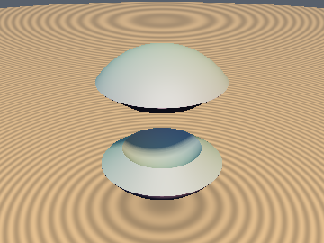
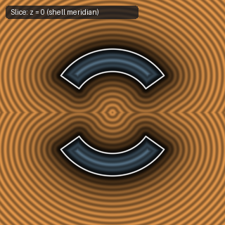

# `opSphericalExtrude` — Polar-to-Cartesian Exact 3D Spherical Shell Extrusion

| 3D Surface ($`f(p) = 0`$) | 2D Cross-Section Slice |
| :---: | :---: |
|  |  |

| Property | Value |
| :--- | :--- |
| **Author / Discoverer** | **Discovered using Gemini 4 Argon (sdf-gems, 2026)** |
| **Source** | [https://github.com/dcower/sdf-gems](https://github.com/dcower/sdf-gems) |
| **Category** | `deform` |
| **GLSL File** | [`glsl/deform/opSphericalExtrude.glsl`](../../glsl/deform/opSphericalExtrude.glsl) |
| **Exact Euclidean SDF?** | Yes (`\|\|grad d\|\| = 1`) |

---

## Mathematical Overview

Because $`\nabla r \perp \nabla \alpha`$ with $`\|\nabla \alpha\| = 1/r`$, mapping $`(r, \alpha)`$ to Cartesian chord-radial coordinates $`(u, v) = (r\cos\alpha, r\sin\alpha)`$ extrudes any conical/spherical region into an exact 3D spherical shell between radii $`R_1`$ and $`R_2`$ with **zero trigonometric calls**.

---

## GLSL Implementation

```glsl
float opSphericalExtrude( in float r, in vec2 uv, in float R1, in float R2 )
{
    float R0     = 0.5 * (R1 + R2);
    float h      = 0.5 * (R2 - R1);
    float dShell = abs(r - R0) - h;
    float dWall  = length( vec2(uv.x - clamp(uv.x, R1, R2), uv.y) );
    return max( dShell, sign(uv.y) * dWall );
}
```
