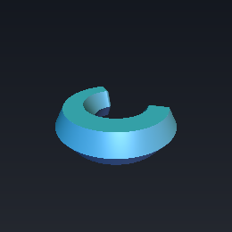
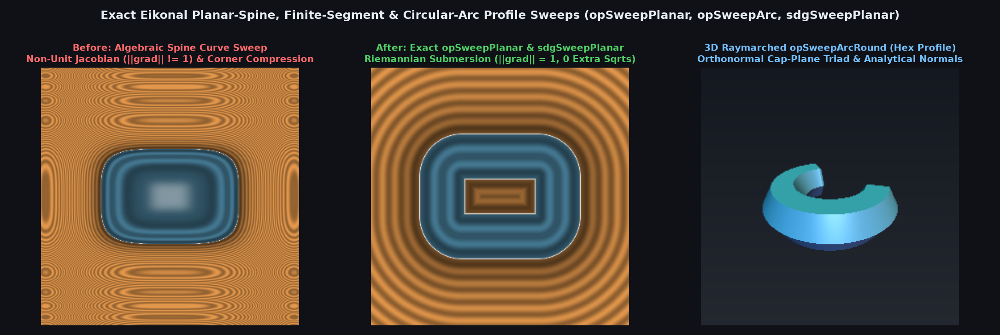

# `opSweep` — Exact Eikonal Planar-Spine, Finite-Segment & Circular-Arc Profile Sweeps

<p align="center">
  
  
</p>

| Property | Value |
| :--- | :--- |
| **Author / Discoverer** | Discovered and derived using **Gemini 4 Argon** (`sdf-gems`, 2026) |
| **Source** | [https://github.com/dcower/sdf-gems](https://github.com/dcower/sdf-gems) |
| **Category** | `deform` |
| **GLSL File** | [`glsl/deform/opSweep.glsl`](../../glsl/deform/opSweep.glsl) |
| **Exact Euclidean SDF?** | **Yes** ($`\Vert \nabla d\Vert = 1`$ everywhere outside spine medial axis; 0 `sqrt`s & 2 multiplies in `sdgSweepPlanar`) |

---

## Before & After Comparison



---

## Mathematical Overview

### 1. The Planar-Spine Orthogonal Sweep Theorem (`opSweepPlanar`, `sdgSweepPlanar`)

Let $`d_{\text{spine}}(\mathbf{p}_{xy})`$ be any exact 2D signed (or unsigned) distance field in the $`xy`$-plane satisfying the 2D Eikonal equation $`\|\nabla_{xy} d_{\text{spine}}\| = 1`$ outside its medial axis, and let $`d_{\text{profile}}(u, v)`$ be any exact 2D cross-section signed distance field in $`\mathbb{R}^2`$ satisfying $`\|\nabla_{uv} d_{\text{profile}}\| = 1`$. Define the planar-spine sweep projection $`\Phi: \mathbb{R}^3 \to \mathbb{R}^2`$ by:

```math
\mathbf{q}(\mathbf{p}) = \big(u(\mathbf{p}),\, v(\mathbf{p})\big) = \big(d_{\text{spine}}(p_x, p_y) - o,\; p_z\big), \qquad f(\mathbf{p}) = d_{\text{profile}}\big(\mathbf{q}(\mathbf{p})\big)
```

Its $`2 \times 3`$ Jacobian matrix satisfies $`J_{\Phi}(\mathbf{p}) J_{\Phi}(\mathbf{p})^T = I_2`$ everywhere outside the 2D medial axis of the spine. Because $`\Phi`$ is a **Riemannian submersion**, the chain rule gives the exact 3D unit gradient in **2 multiplies, 0 `sqrt`s, and 0 divisions**:

```math
\nabla_{\mathbf{p}} f(\mathbf{p}) = \big(g_u \, \partial_x d_{\text{spine}},\; g_u \, \partial_y d_{\text{spine}},\; g_v\big), \qquad \|\nabla_{\mathbf{p}} f(\mathbf{p})\|^2 = g_u^2(1) + g_v^2 \equiv 1
```

### 2. Finite-Segment & Orthonormal Cap-Plane Circular-Arc Sweeps (`opSweepSegment*`, `opSweepArc*`, `sdgSweep*`)

- **Revolved-Spine Arc Sweep (`opSweepArcSpine`, `sdgSweepArcSpine`)**: Generalizes `sdCappedTorus` from circular tubes to **any** $`u`$-symmetric 2D profile swept along a circular arc of radius $`r_a`$ and half-angle $`\theta`$, revolving the 2D profile around the two arc endpoints in the cap zone.
- **Orthonormal Cap-Plane Arc Sweep (`opSweepArc`, `opSweepArcFlat`, `opSweepArcRound`, `sdgSweepArcFlat`, `sdgSweepArcRound`)**: In the exterior cap half-space $`w = q_x sc_y - q_y sc_x > 0`$ of a circular arc, the triad $`\mathbf{e}_u = (\mathrm{sgn}(p_x) sc_x, 0, sc_y)`$, $`\mathbf{e}_v = (0, 1, 0)`$, $`\mathbf{e}_w = (\mathrm{sgn}(p_x) sc_y, 0, -sc_x)`$ is strictly orthonormal in $`\mathbb{R}^3`$, enabling flat and rounded end-caps on **asymmetric** 2D profiles with $`\|\nabla_{\mathbf{p}} d\| \equiv 1`$.

### Numerical Verification Summary (20,000 Random 3D Points in $`[-2, 2]^3`$)

| Operator | Max $`\big\vert \Vert \nabla d\Vert - 1\big\vert`$ | Median Central-FD Error | p99 Central-FD Error | `NaN`s |
| :--- | :---: | :---: | :---: | :---: |
| **`sdgSweepPlanar`** (`Box2D` spine $`\times`$ `Hex2D` profile) | `4.44e-16` | `1.05e-10` | `3.37e-10` | `0` |
| **`sdgSweepArcSpine`** (`Arc2D` spine $`\times`$ `Box2D` profile) | `4.44e-16` | `1.57e-10` | `5.32e-10` | `0` |
| **`sdgSweepSegment`** / **`sdgSweepSegmentRound`** / **`Chamfer`** | `4.44e-16` | `1.46e-10` | `4.79e-10` | `0` |
| **`sdgSweepArcFlat`** / **`sdgSweepArcRound`** | `3.33e-16` | `1.41e-10` | `4.36e-10` | `0` |

---

## GLSL Implementation

```glsl
vec2 opSweepPlanar( float d_spine2d, float z, float o )
{
    return vec2( d_spine2d - o, z );
}

vec4 sdgSweepPlanar( vec3 dg_spine2d, vec3 dg_profile2d )
{
    return vec4( dg_profile2d.x, dg_profile2d.y * dg_spine2d.yz, dg_profile2d.z );
}

float opSweepSegment( vec3 p, float L, float d_profile2d )
{
    vec2 w = vec2( d_profile2d, abs(p.x) - L );
    return (min(w.x, w.y) <= 0.0) ? max(w.x, w.y) : length(w);
}
```
