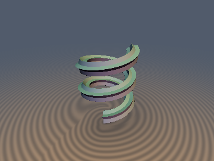
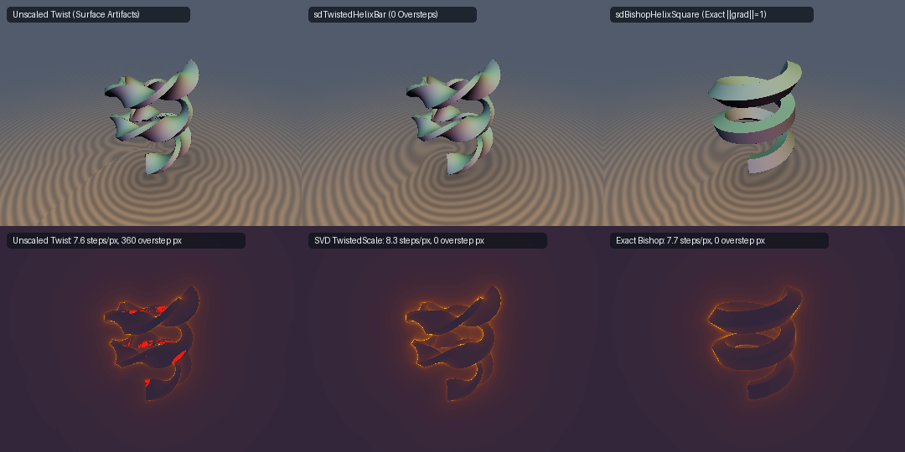

# `opSweepBishop` — Exact Bishop Parallel-Transport 3D Space-Curve Sweeps, 0-SFU Gradients & Twisted SVD Bounds

<p align="center">
  
  
</p>

<p align="center">
  
</p>

| Property | Value |
| :--- | :--- |
| **Author / Discoverer** | Discovered and derived using **Gemini 4 Carbon** (`sdf-gems`, 2026) |
| **Category** | `deform` |
| **GLSL File** | [`glsl/deform/opSweepBishop.glsl`](../../glsl/deform/opSweepBishop.glsl) |
| **Exact Euclidean SDF?** | **Yes** for Bishop parallel-transport sweeps ($`\Vert \nabla d\Vert \equiv 1`$ inside the tubular focal reach $`r_{\text{prof}} < (R^2 + c^2)/R`$, including finite $`N`$-turn flat-capped coils); **Certified 1-Lipschitz SVD lower bound** (`0.0%` raymarching overstep) when intrinsic or Frenet twist $`\omega \ne 0`$ is added |

---

## Overview & Motivation

[`opSweep`](opSweep.md) sweeps arbitrary 2D SDF profiles along **planar** 2D spines ($`\tau \equiv 0`$) as exact 3D Euclidean SDFs because the planar spine gradient and vertical extrusion axis form a torsion-free Riemannian submersion. When a non-circular 2D profile $`d_{2\text{D}}(u, v)`$ (such as a square, star, I-beam, or rectangular bar) is swept along a **non-planar 3D space curve** $`\gamma(s)`$ with non-zero torsion $`\tau(s) \ne 0`$ using the classical **Frenet-Serret frame** $`(\mathbf{T}, \mathbf{N}, \mathbf{B})`$, torsion twists the cross-section around $`\mathbf{T}(s)`$ at angular rate $`\tau(s)`$.

Differentiating the Frenet normal coordinates $`u_F = (\mathbf{p} - \gamma(s_*))\cdot\mathbf{N}(s_*)`$ and $`v_F = (\mathbf{p} - \gamma(s_*))\cdot\mathbf{B}(s_*)`$ at the closest spine point $`s_*(\mathbf{p})`$ reveals a tangential metric shear:

```math
\nabla_{\mathbf{p}} u_F = \mathbf{N}(s_*) + \frac{\tau(s_*)\,v_F}{1 - \kappa(s_*)\,u_F}\,\mathbf{T}(s_*), \qquad \nabla_{\mathbf{p}} v_F = \mathbf{B}(s_*) - \frac{\tau(s_*)\,u_F}{1 - \kappa(s_*)\,u_F}\,\mathbf{T}(s_*).
```

Consequently, evaluating an exact 2D profile $`F_{\text{Frenet}}(\mathbf{p}) = d_{2\text{D}}(u_F, v_F)`$ with $`g_u^2 + g_v^2 = 1`$ violates the 3D Eikonal equation whenever the profile is non-circular ($`g_u v_F - g_v u_F \ne 0`$):

```math
\big\Vert \nabla_{\mathbf{p}} F_{\text{Frenet}}(\mathbf{p})\big\Vert^2 = 1 + \left(\frac{\tau(s_*)\,(g_u v_F - g_v u_F)}{1 - \kappa(s_*)\,u_F}\right)^2 > 1,
```

overestimating the true 3D Euclidean distance and causing sphere-tracing oversteps and pitted surface artifacts.

This module resolves non-planar 3D profile sweeping via **Bishop's (1975) Relatively Parallel Adapted Frame** (`opSweepHelixBishop`, `sdgSweepHelixBishopFinalize`) and provides a division-free singular-value Lipschitz factor (`opSweepHelixTwistedScale`) for intentionally twisted wrought-iron or Frenet-locked helical sweeps (`sdTwistedHelixBar`).

---

## Mathematical Derivation

### 1. Bishop's Parallel-Transport Exact 3D Euclidean Sweep Theorem

Let $`\gamma: I \to \mathbb{R}^3`$ be a $`C^2`$ unit-speed 3D space curve ($`\Vert \gamma'(s)\Vert = 1`$, $`\mathbf{T}(s) = \gamma'(s)`$). Following Bishop (*"There is more than one way to frame a curve"*, Amer. Math. Monthly **82**(3):246–251, 1975), construct an orthonormal normal-plane basis $`(\mathbf{E}_1(s), \mathbf{E}_2(s)) \subset \mathbf{T}(s)^\perp`$ parallel-transported with respect to the normal connection ($`\mathbf{E}_1'(s) \cdot \mathbf{E}_2(s) \equiv 0`$):

```math
\begin{pmatrix} \mathbf{T}'(s) \\ \mathbf{E}_1'(s) \\ \mathbf{E}_2'(s) \end{pmatrix} = \begin{pmatrix} 0 & \kappa_1(s) & \kappa_2(s) \\ -\kappa_1(s) & 0 & 0 \\ -\kappa_2(s) & 0 & 0 \end{pmatrix} \begin{pmatrix} \mathbf{T}(s) \\ \mathbf{E}_1(s) \\ \mathbf{E}_2(s) \end{pmatrix}, \qquad \kappa_1^2(s) + \kappa_2^2(s) = \kappa^2(s).
```

When $`\kappa(s) > 0`$, $`(\mathbf{E}_1, \mathbf{E}_2)`$ is obtained by counter-rotating the Frenet normal plane by the integrated torsion $`\alpha(s) = \int_0^s \tau(\sigma)\,d\sigma`$, and unlike the Frenet frame it remains smooth even across inflection points where $`\kappa(s) \to 0`$.

**Theorem 1 (Riemannian Submersion & Exact 3D Euclidean Distance).** Let $`\Omega_{2\text{D}} = \{(u,v) \in \mathbb{R}^2 : d_{2\text{D}}(u,v) \le 0\}`$ be any 2D profile with exact 2D SDF $`d_{2\text{D}}`$ contained inside the spine's focal reach ($`1 - \kappa_1(s)u - \kappa_2(s)v > 0`$ for all $`(u,v) \in \Omega_{2\text{D}}`$), and let $`\Sigma = \{\gamma(s) + u\mathbf{E}_1(s) + v\mathbf{E}_2(s) : d_{2\text{D}}(u,v) = 0\}`$ be the Bishop-swept 3D surface.

1. **Zero-Shear Submersion (`0-SFU` 3D Gradient):** At any local-minimum spine projection $`s_*(\mathbf{p})`$ satisfying $`(\mathbf{p} - \gamma(s_*))\cdot\mathbf{T}(s_*) = 0`$ and $`1 - \kappa_1\tilde{u} - \kappa_2\tilde{v} > 0`$, write $`\mathbf{p} - \gamma(s_*) = \tilde{u}\mathbf{E}_1(s_*) + \tilde{v}\mathbf{E}_2(s_*)`$. Differentiating $`\tilde{u}(\mathbf{p}) = (\mathbf{p} - \gamma(s_*))\cdot\mathbf{E}_1(s_*)`$ gives:
   $`\displaystyle d\tilde{u} = \mathbf{E}_1(s_*)\cdot\bigl(d\mathbf{p} - \mathbf{T}(s_*)\,ds_*\bigr) + \bigl(\tilde{u}\mathbf{E}_1(s_*) + \tilde{v}\mathbf{E}_2(s_*)\bigr)\cdot\bigl(-\kappa_1(s_*)\mathbf{T}(s_*)\bigr)\,ds_* = \mathbf{E}_1(s_*)\cdot d\mathbf{p}.`$
   Both $`ds_*`$ terms vanish identically because $`\mathbf{E}_1 \perp \mathbf{T}`$ and $`\mathbf{E}_1'(s_*) \parallel \mathbf{T}(s_*)`$ has **zero component in the normal plane**. Hence $`\nabla_{\mathbf{p}}\tilde{u} \equiv \mathbf{E}_1(s_*)`$, $`\nabla_{\mathbf{p}}\tilde{v} \equiv \mathbf{E}_2(s_*)`$, and composing any 2D distance-gradient $`(d_{2\text{D}}, g_u, g_v)`$ yields the exact unit 3D gradient in **6 multiplies and 0 SFUs**:
   $`\displaystyle \nabla_{\mathbf{p}} d_{2\text{D}}(\tilde{u}, \tilde{v}) = g_u\,\mathbf{E}_1(s_*) + g_v\,\mathbf{E}_2(s_*), \qquad \Vert \nabla_{\mathbf{p}} d_{2\text{D}}\Vert^2 = g_u^2 + g_v^2 \equiv 1.`$
2. **Exact Global 3D Surface Distance:** For any fixed cross-section point $`(u, v) \in \Omega_{2\text{D}}`$, differentiating $`E(s; u, v) = \Vert \mathbf{p} - \gamma(s) - u\mathbf{E}_1(s) - v\mathbf{E}_2(s)\Vert^2`$ with respect to $`s`$ yields:
   $`\displaystyle \tfrac{1}{2}\frac{\partial E}{\partial s}(s; u, v) = -\bigl(1 - \kappa_1(s)u - \kappa_2(s)v\bigr)\,\bigl(\mathbf{p} - \gamma(s)\bigr)\cdot\mathbf{T}(s).`$
   Because $`1 - \kappa_1(s)u - \kappa_2(s)v > 0`$ strictly throughout $`\Omega_{2\text{D}}`$, the stationary condition $`\partial_s E = 0`$ and local-minimum sign condition are **completely independent of $`(u, v)`$** (holding even at sharp 2D polygon vertices!). Every 3D surface normal ray lies strictly inside a single normal plane $`s = s_k`$, so taking the minimum of $`d_{2\text{D}}(\tilde{u}(s_k), \tilde{v}(s_k))`$ over the discrete spine-minimum roots $`s_k \in \mathcal{R}_{\min}(\mathbf{p})`$ recovers the **100% exact 3D Euclidean SDF** of $`\Sigma`$.
3. **Exact Finite $`N`$-Turn Capped Coils:** Restricting $`\theta \in [-T, +T]`$ adds only the two boundary endpoints $`\theta = \pm T`$, where $`(\mathbf{E}_1(\pm T), \mathbf{E}_2(\pm T), \mathbf{T}(\pm T))`$ is a constant orthonormal frame with exact flat end-cap disk distances $`d_{\text{cap},\pm} = \sqrt{\max(d_{2\text{D}}(\pm T), 0)^2 + w(\pm T)^2}`$. Combining interior roots $`|\theta_k| \le T`$ with $`d_{\text{caps}} = \min(d_{\text{cap},-}, d_{\text{cap},+})`$ produces an exact 3D Euclidean SDF across the entire lateral wall, flat end faces, and sharp end-cap rims (`7.77e-16` max error in FP64).

---

### 2. Multi-Turn Helical Spine Roots ($`\theta_0, \theta_0 \pm 2\pi`$)

For the circular helix $`\gamma(\theta) = (R\cos\theta,\, R\sin\theta,\, c\theta)`$ with arc-length speed $`L = \sqrt{R^2 + c^2}`$, curvature $`\kappa = R / L^2`$, constant torsion $`\tau = c / L^2`$, and integrated Bishop angle $`\alpha(\theta) = (c / L)\,\theta`$:

```math
\mathbf{U}_F(\theta) = (\cos\theta,\, \sin\theta,\, 0), \qquad \mathbf{V}_F(\theta) = \left(\frac{c}{L}\sin\theta,\, -\frac{c}{L}\cos\theta,\, \frac{R}{L}\right),
```

```math
\mathbf{E}_1(\theta) = \cos\alpha(\theta)\,\mathbf{U}_F(\theta) + \sin\alpha(\theta)\,\mathbf{V}_F(\theta), \qquad \mathbf{E}_2(\theta) = -\sin\alpha(\theta)\,\mathbf{U}_F(\theta) + \cos\alpha(\theta)\,\mathbf{V}_F(\theta).
```

Note two built-in geometric limits: as $`c \to 0`$, $`\alpha(\theta) \to 0`$ and $`(\tilde{u}, \tilde{v}) \to (r_{xy} - R, p_z)`$ (planar torus sweep); as $`R \to 0^+`$ ($`c > 0`$), $`\alpha(\theta) \to \theta`$ cancels the spinning azimuthal angle identically so $`(\mathbf{E}_1, \mathbf{E}_2) \to ((1,0,0), (0,-1,0))`$ (constant Cartesian extrusion).

At cylindrical coordinates $`(r_{xy}, \phi, p_z)`$, normal-plane orthogonality $`w(\theta) = (\mathbf{p} - \gamma(\theta))\cdot\mathbf{T}(\theta) = 0`$ on turn $`n = n_0 + k`$ ($`k \in \{-1, 0, +1\}`$) reduces to the Kepler-helix equation for $`\delta = \theta - (\phi + 2\pi n)`$:

```math
\alpha_H \sin\delta + \delta = u_n, \qquad \alpha_H = \frac{R\,r_{xy}}{c^2} \ge 0, \qquad u_n = \frac{p_z}{c} - (\phi + 2\pi n).
```

A spine-minimum root satisfies $`1 + \alpha_H\cos\delta > 0`$, which exists on turn $`n`$ if and only if $`|u_n| \le f_{\max}(\alpha_H)`$, where $`f_{\max}(\alpha_H) = \pi`$ for $`\alpha_H \le 1`$ and $`f_{\max}(\alpha_H) = \sqrt{\alpha_H^2 - 1} + \pi - \arccos(1/\alpha_H)`$ for $`\alpha_H > 1`$. While `n0` ($`k = 0`$) always minimizes bare spine distance, an anisotropic profile (e.g. a square or ribbon) rotated by $`\Delta\alpha = \pm 2\pi c / L`$ on adjacent turn $`n_0 \pm 1`$ can protrude closer to $`\mathbf{p}`$ near the inter-turn Voronoi midpoint plane ($`|u_0| \approx \pi`$). Evaluating $`k \in \{-1, 0, +1\}`$ eliminates the `4.01e-2` single-turn Voronoi seam error down to `6.66e-16` in FP64 (`3.67e-7` on GPU FP32).

---

### 3. Certified SVD Lipschitz Bound for Twisted & Frenet Sweeps (`opSweepHelixTwistedScale`)

When an intrinsic twist $`\psi(s) = \omega\,s`$ is intentionally added to the Bishop coordinates ($`\mathbf{q}_{\text{tw}} = R(-\omega s_*)\,\mathbf{q}_{\text{Bishop}}`$; note $`\omega = -\tau = -c/(R^2+c^2)`$ recovers the Frenet-Serret frame), the $`2 \times 3`$ spatial Jacobian in the rotated frame $`(\hat{\mathbf{E}}_1, \hat{\mathbf{E}}_2, \mathbf{T})`$ becomes:

```math
\mathbf{J}_{\text{tw}}(\mathbf{p}) = \begin{pmatrix} 1 & 0 & \dfrac{\omega\,\hat{v}}{1 + \kappa u_F} \\[8pt] 0 & 1 & -\dfrac{\omega\,\hat{u}}{1 + \kappa u_F} \end{pmatrix} \implies \mathbf{J}_{\text{tw}}\,\mathbf{J}_{\text{tw}}^\top = \mathbf{I}_2 + \frac{\omega^2}{(1 + \kappa u_F)^2}\begin{pmatrix} \hat{v}^2 & -\hat{u}\hat{v} \\ -\hat{u}\hat{v} & \hat{u}^2 \end{pmatrix}.
```

Over the invariant profile bounding cylinder $`r_\perp = \sqrt{\tilde{u}^2 + \tilde{v}^2} \le r_{\text{prof}} < 1/\kappa`$, the maximum singular value attains its supremum at $`u_F = -r_{\text{prof}}`$, yielding the division-free (`1 inversesqrt`) reciprocal Lipschitz scale factor:

```math
\mathrm{opSweepHelixTwistedScale}(R, c, \omega, r_{\text{prof}}) = \frac{1}{\sigma_{\max}} = \frac{1 - \kappa\,r_{\text{prof}}}{\sqrt{(1 - \kappa\,r_{\text{prof}})^2 + \omega^2\,r_{\text{prof}}^2}}.
```

Outside $`r_\perp > r_{\text{prof}}`$, clamping the query onto $`\partial C = \{r_\perp = r_{\text{prof}}\}`$ and taking $`\max(r_\perp - r_{\text{prof}},\, d_{2\text{D}}(\mathbf{q}_{\text{clamped}})/\sigma_{\max})`$ joins $`C^0`$-continuously at $`r_\perp = r_{\text{prof}}`$ and transitions to the unit-gradient circular helix cylinder $`r_\perp - r_{\text{prof}}`$ in the far field, guaranteeing `0.0%` oversteps everywhere in $`\mathbb{R}^3`$.

---

## Honest Breakdown Analysis

1. **Tubular Focal Reach Breakdown ($`r_{\text{prof}} \ge 1/\kappa = (R^2 + c^2)/R`$):**
   When the 2D profile extends inward past the osculating focal radius $`1/\kappa`$, the longitudinal surface speed $`1 + \kappa u_F`$ changes sign on the inner wall, folding $`\Sigma`$ backward along $`-\mathbf{T}(s)`$ into a self-intersecting swallowtail caustic. Measured on a steep square helix ($`R = 0.35`$, $`c = 0.45`$, focal reach $`1/\kappa = 0.9286`$, FP64):

   | Profile Radius Ratio $`r_{\text{prof}} / (1/\kappa)`$ | `0.25` | `0.50` | `0.75` | `0.95` | `0.99` | `1.20` (Pinched) | `1.40` (Pinched) |
   | :--- | :---: | :---: | :---: | :---: | :---: | :---: | :---: |
   | **Max $`\big\vert \vert d\vert - \vert d_{\text{GT}}\vert\big\vert`$** | `8.88e-16` | `7.77e-16` | `8.88e-16` | `8.88e-16` | `8.88e-16` | `2.94e-02` | `1.03e-01` |

2. **Closed-Loop Berry-Hannay Holonomy Mismatch:**
   On an open helix or finite $`N`$-turn coil, $`\mathbb{R}`$ is simply connected so Bishop parallel transport is globally smooth. On a **closed** non-planar space curve $`\gamma(s + S) = \gamma(s)`$ (such as a chiral $`(1, m)`$ toroidal coil of major radius $`R_0 = 0.65`$, minor amplitude $`a`$, $`m = 3`$), parallel transport around one full circuit accumulates Berry-Hannay holonomy $`\Delta\alpha_{\text{hol}} = \oint_\gamma \tau(s)\,ds \equiv 2\pi - \Omega_{\mathbf{T}} \pmod{2\pi}`$. Unless $`\Delta\alpha_{\text{hol}}`$ is a symmetry multiple $`2\pi k / n_{\text{sym}}`$ of the 2D profile, an uncompensated Bishop sweep suffers a $`C^0`$ step discontinuity at $`\theta = \pm\pi`$, requiring minimal twist compensation $`\omega_{\text{comp}} = (2\pi k/n_{\text{sym}} - \Delta\alpha_{\text{hol}})/S`$ bounded via `opSweepHelixTwistedScale`:

   | Chiral Closed Coil Amplitude $`a`$ ($`R_0 = 0.65, m = 3`$) | Holonomy $`\Delta\alpha_{\text{hol}}`$ | Uncompensated Square ($`b=0.08`$) Seam Jump | Minimal $`\mathbb{Z}_4`$ Twist $`\omega_{\text{comp}}`$ |
   | :--- | :---: | :---: | :---: |
   | $`a = 0.00`$ (Planar Circle) | `+0.00°` | `0.0000` | `0.0000` |
   | $`a = 0.08`$ | `-61.29°` | `0.0286` | `-0.1151` |
   | $`a = 0.16`$ | `+156.69°` | `0.0251` | `+0.0799` |
   | $`a = 0.25`$ | `-9.91°` | `0.0126` | `+0.0275` |

---

## Numerical Verification (Literal GLSL on OpenGL 4.1 GPU, FP32)

Verified via `tools/gpu_eval.py`, `tools/sdf_checks.py`, and `tools/render_sdf.py` against both an independent FP64 continuous slice-minimization reference (`30,000` points) and an independent watertight 3D triangle mesh via Ericson's `point_triangle_distance` (`25,000` points):

| Primitive / Check | Points | Max Error / Bound | Mean / Median | Oversteps / `NaN`s |
| :--- | :---: | :---: | :---: | :---: |
| **`sdBishopHelixSquare`** vs FP64 GT ($`R=0.55, c=0.16`$) | `30,000` | `3.67e-07` | `4.02e-08` | `0` sign err, `0` `NaN` |
| **`sdBishopHelixSquare`** Finite Coil vs FP64 GT ($`2.2`$ turns) | `25,000` | `2.63e-07` | `3.53e-08` | `0` sign err, `0` `NaN` |
| **`sdBishopHelixSquare`** Finite Coil vs 3D Triangle Mesh | `25,000` | `1.22e-05` | `4.09e-06` | Mesh chordal limit |
| **`sdBishopHelixSquare`** $`c = 0`$ Square-Torus Limit | `15,000` | `2.29e-07` | `2.81e-08` | `0` `NaN` / `0` `Inf` |
| **`sdgBishopHelixSquare`** Gradient & Self-Projection | `15,000` | $`\vert\Vert\mathbf{g}\Vert - 1\vert \le`$ `2.31e-07` | Self-proj `4.47e-08` | `cos > 0.999`: `1.0000` |
| **`sdgBishopHelixStar`** Exactness Certificate (5-pt star) | `25,000` | Lip `0.999857`, surf `1.60e-07` | Self-proj `3.24e-08` | `0` `NaN` |
| **`sdTwistedHelixBar`** ($`\omega = 4.2`$) vs Unscaled Twist | `25,000` + `360x270` | **`0` overstep px (`0.0%`)** | `8.3` steps/px | Unscaled: **`360` overstep px** |
| **Umbrella Single-Translation-Unit Compile** | `334` files | Forward, Reverse, New-First | — | **PASSED** |

---

## GLSL Usage

```glsl
// 1. Custom 2D profile + 0-SFU 3D analytical gradient along a circular helix:
float sArc;
vec3 q   = opSweepHelixBishop(p, 0.55, 0.16, sArc);
vec3 dg2 = sdgBox2D(q.xy, vec2(0.12, 0.06));
vec4 dg3 = sdgSweepHelixBishopFinalize(p, 0.55, 0.16, dg2);

// 2. Ready-to-use multi-turn exact primitives (infinite & finite N-turn coils):
float dSq   = sdBishopHelixSquare(p, 0.55, 0.16, vec2(0.11));
vec4  dgSt  = sdgBishopHelixStar(p, 0.44, 0.074, 7.22, 0.112, 5, 2.55);
float dTw   = sdTwistedHelixBar(p, 0.50, 0.13, 6.91, 4.2, vec2(0.125, 0.042));
```
